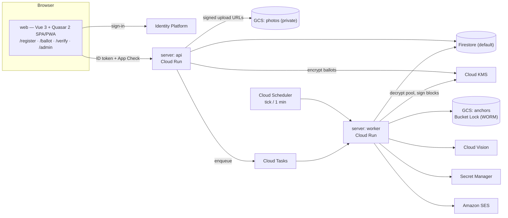
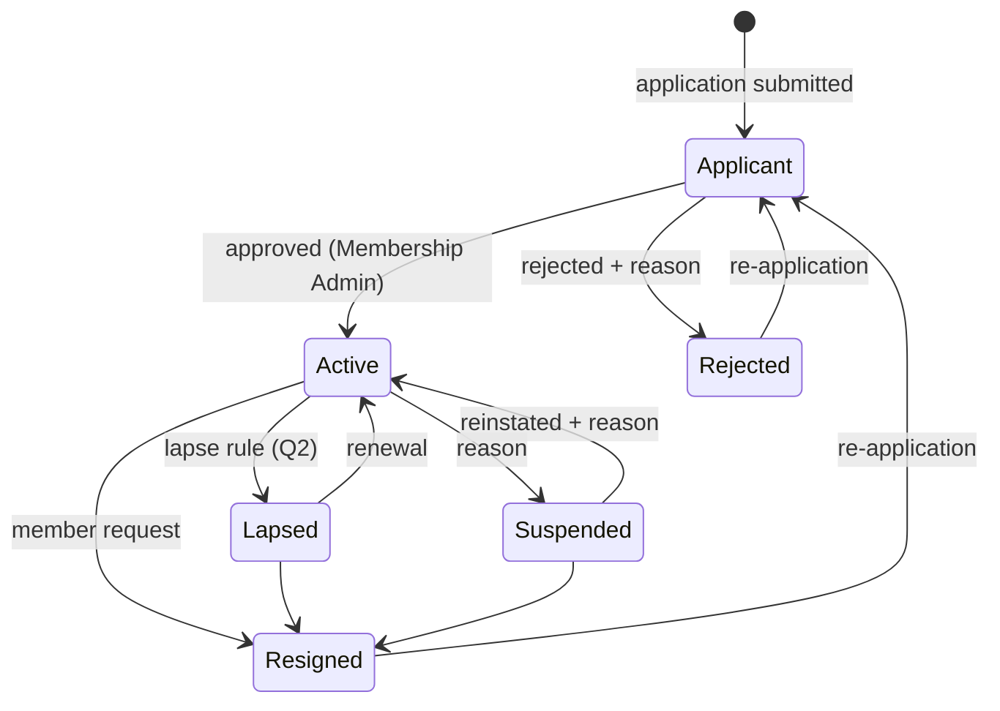
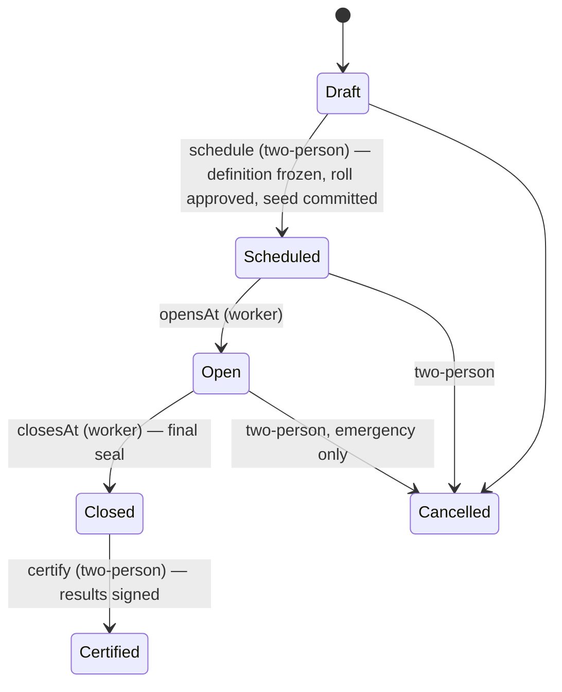
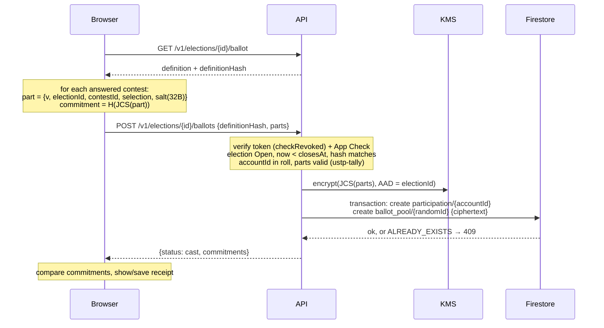

# USTPVote2 — System Design

| | |
|---|---|
| Status | Draft v0.1 — for review by USTP stakeholders |
| Date | 2026-10-20 |
| Source | [Standalone Technical Specification](spec/USTP-Standalone-Technical-Specification.docx) ([text](spec/technical-specification.md)) |
| Scope | Everything in spec §1.1 (V1). Section numbers below are this document's own; "spec §N" refers to the source. |

This document turns the standalone specification into an implementable design: concrete data layouts,
algorithms, trust boundaries and interfaces. Where the spec is silent or ambiguous it proposes an answer and
marks it; decisions that belong to USTP (bylaws, policy) are collected in [§18 Open questions](#18-open-questions).

---

## 1. Goals, non-goals, principles

### Goals
1. Run USTP member registration and organizational elections for 1,000–5,000 members inside one GCP project
   per environment, within free tiers (spec §8: ≈ $0.30–$0.60/month).
2. **Independent verifiability.** Anyone holding the public record can check that (a) the published ballots are
   exactly the ones tallied, (b) the tally is correct, (c) the record was not rewritten after the fact, and a voter
   can check (d) that their own ballot is included.
3. **Secret ballot** (per election) against members, observers, administrators and anyone with database read
   access. See [§2](#2-threat-model-and-trust-assumptions) for the precise boundary.
4. **Separation of duties**: no single administrator can approve a roll, certify a result or change an office alone.

### Non-goals for V1
- Cryptographic end-to-end verifiability that removes trust in the server at cast time (homomorphic tallying,
  verifiable mixnets). The design leaves room for it but does not attempt it.
- Coercion resistance / receipt-freeness (see [§7.5](#75-receipts-and-voter-verification)).
- Multi-seat ranked methods (STV), write-in candidates, weighted votes, proxy voting, vote changes after casting.

### Principles
- **The server is the only writer.** Firestore and Storage rules deny all client access; every read and write goes
  through the API with ID-token + App Check verification.
- **Everything that matters is a canonical object with a hash.** RFC 8785 (JCS) → UTF-8 → SHA-256, lowercase hex.
- **Determinism.** The same inputs produce a byte-identical results bundle on any machine.
- **Pure core, thin adapters.** Counting, hashing, state machines and role rules live in I/O-free packages
  (`ustp-tally`, `ustp-audit`, `ustp-domain`) that run unchanged in the API, the worker, the browser `/verify` page
  and a third party's laptop. GCP code is a thin layer around them.
- **History is append-only.** History collections are never updated or deleted by application code, and the ledger
  hash chain makes any out-of-band edit detectable.
- **Least privilege per service.** The API and worker run as different service accounts with disjoint KMS rights.

## 2. Threat model and trust assumptions

| Adversary | Can | Cannot (by design) | Controls |
|---|---|---|---|
| Outside attacker | Call public endpoints | Read member data, cast ballots | ID token + App Check on every call; rules deny direct DB access |
| Voter | Vote once, see own receipt | Vote twice; vote without being on the frozen roll | `transaction.create()` on `participation/{accountId}`; roll check in the same request |
| Member / public observer | Read published blocks, results, anchors | Link a ballot to a voter | Sealed blocks carry no voter IDs, ordered by random commitment, ≥ k ballots each |
| Firestore reader (insider with DB access, leaked backup/export/PITR) | See *who* voted and when | See *how* anyone voted, during or after the election | Pool entries are KMS-encrypted; pool key version destroyed after certification ([§7.3](#73-ballot-pool-encryption)) |
| Single administrator | Act within their role | Approve their own request; certify, freeze a roll or change an office alone | Two-person rule ([§10](#10-administration-and-separation-of-duties)) |
| Anyone with write access to the DB | Edit documents out of band | Do so undetected | Ledger hash chain, KMS-signed blocks, WORM anchors in Bucket Lock ([§8](#8-audit-ledger-hash-chain-merkle-blocks-anchors)) |
| GCP project owner / deployer | Deploy new code, change IAM | Rewrite already-anchored history | Bucket Lock; recommended public mirroring of anchors; Binary Authorization; reviewed deploys |
| **Compromised API service** | **See ballot contents with voter identity at cast time; cast for eligible non-voters** | — | Code review, reproducible builds, Binary Authorization, minimal human access, post-election participation check |

**Residual trust, stated plainly:** in V1 the API process sees the voter's identity and the ballot in the same request.
Secrecy and cast-time integrity therefore rest on the API code being the reviewed code and on nobody being able to
inspect the running process. Everything *after* the cast — storage, sealing, publication, tallying, certification — is
verifiable without trusting the operators. Spec §9's "fully consistent" privacy evaluation holds under this assumption.

Ballot stuffing by a compromised API is bounded by the roll and is detectable: after close, auditors (and, if USTP
chooses, members) can see the participation list and any member can report "I did not vote but am listed".

**Invariants an auditor can check from the record** (implemented by the future `ustp-verify` CLI):
1. ballots in sealed blocks = participation records ≤ roll entries, and every participant is on the roll;
2. every sealed block's Merkle root and hash recompute, and each appears in the ledger;
3. the ledger hash chain is unbroken, every ledger block's signature verifies, and the anchors match;
4. re-running `ustp-tally` on the sealed blocks with the revealed tie-break seed reproduces the certified results hash.

## 3. Architecture



### 3.1 Components

| Component | Runtime | Responsibility |
|---|---|---|
| `apps/web` | Vue 3 + Quasar 2 on Vite, Firebase Hosting | Member, voter, verifier and admin UI. Computes ballot commitments and verifies Merkle proofs client-side with `ustp-audit`. |
| `apps/server` → **api** | Node 26 LTS, NestJS 12 on Fastify 5, Cloud Run service | All client-facing endpoints. Stateless. |
| `apps/server` → **worker** | Same image, different entrypoint, Cloud Run service (IAM-only ingress) | Election clock, pool sealing, ledger blocks, anchoring, tally, photo checks, email. |
| `packages/tally` (`ustp-tally`) | Pure TypeScript, zero dependencies | Ballot validation and deterministic counting for every contest type. Published publicly (spec §1.1). |
| `packages/audit` (`ustp-audit`) | Pure TypeScript, depends only on `@noble/hashes` | JCS, SHA-256, hash chains, RFC 9162 Merkle trees and proofs, ballot commitments, tie-break ordering. Isomorphic (Node + browser). Published publicly. |
| `packages/domain` (`ustp-domain`) | Pure TypeScript | Shared types, state machines, role rules, two-person checks, Firestore path constants. |

**Why one server package with two entrypoints:** the API and worker share Firestore repositories, KMS adapters and
domain logic. One package and one container image keep them in lockstep; two Cloud Run services with different
service accounts keep their privileges apart.

**Why the worker is a Cloud Run *service*, not a Job:** a once-per-minute tick as a Cloud Run Job execution pays
container start-up every minute (≈ 1,440 executions/day) and would exceed the 180,000 vCPU-second free tier. An
HTTP-triggered, request-billed service handles a tick in well under a second and scales to zero between elections.
All periodic work runs off **one** Cloud Scheduler job per environment (Cloud Scheduler gives 3 free jobs per billing
account — one per environment). One-off work (photo checks, emails, tally) goes through Cloud Tasks.

### 3.2 Repository layout

```
apps/server        NestJS on Fastify — src/main-api.ts, src/main-worker.ts
apps/web           Vue 3 + Quasar 2 SPA/PWA
packages/tally     ustp-tally   (public)
packages/audit     ustp-audit   (public)
packages/domain    ustp-domain  (internal)
infra/firebase     firestore.rules, storage.rules, indexes, hosting config
infra/terraform    (M5) project, IAM, KMS, buckets, scheduler, Binary Authorization
docs/              this design, the source spec, ADRs
```

Toolchain: npm workspaces, TypeScript 6 (ESM, `nodenext`), Vitest, Vite 8 with `@quasar/vite-plugin`.
Builds use the committed lockfile with `npm ci --ignore-scripts` (spec §7).

## 4. Identity and accounts

- **Account ID.** Every person gets a USTP-minted UUIDv7 `accountId` (spec §3). Everything — rolls, roles,
  status history — keys on `accountId`, never on an Identity Platform `uid` or email. UUIDv7 embeds the creation
  time in milliseconds; that is acceptable (not secret) and makes IDs sortable.
- **Identities.** `account_identities/{uid}` maps an Identity Platform user to an `accountId`, so each request
  resolves in one read. One account may have several identities; an identity belongs to exactly one account.
- **Providers.** Google, Microsoft, Apple, passwordless email link, and email/password. The admin "auth switches"
  (`sign_in_methods`) are enforced by the API: a token whose `firebase.sign_in_provider` is switched off is refused,
  which takes effect immediately without changing Identity Platform configuration.
- **First sign-in.** `POST /v1/accounts` creates `accounts/{accountId}` and `account_identities/{uid}` in one
  transaction (`create`, so a race cannot mint two accounts for one uid).
- **Portability.** To add a login method the member, while signed in, also signs in with the new method and the client
  sends both ID tokens; the API links the second uid to the same account. Losing every login method requires
  Membership-Admin-assisted relinking with a written reason, recorded in the ledger.
- **Passwords (NIST SP 800-63B-4).** Minimum 15 characters (the single-factor minimum, applied to everyone), at least 64
  allowed, no composition rules, no forced rotation, breached-password screening, rate-limited attempts. Identity Platform
  enforces length; the browser screens against breached passwords before submission (see open question Q9), because
  Identity Platform never exposes the password to our code.
- **MFA.** Required for every admin role: admin endpoints reject tokens without `firebase.sign_in_second_factor`, and
  approvals additionally require `auth_time` within the last 15 minutes. `account_factors` mirrors enrolled factor
  types for policy and reporting; no secrets are stored.
- **Request authentication.** `Authorization: Bearer <ID token>` and `X-Firebase-AppCheck: <token>`, both verified
  with the Firebase Admin SDK. Casting a ballot and every admin action verify with `checkRevoked`.

## 5. Registration

### 5.1 Member status



Every transition writes, in one transaction, the new status on `members/{accountId}`, an append-only
`member_status_history` entry and a ledger entry. Admin-initiated transitions require a non-empty written reason
(spec §9, due process). The allowed transitions are defined once in `ustp-domain`.

### 5.2 Applications, bylaws, address

- `applications/{applicationId}` stores the answers, the bylaws version accepted and that version's content hash
  (`bylaws_versions/{version}`), so it is provable which text the applicant agreed to.
- **Address minimization:** the street address is used once to look up state/district, then discarded — never
  written to Firestore, logs or task payloads. Only the derived `state` / `district` are stored. The lookup provider is
  open (Q8).

### 5.3 Profile photos

1. API issues a signed upload URL to the private photos bucket (5 MB limit, JPEG/PNG only, 15-minute expiry).
2. The client confirms the upload; the API records `profile_photos/{photoId}` (`pending_check`) and enqueues a task.
3. Worker calls Cloud Vision `SAFE_SEARCH_DETECTION` and `FACE_DETECTION` and records `photo_checks/{checkId}`:
   face count, blur/under-exposure likelihoods, SafeSearch likelihoods → verdict `pass` or `flag`.
4. **The machine never rejects.** Flagged photos go to the Membership Admin queue; only a human can reject, with a
   reason. No face recognition or matching is performed and no face embeddings are stored.

## 6. Elections

### 6.1 Lifecycle



Spec §4 lists Draft → Scheduled → Open → Closed → Certified. This design adds **Cancelled** and makes
**scheduling** a two-person action, because freezing the contest rules matters as much as freezing the roll.

**Draft → Scheduled** requires: every contest passes `ustp-tally` spec validation; every proposal snapshot is
reviewed; an approved roll snapshot is attached; the definition is frozen as `definitionHash = H(JCS(definition))`;
a fresh 32-byte tie-break seed is generated into Secret Manager and only its hash `tieBreakSeedCommitment` is
published; a new version of the ballot-pool KMS key is created for this election. All of that is one ledger entry.
Scheduling warns if the roll is too small for the anonymity threshold (roll < 3k).

### 6.2 Contests

One election = one ballot with any mix of contests (spec §1.1). Each contest is one of:

| `kind` | Covers (spec §1.1) | Selection on a ballot |
|---|---|---|
| `proposal` | Platform/bylaw proposals: Yes / No / Abstain, configurable pass rule and quorum | `"yes"` \| `"no"` \| `"abstain"` |
| `choose_n` | Plurality (seats 1, max 1), block (seats N, max N), approval (max = all candidates); optional support floor | array of candidate IDs (`[]` = blank) |
| `irv` | Single-seat instant-runoff | ranked array of candidate IDs, most preferred first (`[]` = blank) |

Voters may skip a contest (undervote). Rules are in [§9](#9-tallying-ustp-tally).

### 6.3 Roll snapshots

An Election Admin requests a snapshot: eligibility criteria (default: status `Active` at `asOf`; see Q3), the sorted
list of eligible `accountId`s, its count and a Merkle root over `H(JCS({electionId, accountId}))`. An Auditor
(≠ requester) reviews and approves; on approval the worker KMS-signs the snapshot header, writes
`eligibility_snapshots/{snapshotId}` and `elections/{id}/roll_entries/{accountId}`, and appends a ledger entry. The
roll is frozen from then on: later status changes do not alter it (Q4). Every roll entry carries equal weight.

### 6.4 Proposals and positions

- `proposal_snapshots` freeze the exact title and text of a proposal with its content hash; `proposal_reviews` record
  the review that admits it to a ballot. V1 enters proposals in the admin console; an external source is Q6.
- `positions` define offices (title, seats, term length). Certifying an election that fills an office creates
  `position_terms` that reference the certified results hash. Any other change to an office or term is a two-person
  action.

## 7. Ballot casting and secrecy

### 7.1 Cast flow (secret ballot)



- The **participation** document's ID is the `accountId`; `transaction.create()` fails if it exists, which is the
  duplicate-vote guard (spec §4). It stores only `accountId` and server time.
- The **pool** document has a random server-generated ID and holds only ciphertext. No voter ID, no timestamp field.
- The cast endpoint never logs request bodies; the Fastify logger redacts `authorization`, App Check headers and the
  body for `/ballots`.
- The "you voted" email task carries `accountId` and `electionId` only — never commitments.

### 7.2 Sealer

Firestore records a commit timestamp on every document. The participation record and pool record of one vote share a
commit time, so anyone who can read the pool could link them. The sealer removes the pool records (spec §4, §7):

```
every tick, for each election in Open or Closed with pool entries:
  n = pool size, k = election.kAnonymity (default 10)
  Open:   if n >= 2k: seal a uniformly random (CSPRNG) subset of n - k entries, leave k in the pool
  Closed: seal everything (≥ k by construction whenever turnout ≥ k)
seal(entries):
  decrypt each (KMS); group parts by contestId; sort each group by commitment
  block = {v, electionId, index, prevSealedHash, ballotCount,
           contests: {contestId: [part...]}, merkleRoot: MTH(all commitments, sorted)}
  sealedHash = H(JCS(block))
  one transaction: create sealed_blocks/{index}; delete the sealed pool entries; append ledger entry
```

- Leaving k entries behind while open guarantees every block — including the last — holds ≥ k ballots, so a block's
  commit time narrows a voter down to no fewer than k candidates.
- **Ordering by commitment** instead of shuffling: commitments are salted hashes, so the order is unrelated to cast
  order, and the published order is canonical without trusting a shuffle.
- **Per-contest grouping**: parts of one ballot are not kept together in published blocks, which defeats linking a
  voter's choices across contests ("pattern voting"). Each part is verifiable on its own (§7.5).
- Blocks are capped at 400 ballots to stay well under Firestore's 1 MiB document limit.

### 7.3 Ballot-pool encryption

Not in the spec; added because the sealer alone does not stop someone reading the pool *while* it exists (a real-time
listener with database read access, or a backup / point-in-time-recovery copy).

- Symmetric KMS key `ballot-pool`; a new key version per election, created at scheduling.
- The **api** service account may only **encrypt**; the **worker** service account may only **decrypt**. No human
  holds either permission in production. KMS Data Access audit logs are on, so any decrypt is visible.
- After certification the election's key version is **destroyed**. Any copy of the pool in backups or PITR becomes
  permanently unreadable — forward secrecy for past elections.
- Cost: one key version (≈ $0.06/month) per election while it exists, plus one encrypt and one decrypt per ballot.

### 7.4 Open (roll-call) ballots

For `secrecy: "open"` elections the API writes the plaintext parts with the `accountId` into the participation
record; no pool, no encryption. The sealer still produces sealed blocks — parts carry `accountId` and are sorted by it
— so tallying, publication and verification follow one path for both modes.

### 7.5 Receipts and voter verification

- The browser computes each part's commitment *before* sending, so the voter does not have to trust the server's
  echo. The receipt is the list of `{contestId, commitment}` plus the salts; the voter can save it (file download,
  and optionally browser storage).
- After the ballot is sealed, `/verify` fetches an inclusion proof for each commitment and checks, in the browser:
  RFC 9162 inclusion in the sealed block's Merkle root → the block's hash in the ledger → the ledger block's signature
  → the anchor object in the Bucket Lock bucket.
- **Trade-off:** salt + selection lets a voter *prove* to someone else how they voted (vote selling / coercion).
  This is inherent to this receipt design and accepted for V1, as in most organizational systems with receipts.
  Commitments are never emailed or stored with the voter's identity.

## 8. Audit ledger: hash chain, Merkle blocks, anchors

### 8.1 Canonical hashing
All hashed objects are RFC 8785 JCS-canonicalized, UTF-8 encoded and SHA-256 hashed, written as lowercase hex.
Every hashed object carries `v` (schema version). JCS input is restricted to I-JSON: finite numbers, well-formed
strings, plain objects and arrays — anything else is an error rather than silently coerced.

### 8.2 Ledger entries (`audit_events/{seq}`)

```
entry = { v, seq, type, at, actor, subject, payload, prevHash }   hash = H(JCS(entry))
```

- One global chain. Appending runs in a transaction on `ledger_head/main` (`{seq, hash}`): read head, write
  `audit_events/{seq+1}`, update head. Writes are rare (admin actions, ≤ one seal per election per minute), well
  under Firestore's per-document write rate. **Ballot casts never touch the ledger** — that would serialize voting
  and re-create the timing link the sealer removes.
- Genesis `prevHash` is 64 zeros.
- Entry types (initial): `member.status_changed`, `application.decided`, `photo.decided`, `account.relinked`,
  `role.granted`, `role.revoked`, `approval.requested`, `approval.decided`, `signin_method.changed`,
  `roll.approved`, `election.scheduled`, `election.opened`, `election.closed`, `election.cancelled`,
  `ballots.sealed`, `results.computed`, `results.certified`, `position_term.created`.
- **Selective disclosure:** member-related entries contain personal data and are visible to Auditors only. Election
  entries are public. A public verifier checks a public entry by Merkle inclusion in its ledger block (§8.3) without
  seeing the private entries in that block.

### 8.3 Ledger blocks (`blocks/{index}`)

On each tick, if entries exist beyond the last block: build an RFC 9162 Merkle tree over their entry hashes and write
`block = {v, index, prevBlockHash, firstSeq, lastSeq, merkleRoot, headEntryHash, createdAt}`,
`blockHash = H(JCS(block))`, plus a KMS signature over `blockHash` (`audit-signing`, EC P-256 / SHA-256).

Merkle trees follow RFC 9162 §2.1 exactly — leaf `H(0x00 ‖ d)`, node `H(0x01 ‖ l ‖ r)`, split at the largest
power of two below n, inclusion proof verification per §2.1.3.2 — so third parties can use existing tooling.

### 8.4 Anchors (spec §4 "External Anchoring")

- Each new block is written as `gs://<project>-anchors/v1/blocks/<index, 10 digits>.json` (JCS of block, hash,
  signature, key version) to a bucket with a retention policy. `anchors/{index}` records the object URI and generation.
- **Smart anchoring** (spec §8): only when a new block exists — at most one object per minute, usually far fewer.
- The bucket's retention policy is **locked in production only**. Locking is irreversible: no object (or the bucket)
  can be deleted before retention expires. dev/staging use an unlocked policy. The retention period is Q11.
- **Recommendation:** make the anchor objects publicly readable (or mirror them to a public repository) so that
  outsiders hold copies. Bucket Lock prevents rewriting, but only outside copies prove the history was never forked
  from the start by whoever controls the project.
- The `audit-signing` public key is published in the repository and the anchor bucket.

## 9. Tallying (`ustp-tally`)

`ustp-tally` is pure, synchronous, dependency-free and uses integer arithmetic only. Ratios are `{num, den}` integers
compared by cross-multiplication with `BigInt`; no floating point affects an outcome.

**Validation.** The same validator runs at cast time (API rejects invalid ballots with 400) and at tally time
(defensive: anything invalid is counted under `invalid` and excluded). Contest specs are validated too (IDs, seats,
ratio bounds, tie-break order is a permutation of the candidates).

**Proposal.**
- Counts yes / no / abstain. Quorum participation = yes + no + abstain in this contest.
- Quorum (optional): `minBallots` and/or `rollRatio` (≥ ⌈roll × ratio⌉); unmet → outcome `no_quorum`.
- Pass rule: `threshold {ratio, comparison: gt | gte}` applied to yes / base, where base is `yes_no` (abstentions
  ignored), `yes_no_abstain` (abstentions count against) or `roll` (fraction of the whole roll). Default: more than
  1/2 of yes + no. Base 0 → `failed`.

**Choose up to N.**
- Valid ballot: distinct candidate IDs, at most `maxSelections`; `[]` is a valid blank.
- Rank by votes descending, then tie-break order. A candidate needs ≥ 1 vote to be elected.
- Support floor (optional): a candidate is eligible only if votes / valid contest ballots (blanks included) meets
  the floor threshold; seats may remain vacant.
- Fill seats in rank order from eligible candidates. A tie straddling the last seat is resolved by tie-break order and
  reported.

**Instant-runoff (single seat).**
- Valid ballot: distinct candidate IDs, at most `maxRanks`; `[]` is a valid blank (excluded from rounds).
- Each round counts every ballot for its highest-ranked continuing candidate; ballots with none are exhausted.
- A candidate with more than half of the continuing ballots is elected; if one candidate remains, they are elected.
- Otherwise the candidate with the fewest votes is eliminated. Ties for last: compare the tied candidates' counts in
  earlier rounds, most recent first, and eliminate the one with fewer; if tied in every round, eliminate the one
  latest in tie-break order. Every round, elimination and tie-break is in the output.

**Tie-break order.** At close the seed is revealed. For each contest, `ustp-audit` orders candidates by
`H(JCS({v:1, seed, contestId, candidateId}))` ascending; earlier is favoured. Anyone can check
`H(seed) = tieBreakSeedCommitment` from the scheduled definition and recompute the order.

**Results bundle.** `{v, electionId, definitionHash, roll {snapshotId, merkleRoot, count}, participationCount,
sealedBlocks [{index, sealedHash}], tally {library: "ustp-tally", version}, tieBreakSeed, contests [...]}`.
`resultsHash = H(JCS(bundle))`, KMS-signed, ledgered as `results.computed`; certification (two-person) ledgers
`results.certified` referencing the same hash.

## 10. Administration and separation of duties

### 10.1 Roles (spec §5)

| Capability | Membership Admin | Election Admin | Auditor | System Admin |
|---|:-:|:-:|:-:|:-:|
| Triage applications and photos; change member status | ● | | | |
| Create/edit draft elections, contests, proposals | | ● | | |
| Request roll snapshot, scheduling, certification, cancellation | | ● | | |
| Approve roll, scheduling, certification, cancellation, office changes | | | ● | |
| Read full ledger, run verifications | | | ● | |
| Grant/revoke roles (two-person between System Admins), sign-in switches, operations | | | | ● |

**Incompatible role pairs:** Auditor with any other role. An Election Admin who is a candidate in an election may not
act on that election (Q12). All admin roles require MFA. The first System Admin is bootstrapped once from deployment
configuration and ledgered.

### 10.2 Two-person rule

`approval_requests/{id}`: `{action, target, payload, payloadHash, requestedBy, requestedAt, approverRole, status,
decidedBy, decidedAt, reason, expiresAt}`.

- Approver ≠ requester (by `accountId`), holds `approverRole` at decision time, signed in with MFA within 15 minutes.
- The approver approves `payloadHash`; execution re-checks every precondition and acts on exactly that payload.
- Requests expire after 7 days. Request, decision and execution are each ledgered.

| Action | Requested by | Approved by |
|---|---|---|
| `roll.approve` | Election Admin | Auditor |
| `election.schedule` | Election Admin | Auditor |
| `election.certify` | Election Admin | Auditor |
| `election.cancel` (Scheduled/Open) | Election Admin | Auditor |
| `position.modify` | Membership or Election Admin | Auditor |
| `role.grant` / `role.revoke` | System Admin | another System Admin |

## 11. Data model (Firestore `(default)` database)

Firestore Native mode has no namespaces. The spec's two namespaces are **module boundaries in code**: each module owns
its collections through its own repository classes, and other modules go through its service. Physically,
registration collections are top-level and election data lives under each election.

| Path | Key | Mutability | Notes |
|---|---|---|---|
| **registration** | | | |
| `accounts/{accountId}` | UUIDv7 | mutable | display name, primary email, state |
| `account_identities/{uid}` | Identity Platform uid | create/delete | → `accountId`, provider, linkedAt |
| `account_factors/{accountId}/factors/{factorId}` | | mutable | mirror of MFA enrollment, no secrets |
| `sign_in_methods/{method}` | provider ID | mutable | enabled flag (auth switches) |
| `members/{accountId}` | accountId | mutable | current status, state/district, bylaws version, memberSince |
| `member_status_history/{id}` | auto | append-only | from, to, reason, actor, ledger seq |
| `applications/{applicationId}` | auto | status only | answers, bylaws version + hash |
| `bylaws_versions/{version}` | version | immutable | text, content hash *(added)* |
| `profile_photos/{photoId}` | auto | status only | storage path, status |
| `photo_checks/{checkId}` | auto | immutable | Vision signals, verdict |
| `positions/{positionId}` | slug | two-person | title, seats, term length |
| `position_terms/{termId}` | auto | two-person | holder, start/end, results hash |
| `eligibility_snapshots/{snapshotId}` | auto | immutable once approved | criteria, count, Merkle root, signature |
| **voting** | | | |
| `elections/{electionId}` | UUIDv7 | state transitions | definition, definitionHash, seed commitment, k |
| `elections/{id}/contests/{contestId}` | slug | frozen at schedule | contest spec (`ustp-tally` type) |
| `elections/{id}/candidates/{candidateId}` | slug | frozen at schedule | contestId, display data, optional accountId |
| `elections/{id}/roll_entries/{accountId}` | accountId | immutable | snapshotId |
| `elections/{id}/participation/{accountId}` | accountId | create-only | castAt; open mode: parts |
| `elections/{id}/ballot_pool/{randomId}` | random | create, delete by sealer | ciphertext only |
| `elections/{id}/sealed_blocks/{index}` | integer | immutable | parts by contest, Merkle root, hashes |
| `proposal_snapshots/{snapshotId}` | auto | immutable | text, content hash, source |
| `proposal_reviews/{reviewId}` | auto | immutable | decision, reviewer |
| `results/{electionId}` | electionId | provisional → certified | bundle, hash, signature |
| **audit & admin** | | | |
| `audit_events/{seq}` | zero-padded integer | append-only | ledger entries |
| `ledger_head/main` | — | updated per append | seq, hash *(added)* |
| `blocks/{index}` | integer | immutable | ledger blocks |
| `anchors/{index}` | integer | immutable | GCS URI, generation |
| `role_assignments/{accountId}_{role}` | composite | grant/revoke | grantedBy, approvalId |
| `approval_requests/{id}` | auto | status only | two-person requests *(added)* |

The spec places `role_assignments` and `audit_events` in the voting namespace; they serve both modules, so the
design treats them as a shared audit/admin module. Path constants live in `ustp-domain` as the single source of truth.

## 12. API surface (`/v1`)

Auth legend: **P** public · **M** signed-in member · **V** on the election's roll · role names for admin.

| Method & path | Auth | Purpose |
|---|---|---|
| `GET /healthz` | P | liveness |
| `GET /me` · `POST /accounts` | M | current account; first-sign-in account creation |
| `POST /me/identities` · `DELETE /me/identities/{uid}` | M | link / unlink a login method |
| `GET /bylaws/current` | P | current bylaws version and hash |
| `POST /registration/applications` · `GET /registration/applications/me` | M | apply; status |
| `POST /registration/photo-upload-url` · `POST /registration/photos` | M | photo upload |
| `GET /elections` | M | elections the caller is eligible for |
| `GET /elections/{id}/ballot` | V | ballot definition and hash |
| `POST /elections/{id}/ballots` | V | cast (409 if already voted) |
| `GET /elections/{id}/participation/me` | V | "have I voted?" |
| `GET /public/elections/{id}` · `.../sealed-blocks` · `.../results` | P | published record |
| `GET /public/elections/{id}/proofs/{commitment}` | P | inclusion proof for a receipt |
| `GET /public/ledger/blocks/{index}` · `GET /public/anchors/latest` | P | ledger and anchors |
| `GET /admin/applications` · `POST /admin/applications/{id}/decision` | Membership Admin | registration triage |
| `POST /admin/members/{accountId}/status` · `POST /admin/photos/{id}/decision` | Membership Admin | status, photos |
| `POST /admin/elections` · `PATCH /admin/elections/{id}` · contests, candidates, proposals | Election Admin | election setup |
| `POST /admin/elections/{id}/roll-snapshots` · `.../schedule` · `.../certify` · `.../cancel` | Election Admin | create approval requests |
| `GET /admin/approvals` · `POST /admin/approvals/{id}/decision` | per action | two-person decisions |
| `GET /admin/audit/events` · `GET /admin/audit/verify` | Auditor | ledger, verification run |
| `GET\|PUT /admin/sign-in-methods` · `POST /admin/roles` | System Admin | auth switches, roles (→ approval) |

Errors use RFC 9457 problem details. Request bodies are validated against schemas shared with the web app.

## 13. Worker tasks

| Endpoint | Trigger | Work |
|---|---|---|
| `POST /tasks/tick` | Cloud Scheduler, every minute | open/close elections on time; seal pools; build ledger block; anchor; schedule tally on close |
| `POST /tasks/tally` | Cloud Task after close | reveal seed, run `ustp-tally`, write provisional results bundle |
| `POST /tasks/photo-check` | Cloud Task | Cloud Vision checks |
| `POST /tasks/email` | Cloud Task | send via Amazon SES |
| `POST /tasks/destroy-pool-key` | Cloud Task after certify | destroy the election's ballot-pool key version |

The worker accepts only OIDC tokens from the Scheduler/Tasks service accounts (Cloud Run IAM invoker). Every task is
idempotent; `tick` takes a lease (`locks/tick` with expiry) so overlapping ticks cannot double-seal.

## 14. Security controls

- **Rules:** Firestore and Storage `allow read, write: if false;` (spec §7). Clients use the API and signed URLs only.
- **App Check** enforced on every API route (reCAPTCHA Enterprise provider for web).
- **IAM:** separate service accounts for api and worker; no human has Firestore data access or KMS
  encrypt/decrypt in production; break-glass group with alerting.
- **Logging:** structured logs with redaction; no request bodies on cast; Firestore Data Access audit logs off in
  production (they would record write paths and times; pool encryption makes them harmless, but there is no need for
  them); KMS Data Access audit logs on.
- **Supply chain (spec §7 "Binary Authorization"):** committed lockfile, `npm ci --ignore-scripts` (also set in
  `.npmrc`), Dependabot, base images pinned by digest, Cloud Build provenance, and a Binary Authorization policy that
  lets Cloud Run run only attested images.
- **Abuse:** per-account rate limits on registration and casting, in addition to Identity Platform's limits.
- **Hosting headers:** HSTS, `frame-ancestors 'none'`, `nosniff`, strict referrer policy; CSP tightened once the
  sign-in providers' origins are final.

## 15. Environments, deployment, cost

- Projects `ustp-voting-dev`, `ustp-voting-staging`, `ustp-voting-prod` (spec §2.1). Infrastructure as code with
  Terraform (proposed; Q13).
- Web → Firebase Hosting, which rewrites `/v1/**` to the api Cloud Run service so the API is same-origin (no CORS).
  api and worker → Cloud Run from one image (`node dist/main-api.js` / `node dist/main-worker.js`).
  Config: [`infra/firebase`](../infra/firebase).
- Bucket Lock retention locked in prod only.
- Cost deltas against spec §8: + ≈ $0.06/month per election with a live ballot-pool key version; one Scheduler job
  per environment (free); Cloud Tasks well within its free tier. Total remains under $1/month at the stated scale.

## 16. Testing and verification strategy

- **Pure packages:** Vitest unit tests, RFC 8785 test vectors, Merkle trees cross-checked against an independent
  implementation, worked examples for every tally rule, property-based tests (planned).
- **Server:** integration tests against the Firestore emulator (requires Java + firebase-tools).
- **Election simulation:** build a roll, cast N ballots through the API, seal, tally, certify, then run every
  [§2 invariant](#2-threat-model-and-trust-assumptions) — in CI.
- **Web:** component tests; Playwright end-to-end for register → vote → verify.
- **Independent verification:** `ustp-verify` CLI (M4) consumes only public artifacts.
- **Before the first real election:** external review of the cast path and sealer, and a mock election with members.

## 17. Deviations from and clarifications of the spec

| Spec | This design | Why |
|---|---|---|
| §2 Firestore "namespaces" | Module boundaries in code; top-level registration collections, election data under each election | Firestore Native mode has no namespaces |
| §2 worker as "Cloud Run Worker / Jobs" | Cloud Run service, HTTP-triggered | Per-minute Jobs would exceed the free tier |
| §4 sealer only | + KMS encryption of pool entries with per-election key versions destroyed after certification | Sealing does not protect the pool while it exists, nor backups |
| §4 lifecycle | + `Cancelled`; scheduling is two-person | Need a terminal state for aborted elections; the contest rules matter as much as the roll |
| §5 two-person list | + scheduling, cancellation, role changes | Same reasoning |
| §6 collections | + `approval_requests`, `bylaws_versions`, `ledger_head` | Two-person workflow, provable bylaws agreement, chain head |
| §4 "1-minute anchors" | Anchor only when a new block exists, ≤ 1/min | Matches spec §8 "smart anchoring" |
| §7 "Binary Authorization: reproducible builds" | Lockfile + `--ignore-scripts` **and** an actual Binary Authorization policy on Cloud Run | They are separate controls |
| §9 privacy claims | Hold under the trusted-API assumption stated in §2 | Honest scope of V1 secrecy |

## 18. Open questions

Decisions for USTP; the design's proposed default is in brackets.

1. **Bylaws texts:** which provisions govern elections — quorum, pass thresholds per proposal type, vacancy filling? [configurable per contest]
2. **Lapse rule:** what moves Active → Lapsed (dues, renewal period, inactivity)? [manual admin action in V1]
3. **Voter eligibility:** Active on the snapshot date only, or also a minimum membership age? [Active at `asOf`]
4. **Frozen roll:** if a member is suspended after the roll is frozen, can they still vote? [yes; roll is frozen]
5. **Special candidates:** "None of the above" / "Re-open nominations" options in IRV contests? [modelled as ordinary candidates if wanted]
6. **Proposal source:** where do platform/bylaw proposals originate — manual entry, a website, a forum export? [manual entry]
7. **Anonymity threshold k** and minimum election size. [k = 10]
8. **District lookup provider** for addresses (Google's Civic Information representatives API was retired in 2025). [state only in V1]
9. **Breached-password screening:** acceptable to query a third-party k-anonymity range API (e.g. HIBP) from the browser? [yes, browser-side]
10. **Participation transparency:** after close, who sees *who voted* — auditors only, or all members? [auditors; members on request]
11. **Anchor retention period** for the production Bucket Lock (irreversible once locked). [10 years]
12. **Recusal:** must an Election Admin who is a candidate step aside for that election? [yes]
13. **Infrastructure as code:** Terraform acceptable? [yes]
14. **Repository visibility and license.** `ustp-tally` and `ustp-audit` are meant to be public; the repository was created private. [decide before the first release]
15. **Email sender domain** for Amazon SES and DMARC alignment.
16. **GCP region** for Cloud Run, Firestore and the buckets. [`us-central1`, the cheapest free-tier region]

## 19. Roadmap

| Milestone | Content |
|---|---|
| **M0 — Foundations** *(this commit)* | Design; monorepo; `ustp-tally`, `ustp-audit`, `ustp-domain` with tests; server and web skeletons; CI |
| **M1 — Identity & registration** | Firebase Admin auth guard + App Check; Firestore repositories; emulator harness; accounts, identities, applications, member status, photo pipeline; admin triage UI |
| **M2 — Election setup & ledger** | Elections, contests, candidates, proposals; roll snapshots; approval requests; ledger, blocks, KMS signing, anchors |
| **M3 — Casting & secrecy** | Ballot UI with client-side commitments; cast endpoint; pool encryption; sealer; receipts; `/verify` |
| **M4 — Tally & certification** | Tally task, results bundle, certification, position terms, key destruction; `ustp-verify` CLI |
| **M5 — Hardening & launch gates** | Terraform; Binary Authorization; PWA; accessibility audit; load test; external review; mock election |
