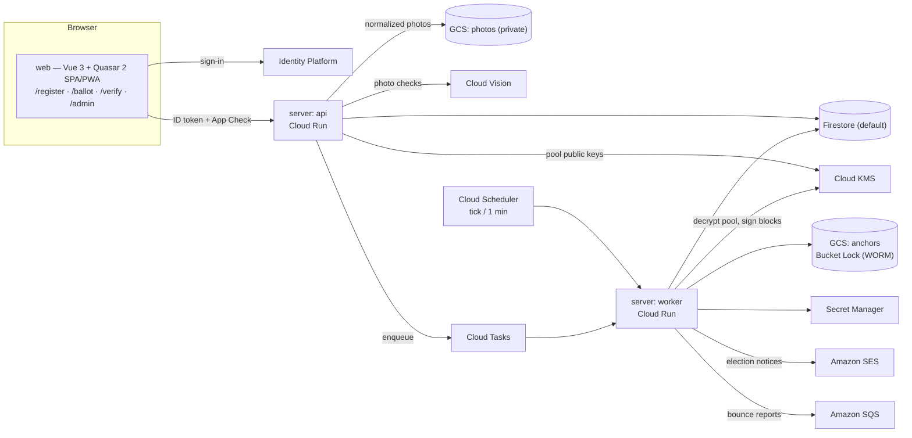
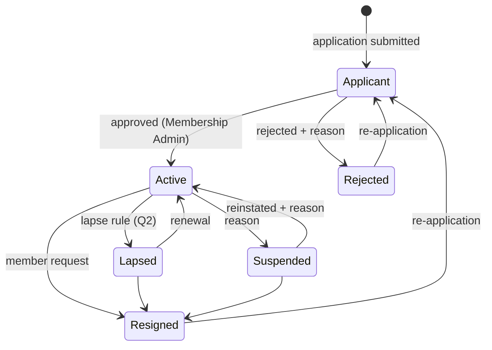
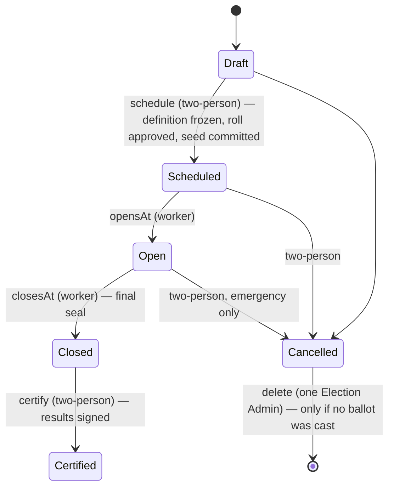
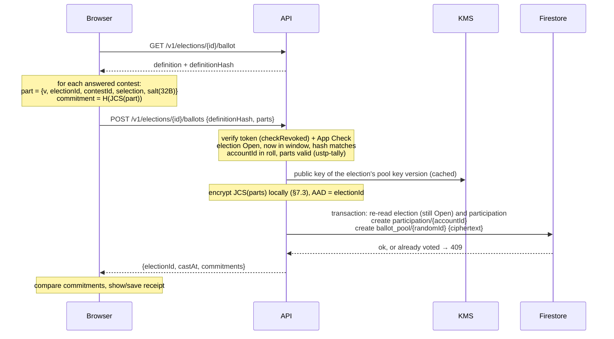

# USTPVote2 — System Design

| | |
|---|---|
| Status | Draft v0.1 — for review by USTP stakeholders |
| Date | 2026-10-20 |
| Source | [Standalone Technical Specification](spec/USTP-Standalone-Technical-Specification.docx) ([text](spec/technical-specification.md)) |
| Scope | Everything in spec §1.1 (V1). Section numbers below are this document's own; "spec §N" refers to the source. |

This document turns the standalone specification into an implementable design: concrete data layouts,
algorithms, trust boundaries and interfaces. Where the spec is silent or ambiguous it proposes an answer and
marks it; decisions that belong to USTP (bylaws, policy) are collected in [§18 Open questions](#18-open-questions).

---

## 1. Goals, non-goals, principles

### Goals
1. Run USTP member registration and organizational elections for 1,000–5,000 members inside one GCP project
   per environment, within free tiers (spec §8: ≈ $0.30–$0.60/month).
2. **Independent verifiability.** Anyone holding the public record can check that (a) the published ballots are
   exactly the ones tallied, (b) the tally is correct, (c) the record was not rewritten after the fact, and a voter
   can check (d) that their own ballot is included.
3. **Secret ballot** (per election) against members, observers, administrators and anyone with database read
   access. See [§2](#2-threat-model-and-trust-assumptions) for the precise boundary.
4. **Separation of duties**: no single administrator can approve a roll, certify a result, appoint someone to an
   office or end a term of office alone.

### Non-goals for V1
- Cryptographic end-to-end verifiability that removes trust in the server at cast time (homomorphic tallying,
  verifiable mixnets). The design leaves room for it but does not attempt it.
- Coercion resistance / receipt-freeness (see [§7.5](#75-receipts-and-voter-verification)).
- Multi-seat ranked methods (STV), write-in candidates, weighted votes, proxy voting, vote changes after casting.

### Principles
- **The server is the only writer.** Firestore and Storage rules deny all client access; every read and write goes
  through the API with ID-token + App Check verification.
- **Everything that matters is a canonical object with a hash.** RFC 8785 (JCS) → UTF-8 → SHA-256, lowercase hex.
- **Determinism.** The same inputs produce a byte-identical results bundle on any machine.
- **Pure core, thin adapters.** Counting, hashing, state machines and role rules live in I/O-free packages
  (`ustp-tally`, `ustp-audit`, `ustp-domain`) that run unchanged in the API, the worker, the browser `/verify` page
  and a third party's laptop. GCP code is a thin layer around them.
- **History is append-only.** History collections are never updated or deleted by application code, and the ledger
  hash chain makes any out-of-band edit detectable.
- **Least privilege per service.** The API and worker run as different service accounts with disjoint KMS rights.

## 2. Threat model and trust assumptions

| Adversary | Can | Cannot (by design) | Controls |
|---|---|---|---|
| Outside attacker | Call public endpoints | Read member data, cast ballots | ID token + App Check on every call; rules deny direct DB access |
| Voter | Vote once, see own receipt | Vote twice; vote without being on the frozen roll | `transaction.create()` on `participation/{accountId}`; roll check in the same request |
| Member / public observer | Read published blocks, results, anchors | Link a ballot to a voter | Sealed blocks carry no voter IDs, ordered by random commitment, ≥ k ballots each |
| Firestore reader (insider with DB access, leaked backup/export/PITR) | See *who* voted and when | See *how* anyone voted, during or after the election | Pool entries are KMS-encrypted; pool key version destroyed after certification ([§7.3](#73-ballot-pool-encryption)) |
| Single administrator | Act within their role; a System Admin can grant or revoke any role, System Admin and Auditor included, alone; a Membership or Election Admin can define or change an office alone | Approve their own request; certify, freeze a roll, appoint to an office or end a term of office alone; change their own roles; change roles or offices unrecorded | Two-person rule; role and office changes in the ledger ([§10](#10-administration-and-separation-of-duties)) |
| Anyone with write access to the DB | Edit documents out of band | Do so undetected | Ledger hash chain, KMS-signed blocks, WORM anchors in Bucket Lock ([§8](#8-audit-ledger-hash-chain-merkle-blocks-anchors)) |
| GCP project owner / deployer | Deploy new code, change IAM | Rewrite already-anchored history | Bucket Lock; recommended public mirroring of anchors; Binary Authorization; reviewed deploys |
| Release workflow (GitHub Actions as `ustp-release`) | Build, attest and run any code on `main` | Change IAM, read Firestore, use the signing or ballot-pool keys; run from another branch or workflow | Workload Identity Federation bound to `release.yml` on `main` in one GitHub environment; required reviewers on staging and production; pull-request review of `main` ([§15](#15-environments-deployment-cost)) |
| **Compromised API service** | **See ballot contents with voter identity at cast time; cast for eligible non-voters** | — | Code review, reproducible builds, Binary Authorization, minimal human access, post-election participation check |

**Residual trust, stated plainly:** in V1 the API process sees the voter's identity and the ballot in the same request.
Secrecy and cast-time integrity therefore rest on the API code being the reviewed code and on nobody being able to
inspect the running process. Everything *after* the cast — storage, sealing, publication, tallying, certification — is
verifiable without trusting the operators. Spec §9's "fully consistent" privacy evaluation holds under this assumption.

Ballot stuffing by a compromised API is bounded by the roll and is detectable: after close, auditors (and, if USTP
chooses, members) can see the participation list and any member can report "I did not vote but am listed".

**Invariants an auditor can check from the record** (checked by the `ustp-verify` CLI, §16, as far as public data allows):
1. ballots in sealed blocks = participation records ≤ roll entries, and every participant is on the roll;
2. every sealed block's Merkle root and hash recompute, and each appears in the ledger;
3. the ledger hash chain is unbroken, every ledger block's signature verifies, and the anchors match;
4. re-running `ustp-tally` on the sealed blocks with the revealed tie-break seed reproduces the certified results hash.

## 3. Architecture



### 3.1 Components

| Component | Runtime | Responsibility |
|---|---|---|
| `apps/web` | Vue 3 + Quasar 2 on Vite, Firebase Hosting | Member, voter, verifier and admin UI. Computes ballot commitments and verifies Merkle proofs client-side with `ustp-audit`. |
| `apps/server` → **api** | Node 26 LTS, NestJS 12 on Fastify 5, Cloud Run service | All client-facing endpoints. Stateless. |
| `apps/server` → **worker** | Same image, different entrypoint, Cloud Run service (internal ingress, callable only by the Scheduler/Tasks invoker account) | Election clock, pool sealing, tally, ledger blocks, anchoring, email. |
| `packages/tally` (`ustp-tally`) | Pure TypeScript, zero dependencies | Ballot validation and deterministic counting for every contest type. Published publicly (spec §1.1). |
| `packages/audit` (`ustp-audit`) | Pure TypeScript, depends only on `@noble/hashes` | JCS, SHA-256, hash chains, RFC 9162 Merkle trees and proofs, ballot commitments, tie-break ordering. Isomorphic (Node + browser). Published publicly. |
| `packages/domain` (`ustp-domain`) | Pure TypeScript | The domain layer (§3.3): shared types, state machines, role rules, two-person checks, aggregate commands, Firestore path constants, sealed blocks, results bundles, and the receipt and results checks the browser, the CLI and the tests share. |
| `packages/verify` (`ustp-verify`) | Node CLI, depends only on `ustp-audit` and `ustp-domain` | Independent verification from public artifacts only (§16). |
| `apps/mcp` (`ustp-mcp`) *(added)* | Node, the MCP TypeScript SDK, `ustp-verify` and `ustp-domain`; the server image's third entrypoint as Cloud Run service `mcp`, at `<site>/mcp` through Hosting, or over stdio on someone's machine | Read-only reports for any AI assistant (Claude, Gemini, ChatGPT): election status, turnout, results and audit reports, from the public api only (§3.4). |

**Why one server package with two entrypoints:** the API and worker share Firestore repositories, KMS adapters and
domain logic. One package and one container image keep them in lockstep; two Cloud Run services with different
service accounts keep their privileges apart.

**Why the worker is a Cloud Run *service*, not a Job:** a once-per-minute tick as a Cloud Run Job execution pays
container start-up every minute (≈ 1,440 executions/day) and would exceed the 180,000 vCPU-second free tier. An
HTTP-triggered, request-billed service handles a tick in well under a second and scales to zero between elections.
All periodic work runs off **one** Cloud Scheduler job per environment (Cloud Scheduler gives 3 free jobs per billing
account — one per environment). One-off work (photo checks, emails, tally) goes through Cloud Tasks.

### 3.2 Repository layout

```
apps/server        NestJS on Fastify — src/main-api.ts, src/main-worker.ts
apps/web           Vue 3 + Quasar 2 SPA/PWA
apps/mcp           ustp-mcp     read-only MCP server for AI-assisted election reports (§3.4)
packages/tally     ustp-tally   (public)
packages/audit     ustp-audit   (public)
packages/domain    ustp-domain  (internal)
packages/verify    ustp-verify  independent verifier CLI (public)
infra/firebase     firestore.rules, storage.rules, indexes (firebase.json at the root: hosting, emulators)
infra/terraform    project, IAM, KMS, buckets, Cloud Run, scheduler, Binary Authorization (see its README)
docs/              this design, the domain model (DOMAIN-MODEL.md), the source spec, ADRs
```

Toolchain: npm workspaces, TypeScript 6 (ESM, `nodenext`), Vitest, Vite 8 with `@quasar/vite-plugin`.
Builds use the committed lockfile with `npm ci --ignore-scripts` (spec §7).

### 3.3 Domain structure

The code follows domain-driven design: bounded contexts that match this document's sections, each owning its
collections, with the rules in the pure core and the GCP code around them. [DOMAIN-MODEL.md](DOMAIN-MODEL.md) holds
the context map, the aggregates and their invariants, the ubiquitous language and the migration path; contexts move to
this structure one at a time, without changing routes, documents or the ledger.

| Context | Sections | Owns |
|---|---|---|
| Accounts & identity | §4 | `accounts`, `account_identities`, `sign_in_methods` |
| Membership | §5.1–5.3 | `members`, `member_status_history`, `applications`, `registration_form`, `registration_form_versions`, `profile_photos`, `photo_checks` |
| Bylaws | §5.2, §5.4, §6.6 | `bylaws_versions`, `bylaws_checks`, `bylaws_check_references` |
| Elections | §5.5, §6, §7, §9 | `elections/**`, `eligibility_snapshots`, `proposal_snapshots`, `results`, `consistency_checks`, `consistency_documents`, `election_checks` |
| Offices | §6.4 | `positions`, `position_terms` |
| Teams | §5.7 | `teams`, `team_members`, `team_requests` |
| Candidacies | §5.8 | `candidacies` |
| Forum | §5.9 | `forum_posts`, `forum_comments`, `forum_votes`, `forum_reports` |
| Members' room | §5.10 | `room_consents`, `room_messages`, `room_memory`, `room_jobs`, `room_state` |
| Communications | §10.9 | `news_posts`, `press_kit`, `press_assets`, `share_posts`, `share_counts`, `calendar_items`, `suggestions`, `suggestion_limits`, `bots` |
| Governance | §5.6, §10 | `role_assignments`, `approval_requests`, `testing_personas`, `navigation`, `anthropic_key` |
| Audit ledger | §8 | `audit_events`, `ledger_head`, `blocks`, `anchors`, `signing_keys` |
| Notifications | §6.8 | `notices` (with `recipients`), `notice_outbox`, `notice_settings`, `notice_receipts`, `notice_tests` |

**Layers.** Records stay plain data (Firestore stores them, JCS hashes them, the browser reads them), so an aggregate
is its record types plus pure functions in `ustp-domain`:

- **Domain** (`packages/domain/src/<context>/`): records, rule checks and *commands*, such as
  `decideApplication(...)`, that take the current records and a request and return an `Outcome`: the next records and
  the domain events, or a refusal saying why and of what kind (`forbidden`, `not_found`, `conflict`, `rate_limited`).
  No I/O and no clock: the time comes in as an argument. The ledger entries are the domain events (`LedgerEvent`, §8.2).
  The package keeps one entry point; the folders only organise it.
- **Application** (`apps/server/src/<context>/*.service.ts`): authorise the caller, open the transaction, load through
  repositories, run the command, append its events to the ledger and save, in that order (Firestore reads come before
  writes). `assertCheck` and `accepted` turn a refusal into the HTTP status it has always had (409 by default).
- **Infrastructure** (`*.repository.ts`, `infra/`): one repository per aggregate, which alone knows its collection
  paths; the KMS, Secret Manager and Vision adapters.
- **Interface**: the controllers and worker routes of §12 and §13, unchanged.

**Ports.** A context publishes a small read or command interface for the others, called inside their transaction
where they need it, and keeps its repositories to itself. `apps/server/src/boundaries.test.ts` fails if code outside a
converted context names its collections or imports its repositories; the API module registers each context's
providers from its `providers.ts`.

**Converted so far: Membership** (members and applications). `ustp-domain/membership/` holds the member-status
machine, the application rules, the records, the Member aggregate (`memberStatusTransition`, `resignMembership`,
`changeMemberStatus`, `testVoterAdmission`) and the MembershipApplication aggregate (`submitApplication`,
`decideApplication`). In the server, `MemberRepository` and `ApplicationRepository` store them, and `Members` and
`MembershipApplications` are the application services. Elections take the roll's Active members, accounts and testing
show statuses and photos require a member record through the `MemberDirectory` port; testing admits a voter persona
through `Members`. Bylaws versions are still served by `MembershipService` until the bylaws context is split out.
**Teams** (§5.7) was built this way from the start: `ustp-domain/teams/` holds the records, the commands (`createTeam`,
`updateTeam`, `archiveTeam`, `joinTeam`, `withdrawRequest`, `decideRequest`, `leaveTeam`, `changeMember`, `addMember`)
and the views; `TeamRepository` stores them, `TeamsService` is the application service, and it reads members only
through `MemberDirectory`. So was **Candidacies** (§5.8): `ustp-domain/candidacies/` holds the records, the commands
(`declareCandidacy`, `changeCandidacy`, `withdrawCandidacy`, `decideCandidacy`, `removeCandidacy`) and the views;
`CandidacyRepository` stores them, `CandidaciesService` reads members through `MemberDirectory`, and districts come
through the `DistrictSource` port (TIGERweb, or the emulator-only local stand-in). **The forum** (§5.9) too:
`ustp-domain/forum/` holds the records, the commands (`newPost`, `editPost`, `deletePost`, `newComment`,
`editComment`, `deleteComment`, `castVote`, `newReport`, `moderatePost`, `moderateComment`, `linkBallot`), the ranks
(`hotRank`, `confidence`) and the views; `ForumRepository` stores them and `ForumService` reads members through
`MemberDirectory` and puts proposals on ballots through the election editor's own `ElectionsService` methods.
**The members' room** (§5.10) too: `ustp-domain/room/` holds the terms, the records, the commands (`acceptTerms`,
`withdrawConsent`, `newMessage`, `deleteMessage`, `newDecision`, `newAction`, `updateAction`, `switchAssistant`), the
checks, `citations`, the slash commands' parser and the views; `RoomRepository` stores them, `RoomService` runs the
room, `RoomAssistant` answers questions through the `RoomModel` port (Ollama, or the emulator-only stand-in), and
questions reach it through the `AssistantDispatch` port (Cloud Tasks, or the api itself with the emulators).
**Communications** (§10.9) too: `ustp-domain/communications/` holds the records, commands and views of news, the
share kit, the calendar, suggestions, the press kit and bots; `CommunicationsRepository` stores them, and a service
per part runs them.

**The web app** follows the same contexts ([DOMAIN-MODEL.md](DOMAIN-MODEL.md) §7). The root of `apps/web/src` holds the
app shell (router, layout and menu, the admin console that composes each context's panels, PWA), the client kernel
(`api.ts`, `session.ts`, `firebase.ts`, `acting.ts`) and the UI kit (`a11y.ts`, `dialogs.ts`, `forms.ts`, the CSS);
each converted context has a folder with its typed client (`api.ts`, the only place its routes are written), its pages
and panels, and its wording. The browser runs `ustp-domain`'s rules to offer only what the API will accept and keeps
no copy of its own; `apps/web/src/boundaries.test.ts` fails if a context's routes appear outside its client. Converted
so far: `membership/` (the Register page and the Applications and Members panels; the status changes the Members panel
offers come from `adminStatusChanges` in `ustp-domain`), the start of `governance/`: the navigation settings'
client, panel and wording, the store the menu, the console's tabs and the voting home read, the quote's client,
store and panel (§10.5), and the hub's client, store, page, admin tabs and wording (§10.6), and `offices/`: the Offices panel, the appointment dialog, the member
profile's Offices card and the public Offices page (§6.4), `teams/`: the Teams page, one team's page (also the
Membership Admins' view of it, from the Teams tab) and the Teams panel (§5.7), `candidacies/`: the Candidates pages,
the declaration form, the Google map and the admin Candidacies tab (§5.8), `forum/`: the Forum page, a post's page
(also the console's view of it) and the Forum panel (§5.9), `room/`: the members' room's page with its door, messages,
composer, decision and action item dialogs and memory panel (§5.10), and `communications/`: the News, post, Press, Share kit
and Suggest pages, the share buttons, and the Communications panel's six tabs (§10.9).

### 3.4 The reporting MCP server *(added)*

`apps/mcp` (`ustp-mcp`) lets an AI assistant answer questions about elections through MCP tools: Gemini CLI or Gemini
Enterprise writing a report into Google Sheets, say, or Claude. It serves that one workflow, reports, and is kept out
of the api so the workflow cannot widen what the system exposes:

- **Public data only.** It calls the unauthenticated `/v1/public/...` endpoints through `ustp-verify`'s `PublicApi`
  and nothing else. It holds no credentials or service account, cannot reach Firestore, and has no tool that writes:
  an assistant using it sees what any visitor can already read and check. Admin-only figures (participation while
  voting is open, notice counts, members) stay out. A tool that needs them is a new decision (an authenticated,
  role-checked route), not an addition here.
- **Five read-only tools**, annotated `readOnlyHint`: `list_elections`, `get_election_status`, `get_turnout`,
  `get_results` (the synopsis of §9 with the results page's `checkResults` over the signed bundle, or the CSV) and
  `get_audit_report` (`verify` from `ustp-verify`). They reuse `ustp-domain` and `ustp-verify`, so a report says what
  the results page and the CLI say, percentages included.
- **Listing from the ledger.** The api has no public list of elections, so the server takes election IDs from the
  public `election.scheduled`, `election.cancelled` and `election.deleted` entries and reads each record; a deleted
  election shows from its entry. The scan costs one request per ledger entry, so the server keeps what the signed
  ledger makes immutable (blocks, blocked entries, private entries' 404s) and later scans fetch only new entries. A
  public list endpoint would replace the scan if the ledger grows large.
- **Turnout while open** counts sealed ballots only, a lower bound, since the sealer leaves up to 2k − 1 ballots in
  the pool (§7.2); the tool says so. Nothing reveals more than the public record.
- **Untrusted text.** Titles, descriptions and candidate names are written by admins and reach the model. The
  server's instructions tell it to report them and never follow instructions inside them, to name provisional and
  certified results as such, and to leave rehearsals out of reports on real elections.
- **Transports.** stdio, for Gemini CLI or Claude Code on someone's machine; stateless Streamable HTTP at `/mcp` for
  remote clients (the Claude API's MCP connector, claude.ai and ChatGPT connectors, Gemini Enterprise): a fresh MCP
  server per request, JSON answers, a 64 KiB request cap, CORS open to any origin (no credentials are involved), and
  only loopback host names when listening on loopback (against DNS rebinding).
- **Hosted on the site.** `https://<site>/mcp`: Firebase Hosting rewrites `/mcp` to the Cloud Run service `mcp`, the
  server image's third entrypoint, so it ships, is attested and is rolled with every release (`mcp.tf`, release.yml).
  Its service account `ustp-mcp` holds no role; anyone may invoke it, without sign-in, since all it serves is public;
  at most `mcp_max_instances` (2) instances cap what a flood of calls can cost. It reaches the api through the site, as
  a visitor does, so the CSV's links and the reports' links name the site.

## 4. Identity and accounts

- **Account ID.** Every person gets a USTP-minted UUIDv7 `accountId` (spec §3). Everything — rolls, roles,
  status history — keys on `accountId`, never on an Identity Platform `uid` or email. UUIDv7 embeds the creation
  time in milliseconds; that is acceptable (not secret) and makes IDs sortable.
- **Identities.** `account_identities/{uid}` maps an Identity Platform user to an `accountId`, so each request
  resolves in one read. One account may have several identities; an identity belongs to exactly one account.
- **Providers.** Google, Microsoft, Apple, passwordless email link, and email/password. The admin "auth switches"
  (`sign_in_methods`) are enforced by the API: a token whose `firebase.sign_in_provider` is switched off is refused,
  which takes effect within a minute (switches are cached for 60 s per instance) without changing Identity Platform
  configuration. Email link and email/password both report the provider `password`, so the API switch covers both;
  choosing between those two is Identity Platform configuration. Tokens from any other provider (custom, anonymous,
  phone) are always refused. At least one provider must stay on, and an admin cannot switch off the provider they are
  signed in with (self-lockout).
- **First sign-in.** `POST /v1/accounts` creates `accounts/{accountId}` and `account_identities/{uid}` in one
  transaction (`create`, so a race cannot mint two accounts for one uid). In the web app a new login is made as the
  first step of registering (§5.2), not on the sign-in page.
- **Portability.** To add a login method the member, while signed in, also signs in with the new method and the client
  sends both ID tokens; the API links the second uid to the same account if that sign-in is under 5 minutes old and the
  uid has no account of its own. The last login method cannot be unlinked. Linking and unlinking are ledgered. Losing
  every login method requires Membership-Admin-assisted relinking with a written reason (not yet built).
- **Passwords (NIST SP 800-63B-4).** Minimum 15 characters (the single-factor minimum, applied to everyone), at least 64
  allowed, no composition rules, no forced rotation, breached-password screening, rate-limited attempts. Identity Platform
  enforces length; the browser screens against breached passwords before creating the account (Q9): it sends only the
  first 5 hex digits of the password's SHA-1 to Have I Been Pwned's range API, with padded responses, and refuses any
  password found there. If that service is unreachable sign-up goes ahead, since Identity Platform never exposes the
  password to our code for a later check.
- **Bot resistance at sign-up and sign-in.** Identity Platform's reCAPTCHA Enterprise integration is enforced for
  email/password sign-up, sign-in and email links, blocking scores at or below 0.3 (the web SDK preloads its
  configuration and attaches a bot-score token; the emulator has none). Identity Platform creates its own reCAPTCHA
  keys, which requires its service agent with `roles/identitytoolkit.serviceAgent`; new projects lack both, and without
  them the public reCAPTCHA config answers 500 and enforced email/password sign-in fails, so the rollout is service
  agent, then audit, then a check that the config answers with a key, then enforce. Email-enumeration protection is
  on, so a wrong password and an unknown address get the same answer; Identity Platform's per-IP sign-up quota
  applies. Behind that, every signed-in api request needs an App Check token (reCAPTCHA Enterprise), applying needs a
  verified email, applications are capped per account (§14) and a person decides each one. These settings are API-only,
  with no console switch for email/password (infra README "Identity Platform").
- **MFA.** Required for every admin role: admin endpoints reject tokens without `firebase.sign_in_second_factor`
  (problem type `/problems/mfa-required`), and approvals additionally require `auth_time` within the last 15 minutes
  (`/problems/reauth-required`; the web app re-authenticates and retries once). `GET /v1/me` reports `mfa.required`
  (holds a role and the policy is on) and `mfa.signedInWithMfa`.
  - The second factor offered is an **authenticator app (TOTP)**: set up on the Account page from a QR code (or typed
    key), then a 6-digit code after the first step of every sign-in and re-authentication. **SMS is not offered**:
    NIST SP 800-63B-4 treats it as a restricted authenticator, and Identity Platform bills per message.
  - **Deployment prerequisite:** TOTP must be enabled in each Identity Platform project with
    `adjacentIntervals: 5`. Terraform does this (`infra/terraform/modules/ustpvote/identity.tf`), together with the
    sign-in methods and authorized domains; the password policy and the Google, Microsoft and Apple providers stay
    manual (infra README "Identity Platform").
  - The Auth emulator does not support TOTP, so integration tests use SMS factors enrolled directly in the emulator to
    obtain real second-factor tokens; the server only checks that a second factor was used. The TOTP-specific browser
    steps can only be exercised against a real project.
  - An `account_factors` mirror for reporting is not built; Identity Platform holds the enrollments.
- **Request authentication.** `Authorization: Bearer <ID token>` and `X-Firebase-AppCheck: <token>`, both verified
  with the Firebase Admin SDK by a global guard; routes opt out only with `@Public()`. Admin routes declare their
  roles with `@Roles(...)`, which also requires MFA and verifies with `checkRevoked` (as will casting a ballot).
- **Safety switches.** `APP_CHECK_ENFORCED=false` and `ADMIN_MFA_REQUIRED=false` exist for local development and
  integration tests; the server refuses to start with either unless the Firestore and Auth emulators are configured.
  The emulator stand-ins `PHOTO_CHECKER=local`, `SECRET_STORE=emulator`, `AUDIT_SIGNER=emulator` (a local P-256
  key kept in Firestore) and `BALLOT_POOL=emulator` (local RSA keys) are refused the same way.
- **Bootstrap.** Emails listed in `BOOTSTRAP_SYSTEM_ADMIN_EMAILS` become System Admins once their account exists and
  the email is verified (checked on every `POST /v1/accounts`, which the web app calls on each sign-in and after
  verification; ledgered with actor `bootstrap`). An account that has ever held the role is never re-granted, so a
  revocation sticks. One is enough, since a System Admin grants roles alone (§10.2); remove the setting once real
  admins exist.

### 4.1 Account preferences: the daily quote and joke *(added)*

An account keeps its own display choices in `accounts/{accountId}.preferences`. They're personal, decide nothing and
are not ledgered. There is one so far, `dailyQuote`:

- **What it shows:** a transhumanist or humanist quote, with its author and where it was written or said, and a
  light joke about science and the future (never about people or politics). Both lists are fixed in
  `ustp-domain` (`DAILY_QUOTES`, `DAILY_JOKES`), and the pair is picked by the reader's calendar day, so everyone
  sees the same pair on the same date and it changes at their midnight. The lists have coprime lengths (21 and 22),
  so a pair comes round again only every 462 days.
- **Off by default.** Nobody sees it until they turn it on in their account (`PUT /v1/me/preferences`
  `{dailyQuote}`); `GET /v1/me` returns the choice on the account, and an account with no `preferences` reads as off.
  When it is on, the card shows on the account page and on the voting home (§10.5).
- **Membership Admins** see whether it is on for a member on that member's profile (`GET
  /v1/admin/members/{accountId}` returns `preferences`).

## 5. Registration

### 5.1 Member status



Every transition writes, in one transaction, the new status on `members/{accountId}`, an append-only
`member_status_history` entry and a ledger entry. Admin-initiated transitions require a non-empty written reason
(spec §9, due process). The allowed transitions are defined once in `ustp-domain`.

### 5.2 Applications, bylaws, address

- **One flow in the web app.** Registering starts on the Register page and runs in three steps, shown at the top of
  the page under the party's intro (the registration form's wording, below): create your login, apply, membership
  review.
  1. *Create your login* (signed-out visitors): Google, Microsoft or Apple, or an email address and password (§4
     password rules and bot resistance). A password sign-up sends the verification email, whose link leads back to
     Register. Someone who already has a login follows "Sign in" and returns to Register afterwards. The sign-in page
     itself only signs people in (email and password, or an email link, plus the federated buttons) and sends newcomers
     to Register; a sign-in there to an account with no membership also lands on Register.
  2. *Apply*: as soon as the account exists the page shows the bylaws and the application. A person whose address is
     not verified yet fills it in while the verification email is on its way; a note above the form says so and can
     send the link again. The page reloads the sign-in when the person comes back to the tab, and Submit checks that
     the ID token says the address is verified (forcing a fresh token once if not) before sending, so an unverified
     submit is stopped in the browser with the answers kept. The api still refuses any application from an unverified
     address.
  3. *Membership review*: the submitted application's status, until a Membership Admin decides it, and the bonus
     link the intro promises (Tips for Advancing a Brighter Future) once a Membership Admin has set its address.
     Active members see that link on Register too.
- **Who sees what.** The web app's menu links (Register, Ballot, Verify, Offices, Candidates, Admin) and the header's Sign in button
  are the ones the navigation settings give the person's membership state and roles (§10.5). By default everyone sees
  all five links, signed in or not, visitors see Sign in, and each page tells people it is not for what they can do
  instead, as it does for anyone who reaches it by its address. Offices is the public list of who holds each office
  (§6.4). On a phone the links that do not fit the bar's one row are behind its More button (§10.5). On
  Register, signed-out visitors
  start at step 1, and people who may apply (no membership, or a rejected or resigned one: `mayApply` in
  `ustp-domain`) at step 2. An applicant sees step 3. An Active, lapsed or suspended member sees their status instead
  of the form, and what can change it: a Membership Admin renews a lapsed membership or reinstates a suspended one,
  and the member can resign on the Account page. Ballot needs a sign-in, and someone on no current roll is told why
  from their membership status (not a member yet, an applicant, lapsed or suspended, or Active but on no roll).
- `applications/{applicationId}` stores the answers, the bylaws version accepted and that version's content hash
  (`bylaws_versions/{version}`), so it is provable which text the applicant agreed to, and the version of the
  registration form's wording it answered (`formVersion`, below). An application is accepted only against the
  *current* bylaws (version and hash must both match) and the *current* wording (409 otherwise, and the Register page
  reloads the wording, keeping the answers), and only from a verified email address. Bylaws versions are published by
  a Membership Admin, are immutable, and are ledgered.
- Amending the bylaws means publishing the next version. A Membership Admin drafts it in Admin → Bylaws from the
  current text, from a Word document (the browser reads the `.docx` and writes out Word's automatic numbering, such
  as "Article IV." or "2.3", so the text keeps it), or blank; edits it line by line or as a whole; reviews a line
  diff against the current version; and publishes it with a change note. The version records `amends` (the version it
  started from) and the api refuses it unless that is still the current version, so two drafts cannot silently
  overwrite each other; `bylaws.published` ledgers `amends` too. While an election whose proposals amend the current
  version (§6.6) is scheduled, open or closed, publishing is refused (409) until it is certified or cancelled. A
  certified election's passed amendments are published as the next version with `adoptedIn`, which requires the
  exact adopted text (§6.6).
- Any version can be downloaded as a stamped Word copy for passing around: a stamp block (party, title, version,
  publish date, amended version, change note, SHA-256 of the text, where to check it), the version and hash in every
  page header, and "page X of Y". The public page `/bylaws/{version}` shows the text, hash, change note and changes
  from the version it amends, and "Check a copy" reads a `.docx` in the browser and says which published version, if
  any, its text matches by SHA-256 (the stamp block is a separate paragraph style, so it is not part of the text).
  The published text and hash remain the record; a Word copy is a convenience.
- **Bylaws check (advisory):** while drafting, a Membership Admin can ask Claude whether the draft contradicts the US
  Constitution, Transhumanist principles or the USTP Constitution, for the whole draft or only the lines changed since
  the version it amends. It never blocks publishing, decides nothing and is not ledgered. See [§5.4](#54-bylaws-check).
- The application asks for: legal and preferred name; date of birth (at least `MINIMUM_MEMBER_AGE`, 18 until USTP
  decides Q17); an attestation of that minimum age; state, city and US ZIP code (never a street address); an optional
  phone number (stored as E.164); the two membership questions (below); optional statement, interests, skills, how they
  heard about USTP, and wishes to volunteer or run for office; and opt-ins to the newsletter and to announcements, each
  stored with the time consent was given. The browser and the api apply the same schema, the api with its own clock.
  Applications made before the membership questions also attested support for the USTP platform
  (`attestations.supportsPlatform`); the Core Ideals question replaced that attestation, which, being required, would
  have refused anyone who could not give it.
- **Membership questions and member classes.** Two required questions, each answered Yes or No, and neither answer
  ever refuses or holds up an application:
  1. "Are you eligible to vote in any United States elections?" (`usVoteEligible`). Yes makes the person a **United
     States Member**, No an **Allied Member** (`memberClass` in `ustp-domain`). The class is shown to Membership Admins
     on the profile, in the Applications tab and as the Members table's Class column, filter and CSV column, and to the
     member on their Account page.
  2. After the **Core Ideals of the Transhumanist Party** (three by default: significant life extension through science
     and technology; a culture and politics informed by reason, science and secular values; reducing and eliminating
     existential risks), "Do you agree with the Core Ideals of the Transhumanist Party listed above (however you may
     interpret those ideals)?" (`agreesWithCoreIdeals`). Its help text says that voting on platform planks and the
     party's structure may, at the Chairman's discretion, be limited to those who answered Yes. Nothing restricts votes
     by it yet: the answer is stored on the member record so that a later roll criterion can (§6.3, *future work*).

  What each answer means is fixed in code, since rules hang off it; only the wording changes. Both answers are copied
  to `members/{accountId}`, and a later application (after a rejection or resignation) replaces them. Members who joined
  before the questions, and test personas (§10.4), have both null: "Not asked" in every view. Members cannot change
  the answers on their Account page, and Membership Admin corrections do not cover them.
- **The registration form's wording** *(added)*. Membership Admins (Admin → Registration form, the admin section
  `registration`) change the intro above Register's steps, each question and its help text, the Core Ideals' heading and
  list (1–10, numbered "Ideal 1." on the page), and the bonus link's title and address (`https://` only; empty shows
  no link, and no address is filled in by default, never guessed). The panel shows a preview as applicants will see it
  and lists the unsaved changes. The default (version 0) is the party's own wording; its sentence pointing to "a
  separate page containing the form" is left out, since here the form is the page itself. Rules
  (`membership/registration-form.ts` in `ustp-domain`): the intro is plain-text paragraphs separated by a blank line,
  each put on one line (4,000 characters); every other part is put on one line; a question is needed (300), help is
  optional (1,000), the heading is needed (120), each ideal at most 500. `registration_form/current` holds the wording
  with a `version` counter, and each saved version is also kept, never changed, in
  `registration_form_versions/{version}`, so the wording any application answered can be read back.
  `GET /v1/registration/form` (public, not cached, since an application must answer the version stored now) and
  `GET /v1/registration/form/{version}` (public, any saved version, 0 the default) serve it without who changed it;
  `GET|PUT /v1/admin/registration-form` (Membership Admin) reads it and saves it whole from the version it was edited
  from (409 if someone saved since; 400 if a question, the heading or every ideal is missing, a part is over its limit
  or the address is not `https://`). Each save that changes something is ledgered as `registration_form.changed` with
  each changed part and its new value; like the home page quote it is an internal setting, visible to Auditors only.
- Data minimization: the date of birth stays on the application, for the Membership Admin's review, and is never
  copied to `members/{accountId}`; the member record gets only what membership uses afterwards (name, state, city, ZIP,
  phone, the consents, and the answers to the two membership questions). Members who applied before these fields have
  `contact` and `communications` null.
- Separation of duties within membership: an admin cannot decide their own application or change their own status.
  Status changes other than application decisions (suspend, reinstate, lapse) use a separate endpoint so an
  application can never be bypassed.
- **Member profiles.** A Membership Admin opens any member from the Members or Applications tab:
  `GET /v1/admin/members/{accountId}` gives the member record, every application the account made with all its
  answers (date of birth included, as it is for the review), and the status history. The profile page shows them, with
  the member's class and Core Ideals answer beside their status, and Change status and Correct details. Opening a profile is not ledgered or logged, like every other admin read. System
  Admins do not see profiles: their People list stays as in §10.3.
- **Members tab.** The Membership Admin's list loads every member from `GET /v1/admin/members`, 500 a request, and
  each member's offices from `GET /v1/admin/positions`: the active terms held under the member's account (a candidate
  entered with it, or an appointment, §6.4), each shown as the office's title over its description; anyone else is "Member" while they have a
  membership (active, lapsed, suspended). The browser does the rest, over the whole list: a search of legal and
  preferred names, a state filter, a class filter (United States Members, Allied Members, or Not asked), status
  filters with counts (Active, Lapsed, Suspended and Resigned always; Applicant and Rejected while someone has that
  status, since applications are decided on their own tab), sorting by any column (Class included, Not asked last),
  and 50 rows a page. Each row keeps the profile link, the copy-account-ID button, History and Change
  status (§5.1). **Export CSV** builds the file in the browser from the list as filtered and sorted, or from the
  ticked rows if any: name, account ID, offices, state, class, the Core Ideals answer, status and member-since date
  (the reader's own date), never contact details or opt-ins; UTF-8 with a byte-order mark for Excel, and a cell a spreadsheet would read as a formula
  starts with `'`. The checkboxes only choose what to export: there are no bulk status changes. The api never sees an
  export, so like opening a profile it is not ledgered or logged.
- **Changing details after joining.** The record keeps what membership uses, and it changes in two ways, each ledgered
  as `member.details_changed` with the names of the fields that changed (`legalName`, `contact.phone`,
  `communications.newsletter`…) and never their values, since the ledger cannot be erased:
  - *The member*, on their Account page (`POST /v1/me/details`): preferred name, state, city, ZIP, phone, and the two
    email opt-ins. An opt-in keeps the time it was first given; withdrawing it clears it. Not the legal name.
  - *A Membership Admin*, on the profile (`POST /v1/admin/members/{accountId}/details`): legal and preferred name,
    state, city, ZIP and phone, with a written reason; never the opt-ins, which are the member's to give, and never
    their own record.

  Both use the application's rules for the fields they share (`ustp-domain`), and a change that changes nothing is
  refused. The applications themselves are never edited: they stay the record of what was agreed to.
- **Address minimization:** the street address is used once to look up state/district, then discarded — never
  written to Firestore, logs or task payloads. Only the derived `state` / `district` are stored. The lookup provider is
  open (Q8).

### 5.3 Profile photos

Optional, for members with a membership record (applicants included).

1. **Upload through the API:** `PUT /v1/me/photo` with the raw image as the body (`image/jpeg`, `image/png` or
   `image/webp`, at most 5 MB; anything else is 415/413).
2. **Normalize:** the API decodes it with `sharp` (rejecting anything that is not really an image of those formats, or
   smaller than 200×200), applies EXIF orientation, shrinks it to at most 1024 px, and re-encodes it as JPEG. This
   drops all metadata: GPS location, camera serials, embedded thumbnails, anything hidden in the original bytes.
3. **Check, inline:** Cloud Vision `FACE_DETECTION` (face count, detection confidence, blur and under-exposure
   likelihoods) and `SAFE_SEARCH_DETECTION`. `photoVerdict` in `ustp-domain` turns the signals into `pass` or `flag`
   with plain-language reasons (no face / more than one face / face not clearly visible / blurry / too dark / may be
   inappropriate, at `LIKELY` or above). Recorded in `photo_checks/{checkId}`.
4. **Store:** the normalized JPEG goes to the private photos bucket (`PHOTOS_BUCKET`) at
   `profile-photos/{accountId}/{photoId}.jpg`; `profile_photos/{photoId}` is `accepted` (passed) or `needs_review`
   (flagged). A new upload marks the previous photo `superseded` and deletes its image.
5. **The machine never rejects.** Flagged photos go to the Membership Admin queue (`GET /v1/admin/photos`); only a
   person accepts or rejects, with a written reason, ledgered as `photo.decided`. Rejecting deletes the image; the
   member sees the reason. Admins cannot decide their own photo. Members can remove their photo at any time.
6. No face recognition or matching is performed, no face embeddings are stored, and images are only ever served to
   the member and Membership Admins through authenticated API routes (never public URLs).
7. **What the member sees:** the web app shows the chosen photo before uploading it (full and as the square it will
   appear in, with what the check looks for), and afterwards the photo, which opens larger, with the check's outcome
   in words: passed (one clear face, in focus, well lit), or what it found (`PHOTO_FLAGS` in `ustp-domain`) with a
   tip for each finding, or a reviewer's reason.
8. **Taking the photo with the camera:** phones and tablets open their own camera app (a file input with
   `capture="user"`); computers with a camera get a live, mirrored preview (`getUserMedia`, front camera, no audio)
   that runs only while its window is open, and the photo taken is not mirrored. Either way the photo goes through
   the same review and upload; nothing leaves the browser before that. Hosting already allows the camera for the
   site's own pages (`Permissions-Policy: camera=(self)`).

With the emulators there is no Vision API, so a local stand-in (`PHOTO_CHECKER=local`, refused outside the emulators)
assumes one clear face and flags only dark images, so the review flow can be exercised. Deployment needs: the
`PHOTOS_BUCKET` (private, uniform bucket-level access), the Vision API enabled, and the api service account allowed
to read, write and delete objects in that bucket.

### 5.4 Bylaws check

An advisory review of a bylaws draft by an AI model (Claude, by Anthropic), added at USTP's request, which flags lines
that may contradict one of three references and says why. It is a reading aid for the Membership Admin: it can miss
conflicts and flag ones that are not there, and nothing depends on its answer.

**References.** What a finding can name as the conflicting source:

| Source | Text the model is given | Where it comes from |
|---|---|---|
| US Constitution | The Constitution and Amendments I–XXVII, the National Archives transcription | Vendored as a dated snapshot (`apps/server/src/bylaws-check/us-constitution.ts`, 2026-10-22, with its URLs and SHA-256); public domain and unchanging |
| Transhumanist principles | Article I of the USTP Constitution ("Immutable Principles": Core Ideals, Statements of Historical Fact, Immutable Operating Principles) and the Transhumanist Bill of Rights, Version 3.0 (adopted by USTP members in December 2018) | The party's own statement of its principles on transhumanist-party.org: the constitution's Article I, and `/tbr-3/` |
| USTP Constitution | The rest of the Constitution of the United States Transhumanist Party (Articles II–IX, the Platform in Article VI included) | transhumanist-party.org/constitution/ |

"Transhumanist principles" is pinned to those two party texts rather than to transhumanism at large, because they are
what USTP itself adopted and publishes as its principles (its Values page quotes the Core Ideals and the Platform). The
party's pages are read by the worker at check time, through the site's WordPress REST API (the page body without the
theme), and cached in `bylaws_check_references/{id}` for 24 hours; if the site cannot be read, an older cached copy is
used, and with none the check fails. They are not copied into this repository: the party amends them (the constitution
last in March 2025; the page was updated in September 2026), and the site marks them "All Rights Reserved". Every check
records which text it used: URL, when it was read, the page's last-modified time and the SHA-256 of the text sent.

**Flow.** A review of a whole draft plus about 55,000 tokens of references takes a minute or two, longer than Firebase
Hosting's 60-second limit on an api request, so it runs in the worker:

1. `POST /v1/admin/bylaws/checks` (Membership Admin) with the draft's title and text, the version it amends and the
   scope (`draft`, or `changes`: lines added or changed since `amends`, computed by the api with the same line diff the
   editor shows). The api stores `bylaws_checks/{checkId}` as `queued` and answers 202. One check at a time per admin,
   at most `MAX_BYLAWS_CHECKS_PER_DAY` (20) per admin in 24 hours (409 and 429 otherwise); 503 when the check is off.
2. Every minute a Cloud Scheduler job of its own calls `POST /tasks/bylaws-checks` on the worker, which claims up to
   three queued checks in transactions (`queued` → `running`, so overlapping runs never review a draft twice), reviews
   them side by side and stores the findings (`done`) or the error (`failed`). A check still running after
   `BYLAWS_CHECK_TIMEOUT_MINUTES` (10) is marked failed. It is not a step of the tick, which must never wait on it.
3. The browser polls `GET /v1/admin/bylaws/checks/{checkId}` every 3 seconds until it is done or failed.

**The request to Claude.** Model `claude-opus-5-5` (`BYLAWS_CHECK_MODEL` overrides it) with adaptive thinking at effort
`high`, streamed, with a fixed system prompt, then the three references (one prompt-cache breakpoint after them, so
repeated checks within five minutes pay a small fraction for them), then the draft with every line numbered. For scope
`changes` the prompt names the lines to review and quotes the lines the draft removed. The system prompt defines the
three sources as above, asks only for contradictions (not style or omissions), points out that the US Constitution
mostly restrains governments rather than a private party, and says the bylaws and references are material, not
instructions. Structured output (a JSON schema) returns a summary and findings: lines, source, provision (as the
reference numbers it, e.g. "Article V, Section II"), severity (`high` plain contradiction, `medium` likely, `low`
tension) and a plain-language explanation. The worker keeps only findings that name real lines (and, for `changes`,
involve a changed line), most severe first. `fallbacks: "default"` lets the API retry a request its safety classifiers
decline on Anthropic's recommended fallback model; the record names the model that answered. A refusal, a truncated
answer or an API error fails the check with that reason.

**In the editor.** Flagged lines get a bar down their left edge and a worded label ("Finding 2") with a flag icon,
plus hidden text naming the severity and source; the edit button says "(flagged)". The findings list gives each one's
severity in words, source and provision, explanation and buttons that jump to its lines. A line edited after the check
loses its highlight and the finding says so. Nothing about the check is shown on the public bylaws pages.

**Without Anthropic.** There is no Anthropic emulator, so with the emulators `BYLAWS_CHECKER=stub` (the default there,
refused outside them) runs a deterministic stand-in that flags three test phrases ("religious test", opposing "life
extension", "without a vote of the members") and reads no references; CI and local development use it. A real
project has `BYLAWS_CHECKER=off` until it is switched on (`bylaws_check_enabled` in Terraform), which sets it to
`claude` on both services; it then runs once a System Admin has added the Anthropic API key (§5.6). Only the worker
reads the key; the internet-facing api can store one a System Admin pastes but never read it back.

**Cost and privacy.** See §14 and §15. The draft text leaves Google Cloud for Anthropic's API; it is the party's own
working text, and the check sends nothing about who asked. USTP should agree to that before switching it on (Q18).

**Shared with the other checks.** The worker's queue (`runCheckQueue`: claim in a transaction, run side by side,
fail after the timeout), the request to Claude (`claudeReview`), the party's texts and their cache, and the
Anthropic API key (§5.6) also serve the platform consistency check (§5.5); the queue, the request, the key and the
per-person limits serve the election setup check (§6.9). Each is switched on separately and has its own Scheduler job.

### 5.5 Platform consistency check *(added)*

An advisory review by Claude of whether an election's proposals agree with the party's adopted texts and with each
other. A voter on the election's roll can ask for it on the ballot page, and an Election Admin or Auditor in the
election editor; **each person may run it once per election**. Like the bylaws check it is a reading aid: it can miss
inconsistencies and report ones that are not there, and it changes no ballot, vote or result.

**What "the party's platform" is.** USTP's platform is not a document of its own: it is Article VI of the USTP
Constitution, the numbered sections that platform votes add, amend and repeal (Platform Vote #9's Question XI offers
an amendment to Section XXVII). So the check can compare the election's questions with four documents, and always
compares them with each other:

| Document | Sources a finding names | Text the model is given | Where it comes from |
|---|---|---|---|
| USTP Constitution | Platform; USTP Constitution | Article VI is the Platform; the rest, Article I's Immutable Principles included | transhumanist-party.org/constitution/, read and cached as for the bylaws check (§5.4) |
| Transhumanist Bill of Rights | Transhumanist Bill of Rights | Version 3.0, adopted by USTP members in December 2018 | `/tbr-3/`, as in §5.4 |
| Bylaws in force | Bylaws | The version in force in this system, which members agree to and amendments change (§6.6) | `bylaws_versions`: the version current when the check is asked for |
| Constitution of the United States | US Constitution | With all 27 amendments | The bylaws check's copy, bundled with the server (§5.4) |
| *(always)* | Ballot | The election's other questions | The check's own questions |

**Which documents (added 2026-10-27).** Each election chooses its own, in the election editor's card: an **Election
Admin**, while the election is a **draft**, like the rest of its setup (409 after; a candidate in it may not, Q12).
Every document is on unless an Election Admin turns it off, so a new election compares with all four. They are fixed
once the election is scheduled, so every check of it, a voter's or an officer's, compares with the same texts. Per
election rather than per deployment, because what is worth comparing differs: a bylaws vote with the bylaws and the
Constitution, a platform vote with the Platform and the Bill of Rights, and the US Constitution where a plank asks
governments to act. Not System Admins: they do not read election setup (§10.1, §10.5). Kept in
`consistency_documents/{electionId}` (absent means all four), outside the frozen definition, so choosing changes no
definition hash and nothing ledgered; deleted with its election. Each check records the documents it compared with
(`documents`), so a saved result says what it was checked against even after the choice changes; checks saved before
this have none and compared with the first three (`ORIGINAL_CONSISTENCY_DOCUMENTS`). With no document chosen the
questions are only compared with each other, so a single question has nothing to check (409).

The Constitution of the United States binds governments, not a private association: the prompt asks for a question
against it only when what the question calls for could not be done without breaching it (a law it forbids, a power it
does not give), or when the party itself would act against a guarantee members should know about, and says a plank
calling for a constitutional amendment is not inconsistent with it for that reason.

**The questions** are every proposal (title and text, and for a bylaws amendment its changed lines in words,
`amendmentText`) and every candidate contest that fills no office, whose options are positions to adopt: the "current
section or amendment" choices and ranked platform questions of a platform vote. Contests that fill an office elect
people, whom the check does not assess (`consistencyMaterial` in `ustp-domain`). Each question is numbered by its
place on the ballot. An election with only offices has nothing to check (409), and the questions may run to
`MAX_CONSISTENCY_MATERIAL_CHARACTERS` (500,000, the bylaws check's limit on a draft).

**Only what the person can read, and never a vote.** A voter's check is built from exactly what
`GET /v1/elections/{id}/ballot` gives them, refused as it is refused (404 for drafts and cancelled elections, 403 off
the roll); an Election Admin's or Auditor's from the election as the editor shows it, a draft as it stands. Nothing
about votes or participation is read, stored or sent: a voter who voted and one who did not get the same questions
(tested). The record keeps the questions as they were when asked, their SHA-256 and the definition hash they were read
from, so the editor can say when a draft has changed since. System Admins do not read election setup (§10.1, §10.5),
so they have the check from a ballot they are on the roll for, like any member; the editor's check is for Election
Admins and Auditors.

**Once each.** The record is `consistency_checks/{electionId}_{accountId}`. The api writes it in a transaction that
reads it first, so after a finished check, or while one runs, a second request is refused (409, "each person may run
it once per election"), from the ballot or the editor alike, and two at once cannot both pass
(`checkConsistencyRequest`). A check that failed (an API error, a refusal, a timeout) does not count and may be asked
for again. The whole server takes at most `MAX_CONSISTENCY_CHECKS_PER_DAY` (100) checks in 24 hours (429), a cost
bound across all voters, counted outside the transaction. 503 when the check is off.
The documents chosen when a check is asked for are stored on it, and only the bylaws in force are captured when the
bylaws are among them.

**Flow.** Nothing runs on its own: a check starts only when a person clicks the button, never when a ballot is
published, an election opens or a draft changes, and the worker only runs checks people have asked for. As in §5.4,
the click's request makes the api store the record `queued` and answer 202; a Cloud Scheduler job of its own calls
`POST /tasks/consistency-checks` every minute, which claims up to three queued checks and reviews them side by side,
and fails one still running after `CONSISTENCY_CHECK_TIMEOUT_MINUTES` (10); the browser polls
`GET …/consistency-check` every 3 seconds. That `GET` says whether the check is on and which documents it compares
with, and returns the caller's own record, never anyone else's.

**The request to Claude.** The bylaws check's request: model `claude-opus-5-5` (`CONSISTENCY_CHECK_MODEL` overrides
it), adaptive thinking at effort `high`, streamed, `fallbacks: "default"`, structured output. A system prompt for the
chosen documents (`systemPrompt`; the same documents give the same prompt), then the chosen reference texts (a
prompt-cache breakpoint), the bylaws in force if chosen, then the ballot (a second breakpoint, so others checking the
same ballot within five minutes pay a fraction). The prompt names only the chosen documents and defines only their
sources, and the answer's schema allows only those and "ballot"; it asks for
proposals that contradict an adopted text and for questions that could all pass but not all be carried out; says a
proposal meant to amend or repeal a section is not inconsistent for doing so (only its effects on provisions it leaves
alone count), that the options of one question are alternatives and not to be reported against each other, to make no
findings about people, and not to judge merits or how anyone should vote; and says the texts are material, not
instructions. Each finding gives the questions it concerns, its source and provision, a short exact quote of the
ballot (`passage`), a severity (`high`, `medium`, `low`, shown as "Clear conflict", "Likely conflict", "Possible
tension") and a plain explanation that names questions by title. The worker keeps findings that name questions it
sent (two or more for a conflict within the ballot), and a passage only if one of those questions has exactly those
words; the most severe first.

**On the page.** A card, "Consistency with the platform", on the ballot page (above the questions) and in the election
editor (above Contests) says what the check reads, naming only the documents chosen, and that it is advisory. In the
editor an Election Admin on a draft has a checkbox per document ("Compare the questions with"); anyone else there reads
which are chosen. A result ends with what it was compared with, from its own record, and the editor says when that
differs from what is chosen now. "Check consistency with Claude" opens a
confirmation that the proposals go to Anthropic and nothing about the person or their vote does, and that it runs once;
its focus starts on Cancel. The progress and then the outcome take the button's place, focus moves there, and the end
is announced. Each finding gives its severity in words with an icon, the source and provision, the passage, the
explanation, and buttons that go to the questions it concerns, by title. Once the person has had their run, the
button's place says so ("You have used your one consistency check of this election…") and their saved result follows,
whenever they come back, also after the check is switched off; after a failed check the button returns. Nothing about
it is public, ledgered or shown to anyone else.

**Without Anthropic.** With the emulators `CONSISTENCY_CHECKER=stub` (the default there, refused outside them) runs a
deterministic stand-in that flags four test phrases (opposing "life extension", acting "without a vote of the
members", "replace", "religious test" against the US Constitution), each only when its document is chosen, and
questions that name the same platform section ("Section E9-A"), and reads no references. A
real project has `CONSISTENCY_CHECKER=off` until `consistency_check_enabled` in Terraform sets it to `claude` on
both services; it then runs once a System Admin has added the Anthropic API key (§5.6), the one the bylaws check uses,
and until then the card is not shown. It is switched on separately because voters can ask for it, so what it costs and what leaves Google Cloud
differ (§14, §15, Q18). Deleting an election (§6.1) removes its checks after the transaction, as it does its notices.

### 5.6 The Anthropic API key *(added)*

The Claude checks (§5.4, §5.5, §6.9) call Anthropic's API with one key, USTP's. A System Admin adds, replaces or removes it
in the app, under **Admin › Claude**, without a terminal or the Google Cloud console, and nobody can read it back.

- **Where it is kept.** As the newest version of the Secret Manager secret `anthropic-api-key`, which Terraform
  creates empty, so the key is never in Terraform state. Adding a key adds a version and destroys every older one, so
  one key is live at a time; removing it destroys them all. `anthropic_key/current` records who added the key in use,
  when, its Secret Manager version and its last four characters (to match it with the keys in Anthropic's Console),
  never more of it.
- **Who touches it.** The browser sends it once, in the body of `PUT /v1/admin/anthropic-key`, from a password field
  that is cleared once the key is saved. The api tries it (below), writes it as a version and keeps nothing: its
  account has `secretVersionManager` on that one secret, which adds, lists and destroys versions but cannot read them.
  The worker reads the newest version each time it runs a check, so a key added, replaced or removed counts from the
  next check, without a release or restart. No record, ledger entry, log line or API answer holds the key.
- **Tried first.** The api first checks the paste's shape: an Anthropic API key starts `sk-ant-`, has no spaces and is
  not an Admin API key (which manages the whole Anthropic organization and cannot run a check); a paste that fails is
  sent nowhere (400), so another service's secret pasted by mistake never reaches Anthropic. It then asks Anthropic's
  Models API for each model the checks use, sending only the key and the model names. A key Anthropic refuses (wrong,
  revoked, or not offered that model) is not kept (422), and nothing is saved when Anthropic cannot be asked (502).
  With the emulators nothing goes to Anthropic: a key of the right shape is kept untried, in the emulator-only
  stand-in secret store.
- **What the panel shows.** Whether a key is set; for one added in the app, its last four characters, when and by
  whom; for one added another way (`gcloud secrets versions add`), only that it is set and when. And how the
  deployment switches each check: on (saying when it waits for a key), the stand-in, or off, naming the Terraform
  setting that turns it on. The switches stay in Terraform, not the panel: turning a check on decides what leaves
  Google Cloud and what it costs (Q18), which is the deployment's decision.
- **Until there is a key** a check switched to `claude` cannot be asked for: the consistency check's card and the
  election setup check's are not shown, and a request for any check answers 503, saying that a System Admin adds the
  key under Admin › Claude. A check
  already queued when the key is removed fails with that reason.
- **Ledgered** as `anthropic_key.changed` (`added` or `removed`), with the System Admin as actor and nothing about the
  key; Auditors only. Removing a key does not revoke it at Anthropic, which the confirmation says: that is done in
  Anthropic's Console.

### 5.7 Teams *(added)*

Teams are working groups (outreach, media, policy…) Active members join between elections. They hold no office and
decide nothing for the party: they are how members find each other and work together. `ustp-domain` (`teams/`) holds
the rules; the api's `teams` context owns the three collections.

- **Who creates them.** A Membership Admin, under **Admin › Teams**: the team's name, an ID for its address
  (`/teams/{teamId}`, fixed once created), what it does, how people join, an optional question for people asking to
  join, an optional size limit, an optional link for its members (a Discord channel, a group chat: `https://` only),
  and a colour and a symbol from fixed lists. A team is created with its first lead, who must be an Active member.
  Membership Admins rename, archive and restore teams, and can change anything on any team: put any Active member on
  it as a lead or a member (whatever its join policy or size limit), take the lead from someone, remove anyone, and
  decide requests. There is no new role: running teams is part of running the membership.
- **Leads.** A team always has at least one lead. A lead decides requests to join, removes members, makes a member a
  co-lead, steps down while another lead remains, and changes the team's settings except its name. Only a Membership
  Admin takes the lead from someone else or removes a lead, so leads cannot push each other out. The last lead can
  neither leave nor step down: someone else is made a lead first. Leads hold no admin role and need no two-step sign-in.
- **Joining.** Only Active members join, ask, lead or see teams; anyone else signed in is told teams are for Active
  members (403). Each team's join policy is one of: *open* (joining is immediate), *approval* (the member asks,
  answering the team's question if it has one and adding a message; a lead or Membership Admin approves or declines,
  with an optional note shown to them) or *closed* (nobody joins or asks; a Membership Admin adds people). A member has
  at most one request per team (`team_requests/{teamId}_{accountId}`, replaced by the next); they can withdraw it while
  it waits, and after a decline ask again `DECLINED_RETRY_DAYS` (14) days after the decision. Whoever puts someone on a
  team closes a request they still had waiting, so nobody is both on a team and waiting to join it.
- **Size limit.** Only Active members count against it, leads included. Joining and approving stop when it is
  reached; lowering it below the team's size removes nobody. A Membership Admin may add past it.
- **Who sees what.** Every Active member sees every team that is not archived: what it does, its leads, how many are
  on it and who (preferred name, else legal name, and state), and their own standing (member, lead, a request and its
  outcome). Only a team's members and Membership Admins get its link. Its leads and Membership Admins also see the
  requests waiting (name, state, message, the question and answer) and anyone on it who is no longer an Active member,
  whom other members do not see. People who stop being Active keep their place until a lead removes them, but cannot
  act on any team meanwhile and do not count against the size limit; their place returns if they become Active again.
- **Archived teams** are hidden from members, and nobody joins, asks or changes them except Membership Admins; their
  members and requests are kept, and restoring the team brings it back as it was. Teams are not deleted.
- **Concurrency and the ledger.** Each change runs in one transaction that re-reads the team, its places and the
  people on it. Settings are saved whole from the version they were edited from (409 if someone saved since).
  `team.changed` (created, updated with the settings that changed, archived, restored) and `team.member_changed`
  (`joined`, `added`, `left`, `removed`, `made_lead`, `stepped_down`, `made_member`, with the person as subject and
  their role afterwards) are ledgered with the change, for Auditors only. A request to join, or its withdrawal or
  decline, is not ledgered: the request record keeps who decided it and when.
- **Not yet:** emailing leads about new requests (leads see a count on the Teams page and the team's page), a team's
  own discussion space, and nested teams.

### 5.8 Candidacies for public office *(added)*

Members running for public office say so on the Candidates page: what they are running for, where, when and on what
platform, and the page puts each candidacy on a Google map of its district. Decided with the user (2026-10-29): public
office, not the party's own offices (§6.4), which its elections fill; a Membership Admin approves every declaration
before it shows; and the page is public.

- **Who.** Active members declare (`POST /v1/candidacies`), change (`PUT /v1/candidacies/{id}`, with the version they
  edited) and withdraw (`POST /v1/candidacies/{id}/withdraw`) their own; anyone can withdraw theirs, Active or not. A
  member has at most five open candidacies whose election is not over, and one per race (office, district, election day
  and kind).
- **What.** The kind of office (`PUBLIC_OFFICES`: President, U.S. Senate, U.S. House, a statewide office, the state
  senate or house, a county office, a city or town office), which fixes the kind of district: the nation, the state, or
  a congressional, state senate, state house, county or place district within it (`OFFICE_DISTRICTS`); the office as it
  appears on the ballot ("Mayor"); the state and the district's Census GEOID; the election day and whether it is a
  primary, the general election, a special election or a runoff; optionally the party or label on the ballot and an
  https campaign website; and the platform, plain text up to 5,000 characters, shown with its paragraphs and never as
  HTML. The name shown is the member record's preferred name, else the legal name, so nobody declares in another's
  name. An election day is accepted until it is over everywhere in the US (from the day before today in UTC) and up to
  ten years ahead.
- **Districts come from the Census Bureau**: TIGERweb's current boundaries (the 120th Congressional Districts, the 2026
  state legislative districts, counties and incorporated places), which need no key. The form lists the districts of
  the office's kind in the chosen state (`GET /v1/public/districts?kind=&state=`), and the api looks the chosen GEOID up
  again when it saves, storing the Census name, a point inside the district for its pin and the set of lines it comes
  from (`vintage`), so a candidacy reads the same after the lines move. Outlines
  (`GET /v1/public/districts/{kind}/{geoid}/boundary`) are GeoJSON, simplified in proportion to the district (about 500
  points across it). The api keeps lists a day and the latest 200 outlines; both routes let browsers keep them an hour
  and Hosting's CDN a day; TIGERweb not answering is a 503. With the emulators, `DISTRICTS=local` swaps in two made-up
  districts of each kind per state, for tests that must not reach the internet (`DistrictSource`, the context's port to
  the outside).
- **Review.** A declaration waits for a Membership Admin under Admin › Candidacies, shown with its district's map and
  the member's own state. *Approve* makes that version the published one. *Ask for changes* declines it with a note the
  member sees; they edit it and send it again. A change to a public candidacy waits the same way while the published
  version stays up, and changing it back to the published text leaves nothing waiting. A decision is on the version the
  admin saw (`basedOn`; 409 if the member changed it since), approving needs the member to be Active, and nobody reviews
  their own. A Membership Admin can also take a candidacy down with a reason the member sees. Withdrawn and taken-down
  candidacies are kept and never shown again; a member declares anew instead.
- **Public.** `GET /v1/public/candidacies` gives anyone the published version of every open candidacy whose member is
  Active now (a lapsed or suspended member's are hidden until they are Active again), upcoming elections first and past
  ones after; `GET /v1/public/candidacies/{id}` is one. The Candidates page puts them on the map, a pin each, with a
  state filter and the list beneath (past elections folded away); says that a Membership Admin reviewed each and that
  being listed is not an endorsement (Q20); and shows signed-in members their own, with where each stands. A
  candidacy's own page draws its district's outline.
- **The map** is Google Maps' JavaScript API, loaded by the first page that needs it with the browser key the api
  gives out (`GET /v1/public/maps`, from `GOOGLE_MAPS_BROWSER_KEY`, which Terraform creates restricted to that API and
  to the web app's origins; infra README "Candidates map"). Pins and outlines are drawn with the Maps data layer, and
  pop-ups are built from text nodes, since what they show is what members wrote. Everything on the map is in the page's
  text too; where no key is set, or Google refuses it, a page says the map could not load and keeps its list.
- **Ledger.** `candidacy.changed`, for Auditors only like other entries about members: `approved` and `declined`, with
  the `contentHash` H(JCS({v: 1, content})) of the version decided; `withdrawn`, when the candidacy was public; and
  `removed`. Each names the office, the district's GEOID and the election day. Declaring and changing are not ledgered:
  nothing is public until a decision.
- **Code.** `ustp-domain/candidacies/`: the records, schemas, the commands `declareCandidacy`, `changeCandidacy`,
  `withdrawCandidacy`, `decideCandidacy` and `removeCandidacy`, and the views. `apps/server/src/candidacies/`: the
  repository, service and controllers, and the `DistrictSource` port with its TIGERweb and local adapters.
  `apps/web/src/candidacies/`.

### 5.9 Forum *(added)*

A Reddit-style forum where Active members talk things over and propose what the party should adopt. It decides
nothing: an Election Admin may put a proposal on a ballot, and the election decides. `ustp-domain` (`forum/`) holds the
rules; the api's `forum` context owns the four collections. Decided by the user on 2026-10-28: only Active members read
and write it, forum votes are advisory and an Election Admin copies a proposal onto a ballot (this settles Q6), and
Membership Admins moderate, with no new role.

- **Who.** Only Active members read, post, comment, vote and report; anyone else signed in is told the forum is for
  Active members (403). Staff read it at the console (`/v1/admin/forum`) whatever their membership: Membership Admins to
  moderate, Election Admins to put proposals on ballots. Authors are shown by preferred name, else legal name, and state.
- **Posts** are a *discussion* (a title, text optional) or a *proposal* (a title and the text that would go on a
  ballot). Text is plain: paragraphs on blank lines, `http(s)://` addresses shown as links, never HTML. Each member may
  make `FORUM_LIMITS.postsPerDay` (10) posts and `commentsPerDay` (200) comments in any 24 hours (429 after).
- **Comments** reply to the post or to a comment, nesting at most `FORUM_LIMITS.depth` (8) deep; a thread loads its
  first `FORUM_LIMITS.thread` (2,000) comments. Comments sort by best (the lower bound of the Wilson score interval on
  up and down votes, as Reddit's "best"), top, newest or oldest.
- **Votes.** One vote per member per post or comment, up or down, which they can change or take back
  (`forum_votes/{kind}_{targetId}_{accountId}`). Authors start with their own upvote, as on Reddit, and may take it back.
  Everyone sees the score; nobody but the voter sees their vote, and no route lists votes. Votes and posts are not
  ledgered. Lists sort by *hot* (`hotRank`: the score's order of magnitude plus the post's age, each tenfold of score
  worth 12.5 hours, kept on the post with each vote), *new* or *top*, with pinned posts first; *Everything*,
  *Discussions* or *Proposals*; 25 a page.
- **Authors** change their own post's title and text, or their comment, while it is not removed (shown as edited), and
  delete them: the text (and a post's title) is erased for good, and the place stays so replies keep theirs. A proposal
  on a ballot no longer changes: the ballot has its text as it was.
- **Moderation.** Membership Admins remove and restore posts and comments, lock and unlock threads, and pin and unpin
  posts. Removing needs a reason, shown to the author with what they wrote; other members see only that it was
  removed, and a removed post leaves the lists (Membership Admins see it under *Removed*). Locking needs a reason, shown
  to everyone; nobody comments on a locked thread. Each action is ledgered as `forum.moderated` (the author as subject,
  the action and reason; Auditors only).
- **Reports.** A member reports someone else's visible post or comment with a reason (spam, harassment, not party
  business, misleading, something else) and an optional note; reporting it again replaces theirs. Membership Admins see
  open reports grouped by what they are about, with the reasons and notes but never who reported; removing the post or
  comment closes its reports as acted on, and dismissing closes them without acting.
- **To a ballot.** An Election Admin puts a visible proposal on a draft election: its title and text are frozen as a
  proposal snapshot (§6.4) whose source names the post and its author, a yes/no proposal question pointing at it is
  added with the pass rule they choose (and the question's title, the post's unless changed), and the post records the
  election. These are the election editor's own steps with its checks (a draft, no recusal), and the Auditor's approval
  of scheduling still admits the text to the ballot. The post shows each election it is on and where that election is
  (being prepared, scheduled, voting now, closed, certified, cancelled), linking to the ballot while voting and the
  results after.
- **Not yet:** notifications of replies, editing history, images and formatting, search, flairs beyond the two kinds,
  and a forum per team.

### 5.10 The members' room and its assistant *(added)*

A chat room for Active members, with an assistant that reads the room, keeps the group's project memory (its decisions
and action items) and answers questions from it. It is a tool for the party's internal work, not a companion and not a
public voice. From the user's *Member Room Assistant Spec* (2026-10-29), built in stages: this one is the text room,
consent and memory (the spec's phases 0, 1 and 3); political analysis with Claude (`/analyze`, `/landscape`,
`/objections`, on documents members submit and on forum proposals) comes next, and voice (calls and voice notes
transcribed, audio recaps, the weekly digest) after it. Decided by the user on 2026-10-29: members accept the room's AI
terms on first entry, not in the application; the room's model is self-hosted, so nothing said in the room goes to an
AI company, and only documents a member submits to `/analyze` will go to Claude; and messages are kept 90 days.
`ustp-domain` (`room/`) holds the rules; the api's `room` context owns the five collections.

- **Who.** Active members who accepted the room's current terms. Anyone else signed in is told the room is for Active
  members; an Active member who has not accepted them (or accepted an older version, or left) sees the terms and
  nothing of the room. Every room route checks both on every request, and a waiting request checks again before it
  answers, so the room only ever holds people who said yes (spec rule 1) and no list of members can drift from the
  consents: the spec's weekly audit has nothing to compare. There is no console view of the room: an admin reads it
  only as a member who accepted the terms. The room's admins are Membership Admins in the room, with no new role.
- **Consent at the door.** The terms (`ROOM_TERMS`, versioned in code) say what the assistant does and keeps, that it
  runs on the party's own servers, how long things are kept, that what is kept is a record the party may have to
  produce, and how to leave. Accepting the version shown (`POST /v1/room/consent`) writes `room_consents/{accountId}`
  and the ledger entry `room.consent_changed` (`accepted`, the version and the SHA-256 of its text; the member as actor
  and subject, Auditors only) in one transaction, before the room opens to them. `/leave-room` (`DELETE
  /v1/room/consent`) withdraws it at once, ledgered `withdrawn`; accepting again brings them back. A new terms version
  is a code change that sends everyone back to the door. What a member posted stays when they leave, until it expires;
  they can delete it first.
- **Messages.** Plain text up to 4,000 characters, links shown as links, never HTML (`room_messages/{messageId}`,
  UUIDv7). Members post (`POST /v1/room/messages`), 20 a minute and 2,000 a day at most. Authors delete their own and
  Membership Admins any (`DELETE /v1/admin/room/messages/{id}`, with their second factor): the text is erased and the
  place stays, and so that its text survives nowhere, the answers that cite it are erased with it; a question still
  waiting for the assistant is cancelled. Besides members' messages the room holds the assistant's answers and notices
  of what someone did (a decision logged, an action item added or done, the assistant switched). Messages are deleted
  90 days after they were posted (the user's choice); memory keeps what was decided.
- **Live updates.** Browsers cannot read Firestore (§14) and Hosting does not carry WebSockets, so the page long-polls:
  `GET /v1/room/updates?since={n}` answers at once if the room changed after change number `n`, else holds the request
  until it does or 25 seconds pass (inside Hosting's 60). Every change takes the next number from `room_state/feed` in
  its transaction and stamps it on what changed, so one query finds the changes; one Firestore listener on the feed
  per api instance wakes the waiting requests, and only while some wait. The answer carries the messages made or
  deleted since, in order, the assistant's state, and counters that tell the page to reload memory or who is in the
  room; a page more than 300 changes behind reloads. A hidden tab stops asking until it is shown again, since a held
  request keeps an api instance busy, and billed (§15).
- **`/ask`.** The question is posted as the member's message (`POST /v1/room/ask`) and queued; the room shows the
  assistant thinking. The api queues it as a Cloud Task that calls the worker (`POST /tasks/room-assistant`, §13), since
  the model may take a minute or two to start, longer than a request through Hosting may wait. The worker embeds what
  the room said since the last question, finds the 20 messages and 12 memory items nearest the question by meaning
  (Firestore vector search, cosine, over EmbeddingGemma's 768-dimension vectors), adds the latest decisions, the open
  action items and the last messages, at most 40 sources (members' messages, never earlier questions), and has the model answer from those alone, citing them as
  `[n]`. Citations of anything it was not given are dropped, the rest renumbered in the order first cited, and the
  answer is posted with a link to each source it cited (a message in the room, or the item in memory). Members' messages and memory are embedded only then, so the
  GPU wakes for questions, not chat. A run gives up after 270 seconds, inside the worker's 300, so a model too slow to
  start gets a reply asking again in a minute; a question not answered in 10 minutes (a lost task, a crashed run), or
  that could not be queued, gets a reply saying why too; the reasons never hold the room's text, and nor does any log. Each member asks 50 a day at most, and the
  room has at most 10 waiting. With no model on the deployment `/ask` answers 503; the rest of the room works.
- **What the assistant is told (spec rule 6).** Answer only from the numbered sources and cite them; say plainly when
  they do not answer; mark what is uncertain; describe decisions as the group's; never describe, guess or summarize
  what a member thinks, believes or supports politically, and name people only as action items' owners or, when asked,
  as who said something; no small talk, no persona, no opinions of its own.
- **Memory.** `/decide` logs a decision as the group's (`POST /v1/room/decisions`), from scratch or from a message's
  menu, keeping what that message said (500 characters) so the decision outlives it; decisions stay until someone
  removes them. `/todo` adds an action item (`POST /v1/room/actions`): the task, its owner (someone in the room) and an
  optional due date; its owner, whoever added it or a Membership Admin changes it or marks it done, and done items are
  deleted 90 days later. Each makes a notice in the room. `/memory` (`GET /v1/room/memory`) shows everything the
  assistant keeps besides the chat; the page searches it by words, so what a member looks for never leaves their
  browser, nor reaches a log. `/forget` deletes an item for good (`DELETE /v1/room/memory/{id}`; whoever added it, or a
  Membership Admin through `/v1/admin/room`), with the room's notices about it and the answers that cite it. Memory is not ledgered: the ledger is permanent, and forgetting must be real. It never holds who holds
  which opinion, personal details about members, raw audio or private messages.
- **The kill switch.** `/assistant off` (`PUT /v1/admin/room/assistant`, a Membership Admin in the room with their
  second factor) stops the assistant at once: the questions waiting are cancelled, a run under way stops before its next
  call to the model, and nothing more goes to the model until `/assistant on`. Decisions, action items and the chat keep working. Ledgered as `room.assistant_switched`, with
  a notice in the room.
- **The admins' switches** (Admin › Members' room, asked for by the user on 2026-10-30). *The room open or closed*:
  Membership and System Admins close it for everyone for a while (every room route then refuses, and the door says who
  closed it; nothing is deleted) and open it again (`PUT /v1/admin/room/settings/open`). *The model server on or off*:
  System Admins only, since it decides what the GPU costs (`PUT /v1/admin/room/settings/server`). Off, nothing goes to
  the model, so the GPU service scales to zero within about 15 minutes and bills nothing; the questions waiting are
  cancelled and new ones refused, while the chat and memory work. On, questions reach it again, and the worker starts
  it at once (a `room-warm` Cloud Task that embeds one word and generates one token, sending nothing from the room) so
  the next question need not wait while it loads. Terraform still creates the server once (`room_model_enabled`);
  after that this switch decides whether it runs. Both switches are ledgered as `room.settings_changed`, post a notice
  in the room, and reach open pages at once through the feed. Neither needs the admin to be in the room. A System Admin
  with no membership is named by their account's display name, else "an admin", never by email.
- **The model (spec rule 3).** `ROOM_MODEL`: `ollama`, an Ollama server in the project, the private `room-model` Cloud
  Run service with one NVIDIA L4 GPU (Gemma 4 26B A4B, Apache 2.0, in its 16 GB quantization-aware build with a
  16K-token context, and EmbeddingGemma, under the Gemma Terms of Use), invoked only by the worker's account with an
  ID token, scaling to zero after idle (Terraform `room_model_enabled`, infra README "Members' room model"); `local`,
  the emulator-only stand-in, which quotes the sources sharing the most words with the question; or `off`. Off unless
  set, outside the emulators. Not yet tried against a real project.
- **Retention (spec rules 4 and 9).** The worker's tick deletes what is past its time (§13):

  | What | Kept |
  |---|---|
  | Messages, the assistant's answers, notices | 90 days |
  | Decisions | until someone removes them |
  | Action items | 90 days after they are done |
  | A question's job record | a day after it finishes (its answer is a message) |
  | Consents | while the room exists; each change is in the ledger |

- **Not yet:** `/analyze`, `/landscape` and `/objections` with Claude, the allowlisted source fetcher, the citation
  checker, the one-time provider notice and new terms naming the provider (the next stage); plans and the party's
  framework documents in memory; voice rooms (self-hosted LiveKit), voice notes, transcription, call recaps and the
  weekly audio digest; answering by voice during a call; editing messages; attachments; a room per team.

## 6. Elections

### 6.1 Lifecycle



Spec §4 lists Draft → Scheduled → Open → Closed → Certified. This design adds **Cancelled** and makes
**scheduling** a two-person action, because freezing the contest rules matters as much as freezing the roll.

**Draft → Scheduled** (implemented in M2b): the Election Admin's request carries the current `definitionHash` and the
approved roll. When the Auditor approves, the server **recomputes the hash from the stored contests, candidates and
proposal texts** and refuses if anything changed since the request (the Auditor approves only what they saw), re-runs
`validateDefinition` (voting must still open in the future), and checks the roll is still the approved one. A fresh
32-byte tie-break seed is generated and stored in Secret Manager under a new secret per attempt (Secret Manager is not
transactional; the election records `tieBreakSeedRef`, the secret's ID, for the attempt that committed). Only its hash
`tieBreakSeedCommitment` is published. One ledger entry, `election.scheduled`, records the definition hash, roll
root and count, seed commitment and voting window. From then on nothing in the definition or roll can be edited.
Planned: warn when the roll is too small for the anonymity threshold (roll < 3k). Before requesting, an admin can
run the advisory election setup check against the bylaws (§6.9), and the editor notes contests that fill only some of
an office's seats; neither gates the request.

**Scheduled → Open → Closed** (implemented in M3a, the worker's clock on every tick): for a scheduled secret election
the worker first creates its ballot-pool key version ([§7.3](#73-ballot-pool-encryption)) and records it as
`poolKeyVersion`. At `opensAt` it opens the election — only once that key is ready, and only if the stored contests,
candidates and proposal texts still hash to the frozen `definitionHash` (otherwise the tick fails loudly and the election
stays scheduled). At `closesAt` it closes it. Each transition re-reads the election in a transaction (an election
cancelled meanwhile is left alone, and overlapping ticks move it once) and ledgers `election.opened` (definition hash,
window, pool key version) or `election.closed`, with actor `system`. Once an election is open, the same tick starts
emailing everyone on its roll that it is time to vote, once each, and a day before it closes reminds those who have
not voted ([§6.8](#68-election-notices-added)).

**Closed → results** (implemented in M4a): once every ballot is sealed (`sealedAt`, §7.2), the worker tallies the
election on the same tick and publishes provisional, signed results ([§9](#9-tallying-ustp-tally)). The election stays
Closed until certification moves it to Certified.

**Closed → Certified** (implemented in M4b, two-person `election.certify`): an Election Admin who is not a candidate
requests certification of a closed election's provisional results; the request names their `resultsHash`, and is
refused before the results exist or when an office its contests fill does not exist. An Auditor who is not a candidate
approves; in the decision's transaction the server re-checks that the election is still Closed and the results are
still provisional with exactly that hash, marks the results `certified` (`certifiedAt`, `certifiedLedgerSeq`), moves
the election to Certified (`certifiedAt`), creates a term of office for every winner of a contest tied to an office
(§6.4), and ledgers `results.certified` (`electionId, resultsHash, approvalId, terms`) and one `position_term.created`
per term. On its next tick the worker destroys the election's ballot-pool key version (§7.3).

**Cancelling** a draft is a single Election Admin action; cancelling a scheduled or open election is two-person
(`election.cancel`, approved only if the election is still in the state it was requested from). Both are ledgered.

**Deleting** a cancelled election nobody voted in removes it for good (`POST /v1/admin/elections/{id}/delete`, with a
written reason). One Election Admin does it at once, as for cancelling a draft: not a candidate in the election, and
signed in within the last 15 minutes, since nothing can bring it back. In one transaction the server re-reads the
election and refuses unless `checkElectionDeletable` in `ustp-domain` passes: the election is Cancelled, it has no
participation records (no ballot was cast, whatever its state when cancelled; an approved roll does not count), and
the worker has destroyed its ballot-pool key version, which it finds only through the election (§7.3; within a minute
of cancelling). It then deletes the election document and everything under it (contests, candidates, and the empty
participation, pool and sealed-block collections), every voter roll snapshot of the election, and requests about it
that are still pending, and ledgers `election.deleted` (`electionId, title, reason`, the admin as actor). After the
commit it deletes the election's tie-break seed secret; a failure there is logged and leaves only an unused secret.
What stays: every ledger entry about the election (public ones such as `roll.approved`, `election.scheduled` and
`election.cancelled` still verify by their inclusion proofs, §8.2), decided requests (the record of who approved
what), and proposal texts, which elections share. The public record and the admin view answer 404 afterwards; the
verify CLI, asked about a deleted election, checks instead that its `election.deleted` entry follows its cancellation,
is its last entry, and that no entry records ballots sealed for it. The election editor offers Delete on a qualifying
cancelled election (the detail's `ballotsCast` says how many ballots were cast) and explains when it cannot. What it
gives up: an election that was scheduled, and perhaps opened, loses its published definition and roll; its ledger
entries still hold their hashes, so nobody can quietly rewrite what was scheduled, but the texts themselves are gone.

**Deleting a rehearsal** *(added)*: where testing mode is on (§10.4, never in production), a rehearsal, an election
whose approved roll is test voters only, can also be deleted once it is certified or cancelled, whatever was cast in
it, so a demonstration can run through voting and certification and then be cleared away. `checkElectionDeletable`
takes whether the roll is a rehearsal, whether testing mode is on and how many terms of office the certification
started: a closed rehearsal must be certified first (a closed election cannot be cancelled), its ballot-pool key must
be destroyed as above, and one that seated anybody in an office stays on record, since its terms are part of the
office holders' history. The delete also removes `results/{electionId}`, and its ballots, participation records and
sealed blocks go with the election's subcollections; a rehearsal's roll is at most 50 test voters, so this fits the
one transaction. The `election.deleted` entry adds `rehearsal: true` and `ballotsCast`. The verify CLI accepts a
deletion after `results.certified` only when the election's `roll.approved` entry records a roll of test voters only,
and reports it as a rehearsal; what the deletion entry says about itself is not taken on trust. The editor shows
Delete on a certified rehearsal too (the detail's `ballotsCast` and `officeTerms`). Where testing mode is off, a
rehearsal is held to the rule above.

**Workflow in the election editor** *(added)*: the editor shows where the election is in this lifecycle and what its
next step waits on, as swim lanes of who does each step, with the current step highlighted, and beside them the same
steps as a list. The
steps are Draft (readiness checks, voter roll, scheduling), Scheduled, Open, Closed (ballots sealed, results computed,
certification) and Certified, with Cancelled and Deleted as the ways out. `electionProgress` in `ustp-domain` works
them out from the admin view of the election (`ElectionDetail`) and the time: each step is done, current (exactly
one), to come, possible (a way out still open) or not reached (after a cancellation; cancelling once closed). The draft
steps follow the editor's own order, so a roll approved before the checks pass shows as done out of order; a
cancelled election keeps the steps it reached, read from `scheduledAt` and `openedAt`, and Deleted stays possible
while the rule above can still be met (nobody voted, or a rehearsal that seated nobody, where testing mode is on). What it waits on is what the data says, nothing more: an Election Admin's request (roll,
scheduling, certification) or fixing what the readiness checks list; an Auditor's decision on a pending request
(roll, scheduling, certification, cancellation), with the time it was asked; or the worker's tick (§13), for a
secret election's pool key, the opening or closing time (or, once it has passed, the next tick), sealing, the tally
and destroying the pool key.

The swim lanes have a lane for each who acts: the Election Admin, who builds the ballot and requests the roll,
scheduling, certification and cancelling, cancels a draft at once and deletes; the Auditor, who approves each of those
requests (§10.2); the worker, which on its clock makes and later destroys a secret election's ballot key, opens and
closes voting, seals the ballots and counts them; and the voters, the members on the roll. Across the lanes is a band
for each state, Draft to Certified, then Cancelled and Deleted as the ways out, and in them the actions in the order
they happen, an arrow from each to the next (a request and its approval side by side in one row). A secret
election's key steps are left out of a roll-call one. Each action's status is its step's, made finer by what the
election waits on: while an Auditor's decision is awaited, the Election Admin's request is done and the decision is
current; while voting is open, voting is current until the closing time and then the worker's closing; a cancelled
election shows the way it was cancelled as done and the step it would have taken next (opening, closing) as not
reached. `swimLanes` in the web app works this out from `electionProgress`, so the lanes and the list never disagree.
The lanes are an SVG the app draws itself from fixed labels, never an election's own text, laid out to the width of
the card (at most 640 px), so the text stays at 12 px from a 320 px phone up; each action's status is marked with a
symbol as well as a colour, in each theme's palette. The list is what a screen reader reads (the lanes are one image
to it): an ordered list with `aria-current="step"` on the current step and its status before every step's name. It
shows nothing the editor did not already hold: no ballots, no participation, no names. It reflects the page as
loaded, apart from the times, which it rereads every 30 seconds; reloading shows what the worker has done since.
(Until 2026-10-26 the picture was a flowchart of the steps alone, drawn with Mermaid, which the editor loaded on its
own and the service worker kept out of the app shell; the lanes need no library.)

The emails to voters (§6.8) go with the steps *(added 2026-10-27)*. In the Open band the worker "Emails the roll",
with an arrow on to "Vote", and before the close (a day, or the lead time System Admins set) "Sends a reminder" to
those who have not voted, before it closes voting; an election open no longer than the lead time has no reminder, so
its lanes leave it out. In the list, after Open for voting, "Email to voters" says what the emails are ("Official
election notices: they go out whatever members' newsletter and announcement choices. Counts only; who each went to is
not shown.") and, for each, the line the editor's "Email to voters" card shows: how many of how many it went to, or
when it will go, or why it will not. Their status comes from `noticeSteps` in `ustp-domain`, from the notices' counts
(`GET …/notices`, one request shared with the card, which rereads it while an email is due or going out) and the
election alone: sending or due now is current, sent is done, and an email that will not come is not reached: switched
off by a System Admin, no contact for questions set, email not set up in the deployment (`MAIL_TRANSPORT=off`, so
nothing is sent until Amazon SES is), a rehearsal outside testing mode, the reminder of a short election, or voting
closed before it went. The emails never hold the election up, so they are never its current step: the list item has a
status marker and its status in words ("Sending", "Sent", "To come", "Not sent") but no `aria-current`. Who each email
went to is not shown, as on the card.

**Calendar event** *(added)*: `GET /v1/public/elections/{id}/calendar.ics` is the voting window as one iCalendar event
(RFC 5545, made by `votingCalendar` in `ustp-domain`): `UID` the election ID (a UUIDv7, as RFC 7986 recommends),
`DTSTART` `opensAt` and `DTEND` `closesAt` in UTC, `SUMMARY` "USTP vote: " and the title, the election's description
and the ballot page's address in `DESCRIPTION`, the ballot page as `URL`, `DTSTAMP` the time it was made, and
`TRANSP:TRANSPARENT` so a week of voting does not show as busy. It is served for every election past its draft and holds
only what the public record shows, so it is one file for everyone: the link carries no credentials and says nothing
about who is on the roll. No page links to it any more (the ballot list and the ballot page did, as "Add to
calendar", until 2026-10-26); the address stays public, for anyone who wants the event. The window is
frozen at scheduling and drafts are never published, so a downloaded event's times cannot go stale and `SEQUENCE`
stays 0. Cancelling is the one change: the event becomes `STATUS:CANCELLED` with `SEQUENCE:1`, which replaces the
earlier copy when the file is opened again, but a file already imported is not updated by itself. Once a cancelled
election is deleted, the file answers 404, like its public record. A feed a calendar subscribes to (every upcoming
election the voter is on the roll for) is not offered: it would need a secret URL per voter, and whoever holds that
URL, the calendar service included, would learn which rolls the voter is on.

### 6.2 Contests

One election = one ballot with any mix of contests (spec §1.1). Each contest is one of:

| `kind` | Covers (spec §1.1) | Selection on a ballot |
|---|---|---|
| `proposal` | Platform/bylaw proposals: Yes / No / Abstain, configurable pass rule and quorum | `"yes"` \| `"no"` \| `"abstain"` |
| `choose_n` | Plurality (seats 1, max 1), block (seats N, max N), approval (max = all candidates); optional support floor | array of candidate IDs (`[]` = blank) |
| `irv` | Single-seat instant-runoff | ranked array of candidate IDs, most preferred first (`[]` = blank) |

Voters may skip a contest (undervote). Rules are in [§9](#9-tallying-ustp-tally).

### 6.3 Roll snapshots

An Election Admin requests a snapshot (implemented in M2b): eligibility criteria (default: status `Active` at
`asOf`; see Q3), the sorted list of eligible `accountId`s, its count and a Merkle root over
`H(JCS({v: 1, electionId, accountId}))` (`rollMerkleRoot` in `ustp-domain`; a member can be given their own inclusion
proof). The snapshot is written to `eligibility_snapshots/{snapshotId}` as `pending` with a `roll.approve` request.
An Auditor (≠ requester, and not a candidate in the election) reviews the names and approves; the snapshot becomes
`approved`, the election points at it, any previously approved roll is `superseded`, and `roll.approved` is ledgered.
A rejected snapshot is marked `rejected`. The roll is frozen from then on: later status changes do not alter it (Q4).
Every roll entry carries equal weight.

*Future work: a Core Ideals criterion.* The application's second membership question (§5.2) tells applicants that
voting on platform planks and the party's structure may, at the Chairman's discretion, be limited to members who
answered Yes. Rolls do not use the answer yet. `members/{accountId}.agreesWithCoreIdeals` keeps it for a criterion such
as `{status: 'active', agreesWithCoreIdeals: true}`, which would be recorded in the snapshot, the request payload the
Auditor approves and the signed roll statement like `testVotersOnly`. Still to decide: who switches it on for an
election (the Chairman, through the Election Admin who requests the roll?), and what happens to members who joined
before the question (null: never asked).

**Rehearsal rolls** (testing mode only, §10.4): `POST …/roll` with `voters: 'test_voters'` snapshots only the Active
test voter personas, so a rehearsal's turnout and quorum are its own and not diluted by real members. Its criteria
are `{status: 'active', testVotersOnly: true}`, and that is recorded wherever the roll is: in the snapshot, in the
request's payload (so the payload hash the Auditor approves covers it), in the `roll.approved` entry that copies the
payload, in the roll statement the worker signs, and in the public record's `roll.criteria`. An ordinary roll keeps
exactly `{status: 'active'}` and has no `criteria` in its payload, so rolls already signed still verify. The api
refuses a rehearsal roll where testing mode is off (403), and so do the roll and schedule approvals, which check
again; with no Active test voters the request gets 409.

The snapshot document holds the whole sorted list, about 25,000 members within Firestore's 1 MiB document limit (the
spec's scale is 1,000–5,000); the casting check in M3 reads it once per instance (it never changes), so a separate
`roll_entries` collection is not needed until rolls outgrow one document.

**Signature** (implemented in M2c): on its next tick after approval, the worker signs
`rollStatement = {v, type: 'roll', electionId, snapshotId, criteria, asOf, count, merkleRoot, approvalId}` with the
`audit-signing` key ([§8.3](#83-ledger-blocks-blocksindex)) and stores it as the snapshot's `signature`. The api never
signs, so signing waits for the worker (≤ 1 minute); scheduling does not wait for it. A roll superseded before the
worker got to it is still signed, since it was approved.

### 6.4 Proposals and positions

- `proposal_snapshots` freeze the exact title and text of a proposal with its content hash
  `H(JCS({v: 1, title, body}))`, or for a bylaws amendment `H(JCS({v: 2, title, body, amendment}))` (§6.6); they are
  immutable, and a proposal contest points at one. Proposals are entered in the admin console, or put on a ballot from
  the forum by an Election Admin (§5.9; Q6). The review that admits a text to the ballot is the Auditor's approval of
  the scheduling request, which covers the whole definition including every proposal's content hash; a separate
  `proposal_reviews` collection is not used.

### 6.5 The election definition (implemented in M2a)

Drafts are edited piecewise (election, contests, candidates). `buildDefinition` in `ustp-domain` assembles them into
one canonical object: election fields, then contests in order, each with its `ustp-tally` spec, its proposal's
snapshot ID and content hash, and its candidates in the order the spec lists them. `definitionHash = H(JCS(definition))`
is shown live in the editor and to Auditors, and `validateDefinition` lists what blocks scheduling (no contests,
voting not in the future, missing proposal text or candidates, any `ustp-tally` spec problem such as more seats than
candidates). Scheduling (M2b) freezes exactly this hash. Contest and candidate IDs are random Firestore IDs, or those
an election package (§6.7) or the ballot builder (below) gives; all fit the `ustp-tally` ID pattern. Only drafts can be
edited.

**The ballot builder** *(added 2026-10-28)*: the election editor builds a draft's ballot in place, the way a form builder
does, rather than in a dialog per contest.

- **As voters will read it.** The ballot's title, description, voting window and secrecy come first (the anonymity
  threshold under More settings), then each question as a card in ballot order: its number, the question, an optional
  description, its rules in the words the ballot page uses (`rulesText`), and its options with the control voters will
  see beside each (a circle, a box, a rank), or for a proposal the text voted on.
- **Types in plain words.** A question is added with one click by its type: Yes / No / Abstain (a `proposal`, passing
  by more than half of yes + no), Choose one (`choose_n`, one seat, one choice), Choose several (`choose_n`: how many
  win, 1 to start with, and how many each voter may tick: as many as there are options, which is approval voting, or up
  to a number) and Rank in order (`irv`). Changing a question's type keeps its options in the page, so switching back
  brings them back. The rarer rules are folded under More rules, with a line saying what they are: the pass rule (the
  presets, or a rule no preset matches, kept as it is), quorum as a share of the roll and as a number of ballots, the
  support floor, the most a voter may rank, and the office the winners take up (§6.4). A question read and saved
  unchanged gives exactly the stored contest, so the hash changes only when the ballot does (a share stored as 1/3 stays
  1/3 while its percentage is not edited).
- **Options in place.** Enter adds the next option and Backspace in an empty one removes it; an empty option is a
  placeholder and is not saved. Each option's menu moves it up or down, duplicates it (without its member link, since a
  member stands once in a question), adds a statement, and unlinks it. Typing two or more letters of a name offers, under
  the option, up to three Active members it matches (the member search, below), reached with the down arrow or Tab;
  linking one gives the option the member's legal name, and renaming a linked option to another name unlinks it.
- **Proposal texts** are written in place, or one already captured is chosen, bylaws amendments among them (§6.6; shown
  with their changes, never edited here). Leaving the text's field with changes captures it as a new proposal text,
  titled as the question then is, and attaches it; the text it replaces stays in the record, since proposal texts never
  change (§6.4). Until then the save bar says the text is saved on leaving its field.
- **Moving, copying, deleting.** Questions and options move by dragging their handle, by Alt+↑ and Alt+↓ in their
  fields, and by buttons (a question's Move up and Move down, an option's menu), so every move has a keyboard way and a
  single-pointer way (WCAG 2.5.7). Duplicate puts a copy with new IDs after the original. Delete takes effect at once,
  and Undo in the save bar puts back what was deleted (the last 20 questions and options), under the same IDs.
- **Autosave.** There is no Save button: a change saves itself once typing pauses (0.8 s), or at once when a question
  is added, moved, copied or deleted. Saves run one at a time in the order the changes were made, so a question is
  created before the order that lists it, and deleting a question drops any save of it still waiting. A field the rules
  refuse (an empty question, a percentage over 100) says why under itself and is not sent until it is fixed; what only
  blocks scheduling (no options yet, no text) is said on the question as what is left to finish it. A bar at the bottom
  of the window, while the ballot is in view, says "All changes saved", "Saving…", "Not saved: fix what is marked in 2
  places" or why the server refused, with Try again and Reload the ballot. Leaving the page saves what is waiting first,
  and asks before leaving anything that cannot be saved; closing the tab with changes unsaved asks the browser's
  question. Once saving pauses, the editor rereads the problems, the hash, the workflow and the setup check.
- **Preview as voter** opens the ballot page itself (`/admin/elections/{id}/preview`, Election Admins and Auditors)
  with the definition the draft would freeze if it were scheduled now, built in the browser by `buildDefinition` from the
  editor's view of the draft. Every question can be answered as voters will answer it; a banner says it is a preview,
  its review dialog has nothing to cast, and nothing is sent or published.
- **The api.** `PUT /v1/admin/elections/{id}/questions/{contestId}` saves one question whole, in one transaction:
  `{contest, candidates, position?}`. `contest` takes the fields of `POST …/contests`, except that a proposal's
  `proposalSnapshotId` may be null until its text is chosen (the draft then lists that among its problems); `candidates`
  are the options in ballot order, each with the ID the builder gave it (the `ustp-tally` pattern, as in a package). It
  creates the contest when none has that ID, at `position` (renumbering the questions after it) or last, and otherwise
  replaces its rules, keeping its place; options it lists are created or replaced, and those it leaves out deleted. The
  piecewise endpoints' rules all hold (`planQuestion` in `ustp-domain`): a draft, an admin who is not a candidate, an
  existing proposal text and office, amendments that fit (§6.6), an Active member for each account newly linked and
  never the admin's own (a link already there is not checked again, as below), a member at most once in a question, and
  no option that is another question's (409). `PUT /v1/admin/elections/{id}/question-order` takes every question's ID
  once, in the new order (`planQuestionOrder`; 409 when the list is not the ballot's questions, which means the page is
  out of date). Like every draft edit, neither is ledgered. Because the builder chooses the IDs, saving a question again
  changes nothing, and undoing a delete puts back exactly what was deleted, definition hash included (tested). The
  piecewise endpoints stay for the API's other clients.
- **Read only.** Auditors, and everyone once the election is scheduled, see the ballot as stored: the details as facts,
  and each question with its rules, candidates (statements shown, member links marked) and proposal text with its
  content hash.
- `positions` define offices (title, seats, term length). Certifying an election that fills an office creates
  `position_terms` that reference the certified results hash. Ending a term early is a two-person action, and so is
  appointing someone to an office without an election (added in M5). Implemented in M4b:
  - **Offices** (`positions/{positionId}`, a slug: `{title, description, seats, termMonths, definedAt, approvalId}`)
    are defined or changed by one Membership or Election Admin, at once and with a written reason
    (`POST /v1/admin/positions`; `position.defined` ledgered with that admin as actor and the reason; `approvalId`
    null). Changing an office does not touch terms already running. Until USTP chose otherwise, defining an office
    was `position.modify` with `{change: 'define', position}`, approved by an Auditor; requests made that way can still
    be decided until they expire (then `approvalId` names the request), and nothing creates new ones. What it gives
    up: one admin can create an office, or change its seats or term length, without a second person; the change is
    public in the ledger, and an election that fills the office is still frozen and approved by an Auditor at
    scheduling, and its results certified by one.
  - **Contests fill offices:** a candidate contest may name a `positionId` while the election is a draft (it must
    exist); it is part of the frozen definition, so the Auditor scheduling the election sees which office each contest
    fills. Proposals cannot fill an office.
  - **Terms** (`position_terms/{termId}`: holder name and account if the candidate had one, contest, election,
    `startsAt`, `endsAt`, `resultsHash`, `status`) are created by certification, one per winner, starting at
    certification and lasting the office's `termMonths` (same day of the month, or its last day). Ending one early
    (resignation, removal) is `position.modify` with `{change: 'end_term', termId}`; the holder may neither request
    nor approve it (`position_term.ended` ledgered).
  - **Appointments** *(added)*: a term can also come from an appointment instead of an election: for an office no
    election has filled yet (its first holders when the system starts, including people already serving then), or
    for someone who must be appointed between elections (to fill a vacancy, or as an interim holder). An appointment
    is the two-person action `position.appoint` (§10.2), never one person's: a Membership or Election Admin, the
    roles that define offices, asks (`POST /v1/admin/positions/{id}/appointments` with the member's `accountId`, the
    dates and a written reason) and an Auditor approves. The request's subject is the appointee's account, so the
    appointee may neither ask nor approve, and only one appointment per member waits at a time. The rules are
    `planAppointment` (at the request) and `appointTerm` (in the decision's transaction, with the approval's time) in
    `ustp-domain`, which check the same things again:
    - **Only an Active member** can be appointed, read from their member record as for linking a candidate (§6.5).
      The term carries their account and their legal name as the request recorded it, which is what the Auditor saw.
    - **Dates:** the term starts when the appointment is approved, or on an earlier date the request gives, for
      someone already serving when it is recorded; never a later one, since an appointment takes effect when it is
      approved. It ends on a date the request gives, or after a number of months, by default the office's
      `termMonths`, counted with `addMonths` as for elected terms. It may be shorter than a full term (to the end of
      a vacated term, or until the next election) but never longer than the office's `termMonths` from its start, and
      it must not already be over when it is approved.
    - **A sitting holder is never displaced:** an appointment only fills a free seat, so it is refused while the
      office has as many active terms as seats, and for a member who already holds the office. To replace someone,
      end their term first (`position.modify` as above, approved by an Auditor), then appoint. A term counts as
      active until it is ended, whatever its end date (whether holders serve on until a successor is chosen is Q1).
    - **The reason is required and public.** It is in the request (`approval.requested`, Auditors only) and in the
      `position_term.appointed` entry, which is public like `position_term.created` (`termId, positionId,
      holderName, accountId, startsAt, endsAt, reason, approvalId`, the Auditor as actor), so it should name the
      authority for the appointment (the bylaws article, the officers' vote). The term records `basis:
      'appointment'`, the request's `approvalId` and the reason, and no election, contest or results hash. Elected
      terms record `basis: 'election'`; those certified before appointments existed have no `basis` and are elected.
    - **Ending an appointed term early**, or removing an appointee, is the same `position.modify` `end_term` request
      as for an elected term, approved by an Auditor, which the holder may neither request nor approve.

    In the web app, the Offices tab offers Appoint on each office and the member profile (Membership Admins, §5.2)
    Appoint to an office. Both ask for the member (the profile's own member there), the office, the dates and the
    reason, show the term's dates before sending, explain a refusal with the same rules, and list the appointments
    and term endings waiting for an Auditor, who decides them in the Approvals tab. The member is found with the
    candidate search (§6.5), which Membership Admins may use for this.
  - **Public:** `GET /v1/public/positions` lists the offices and their active terms, each marked elected or appointed
    (`basis`); office holders are public, like the results and appointments they come from. The web app's Offices
    page (`/offices`, public) shows each office's holders, since and until when, and for an appointment that it was
    one and why; by default it is in everyone's menu, signed out too (§10.5). Administrators see every term in the
    console's Offices tab.

**Candidates who are members.** A candidate is the name the ballot shows, and may be linked to the account of the
member standing (`accountId`). The link is what recusal checks (§10.1, §10.2) and what a term of office and the Members
tab use to name the holder (§6.4, §5.2); it is not part of the definition, so the hash and voters see only the name.

- **Only an Active member's account** can be linked, read in the transaction that adds the candidate
  (`checkCandidateAccount` in `ustp-domain`; 400 for any other account, a lapsed or suspended member, or one with no
  member record), and the same holds on import (§6.7). Nobody can link their own account (403). A member whose status
  changes later stays linked.
- **Picking the member:** as the Election Admin types a name in a question's option (the ballot builder, above), the
  editor asks `GET /v1/admin/member-search?name=…` (Election Admin, and Membership Admin to appoint a member to an
  office, §6.4; 10 matches, `limit` up to 20) for the Active members whose
  legal or preferred name holds every word typed, in any case and with or without accents: names that start with the
  text first, then those where each word typed starts a word of the name, then the rest, alphabetically within each
  (`matchMembers`). A match carries only the account ID, legal and preferred name and state, enough to tell two people
  with one name apart: the roll already shows Election Admins legal names and states (§6.3), and the search adds no
  status, contact details or dates. Linking a member gives the option their legal name; a name typed without linking
  anyone is saved as typed, unlinked. The builder offers the first three matches, says why the admin's own account and
  members already linked in that question cannot be linked instead of offering them, and marks each linked option.
- **How it searches:** Firestore has no text search, so the api reads every Active member's names (a projection query,
  still billed as one read per member) and matches them in memory. At the spec's 1,000–5,000 members that is quick
  enough for a search that runs once typing pauses (300 ms); a name index can come if membership outgrows it. Like
  other admin reads it writes nothing and is not ledgered.

### 6.6 Bylaws amendments

A proposal can change particular lines of the published bylaws, so members vote on exactly the words that change and,
once the election is certified, the amended bylaws follow from the result instead of being retyped.

**Format** (`ustp.bylaws-amendment` v1, `bylawsAmendmentSchema` in `ustp-domain`, JSON):

```
{ v: 1, base: { version, contentHash },
  changes: [ { op: 'replace', from, to, expect: [old lines], lines: [new lines] }
           | { op: 'insert',  after, anchor: line `after` | null, lines: [new lines] }
           | { op: 'delete',  from, to, expect: [old lines] } ] }
```

- **Lines** are those of the base version's text as stored (`splitLines`: `\r\n` and `\r` read as `\n`), numbered
  from 1, a trailing empty line after the final newline included: the numbering the bylaws editor shows (§5.2).
  Word's own paragraph or list numbering never defines them; a Word copy is only ever a picture of the text.
- **Quotes guard the base.** `replace` and `delete` quote every line they remove (`expect`), and `insert` quotes the
  line it follows (`anchor`, null for `after: 0`, the top). An amendment applies only to the version and hash it
  names, and only while every quoted line reads exactly as quoted.
- **Rules:** changes run top to bottom and do not overlap (an insert may come just before a change that starts at
  the same line, and two inserts at one point must be one insert); a range's quote covers it exactly; no line holds a
  line break; new lines carry no trailing whitespace (a Word round trip would drop it); at most 200 changes and
  300,000 quoted and new characters.

**Applying** (application v1, `applyAmendments`): every amendment must name the same base and fit it. Each change
becomes the base lines it consumes, `[start, end)` (empty for an insert), and its new lines; the changes of all the
amendments are merged in line order (an insert before a change starting at the same line) and applied in one pass, and
the lines are joined with `\n`. The result is the same in any order, and the same as splicing each change in from the
bottom up (both are tested). Two changes from different amendments **conflict** when they consume the same base line,
or an insert falls strictly inside another's lines, or both insert at the same point; adjacent changes do not, nor
does an insert right before or after another change. Conflicting amendments cannot be applied together.

**Showing:** `amendmentDiff` lists exactly the lines each change removes and adds (not a recomputed diff), with base
and amended line numbers and optional context; `amendmentText` says it in words ("Replace line 12: was … now …"), for
printed copies, screen readers and the verify CLI; `amendmentFromTexts` turns an edited copy of the base into an
amendment, one change per run of changed lines.

**In the record:**

- **The proposal** (`POST /v1/admin/proposals` with `amendment`) is a snapshot like any other, with the amendment
  stored on it and hashed with it: `H(JCS({v: 2, title, body, amendment}))`. `body` gives the reasons. Proposals
  without an amendment keep the v1 hash, and their snapshots have no `amendment` field.
- **The definition** names the base on the contest's proposal entry, `amendsBylaws: {version, contentHash}`. The key
  is present only on amendments, so every other definition hashes exactly as before; a golden test pins one.
- **The base must be current and the amendments must fit**, checked at each step:
  - writing the proposal: the base version exists, is the current one and every change fits it (400/409 otherwise);
  - adding or changing a contest that puts an amendment to the vote: the election's amendments share one base, it is
    current, their quotes still match, and none conflict (409 naming the contests);
  - the draft's `problems` list the same, so the editor shows them;
  - the scheduling request, and the Auditor's approval, which reads the current version again inside its
    transaction: the bylaws can change between request and approval, since a draft does not hold them.
- **Scheduling records the base** on the election (`amendsBylaws`, null when nothing is amended). While the election
  is scheduled, open or closed, publishing a new bylaws version is refused (409), so the lines members vote on stay
  the lines in force; certifying or cancelling it releases them.
- **The ballot** (`GET /v1/elections/{id}/ballot`) carries each proposal's amendment. The ballot page checks it with
  `ballotViewProblems`: the definition hash, each proposal's hash (v2 with the amendment) and that the amendment's
  base is the one the definition names; it lists any failure and blocks casting. It shows each amendment's changes in
  words (`amendmentText`) above the reasons, and the election editor shows them on the contest.

**After the vote:**

- **The adopted text** is the base with exactly the passed amendments applied together (`adoptedBylaws` in
  `ustp-domain`, application v1); failed amendments and those without a quorum are left out, and when none passed the
  bylaws are unchanged. The certify approval, the endpoint below, adoption and the verify CLI all compute it this way.
- **Certification fixes it in the ledger.** When at least one amendment passed, the `results.certified` entry records
  `bylaws: {base: {version, contentHash}, contentHash}`, the SHA-256 of the adopted text, so what may be adopted is
  settled when the results are, whatever later code does.
- **`GET /v1/public/elections/{id}/amended-bylaws`** (public): 404 when the election amends nothing, 409 until its
  results are certified, then the base version, every amending contest with its outcome (the full proposal, amendment
  included, for those that passed), the text and its hash, whether the base is still current, and the version
  published from it (`adoptedAs`), if any.
- **Adoption** is publishing that text as the next version (`POST /v1/admin/bylaws` with `adoptedIn: {electionId}`):
  the election must be certified, at least one amendment must have passed, `amends` must be the base, the text must be
  exactly the adopted text, and each election is adopted once (409 otherwise). The version records
  `adoptedIn: {electionId, resultsHash}`, and so does its `bylaws.published` entry. If another version was published
  after certification, the existing `amends` rule refuses it (409); the amendments then have to be redrafted.
- **The verify CLI** (section "Bylaws amendments") checks, from public data only: the base is the version the
  definition names and hashes as named; each outcome is the certified one; each passed amendment is the text the
  definition froze (v2 hash); the served text is the base with the passed amendments applied, with that hash; the
  `results.certified` entry records it; and any adopted version is that text, amends the base and names the election
  in its `bylaws.published` entry.

*Planned (in order):* an editor for writing amendments line by line, with the changes shown as a line diff and
downloadable as JSON and .docx; on the results page, the amended bylaws as a draft .docx and "Publish as the next
version" for Membership Admins.

### 6.7 Election packages

A whole election can be written as one JSON file, imported as a new draft and exported from any election, so elections
can be prepared, reviewed, kept, repeated and tested as files instead of being put together one click at a time.

**Format** (`ustp.election` v1, `electionPackageSchema` in `ustp-domain`; the api and the browser check files with it):

```
{ format: 'ustp.election', v: 1, title, description?, secrecy, kAnonymity?,
  window: { opensAt, closesAt } | { opensInSeconds, votingSeconds },
  contests: [ { id?, kind: 'proposal', title, description?, passRule, quorum?,
                proposal: { title?, body, source?, amendment?, contentHash? } | { snapshotId } }
            | { id?, kind: 'choose_n' | 'irv', title, …the contest's rules, positionId?,
                candidates: [ name | { id?, name, statement?, accountId? } ] } ],
  exportedFrom? }
```

- **Contests** take the same fields as `POST …/contests` (§12), in ballot order. A proposal contest carries its text
  (its title defaults to the contest's) or names a text already captured. A candidate contest lists its candidates,
  each a name or the full form.
- **IDs:** a contest's or candidate's `id`, when given, becomes its ID, so a file and what is imported from it refer to
  contests and candidates the same way. Without one, the ID is random. IDs are unique within the file and fit the
  `ustp-tally` pattern.
- **Window:** absolute, or relative to the import (`opensInSeconds`, then `votingSeconds` of voting, at least a minute),
  for rehearsals that should open soon after they are imported.
- **Limits:** at most 100 contests and 100 candidates per contest, and at most 450 records in all (the election, its
  contests, candidates and new proposal texts), since an import is one Firestore transaction; and the api's 1 MiB
  request limit.

**Importing** (`POST /v1/admin/elections/import`, Election Admin) creates a draft in one transaction, so a refusal
writes nothing:

- **The editor's rules apply to the whole:** every office and named proposal text must exist, and every candidate's
  `accountId` must be an Active member's (400, §6.5). The importing admin cannot be a candidate (403). The bylaws amendments must fit the current version and not conflict
  (409, §6.6).
- **Proposal texts:** each is captured as an immutable snapshot, unless one with the same content hash and source
  exists already, here or earlier in the same file; then that one is used. A `contentHash` in the file must be the
  text's (the schema refuses the file otherwise), so an exported text that was edited is not imported as the original.
- **Not refused:** what would block scheduling, such as a window already past or a contest without candidates. It is
  listed in the new draft's problems, as for any draft.
- **Problems are listed by path** (`contests.2.title: enter a title`), by the browser before sending and by the api
  (400) for anything the browser did not check.
- **Allowed in production:** it only creates drafts, which still need a roll and an Auditor's scheduling approval.

**Exporting** (`GET /v1/admin/elections/{id}/package`, Election Admin and Auditor) works in any state. The file gives:

- the absolute window;
- every contest and candidate with its ID;
- each proposal's full text with its content hash;
- `exportedFrom: {electionId, definitionHash, exportedAt}`, which import ignores.

Importing an export gives the same definition, apart from the election's own ID (tested).

**Web:** "Import JSON" on the Elections tab, which lists any problems by path. "Download as JSON" in the election
editor, next to the Word ballot. Example packages, the dev seed's elections among them, are in `examples/elections` (§10.4).

### 6.8 Election notices *(added)*

Two emails go to an election's roll: when voting opens, everyone on it is told it is time to vote; a day before it
closes, those who have not voted yet are reminded. Both belong to the notifications context (§3.3): the worker sends
them through Amazon SES and keeps a record per person, and the editor shows how they went.

**Who gets them.** The *voting-open notice* goes to every account on the election's approved roll, once. The
*closing-soon reminder* goes, once, to those on the roll who had no participation record (§7.1) 24 hours before voting
closes, and is not sent to anyone who has voted by the time their turn comes; an election open for a day or less gets
no reminder, so it never comes with the notice that voting is open, and a reminder waits until that notice has gone.
Each goes to the primary email address of the account, if it is verified; someone with no address, or an unverified
one, is skipped. Both are official election notices, not marketing: they go out whatever the member's newsletter and
announcement opt-ins (§5.2), which cover only those two kinds of mail, and there is no opt-out, since there are at
most two per election the member may vote in. A rehearsal roll (§6.3) gets no email: where testing mode is on, each
test voter's notices are recorded in the outbox instead, addressed to nobody, since test voters have no address; where
it is off, nothing is recorded. A demo election (§10.4) always has a rehearsal roll, so it mails nobody.

**What the reminder gives away.** To choose its recipients the worker reads who has voted (participation records,
never ballots), so sending it tells Amazon SES which roll members had not voted a day before the close: whoever runs
the mail service, and anyone who gets into that account, can learn it. It never learns how anyone voted. The
reminder's counts show Election Admins the turnout at that moment (roll size less recipients), which Q10 already
allows them; nobody sees who was reminded.

**The messages** (`votingOpenMessage` and `closingSoonMessage` in `ustp-domain`, the same code for the worker, the
editor's preview and the tests), as plain text and simple HTML built from the same blocks, so both say the same:

- *Voting is open:* subject "Voting is open: {title}"; a greeting by the member's preferred (or legal) name; "Vote by"
  the closing time in Eastern Time; a link "Open your ballot for '{title}'" to `/ballot/{id}`; the window in a table
  of seven zones (Eastern, Central, Mountain, Pacific, Alaska, Hawaii, each with its abbreviation, so daylight time is
  explicit, and UTC on the 24-hour clock); a link to the calendar event (`/v1/public/elections/{id}/calendar.ics`,
  §6.1); the election's description; and how to check the vote afterwards (keep the receipt to yourself, since it
  shows the choices; after the close, load it on `/verify`).
- *Voting closes soon:* subject "Voting closes soon: {title}"; that the member has not voted yet and voting closes in
  about so many hours (worked out when it is sent), with thanks to anyone who has voted since; "Vote by", the ballot
  link, the closing time in the same seven zones, and how to check the vote.
- Both end with why the member gets it (the reminder adds that only whether they had voted was used, never how), that
  replies are not read and where to ask instead (`NOTICE_CONTACT`, an address or a page; until USTP names one, a
  bracketed placeholder, and the worker will not send through SES without it, so no real email carries it: Q19), and
  that the party never asks for a password or code by email. Real text and headings, no images, `lang="en"`, links
  named for what they open, the party's colour (#bd4e00, 4.9:1 on white) for links and the heading rule. The title,
  name and description are escaped, and the subject is kept to one line. Links use `WEB_ORIGIN`.

From is `USTP Elections <noreply@transhumanist-party.org>` (Q15), with no Reply-To.

**Sending, once per person** (a tick step, §13). When a notice is due (the election is open and its window has not
ended; for the reminder, from 24 hours before the close), the worker creates `notices/{electionId}_{kind}`
(`preparing`), writes one `pending` record per recipient under it (`recipients/{accountId}`, created only if absent,
so an interrupted run simply repeats), and moves it to `sending`. It then sends a batch of ten at a time, for at most
20 seconds per tick and at most `SES_MAX_SEND_RATE` a second (10 by default, under a new SES account's 14), so a roll
of 5,000 takes about 25 ticks. For each person it first claims the record in a transaction (`pending` → `sending`,
with `claimedAt`), so overlapping ticks never both send it; reads the address from the account, the name from the
member record and, for a reminder, whether they have voted since; sends; and records `sent` with SES's message ID, or
the outcome. The address is used for that send only and stored nowhere else: not in the record, the ledger or the
logs. SES has no idempotency key, so the client makes one attempt per send. An answer from SES, or no connection at
all, means the message was not sent: SES saying "not now" (throttling, quota, paused sending, a key or domain problem)
leaves the record `pending` for the next tick, up to three attempts, after which it is `failed` (`unavailable`), and
the step stops for that tick; SES refusing the message itself fails it (`refused`). A timeout or a dropped connection
leaves it unknown whether the message went: it is failed (`error`), as is a claim older than five minutes
(`interrupted`), and neither is sent again by itself, so nobody gets two. If voting closes before someone's notice
went, it is failed (`voting_closed`) rather than sent late. When every record of the round has an outcome, the worker
ledgers `notice.sent` (actor `system`; election, kind, round, delivery, recipients and the counts sent, failed,
bounced and skipped) and marks the notice `done`.

**Bounces.** Each message carries the SES tag `notice` (the notice's ID) and goes through the configuration set
`SES_CONFIGURATION_SET`, which publishes bounces to an SNS topic feeding an SQS queue (`SES_EVENTS_QUEUE_URL`). Every
tick the worker reads that queue for up to five seconds, turns the `sent` record of each permanently bounced message
`bounced` (found by its message ID), and deletes what it read; transient bounces (SES retries those), complaints and
anything else are dropped. Nothing from outside calls the api: the worker fetches the reports. Without a queue,
bounces are not counted.

**In the election editor** ("Email to voters"), for Election Admins and Auditors (`GET
/v1/admin/elections/{id}/notices`): for each notice, whether it went out and how, as counts (sent, still to send,
failed, bounced, skipped), never addresses or who a status belongs to; before a notice starts, when it will; and a
preview of each message with a sample name and the real contact. While voting is open and a notice's last round has
finished, an Election Admin who is not a candidate can **resend** it to the people it failed for
(`POST …/notices/{kind}/resend`): the notice starts round n + 1, ledgered as `notice.resend_requested` (the admin,
kind, round, how many had failed), and the worker sends to records failed in earlier rounds; nobody it reached gets a
second copy, and bounced addresses are not retried. Both ledger types are visible to Auditors only: they are about
delivering mail, not part of the election's public record (§8.2).

**Send receipts** *(added 2026-10-27)*. Every time the worker sends election email it keeps a receipt,
`notice_receipts/{receiptId}`, written once after the send and never changed: one per pass over a notice's recipients
(a tick's batches for one notice and round), and one per test email. It says which election and email (kind), whether
it was a test, the notice and round, the delivery (`mail` or `outbox`), who started it (`system` for a notice's first
round, else the Election Admin who resent it or asked for the test), when the send started and finished, how many
people it handled, how many messages the mail service took (`accepted`), did not take (`failed`: refused, an error, or
"not now", even when a later pass sends it) and skipped (no verified address, or voted before their reminder went),
and the service's message IDs. Never an address or a message body, so no receipt says who anything went to; the
recipient records already pair accounts with message IDs. A pass that handled nobody leaves none. The editor shows,
for each email, how many went to the roll in how many sends and when the last finished (`noticeReceiptTotals` in
`ustp-domain`), with test emails counted apart and never in that number. Receipts are not ledgered: the round's
`notice.sent` entry already records its counts. They go with their election when it is deleted.

**Test emails** *(added 2026-10-27)*. An Election Admin who is not a candidate in the election (the same people who
may resend) can have either email sent to themselves alone, to see it in their own inbox: "Send test email" on the
card, `POST …/notices/{kind}/test`. The request names no address. The api records `notice_tests/{testId}` (the account
that asked, the account it goes to, when) and answers 202; the worker sends it on its next tick, so the api still never
sends mail. It goes to the primary address of the caller's own account, read by the worker when it sends, and only if
verified; when a System Admin acts as a test persona (§10.4), it goes to the System Admin's own account, since a
persona has no address, and the persona is recorded as having asked. The message is the real one, with the System
Admins' wording, the contact, the admin's own name and links to the election, marked as a test: the subject starts
"[TEST] " and a boxed note opens it, saying it went only to them and that voters get it without the note. A reminder
says how long is left as it will when it goes (or now, once it is due). It goes through this deployment's mail
(`MAIL_TRANSPORT`), never the rehearsal outbox, carries its own SES tag (`{electionId}_{kind}_test`), so a bounce
report about it matches no roll member, and leaves a receipt. The api refuses it (409) where the real email would not
be mailed (email off, or no contact for questions), while the caller's last test of the election has not gone (one at
a time), and (429) after ten of the election in a day; any state of the election will do, so an admin can check the
wording before voting opens. A claim the worker never finished is failed (`interrupted`), not sent again. The card
lists the caller's last few tests (queued, sent, or why not) and polls while one is on its way. It is not ledgered: it
reaches only the person who asked and changes nothing about the election; the receipt records it.

**Settings** *(added 2026-10-27)*. System Admins decide, in Admin › Election emails (`GET|PUT
/v1/admin/notice-settings`, System Admin only, enforced by the API), what the emails do; the defaults are the emails as
described above:
- each email on or off. Switching one off stops new notices of that kind from starting, and holds one already going
  out (what is left goes if it is switched back on while voting is open);
- the reminder's lead time, 1 to 168 whole hours before the close (24 by default). An election open no longer than that
  gets no reminder;
- the contact the emails give for questions, an email address or an https page, which overrides the deployment's
  `NOTICE_CONTACT`. With neither, the worker mails nothing: no notice starts, and one already going out waits;
- each email's subject (one line, at most 150 characters) and opening paragraph (at most 1,000), in place of the
  built-in wording above. `{title}`, `{closes}` (the closing time in Eastern Time) and `{time_left}` ("about 23
  hours") fill themselves in; the checks refuse any other placeholder and stray braces. The text is plain: the HTML
  escapes it, and the subject is kept to one line and 200 characters. Everything else in the emails (the greeting, the
  deadline, the ballot link, the times in every zone, how to check a vote, why the member gets it, the contact line,
  the warning about passwords) stays as it is, filled in automatically.

The From address is not among them: it stays in the deployment's configuration (`MAIL_FROM`), since Amazon SES must
have verified it. The settings are one document, `notice_settings/current`, saved whole with the version they were
edited from (409 if someone saved since, as for the navigation settings, §10.5), cached for a minute by each instance,
and every save that changes something is ledgered as `notice.settings_changed` (the System Admin, the new version, and
each setting that changed with its old and new value; Auditors only). The election editor's card and workflow read
them with each election's counts, so they say when an email is switched off, has no contact, or when the reminder will
go with the lead time set, and the card's preview uses the wording set.

**Delivery.** `MAIL_TRANSPORT` says how the worker sends: `ses` through Amazon SES (its region, configuration set,
queue and an access key in `SES_*` and `AWS_SES_*`; the worker will not start without the key and `WEB_ORIGIN`), `outbox` records each message in `notice_outbox` instead of mailing it (the emulators' stand-in, refused
elsewhere; tests act out SES through addresses at `refused.test`, `unavailable.test` and `bounce.test`), and `off`
sends nothing (the default in a real project; a notice then waits, and starts if email is switched on while voting is
still open). Only the worker holds the AWS key, from Secret Manager; the api only reads counts and starts resends.
Setting SES up (a domain identity with DKIM, leaving the sandbox, the topic and queue, an IAM user that may only send
from the agreed address and read that queue) is in the infra README, "Election notices". Deleting an election (§6.1)
deletes its notices, their records, its receipts, its test emails and its outbox messages after the deletion commits.

### 6.9 Election setup check *(added)*

An advisory review by Claude, on the same plumbing as the bylaws check (§5.4), of whether an election as set up does
what the current bylaws require of it. For example, a bylaws amendment put to a simple majority where the bylaws need
two-thirds, a quorum below the bylaws', a contest electing fewer people than the office has seats, or a voting window
shorter than a required notice period. `validateDefinition` checks that a definition is internally consistent, and the
tally faithfully counts whatever rule was frozen, so a rule that contradicts the bylaws would otherwise go unnoticed.
The check decides nothing: it never blocks scheduling, is not ledgered and is not part of the definition or its hash.
It differs from the platform consistency check (§5.5), which compares what the proposals say with the party's texts;
this one compares how the election is run with the bylaws.

**Run once per version, by an admin.** An Election Admin or Auditor asks for it from the election editor
(`POST /v1/admin/elections/{id}/bylaws-checks`, 202) while the election is a draft, scheduled or open (409 once voting
has closed, and while no bylaws are published). It runs once for each version of what it compares. The api refuses
(409) while a check of the election is queued or running, and when the last finished check already covers the
election, the current bylaws and the offices as they stand. That is recorded as the check's `basis`:

- the definition hash;
- the bylaws version and content hash;
- `positionsHash`, a hash of the offices the contests fill, since an office's seats and term are not in the definition.

The per-requester limits are the bylaws check's: one unfinished check, at most `MAX_ELECTION_CHECKS_PER_DAY` (20) in
24 hours (409 and 429). A failed check does not count and can be asked for again. 503 when the check is off, or for
Claude before a System Admin has added the Anthropic API key (§5.6). The record is `election_checks/{checkId}`.

**Flow.** As in §5.4: the api stores the record `queued`; a Cloud Scheduler job of its own calls
`POST /tasks/election-checks` every minute, which claims up to three queued checks in transactions and reviews them side
by side (`runCheckQueue`), and fails one still running after `ELECTION_CHECK_TIMEOUT_MINUTES` (10). The worker reads the
election, its offices and the current bylaws when it runs, so the `basis` records exactly what was compared, with the
cited bylaws lines as they read then (`quotedLines`). The editor polls `GET /v1/admin/elections/{id}/bylaws-checks`
every 3 seconds: whether the check is on, and the election's latest check with what has changed since it ran
(`changedSince`: the election, the bylaws, an office it fills).

**What Claude is sent.** The request is the other checks' (`claudeReview`): model `claude-opus-5-5`
(`ELECTION_CHECK_MODEL` overrides it), adaptive thinking at effort `high`, streamed, `fallbacks: "default"`, structured
output. The system prompt comes first, then the bylaws with every line numbered (a prompt-cache breakpoint, so checks
within five minutes read them from the cache), then the election:

- its window and its kind of ballot;
- each contest's kind, title, description and rules, in `rulesText` words (moved to `ustp-domain` so the pages and
  the prompt describe a rule alike) and in numbers (ratio and base, quorum, seats, selections, support floor, ranks,
  candidate count);
- the office it fills (seats and term);
- for a proposal, the full text, and for a bylaws amendment (§6.6) the lines it changes in words (`amendmentText`).

It is not sent candidate names or statements, the roll, ballots, participation, or who asked.

The prompt asks for mismatches with the bylaws only, citing bylaws line numbers. Claude works out what kind of question
each proposal is from its text, says nothing where the bylaws are silent, and is strictly neutral: no comment on
candidates or the merits of a proposal, and no voting advice. Structured output returns a summary and findings:

- the contest (or null for the election as a whole);
- the bylaws lines;
- a topic (pass threshold, quorum, seats, term, voting window, secrecy, eligibility, wording, other);
- a severity (`high`, `medium`, `low`, shown as "Clear mismatch with the bylaws", "Likely mismatch with the bylaws",
  "Worth a look");
- a plain-language explanation.

The worker keeps only findings that cite real lines and real contests, the most severe first, then in ballot order.

**Everyone sees the notes.** Once the election is past draft, `GET /v1/public/elections/{id}/bylaws-check` (public)
serves the latest finished check whose `basis.definitionHash` is the frozen definition hash. It leaves out who asked,
the cost and any error. A check of an earlier draft is never shown to voters, and with no matching check nothing is
shown. The ballot page (`/ballot/{id}`), the results page (its full results) and the editor show the notes as **side
notes**:

- each note sits beside its contest, after the contest's rules; election-wide notes go above the contests;
- each is a named `aside` ("Bylaws check notes on Plank 12"), giving the severity in words and the topic, the
  explanation and the quoted bylaws lines;
- each says it comes from an automated check by Claude that can be wrong, and that the Election Admins decide.

The results synopsis, the printable summary in the party's style (§9), does not carry them. The editor's "Check
against the bylaws" card, shown while the server offers the check and afterwards wherever there is one, has:

- what is sent and who will see it;
- the button, disabled while nothing has changed since the last check; once pressed, focus moves to the progress;
- the progress, and the end announced;
- the numbered notes with "Go to contest";
- "Out of date: the election / the bylaws / an office it fills changed since this check".

A line at the top of the page says how many notes there are, linking to the card, so the Auditor deciding on
scheduling sees it.

**Advisories without AI.** `definitionAdvisories` notes, without blocking, a candidate contest electing a different
number of people than its office has seats, or a ranked-choice contest (one winner) filling a multi-seat office. That
is right when only some seats are being filled, and a mistake otherwise. The editor shows these in a "Worth a second
look" banner beside the blocking problems (`ElectionDetail.advisories`, drafts only).

**Without Anthropic.** With the emulators `ELECTION_CHECKER=stub` (the default there, refused outside them) runs a
deterministic stand-in that notes proposals below two-thirds, or without a quorum, when a bylaws line mentions
"two-thirds" or "quorum". A real project has `ELECTION_CHECKER=off` until `election_check_enabled` in Terraform sets it
to `claude` on both services; it then runs once a System Admin has added the key (§5.6), and until then the editor's
card is not shown.

**Cost, privacy, switching on.** See §14 and §15. Switched separately from the other checks, because it sends
different material (the election's rules and proposal texts, with the bylaws) and its notes are shown to every member.
USTP should agree to it first (Q18). Deleting an election (§6.1) removes its checks after the transaction, as it does
its consistency checks.

## 7. Ballot casting and secrecy

### 7.1 Cast flow (secret ballot)



Implemented in M3a (`VotingService`):

- **Voter endpoints:** `GET /v1/elections` lists the scheduled, open, closed and certified elections whose roll holds
  the caller, with `castAt` once they voted. `GET /v1/elections/{id}/ballot` returns the frozen definition, its hash
  and the proposal texts; the web app recomputes the hash and every proposal's `contentHash` in the browser before
  showing the ballot. Drafts and cancelled elections answer 404 to voters; anyone off the roll gets 403.
- **Checks at cast:** the token is checked for revocation (`@CheckRevoked`, as on admin routes); the election must be
  Open and the server clock inside `[opensAt, closesAt)`; the request's `definitionHash` must equal the frozen one, and
  the stored definition must still hash to it; at least one part, each for a different contest of this election, with
  a 32-byte hex salt and a selection `ustp-tally` accepts (400 otherwise). Skipped contests are simply absent.
- The approved roll is read once per api instance and kept in memory (it never changes, §6.3).
- The **participation** document's ID is the `accountId`. The cast transaction reads it and creates it, which is the
  duplicate-vote guard (spec §4); it also re-reads the election, so no ballot is accepted once a close has committed.
  For secret ballots it stores only `accountId` and server time.
- The **pool** document has a random server-generated ID and holds only ciphertext. No voter ID, no timestamp field.
- The cast endpoint never logs request bodies (Fastify does not log bodies; the logger redacts `authorization` and App
  Check headers).
- Planned with email (Amazon SES): the "you voted" email task carries `accountId` and `electionId` only — never
  commitments.

### 7.2 Sealer

Firestore records a commit timestamp on every document. The participation record and pool record of one vote share a
commit time, so anyone who can read the pool could link them. The sealer removes the pool records (spec §4, §7):

```
every tick, for each election in Open or Closed with pool entries:
  n = pool size, k = election.kAnonymity (default 10)
  Open:   if n >= 2k: seal a uniformly random (CSPRNG) subset of n - k entries, leave k in the pool
  Closed: seal everything (≥ k by construction whenever turnout ≥ k)
seal(entries):
  decrypt each (KMS); group parts by contestId; sort each group by commitment
  block = {v, electionId, index, prevSealedHash, ballotCount,
           contests: {contestId: [part...]}, merkleRoot: MTH(all commitments, sorted)}
  sealedHash = H(JCS(block))
  one transaction: create sealed_blocks/{index}; delete the sealed pool entries; append ledger entry
```

Implemented in M3b (`BallotSealer`, every tick after the clock):

- Each block is one transaction: it re-reads the chosen pool entries (if a concurrent tick sealed any of them, this
  one gives up), creates `sealed_blocks/{index}` (once per index), deletes those entries and ledgers `ballots.sealed`
  (`electionId, index, ballotCount, merkleRoot, sealedHash, prevSealedHash`). Overlapping ticks therefore cannot
  seal a ballot twice, and the `locks/tick` lease is not needed.
- Decryption (one Cloud KMS unwrap per ballot, 16 at a time) happens before the transaction.
- The stored record adds `sealedHash`, the sorted `commitments` (the Merkle leaves, kept so a receipt's block can be
  found with one `array-contains` query) and `ledgerSeq`.
- A batch larger than the cap is split evenly into blocks of at most `max(400, 2k)` ballots, so every block still
  holds at least k.
- When a closed election's pool is empty and the sealed ballots equal its participation count, the sealer ledgers
  `election.sealed` (blocks, ballots, last `sealedHash`) and sets `sealedAt`. An election nobody voted in is sealed
  with no blocks. A mismatch for a secret election would mean a lost ballot: it is logged as an error and the election
  is not marked sealed.
- **Contents are published only after close.** While voting is open, only block summaries (index, count, Merkle root,
  hash) and inclusion proofs are public, so nobody sees a running tally; `GET /v1/public/elections/{id}/sealed-blocks`
  answers 409 until the election is closed.

- Leaving k entries behind while open guarantees every block — including the last — holds ≥ k ballots, so a block's
  commit time narrows a voter down to no fewer than k candidates.
- **Ordering by commitment** instead of shuffling: commitments are salted hashes, so the order is unrelated to cast
  order, and the published order is canonical without trusting a shuffle.
- **Per-contest grouping**: parts of one ballot are not kept together in published blocks, which defeats linking a
  voter's choices across contests ("pattern voting"). Each part is verifiable on its own (§7.5).
- Blocks are capped at 400 ballots to stay well under Firestore's 1 MiB document limit.

### 7.3 Ballot-pool encryption

Not in the spec; added because the sealer alone does not stop someone reading the pool *while* it exists (a real-time
listener with database read access, or a backup / point-in-time-recovery copy).

Implemented in M3a:

- **Asymmetric KMS key `ballot-pool`** (`ASYMMETRIC_DECRYPT`, `RSA_DECRYPT_OAEP_3072_SHA256`, named by
  `BALLOT_POOL_KEY`); a **new key version per secret election**, created by the worker after scheduling. Unlike a
  symmetric key, whose encryptions always use the primary version, an asymmetric version can be addressed directly, so
  concurrent elections each get their own version.
- **Hybrid encryption** in the api: each ballot `JCS(parts)` is encrypted with AES-256-GCM under a fresh 32-byte data
  key, with the election ID as associated data (a ciphertext cannot be moved to another election's pool); the data key
  is wrapped with RSA-OAEP-SHA256 to the election's public key and then discarded. The pool entry is
  `{v, keyVersion, wrappedKey, iv, ciphertext, tag}`.
- **The api cannot decrypt at all:** it only reads public keys (`roles/cloudkms.publicKeyViewer`), and only of versions
  of the configured key, so an altered election document cannot point it at another key. Encryption needs no KMS call
  per ballot. The **worker** alone may create versions and decrypt (`cloudkms.cryptoKeyVersions.create`, `.get`,
  `.useToDecrypt`); the sealer (M3b) unwraps each data key through KMS. No human holds decrypt in production. KMS Data
  Access audit logs are on, so any decrypt is visible.
- After certification the election's key version is **destroyed**, and so are the versions of cancelled
  elections. Any copy of the pool in backups or PITR becomes permanently unreadable — forward secrecy for past elections.
  Implemented in M4b as a tick step (not a separate task): for every Certified or Cancelled election with a pool key
  and no `poolKeyDestroyedAt`, the worker destroys the version (Cloud KMS schedules it, restorable for the key's 24-hour
  window; a version already scheduled or destroyed counts as done), then sets `poolKeyDestroyedAt` and ledgers
  `election.pool_key_destroyed`. A Certified election's ballots are all sealed by then; a Cancelled one's are never
  counted. The public record shows `poolKeyDestroyedAt`.
- With the emulators, `BALLOT_POOL=emulator` keeps RSA-3072 key pairs in Firestore instead; the server refuses it
  elsewhere.
- Cost: one key version per election while it exists (a few cents a month), plus one KMS decrypt per ballot at sealing.

### 7.4 Open (roll-call) ballots

For `secrecy: "open"` elections the API writes the plaintext parts with the `accountId` into the participation
record (implemented in M3a); no pool key, no pool, no encryption. The ballot page tells voters their vote is published
with their name. The sealer still produces sealed blocks — parts carry `accountId` and are sorted by it
— so tallying, publication and verification follow one path for both modes. Nothing is secret, so roll-call ballots
are sealed once, at close (M3b): participation is frozen by then, so the chunks are the same on every attempt and blocks
already created are skipped.

### 7.5 Receipts and voter verification

- Before anything is cast, the ballot page checks in the browser that the ballot is the definition frozen at
  scheduling and that every proposal text, with any bylaws lines it changes, is the one the definition commits to
  (`ballotViewProblems` in `ustp-domain`; §6.6). A failure is listed and casting is blocked.
- The browser computes each part's commitment *before* sending, so the voter does not have to trust the server's
  echo, and shows whether the server's commitments match. The receipt (`BallotReceipt`: election, definition hash,
  cast time, the parts with their salts, the commitments) can be downloaded as a file, and kept in browser storage only
  if the voter switches that on (implemented in M3a). It is never sent back to the server.
- After the ballot is sealed, `/verify` fetches an inclusion proof for each commitment and checks, in the browser:
  RFC 9162 inclusion in the sealed block's Merkle root → the block's hash in the ledger → the ledger block's signature
  → the anchor object in the Bucket Lock bucket. Implemented in M3b: the receipt comes from browser storage, a
  downloaded file or a paste and never leaves the browser; only commitments are looked up
  (`GET /v1/public/elections/{id}/proofs/{commitment}`, then the `ballots.sealed` entry through
  `GET /v1/public/ledger/entries/{seq}`, the signing keys and the latest anchor). The checks themselves are
  `checkReceiptPart` in `ustp-domain`, so the integration tests run exactly what the page runs. Each step is shown as
  passed, failed or not yet possible (still in the pool; ledger block or anchor not written yet). The browser checks
  that the anchor *record* covers the ledger block; fetching the anchor object itself needs the bucket to be public
  (§8.4). Once voting has closed it also recomputes every published sealed block (`sealedBlockProblems`).
- **Trade-off:** salt + selection lets a voter *prove* to someone else how they voted (vote selling / coercion).
  This is inherent to this receipt design and accepted for V1, as in most organizational systems with receipts.
  Commitments are never emailed or stored with the voter's identity.

## 8. Audit ledger: hash chain, Merkle blocks, anchors

### 8.1 Canonical hashing
All hashed objects are RFC 8785 JCS-canonicalized, UTF-8 encoded and SHA-256 hashed, written as lowercase hex.
Every hashed object carries `v` (schema version). JCS input is restricted to I-JSON: finite numbers, well-formed
strings, plain objects and arrays — anything else is an error rather than silently coerced.

### 8.2 Ledger entries (`audit_events/{seq}`)

```
entry = { v, seq, type, at, actor, subject, payload, prevHash }   hash = H(JCS(entry))
```

- One global chain. Appending runs in a transaction on `ledger_head/main` (`{seq, hash}`): read head, write
  `audit_events/{seq+1}`, update head. Writes are rare (admin actions, ≤ one seal per election per minute), well
  under Firestore's per-document write rate. **Ballot casts never touch the ledger** — that would serialize voting
  and re-create the timing link the sealer removes.
- Genesis `prevHash` is 64 zeros.
- Entry types implemented in M1: `member.status_changed` (an application decision is a status change carrying the
  `applicationId`), `identity.linked`, `identity.unlinked`, `bylaws.published`, `role.granted`, `role.revoked`,
  `approval.requested`, `approval.decided`, `signin_method.changed`. Added since: `photo.decided`, `roll.approved`,
  `election.scheduled`, `election.opened`, `election.closed`, `election.cancelled` (M2–M3a), `ballots.sealed`,
  `election.sealed` (M3b), `results.computed` (M4a), `results.certified`, `election.pool_key_destroyed`,
  `position.defined`, `position_term.created`, `position_term.ended` (M4b), `election.deleted`, `member.details_changed`,
  `navigation.changed`, `home_quote.changed`, `hub.changed`, `analytics.changed`, `notice.sent`, `notice.resend_requested`, `notice.settings_changed`, `anthropic_key.changed`, `position_term.appointed`, `registration_form.changed`, `team.changed`, `team.member_changed`, `forum.moderated`, `room.consent_changed`, `room.assistant_switched`, `room.settings_changed`, `candidacy.changed` (M5; Auditors only). The authoritative list is `LEDGER_EVENT_TYPES` in
  `ustp-domain`.
- **Selective disclosure:** member-related entries contain personal data and are visible to Auditors only. Election
  entries are public; the election notice entries (`notice.*`, §6.8), about delivering mail rather than the election's
  record, are Auditors' only. A public verifier checks a public entry by Merkle inclusion in its ledger block (§8.3) without
  seeing the private entries in that block. Public types (`PUBLIC_LEDGER_EVENT_TYPES`): `bylaws.published`,
  `roll.approved`, `election.scheduled`, `election.opened`, `election.closed`, `ballots.sealed`, `election.sealed`,
  `election.cancelled`, `election.deleted`, `results.computed`, `results.certified`, `election.pool_key_destroyed`,
  `position.defined`, `position_term.created`, `position_term.appointed`, `position_term.ended`.
  `GET /v1/public/ledger/entries/{seq}` returns a public entry with its block and inclusion proof; anything else, or an
  entry not yet in a block, is 404.

### 8.3 Ledger blocks (`blocks/{index}`)

Implemented in M2c. On each tick, if entries exist beyond the last block, the worker builds an RFC 9162 Merkle tree
over their 32-byte entry hashes and writes
`block = {v, index, prevBlockHash, firstSeq, lastSeq, merkleRoot, headEntryHash, createdAt}`, `blockHash = H(JCS(block))`
and `signature = {keyVersion, signature}`. Blocks and entries are numbered from 1; block 1's `prevBlockHash` is 64 zeros.
A block covers at most 500 entries and a tick seals at most 20 blocks, so a backlog clears over several ticks.

- **Signature:** ECDSA P-256 / SHA-256 over the bytes `JCS(block)`, DER-encoded, base64. Cloud KMS signs digests, and
  the digest of those bytes is `blockHash`, so KMS signs `blockHash`; anyone can check the signature with
  `openssl dgst -sha256 -verify key.pem -signature sig.der block.json` or Web Crypto (`verifyEcdsaP256` in
  `ustp-audit`). The key is `audit-signing` (`EC_SIGN_P256_SHA256`), named by `AUDIT_SIGNING_KEY_VERSION`.
- **Only the worker signs.** Its service account alone holds `cloudkms.signer` on the key; the api, which faces the
  internet, cannot sign, so compromising it cannot produce validly signed blocks. The worker records each key version's
  public key in `signing_keys/{keyId}` (keyId = first 16 hex digits of SHA-256(keyVersion)) and in the anchors bucket
  as `v1/keys/{keyId}.pem` on first use; the api serves them at `GET /v1/public/ledger/keys`.
- **Never sign a broken chain:** before sealing, the worker checks that the new entries are numbered without gaps and
  that their hashes and links verify onto the previous block's `headEntryHash`. If not, the tick fails loudly and
  nothing is signed.
- **Idempotent:** `blocks/{index}` is created, never overwritten. Two overlapping ticks compute the same index and only
  one create succeeds, so the `locks/tick` lease (§13) is not needed for blocks; it arrives with pool sealing in M3.
- **Verification** (`GET /v1/admin/audit/verify`, Auditors): the entry chain and head, then `verifyBlocks` (numbering,
  contiguity, links, Merkle roots, block hashes), every signature against `signing_keys`, and every anchor (§8.4).
  The Auditor console also checks each published block's link, hash and signature in the browser, without relying on
  the server's verdict; Merkle roots need the private entries, so that part is the server's.

A rewrite of sealed history by someone with database access, even one that re-links every later entry and the head,
fails the block's Merkle root; re-hashing the block too fails its signature.

Merkle trees follow RFC 9162 §2.1 exactly — leaf `H(0x00 ‖ d)`, node `H(0x01 ‖ l ‖ r)`, split at the largest
power of two below n, inclusion proof verification per §2.1.3.2 — so third parties can use existing tooling.

### 8.4 Anchors (spec §4 "External Anchoring")

- Implemented in M2c. Each new block is written as `gs://<bucket>/v1/blocks/<index, 12 digits>.json`, the JCS of
  `{v, block, blockHash, signature}`, to a bucket with a retention policy (`ANCHORS_BUCKET`), with
  `ifGenerationMatch: 0` so an object is only ever created. `anchors/{index}` records the URI and object generation.
  Blocks are anchored in order; if an object already exists (a retried tick), it must hold the same bytes.
- Verification downloads each anchor object and checks its content against the block and its generation against the
  record. `GET /v1/public/anchors/latest` returns the newest anchor record.
- Until `ANCHORS_BUCKET` is set, blocks are still sealed and signed, and the worker logs that it is not anchoring.
- **Smart anchoring** (spec §8): only when a new block exists — at most one object per minute, usually far fewer.
- The bucket's retention policy is **locked in production only**. Locking is irreversible: no object (or the bucket)
  can be deleted before retention expires. dev/staging use an unlocked policy. The retention period is Q11.
- **Recommendation:** make the anchor objects publicly readable (or mirror them to a public repository) so that
  outsiders hold copies. Bucket Lock prevents rewriting, but only outside copies prove the history was never forked
  from the start by whoever controls the project.
- The `audit-signing` public key is published in the repository and the anchor bucket.

## 9. Tallying (`ustp-tally`)

`ustp-tally` is pure, synchronous, dependency-free and uses integer arithmetic only. Ratios are `{num, den}` integers
compared by cross-multiplication with `BigInt`; no floating point affects an outcome.

**Validation.** The same validator runs at cast time (API rejects invalid ballots with 400) and at tally time
(defensive: anything invalid is counted under `invalid` and excluded). Contest specs are validated too (IDs, seats,
ratio bounds, tie-break order is a permutation of the candidates).

**Proposal.**
- Counts yes / no / abstain. Quorum participation = yes + no + abstain in this contest.
- Quorum (optional): `minBallots` and/or `rollRatio` (≥ ⌈roll × ratio⌉); unmet → outcome `no_quorum`.
- Pass rule: `threshold {ratio, comparison: gt | gte}` applied to yes / base, where base is `yes_no` (abstentions
  ignored), `yes_no_abstain` (abstentions count against) or `roll` (fraction of the whole roll). Default: more than
  1/2 of yes + no. Base 0 → `failed`.

**Choose up to N.**
- Valid ballot: distinct candidate IDs, at most `maxSelections`; `[]` is a valid blank.
- Rank by votes descending, then tie-break order. A candidate needs ≥ 1 vote to be elected.
- Support floor (optional): a candidate is eligible only if votes / valid contest ballots (blanks included) meets
  the floor threshold; seats may remain vacant.
- Fill seats in rank order from eligible candidates. A tie straddling the last seat is resolved by tie-break order and
  reported.

**Instant-runoff (single seat).**
- Valid ballot: distinct candidate IDs, at most `maxRanks`; `[]` is a valid blank (excluded from rounds).
- Each round counts every ballot for its highest-ranked continuing candidate; ballots with none are exhausted.
- A candidate with more than half of the continuing ballots is elected; if one candidate remains, they are elected.
- Otherwise the candidate with the fewest votes is eliminated. Ties for last: compare the tied candidates' counts in
  earlier rounds, most recent first, and eliminate the one with fewer; if tied in every round, eliminate the one
  latest in tie-break order. Every round, elimination and tie-break is in the output.

**Tie-break order.** The seed is revealed at tally. For each candidate contest, `ustp-audit` orders candidates by
`H(JCS({v:1, seed, contestId, candidateId}))` ascending; earlier is favoured (`tieBreakOrders` in `ustp-domain`).
Anyone can check `H(seed) = tieBreakSeedCommitment` from the scheduled election (its record and its
`election.scheduled` entry) and recompute the order.

**Results bundle** (implemented in M4a):

```
bundle = {v, electionId, definitionHash, roll {snapshotId, merkleRoot, count}, participationCount,
          sealedBlocks [{index, sealedHash, ballotCount}], tally {library: "ustp-tally", version},
          tieBreakSeed, tieBreakSeedCommitment, contests [{contestId, tieBreakOrder, result}]}
resultsHash = H(JCS(bundle))
```

- `buildResultsBundle` in `ustp-domain` builds it from public data only (the frozen definition, the roll's root and
  count, every sealed block, the revealed seed) and it holds no timestamps, so anyone can rebuild it byte for byte.
  Contests are in definition order; `result` is the `ustp-tally` output with every round, elimination and tie-break
  record; `tieBreakOrder` is null for proposals. `participationCount` is the ballots in the sealed blocks, which the
  sealer has checked equal the participation records.
- It refuses (throws) rather than count anything when the definition no longer hashes to `definitionHash`, the seed
  does not match its commitment, the sealed blocks do not verify (`sealedBlockProblems`), or a block holds parts of a
  contest the definition does not have.

**The tally** (implemented in M4a, `Tallier`, a step of every tick right after the sealer, §13):

- For each Closed election with `sealedAt` and no results yet, the worker reads the seed from the secret store by
  `tieBreakSeedRef`, refuses if `seedCommitment(seed) ≠ tieBreakSeedCommitment`, re-checks that the sealed ballots
  equal the participation count, builds the bundle and signs `JCS(bundle)` with the `audit-signing` key. Cloud KMS
  signs digests, and that digest is `resultsHash`, exactly as for ledger blocks (§8.3); the key is published in
  `signing_keys` on first use.
- One transaction re-reads the election and `results/{electionId}`, creates
  `results/{electionId} = {electionId, status: "provisional", bundle, resultsHash, signature, computedAt, ledgerSeq}`
  and ledgers the public `results.computed` entry (`electionId, resultsHash, definitionHash, participationCount,
  tallyVersion, tieBreakSeed`), so the reveal of the seed is itself in the signed, anchored ledger. Overlapping ticks
  record one result; a losing tick's signature is discarded.
- A refusal fails the tick (500) on every tick until someone fixes the cause, so Cloud Scheduler records it; other
  elections are still tallied. Sealing completes on the tick that closes an election, so results normally follow on
  that same tick, and the same tick's ledger block covers `results.computed`.
- `GET /v1/public/elections/{id}/results` returns the record (404 until computed); the public election record carries
  its status, hash, time and ledger entry (`results`).
- `GET /v1/public/elections/{id}/results.csv` serves the same results as CSV for spreadsheets (`resultsCsv` in
  `ustp-domain`), exactly when the record is served: Google Sheets loads it with
  `=IMPORTDATA("https://<host>/v1/public/elections/<id>/results.csv")`, which the results page offers to copy, so no
  Google API, account or credential is involved. It is made from the stored bundle, with contest titles and candidate
  names from the frozen definition, and holds nothing else (no participation, ballots or member data). Its first rows
  give the election, the status (and `certifiedAt`), the results hash, the results page and the signed bundle's URL,
  and say that the signed bundle, not the CSV, is the authoritative record; then each contest: proposal counts, quorum
  and outcome; choose-N ranking, support floor and winners; IRV votes per round, exhausted ballots and each round's
  result; ballots, blanks, invalid, tie-breaks and the tie-break order. RFC 4180 (CRLF, every row the same width),
  UTF-8 without a byte-order mark, and any cell starting with `=`, `+`, `-`, `@`, tab or carriage return gets a
  leading `'` so a spreadsheet cannot run it as a formula. Links use the host the request arrived at:
  `X-Forwarded-Host` (sent by the Vite dev proxy, and expected from Firebase Hosting's rewrite), else `Host`.
- **Word document** *(added)*: "Download as Word" on the results page (beside the CSV), and "Download ballot as Word"
  on the ballot page and in the election editor, save the election as a `.docx`, which Google Docs opens as it is
  (upload it to Drive, then Open with Google Docs). The browser builds it with the `docx` library the bylaws copies use
  (`apps/web/src/election-docx.ts`, loaded only on download), so no endpoint, Google API or sign-in is involved. The
  ballot: title, voting window, secret or roll-call, and every contest in order with its description, its rules in
  words (seats, choices, ranking limit, pass rule, quorum), candidates and statements, and each proposal's text (for an
  amendment, the bylaws lines it changes, then the reasons). On the results page the results follow: provisional, or
  certified with the date; turnout; per contest the outcome, the counts, the IRV rounds, tie-breaks and the tie-break
  order; then the results hash, definition hash and revealed seed, with links to the results page and the signed
  bundle. A stamp block like the bylaws copies' gives the hashes and says the signed bundle is the record; a draft's is
  marked as not final, with the definition hash as it stands. It holds only what the page already shows: the
  definition, the signed results, and the proposal texts the viewer may read. The public record names proposals by
  title and content hash only, so the results page fetches the ballot (`GET /v1/elections/{id}/ballot`) for a
  signed-in voter on the roll and otherwise names each text by its hash; no roll, participation or voter identity goes
  in. The builder refuses a proposal text that does not hash to the definition's `contentHash`, and results whose
  `definitionHash` is not the definition's. File name `ustp-vote-<title>-<date>.docx`, with `-ballot` before the date
  for the ballot alone. With results, the document opens with the synopsis (below), before the ballot.
- **Synopsis** *(added)*: the results page opens on a **Synopsis** tab (beside **Full results**), laid out as the
  party's own results documents are, for publishing as it is. At the top: the voting window, the number on the roll,
  ballots cast, turnout, when the results were counted, and the status in words (provisional: signed and ledgered, not
  yet certified; or certified, with the date, by an Election Admin and an Auditor). Then one entry per contest in
  ballot order, numbered: a proposal's yes, no and abstain votes with their shares of its ballots, its yes share against
  the pass rule's base beside the threshold, its quorum if it has one, and Passed, Failed or No quorum; a choose-N
  contest's candidates, most votes first, with votes, share of its ballots (blanks included, the base a support floor
  uses), Elected or Not elected, and blank ballots; a ranked-choice contest's winner with its share of the continuing
  ballots in the round that elected it and in the first round, the rounds themselves left to the full results. It
  closes with the tally ("14 of 20 proposals passed; 6 failed", and the seats the candidate contests filled or left
  vacant) and the results hash and page. Figures come from `resultsSynopsis` in `ustp-domain`, from the signed bundle
  and the frozen definition only (it refuses a definition the bundle was not counted from); shares stay exact until
  `percent` rounds them half up to one decimal in integer arithmetic. The yes share and its threshold are shown with
  more decimals when one would make them look equal while they are not (1,001 of 2,001 is 50.02% against 50.00%), so
  a displayed share never seems to contradict the outcome, which is always the tally's. The words
  (`apps/web/src/elections/synopsis-text.ts`) are shared by the page and the Word file. **Print** prints the synopsis
  alone, black on white in either theme, without the header, menu, banners or buttons.

**Checking results** (`checkResults` in `ustp-domain`, run by the results page `/results/{id}` and by the integration
tests): the bundle's hash and signature; that it names the frozen definition and the approved roll; that the revealed
seed matches the published commitment; that every published sealed block is counted and recomputes from its parts; a
full re-tally with the page's own `ustp-tally` that must reproduce `resultsHash`; then the `results.computed` entry
through its signed ledger block to an anchor.

Certification (two-person, implemented in M4b, §6.1) ledgers `results.certified` referencing the same hash and marks
the record `certified` with `certifiedAt` and `certifiedLedgerSeq`; the bundle, its hash and its signature are
unchanged. For certified results `checkResults` adds the certification: a `results.certified` entry at
`certifiedLedgerSeq` naming this hash, its inclusion in a ledger block, that block's signature and an anchor. The
results page, the CLI and the tests pass it that entry.

## 10. Administration and separation of duties

### 10.1 Roles (spec §5)

| Capability | Membership Admin | Election Admin | Auditor | System Admin |
|---|:-:|:-:|:-:|:-:|
| Triage applications and photos; view member profiles; change member status; correct member details; change the registration form's wording (§5.2) | ● | | | |
| Create, rename, archive and restore teams; name and remove their leads; change anything on any team (§5.7) | ● | | | |
| Moderate the forum: remove and restore posts and comments, lock and pin threads, see and close reports (§5.9) | ● | | | |
| Put a forum proposal on a draft election's ballot (§5.9) | | ● | | |
| In the members' room, having accepted its terms: delete any message or memory item, change any action item, switch the assistant off and on (§5.10) | ● | | | |
| Open or close the members' room for everyone (Admin › Members' room; §5.10) | ● | | | ● |
| Switch the members' room's model server on or off, which decides its GPU cost (§5.10) | | | | ● |
| Create/edit draft elections, contests, proposals; delete a cancelled election nobody voted in, or a finished rehearsal in testing mode (at once; §6.1) | | ● | | |
| Request roll snapshot, scheduling, certification, cancellation | | ● | | |
| Define or change offices (at once; §6.4); request an appointment to an office or the end of a term (§6.4) | ● | ● | | |
| Approve roll, scheduling, certification, cancellation, an appointment to an office, ending a term of office | | | ● | |
| Read full ledger, run verifications | | | ● | |
| Grant/revoke roles (one System Admin, at once; §10.2), see who holds them (§10.3), sign-in switches, the Anthropic API key (§5.6), operations | | | | ● |

**Content roles** *(added)*: Course Administrators publish the Transhumanism course, and **Communications Admins**
the party's news, press kit and share kit, plan its social media and read suggestions from the public, and also edit
the Link hub (§10.9); neither has any membership, election, ballot or audit power.

**Incompatible role pairs:** Auditor with any other role. **At most two roles per person** *(added)*
(`MAX_ROLES_PER_ACCOUNT`): one person may combine two of Membership Admin, Election Admin and System Admin, never all
three, so no one person both runs the membership, runs elections and controls who holds roles. `checkRoleChange` in
`ustp-domain` applies both rules to every grant (a conflict is named first when a grant breaks both); a revocation is
always allowed, so an account granted more before the limit can be brought within it. The role-change form shows the
refusal in words before sending, and the API refuses the grant (409). An Election Admin who is a candidate in an election may not
act on that election (Q12; enforced on every edit, and nobody can add themselves as a candidate). All admin roles require MFA. The first System Admin is bootstrapped once from deployment
configuration and ledgered; the bootstrap grant keeps to the same rules, so an account that is an Auditor or already
holds two roles is left as it is (logged) and becomes System Admin at a later sign-in once it holds one role.

The admin console is in the web app's menu for whoever the navigation settings show it to: by default everyone
(§5.2, §10.5). Signed out, it leads to sign-in and back; signed in with no role, to a page saying it is for party
officers and that a System Admin grants roles (§10.2). Each officer sees the tabs the settings give their roles, which
are never more than the roles allow, and a page their roles do not cover (an election, for a Membership Admin) returns
to the console.

### 10.2 Two-person rule

`approval_requests/{id}`: `{action, target, payload, payloadHash, requestedBy, requestedAt, approverRole, status,
decidedBy, decidedAt, reason, expiresAt}`.

- Approver ≠ requester (by `accountId`), holds `approverRole` at decision time, signed in with MFA within 15 minutes.
- The account an action affects (`subject`, when it is an account) may be neither requester nor approver.
- The approver approves `payloadHash`; approval executes immediately (status `executed`), re-checking every
  precondition and acting on exactly that payload. Statuses: `pending` → `executed` | `rejected`.
- Requests expire after 7 days (checked at decision time). Request and decision are ledgered, plus the executed
  effect (e.g. `results.certified`) in the same transaction.
- Implemented in M1 for role changes and generalized in M2b: each action has a handler that re-checks its
  preconditions inside the decision transaction and returns its ledger entries and writes. Only one request per
  action and subject can be pending at a time. For election actions the approver must not be a candidate in that
  election.

| Action | Requested by | Approved by |
|---|---|---|
| `roll.approve` | Election Admin | Auditor |
| `election.schedule` | Election Admin | Auditor |
| `election.certify` | Election Admin | Auditor |
| `election.cancel` (Scheduled/Open) | Election Admin | Auditor |
| `position.modify` (ending a term; §6.4) | Membership or Election Admin | Auditor |
| `position.appoint` (a term by appointment; §6.4) | Membership or Election Admin | Auditor |

Defining or changing an office is no longer two-person: one Membership or Election Admin does it at once (§6.4).
Deleting a cancelled election nobody voted in is one Election Admin's action too, like cancelling a draft (§6.1).

**Role changes need one System Admin.** `POST /v1/admin/roles` grants or revokes a role and takes effect at once: no
request, no second admin. Any System Admin may change anyone's roles but their own, System Admin and Auditor
included, so one admin can make another System Admin or remove the others alone. The API checks
(`checkCanChangeRole` in `ustp-domain`): the caller holds System Admin, signed in with MFA within 15 minutes (as for an
approval, since the change executes at once), the account exists and is not the caller's, and the change fits the
roles it holds now (no duplicate grant, no revoking a role it does not hold, the Auditor incompatibility). The
change is ledgered as `role.granted` / `role.revoked` with that admin as actor and the reason in the payload, in the
same transaction as the `role_assignments` write.

This replaced a two-person rule for role changes (`role.grant` / `role.revoke`, approved by another System Admin).
What it gives up: a single System Admin account, if compromised or misused, can take over role management and lock the
other admins out, and the ledger records it only after the fact. Requests made under the old rule stay decidable
(approve or reject by a System Admin other than the requester and the affected person) until they expire; nothing
creates new ones.

### 10.3 People list

System Admins need to see who holds which role, and to name the person a role change is about, without asking them
for their account ID. `GET /v1/admin/accounts` (System Admin, so MFA and the revocation check apply like any admin
route) lists accounts with only what that needs: accountId, display name, primary email and whether it is verified,
when the account was created, the member status if there is a member record, and the active roles from
`role_assignments`. It shows no legal name, state, statement, logins or photo; those stay with the Membership Admin
(§5). It is read-only and writes nothing, not even to the ledger.

- Order is by primary email (stored lowercase), then accountId; `email` filters by prefix and `after` (the last
  row's accountId) pages. `role` (a role, or `any`) lists only role holders, gathered from their assignments, so finding
  the admins never means paging through every member. Pages hold up to 100 rows.
- Roles come from one query for every unrevoked assignment: role holders are few, and the list and the role filter
  both need all of them. The query needs only single-field indexes.
- The web app's People tab (System Admin) shows the list with role chips and an Offices column *(added)*: the offices
  each account holds now, from the offices list (`GET /v1/admin/positions`, readable by every role; §6.4), as the
  Members tab shows them (§5.2), so an admin sees roles and offices side by side. The role-change form picks the person from
  the same list, typing an account ID stays as a fallback, and the form explains a refusal before sending it with the
  API's own checks (`checkCanChangeRole` in `ustp-domain`: not for your own account, compatible with the roles held, at most two roles).
  The form sits in the People tab, under the list ("Change roles" on a row fills it in), and asks for confirmation
  before sending, because the change takes effect at once. The API still decides.

### 10.4 Testing mode

Rehearsing an election means doing every step as the person whose role it is, and the two-person rule (§10.2) needs a
different account on each side. Testing mode lets one System Admin do that alone, on a test deployment only.

- **Where:** off by default. The api refuses to start with `TESTING_MODE=true` unless it runs against the emulators
  or `DEPLOYMENT_ENVIRONMENT` is `dev` or `staging`, and Terraform's `testing_mode` variable is refused for `prod`.
  Dev has it on.
- **Personas:** `POST /v1/testing/personas` (System Admin) creates whichever admin persona is missing (Test
  Membership Admin, Test Election Admin, Test Auditor) and adds the requested number of numbered test voters, at most
  50 per deployment. A persona is an ordinary account with no login (no email, no `account_identities`) plus a
  `testing_personas` record. Admin personas get their role directly; voters become Active members on the current
  bylaws (409 while none is published). Each persona is created in its own transaction with the ledger entry its real
  counterpart gets (`role.granted` or `member.status_changed`, reason `test persona`), naming the System Admin as the
  actor. There is no System Admin persona: role changes stay with real System Admins, recorded under their own
  names.
- **Acting:** a request with `X-Act-As: <persona accountId>` runs as that persona. The guard checks that testing mode
  is on, that the caller is a System Admin signed in with MFA whose token is not revoked, and that the target is a
  persona; the request's account and roles are then the persona's, and the System Admin is kept as its `operator`.
  Every route behaves as it would for the persona, two-person checks included, so a rehearsal exercises the real
  rules, and ledger entries name the persona. The api logs each acting request with operator, persona, method and
  path; that log is what ties a persona's actions to a real person. Linking and unlinking logins refuse while acting,
  and `GET /v1/me` reports `testing.enabled` and `testing.operator`.
- **Web app:** Admin → Testing (System Admins, testing mode only) creates personas, starts acting as one and makes
  demo elections. A bar under the menu names the persona, switches to another or stops. The choice is per browser tab
  (sessionStorage), so two tabs can be two personas; switching reloads the page as the new persona, and ballot receipts
  are kept per persona.
- **Rehearsal roll:** the Election Admin can request a roll of the test voters only (§6.3), which the editor offers as
  "Request rehearsal roll" in testing mode and marks "Rehearsal roll: test voters only". The verify CLI reads who the
  roll holds from the ledger and reports a rehearsal as one.
- **Test votes** (`ustp.test-votes` v1, `testVotesSchema` in `ustp-domain`): a JSON file of how test voters 1, 2, …
  vote in a rehearsal, and what the results must then be.
  - **Ballots:** each test voter's choices, by contest title or ID and candidate name or ID. A proposal takes `yes`,
    `no` or `abstain`; a candidate contest takes the candidates chosen or ranked, `[]` for a blank; any contest takes
    `random`. A contest left out is skipped.
  - **`random: {voters, seed?, skipRate?}`:** voters 1 to `voters` without a ballot of their own cast a random one.
    With a `seed` the ballots are the same everywhere (SHA-256 of `seed:n`), so a rehearsal can be repeated exactly.
  - **`expect`:** a proposal's outcome, or a contest's winners in any order. **`expectBylawsSha256`:** the SHA-256
    of the bylaws its passed amendments give (§6.6).
  - `planTestBallots` resolves a file against the frozen definition and checks every ballot with `ballotProblems`, as
    the api would. `expectedResultProblems` compares the results bundle with `expect`.
  - The test voters cast the ballots through the ordinary ballot endpoint, with the browser's checks. No endpoint
    takes a votes file, so it cannot be used to cast ballots for anyone else.
- **Examples** (`examples/`, with a `manifest.json`): the offices, the example bylaws (not the party's), the dev
  seed's elections and a bylaws-amendments election as `ustp.election` files (§6.7), and votes files for three of
  them. The local seed (`npm run seed:emulators -w apps/server`) imports them. A server unit test checks that every
  file parses, makes a draft ready to schedule and plans its votes, and that the amended bylaws file is what the
  amendments its votes pass give.
- **Demo elections** *(added 2026-10-28)*: `POST /v1/testing/demo-elections` (System Admin, testing mode only, 404
  otherwise; "Create demo election" in Admin → Testing) makes up an election at random and schedules it as a
  rehearsal in one request, so a demonstration can go from voting to results without building a ballot first.
  - **What it is:** `demoElection` in `ustp-domain`, a pure function of a random number generator (`seededRandom`),
    builds an `ustp.election` package (§6.7) on Transhumanist themes from fixed word lists: a title "[Demo] {year}
    {group} {event}", such as "[Demo] 2027 Longevity Caucus Officer Election"; a description saying it is a
    demonstration, made up at random, with invented candidates, test voters and no email; one leadership office (Chair,
    Vice-Chair, Secretary or Treasurer) and one or two others (such as Director of Life-Extension Outreach), each with
    two to four candidates counted by instant runoff, plurality or approval; sometimes a committee electing two or three
    (block voting); and up to two ballot measures (amending a platform plank on morphological freedom, the rights of
    artificial minds, and so on) passing by a majority or two thirds of the yes and no votes, each text ending "This
    text was made up for a demo election. It is not party policy." Secret or roll-call is drawn too, unless the request
    says which, with the smallest anonymity threshold, 2. Every candidate is invented: a first name and a surname from
    two lists that the unit tests check against well-known transhumanists and party figures, with a short platform of a
    background and two pledges. No contest fills an office and no candidate is linked to an account. The same seed
    gives the same ballot; the request may give one (`seed`), and otherwise a random one is used and returned.
  - **How it is made:** through the ordinary services, as a rehearsal is built by hand. The admin personas are created
    if missing and test voters added until five are Active (409 while no bylaws are published, or while a persona's
    role has been revoked). The Test Election Admin imports the package, opening a minute later (`opens: 'now'`, the
    worker's next tick) or five (`'soon'`) and open for `votingMinutes` (5 to 1,440; 15 by default), and requests a
    rehearsal roll and the schedule; the Test Auditor approves both. Each request and decision gives the reason "Demo
    election, made up at random for testing (Admin → Testing)", and every check of those steps applies: the two-person
    rule between the personas, the definition and roll hashes, the tie-break seed. The approvals need a sign-in within
    the last 15 minutes, so that is checked before anything is written, and a demo that fails on the way is cancelled
    and deleted again as a draft. The api logs that the System
    Admin acted as the two personas, as for any acting request. The answer is the scheduled election's detail and the
    seed.
  - **Its roll** is the test voters, never the System Admin or real members: a real account on the roll would make it
    no rehearsal, so it would be mailed and could not be deleted once anyone voted. The System Admin votes by acting as
    a test voter (the card offers "Vote as Test Voter 1", and "Open as the Test Election Admin" for the editor).
  - **No email:** a rehearsal roll's notices go to the outbox, addressed to nobody, whatever `MAIL_TRANSPORT` says
    (§6.8), so neither the voting-open notice nor the reminder reaches anyone, and the deployment's mail transport is
    never called.
  - **In the ledger** nothing about it is left out: the ledger is one append-only chain (§8.2). Its entries are a
    rehearsal's: the requests by the Test Election Admin and the decisions by the Test Auditor (Auditors only, with
    the demo reason), and in public `roll.approved` with `testVotersOnly`, which the verify CLI reports as a rehearsal,
    then `election.scheduled` and the rest. Its title, starting "[Demo]", and its description belong to the frozen
    definition, so they mark it as a demo on every page that shows the election and in its `election.deleted` entry.
  - **Afterwards** it is voted in, closed, sealed, counted and certified (by the personas) like any election, and
    deleted like any rehearsal once certified or cancelled (§6.1), since it seats nobody.
- **Clearing a rehearsal away:** once certified or cancelled, a rehearsal can be deleted permanently, ballots and
  results included, unless it seated someone in an office (§6.1, "Deleting a rehearsal"). Its ledger entries stay.
- **Effect on the record:** what a persona does is real data in that deployment's ledger, rolls and results. That is
  acceptable only because testing mode is confined to test deployments.

### 10.5 Who sees which link, and the voting home

System Admins choose which main-menu links and admin console sections each membership state and staff role is shown,
and the page each starts on (Admin → Navigation). The settings decide what the web app **shows, never what anyone may
do**: the API's role checks (§10.1, §12) are unchanged, and a page reached by its address refuses or explains itself
as before. They also choose the quote on the voting home, or switch it off (Admin → Home page quote; below). The home
page itself, `/`, is the party's link hub (§10.6).

- **Columns (audiences):** signed out; signed in with no membership; each member status (applicant, Active, lapsed,
  suspended, resigned, rejected; §5.1); then each staff role. **Rows:** Register, Ballot, Verify, Offices (the public
  list of office holders, §6.4), Candidates (members running for public office, §5.8), Teams (§5.7), Forum (§5.9), News (§10.9) and Admin; Sign in (the header's button for visitors); the admin sections (Applications,
  Members, Photos, Bylaws, Registration form, Elections, Offices, Candidacies, Teams, Forum, Approvals, People, Sign-in methods, Claude, Election
  emails, Audit ledger, Testing, Navigation, Communications, Link hub, Home page quote); and "Starts on". The vocabulary, defaults
  and rules are `MENU_LINKS`, `ADMIN_SECTIONS`, `AUDIENCES` and the functions beside them in `ustp-domain`
  (`governance/navigation.ts`), shared by the API and the web app.
- **Union.** A person is shown everything their membership state is shown plus everything each role they hold is
  shown: roles add, never take away. Signed out, only the signed-out column applies. A test persona (§10.4) is shown
  what the persona would be.
- **Locked cells.** Admin sections exist only for roles: a membership state alone has none. A section is locked off
  for every role the API does not let use it (`SECTION_ROLES`, the `@Roles` of the routes it calls; a server unit
  test compares the two route by route). Offices and Approvals are open to every role, since every admin may read
  the offices and look at pending requests. A role's Admin link is not switched on its own: it shows while the role
  has any section. Sign in is for signed-out visitors only, so it is locked off for everyone signed in. **Lock-out
  guard:** People (where roles change) and Navigation stay on for System Admins, so nobody can hide from them the tools
  that put everything else back; and signed-out visitors keep at least one way to sign in (Sign in, Register's first
  step, or Ballot or Admin, which send them to sign in), since every admin arrives as a visitor. The API refuses
  settings that break either (409), and the matrix says why before Save.
- **The matrix shows what can be set.** Its columns are All, Membership or Staff roles. With only the membership
  columns, the Admin sections group is one line saying admin sections are given to staff roles, and a button that
  switches to the Staff roles columns (focus moves to the group's header). With all the columns, the membership
  columns of that group are one cell that says "Staff roles only" once, with the same button. Sign in, for everyone
  signed in, is one cell across their columns ("Not applicable: already signed in"). The legend lists the fixed dash
  and tick only while role columns, the only ones that have them, are shown.
- **Defaults** (version 0, before anyone saves) are the menu as it was, with Offices added: all five links for every
  membership state and Sign in for visitors, each role its own sections (System Admins without the Offices section,
  which they may read but not change), roles adding Ballot, Verify and Offices (and Admin, from their sections) so a
  staff member with no membership keeps them. A link or section added later takes its default in settings saved
  before it existed, and every other saved cell stays: settings saved before the Sign in row show it to visitors,
  those saved before the Offices row show Offices to everyone, those saved before Candidates show it to everyone
  (every role included) and the Candidacies section to Membership Admins, those saved before Teams show the Teams
  link to Active members only (the API refuses teams to anyone else) and the Teams section to Membership Admins,
  those saved before the Forum show its link to Active members only and its section to Membership and Election
  Admins, and those saved before News show it to everyone and the Communications section to Communications Admins
  (§10.9).
- **Start page.** Each signed-in audience starts on the voting home (`/vote`, the start page `home`, named "Voting home"
  since the hub took `/`), their account, a menu page it is shown (Offices included),
  or (a role) one of its sections; by default Register with no membership, as signing in did before, and home otherwise. A person with
  roles starts where the first role they hold says, in the order Membership Admin, Election Admin, Auditor, System
  Admin (staff come for their tools, and System Admin's are the occasional ones); without one, where their membership
  state says; and on the voting home if that page is not shown to them. It applies after signing in without a page to
  return to, and when a browser tab first opens the app at the voting home (not on reloads; the installed app opens
  there, its manifest's `start_url`). The hub at `/` never sends anyone elsewhere.
- **Voting home.** `/vote` (the home page until the hub took `/`, §10.6; the hub's "USTP Vote" card and signing out
  lead there, while the app header's title leads back to the home page, the hub) is laid out like a sign-in landing page: a picture across the whole page, the party's quote about
  voting set large on the left with who said it and the source, and a white rounded card on the right. On phones
  (under 1024px) the card stacks under the quote. Signed out, the left side starts with the party's name (the page's
  `h1`, with the app icon), and the card is the sign-in page's own form (`SignInForm`, shared by both pages, so there is
  one sign-in flow) under "Sign in to USTP Vote" and the line saying what the site is for; beneath the form, a line for
  Register ("New to USTP? Register as a member"), Verify and Offices ("Who leads the party? See who holds each
  office"), each when the signed-out column shows it. If a System
  Admin hides Sign in from visitors, the card offers the other ways in they are shown instead, Ballot and Admin
  included (both send a visitor to sign in). Signing in there stays on the page, or goes to the start page, and focus
  moves to the new heading. Signed in, the card is a card for each menu page and section the person is shown, plus
  their account, with what is waiting where a count is cheap: ballots to cast and opening soon, applications and
  photos waiting for review, elections by state, and two-person requests the person could decide (their role approves
  it, and it is neither theirs nor about them). The Register card is worded for where they are in joining (apply, your
  application, your membership, apply again). With the quote switched off, visitors see the line saying what the site
  is for in its place, and people signed in see only their cards, centred.
- **Home page quote.** System Admins change the quote, who said it and its source, or switch it off (Admin → Home page
  quote), with a preview on the picture as visitors will see it. The default is Franklin D. Roosevelt's, word for word
  from the published text of his Address at Marietta, Ohio, on July 8, 1938 (The American Presidency Project,
  <https://www.presidency.ucsb.edu/documents/address-marietta-ohio>): "The ultimate rulers of our democracy are not a
  President and Senators and Congressmen and Government officials but the voters of this country." (Marietta, Ohio,
  not Georgia.) Many popular voting quotes are misattributed, such as "the ballot is stronger than the bullet", often
  credited to Lincoln, so the form asks for the source and says to check the words against it. Rules (`governance/home-quote.ts` in
  `ustp-domain`): each part is put on one line, quotation marks around the whole quote and a dash before the name are
  dropped (the page sets its own), the quote is at most 300 characters, the name 80 and the source 160; a quote that is
  shown needs its words and who said them (400 otherwise), the source is optional, and a hidden quote keeps its words
  for when it is shown again. The page sets the quote smaller the longer it is, sized to its column.
- **Voting home picture.** A sunrise over a horizon in the party's oranges, morning in the light theme and dusk in the
  dark one, drawn for this project as an inline SVG (`apps/web/src/components/HomeBackdrop.vue`), so the party may use
  it freely and there is no licence to track. System Admins may put a photo of their own in its place, behind the voting
  home and every other page but the hub (§10.6, "Page background"); the party then answers for its licence. With the
  quote's own code it is a 5 KB chunk (2 KB compressed) of script and CSS, and no image, in the service worker's app
  shell. Text over it sits on a translucent panel (white at 80% light, near-black at 72% dark), which keeps 4.5:1 or
  more over every colour of the picture at any width (docs/ACCESSIBILITY.md).
- **Every other page looks like the voting home.** Every page but the hub and the voting home has the same picture
  behind it, fixed so a long page scrolls over it, and the page itself on one card lifted off the picture as the voting
  home's cards are (white, or the dark theme's card colour; `apps/web/src/components/PageShell.vue`), set for reading:
  16 px text, a larger and bolder title and card headings. The card is as wide as the page's column (wider for the
  admin console); printing drops the picture and the card.
- **The ballot list and the ballot, by touch.** `/ballot` is a card per election, set like the voting home's cards
  (heading, text, a status line, buttons; `apps/web/src/elections/ballot-list.ts`): the voting window in short dates
  ("Voting Oct 25, 3:30 PM – Nov 15, 2:18 PM", the year only when it is not this one, the day once for a window
  within a day, a time never split from its AM or PM), whether the ballot is secret, where the voter stands in words
  beside an icon (voted, and when; open and not voted yet; not open yet; closed; closed and certified) and what they
  can do next: Vote now (filled: the one thing to do), View your ballot or Read the ballot, and See results first once
  voting has closed. The ballot (`/ballot/{id}`) uses the same short dates. On the list, the ballot and its Cast dialog
  (`.ustp-touch` in `layout.css`), buttons, choices, toggles and "Read the full text" are 48 px tall at least with
  16 px text, round icon buttons 48 px across, and the dialog's text is set like the page's. On a phone (under
  600 px) a row of buttons stacks, each as wide as its card, the dialog's two share its width, Yes, No and Abstain
  stack, each choice is as wide as the card so the whole line is its target, and a ranked row puts its buttons under
  the name. Desktop buttons are as wide as their text.
- **Storage and API.** `navigation/current` holds the whole matrix with a `version` counter. `GET /v1/navigation`
  (public, cached by each api instance for a minute like the sign-in switches) serves it without who changed it;
  `GET|PUT /v1/admin/navigation` (System Admin) reads it and saves the whole matrix. A save names the version it was
  edited from and is refused (409) if someone saved since, so one admin cannot silently undo another's change; cells
  are resolved (locks applied, a role's Admin link from its sections, start pages still shown) and refused if a locked
  cell was switched or a start page is one its audience is not shown. Every save that changes something is ledgered
  as `navigation.changed` with the System Admin as actor and each changed cell in the payload (audience, link or
  section, shown or the new start page); like the sign-in switches it is an internal setting, visible to Auditors only.
  Saving nothing new writes nothing. The quote works the same way, apart: `home_quote/current` (shown, text,
  attribution, source, `version`), `GET /v1/home-quote` (public, cached for a minute, without who changed it), and
  `GET|PUT /v1/admin/home-quote` (System Admin), the whole quote from the version it was edited from (409 if someone
  saved since), tidied before it is checked and stored, each changed part ledgered with its new value as
  `home_quote.changed` (Auditors only).
- **Web app.** The menu, the console's tabs and the voting home follow the settings; they load with the page (the
  defaults stand in until then, and if they cannot be loaded). A System Admin's save applies at once in their own tab;
  everyone else gets it the next time they open the app. The matrix is a table: column groups for membership and staff
  roles, row groups for the menu, the sections and the start page, a checkbox per switchable cell named for what it
  does, as its change is listed ("Show Ballot to Applicant", "Show Admin › Offices to Auditor", so the Offices link
  and the Offices section differ), locked cells as text saying why, and the unsaved changes listed in words before
  saving. The quote loads the first time a tab opens the voting home, alongside the sign-in check, and the router waits
  for it so the card does not jump down when it arrives; until then, and if it cannot be loaded, there is no quote, so
  one the party switched off never flashes up. Saving it applies at once in the admin's tab.
- **One row of links.** The menu bar never wraps, whatever links the settings give and however large the text: the
  links that do not fit, in menu order, go behind a More button at the end of the row, a disclosure button
  (`aria-expanded`) whose list of the same links opens under it, inside the bar's width. The fit is measured from the
  links as rendered (`linksInRow` in the web app), so it follows the font, enlarged text and the window's width. With
  the five default links, a 320 px phone keeps Register, Ballot and Verify in the row and puts Offices and Admin
  behind More; all five fit from about 400 px. More is underlined while the current page is behind it. The list
  closes on Escape (focus returns to More), when focus or a click leaves it, and on going to another page.

### 10.6 The home page: the party's link hub *(added)*

`/` is a link-tree page for the US Transhumanist Party, the same for everyone, signed in or not: a page of its own,
without the app's header and menu, from which the voting app (`/vote`, §10.5) is one link. System Admins and
Communications Admins (§10.9) manage it under Admin → Link hub.

- **Page.** One centred column of 560px at most: share and theme buttons at the top right; the profile (the cover
  banner if there is one, the column's width at 3:1, with the tile over its lower edge, by half the tile on the full
  column and less on a phone; the logo or the name's initials on a tile, the name as the page's `h1`, the tagline and a
  short bio); a row of round monochrome icons; the Discord card ("Join the conversation", "Live on Discord" and how many
  are online when the live widget is on, a full-width "Join our Discord" button); then each section, a small mono label
  over its link cards, each card an icon, a title, an optional subtitle and an arrow (↗ for another site, → for a page
  of this app). A starred card is drawn in the accent. Cards are at least 72px tall and icons 48px across. Share opens
  the device's share sheet where there is one and otherwise copies the address of `/` (or, where the browser refuses the
  clipboard, shows it). The page waits for the hub before it shows, as the voting home waits for its quote, so nothing
  moves; if the hub cannot be loaded, the default's profile and its pages in this app stand in, never the default's
  outside addresses, which System Admins may have taken down since.
- **Content** (`governance/hub.ts` in `ustp-domain`): a profile (name, tagline, bio, logo, cover banner, accent, default
  theme, page background), the Discord card (invite, server ID, live widget on or off), and sections in order, each with
  a title, shown or hidden, and its links in order. A link has a title, a subtitle, an address (a page of this app like
  `/vote`, an `https://` address or `mailto:`; never `http:`, `javascript:` or `//`), an icon (one of twelve networks:
  Discord, X, Reddit, Facebook, Telegram, Instagram, YouTube, TikTok, LinkedIn, Threads, Bluesky, Mastodon; or a symbol:
  voting, membership, course, events, donations, discussion board, chat, news, website, email, video, link), and three
  switches: shown, in the icon row, starred. **The icon row** is every shown link marked for it, whatever its section's
  switch (so a section can be hidden and its icons kept), networks first in the order above, then other icons in page
  order. The Discord card shows while it has an invite. A shown section needs its title; a shown link its title and
  address; a hidden link may be left unfinished, as a draft. Limits: name 80, tagline 160, bio 280, section title 40,
  link title 60, subtitle 80, address 500 characters; 12 sections of 40 links. Each text is put on one line. A link
  keeps its ID when it is edited or moved, so it keeps its clicks.
- **Defaults** (version 0): the name, the tagline in the party site's header ("Putting science, health & technology at
  the forefront of American politics") and a bio; no logo (the initials) and no cover banner; the party's orange, the
  dark theme and the sunrise behind the pages. Apps: USTP Vote (`/vote`, starred), Become a member (`/register`), the
  Transhumanism course (`/course/transhumanism`) and the party's site, then Events, Donate, Discussion board and Chat as
  hidden drafts. Community: Discord server, Subreddit and Telegram channel, drafts in the icon row. Follow us: X,
  Facebook and the LinkedIn group, shown and in the icon row, then Instagram, YouTube, TikTok, Threads, Bluesky and
  Mastodon as drafts in the icon row. **Only addresses checked on the party's own site are filled in**
  (transhumanist-party.org's header and footer, 2026-10-27: the site, `twitter.com/USTranshumanist`,
  `facebook.com/USTranshumanistParty` and `linkedin.com/groups/13502241`; its only YouTube link is the chairman's own
  channel, so it is left out). Every other address, the Discord invite and the server ID are for System Admins to fill
  in, never guessed.
- **Look ("USTP signal").** Black and charcoal grounds (black at the top of the page, #212121 cards, #424242 hairline
  borders), the burnt orange #bd4e00 the only strong colour, its bright tone #ff6900 for hover glow and for orange
  text in the dark theme; light is white cards on a warm off-white (#f6f2ec). Lato for text, Bricolage Grotesque for
  the name and titles, JetBrains Mono for small labels and numbers. 14px card corners, a soft glow and a 2px lift on
  hover over 200ms (no movement with reduced motion), brand icons in the text colour. The **accent** is System Admins'
  choice (empty is the party orange): it fills buttons under white text, so a save refuses one under 4.5:1 with white;
  the bright tone is the same hue and saturation at 50% lightness or more, raised until it reads at 4.5:1 on the dark
  card (`brightAccent`; #bd4e00 gives #ff6900). **Fonts** are self-hosted from the `@fontsource` packages (SIL Open
  Font License): Latin only and WOFF2 only, five files of about 130 KB, in the hub's and the admin tab's chunks and
  cached by the service worker with the app shell, so no request leaves the site and they work offline. Google Fonts
  was not used: every visit would send the visitor's address to Google and need a wider CSP. **Brand icons** are Font
  Awesome Free's (icons CC BY 4.0, Fonticons, Inc.), the twelve SVG paths taken from `@quasar/extras`, so no icon font
  is added. The rest of the app keeps its look.
- **Theme.** The default System Admins choose (dark, light or the device's setting; dark to start with, the look the
  hub is drawn for) applies until a visitor picks one with the hub's theme button or the app header's, a pick kept in
  that browser (`localStorage`). Quasar's dark mode is page-wide, so the theme is the whole app's, and the root's
  `color-scheme` follows it, so the browser's canvas and controls match. For that the hub loads with the first page of
  a tab, alongside the sign-in check and the navigation settings.
- **Discord, without Discord in the browser.** With the live widget on and the server ID set, the API reads Discord's
  public widget (`https://discord.com/api/guilds/{id}/widget.json`, which needs Server Settings › Widget › Enable
  Server Widget) with a 3-second timeout, keeps only the online count, and caches it, failures too, for five minutes;
  `GET /v1/hub/discord` serves it. There is no iframe and no request from a visitor's browser to Discord, so the CSP
  is unchanged. The invite is a plain link.
- **Logo, cover banner and page background** (`governance/hub-images.ts` in `ustp-domain`). Each is uploaded by a System
  Admin as a PNG, JPEG or WebP of at most 5 MB, decoded and re-encoded upright as WebP (metadata dropped, as for profile
  photos, §5.3), stored under the SHA-256 of the stored bytes and served at `GET /v1/hub/{kind}/{sha256}`, cached for a
  year as it never changes. The **logo**: at least 64px each way, kept as a 256px square on a transparent ground, in
  `hub_logos/{sha256}`. The **cover banner** (optional): 3:1, within 5%, and at least 1120×374, 1500×500 recommended;
  cropped from the middle to exactly 3:1 and kept at 1120×374, twice the column, in `hub_covers/{sha256}`. It is
  decorative (`alt=""`), so anything it says belongs in the name, tagline or bio as well, as the settings say. The
  **page background**: the sunrise drawn for the project (§10.5, the default) or a photo, at least 1920×1080, 2560×1440
  recommended, shrunk to fit 2560×2560 (never enlarged) and kept in `hub_backgrounds/{sha256}`. The photo covers the
  window from its centre behind the voting home and every page but the hub (not the hub, which keeps its own ground),
  fixed as the sunrise is, under a scrim in the theme's ground: white at 55% in the light theme and #0c0a0e at 60% in
  the dark one, so the theme's text (#1a1a1a, white) keeps 5.2:1 over any pixel of any photo (`BACKDROP_SCRIMS`, checked
  by the domain tests over pure black and white). Text on the voting home's panels and the pages' cards keeps its own
  contrast on top. A stored image is at most 900 KB, as a Firestore document holds 1 MiB: the quality steps down until
  it fits (a background from 80 to 50), and an image that still does not fit is refused. The settings check the type,
  the 5 MB and the size in the browser before uploading, and the API checks them again. Uploading changes nothing
  visible: an image shows once the hub is saved with its ID, which must be an upload of that kind (400 if there is no
  such upload). None is an outside address, so visitors never load an image from another site.
- **Clicks: counts only.** Every link (card or icon) and the Discord button sends `POST /v1/hub/clicks/{target}` as
  it is followed, same-origin, with no body and no sign-in, `keepalive` so it finishes as the page leaves; the link
  keeps its real address. `hub_clicks/{target}` (`link-{id}` or `discord`) holds a total and a count per UTC day and
  nothing about who clicked: no account, address, cookie or device. Only what the hub shows is counted (404
  otherwise), so nobody can create counters; anyone can still click a link many times, so the counts are a guide, not
  a record, and they are not ledgered. A link's counts outlive its removal.
- **Admin → Link hub** (System Admin; a section like any other in the navigation matrix), three tabs. **Links**: a
  card per section (title, show switch, move up and down, rename, delete, "+ Link") with a dense row per link (icon,
  title, star, "icon row" badge, address or what a draft still needs, clicks in the last 30 days / in all, show
  switch, move, edit, delete), and "Add link" and "Add section"; each change is saved at once, and focus stays on the
  control used. An editor dialog holds a link's fields and its section. **Profile & Discord**: Profile (name, tagline,
  bio, logo, cover banner), Look (accent with its contrast with white, default theme, page background) and Discord
  (invite, server ID, live widget), listed in words before "Save settings". Each image has a preview (the background's
  under the scrim of the current theme), the sizes to upload written beside it, an upload button and one to go without
  it ("Use the initials", "Remove the banner", "Use the sunrise"). **Analytics**: clicks in the last 30 days and in all,
  since when, and a table of every link busiest first, removed ones included.
- **Storage and API.** `hub/current` holds the whole hub with a `version` counter. `GET /v1/hub` (public, cached by
  each api instance for a minute) serves what the page shows: no hidden sections, hidden or unfinished links, or who
  changed it. `GET|PUT /v1/admin/hub` (System Admins and Communications Admins, §10.9) reads and saves the whole hub
  from the version it was edited from (409 if someone saved since; 400 when something shown is unfinished, or an
  address, the invite, the server ID, the accent, or the logo, cover banner or page background cannot be used). It is
  tidied before it is checked and stored, and every change is ledgered as `hub.changed` with the admin who saved it as
  actor: each profile and Discord field with its new value; each section and link added, removed, renamed or edited
  (by field), moved, shown, hidden, starred or put in or out of the icon row; each new order. Like the navigation
  settings it is an internal setting, visible to Auditors only, and saving nothing new writes nothing.
  `PUT /v1/admin/hub/logo`, `/cover` and `/background` take the image as the body and give its ID;
  `GET /v1/admin/hub/clicks` gives each target's total, last 30 days and first day.

### 10.7 Sign-in log and site analytics *(added)*

For auditing and security: who signed in, when, how and from where, and how many people visit the public pages.

- **Sign-in log.** The first request the api sees with a new `auth_time` on an ID token records a sign-in in
  `sign_ins/{uid}_{authTime}`: the login (uid), its USTP account (null for a login with no account yet, the first step
  of Register), email, sign-in method, whether a second factor was used, when they signed in, when the api saw it, the
  client's address, the whole X-Forwarded-For chain and the user agent. Re-authenticating before an approval is a new
  `auth_time`, so it is a new record; refreshing a token is not. The AuthGuard records it after checking the token,
  for the real person even while they act as a test persona (§10.4), and each api instance remembers the sign-ins it
  recorded so later requests skip Firestore; a record that cannot be written is logged and the request goes on. It
  never touches a request body, so casting is unchanged (§7.1): a sign-in record says no more than `participation`
  already does (that someone used the site, and when).
- **The client's address.** Each proxy appends the address it received the request from to X-Forwarded-For, so the
  last `TRUSTED_PROXY_HOPS` entries (1 unless set) are the proxies', the entry before them is the client's, and
  anything further left came from the client and may be forged. With fewer entries the first is taken. How many hops
  Firebase Hosting and Cloud Run's front end add is not documented, so the whole chain is kept beside the address and
  the setting is checked on each deployment: sign in, and compare the address shown with your own. If it is a Google
  proxy's, change `TRUSTED_PROXY_HOPS`. Nothing else relies on the address (§14 "Abuse").
- **Failed attempts** never reach the api: the browser signs in with Identity Platform directly. Identity Platform's
  request logging (Terraform, `identity.tf`) writes every sign-up, sign-in, failed attempt and password reset with the
  caller's real address to Cloud Logging, and a sink copies them into the `sign-in-traffic` log bucket, kept as long as
  the app's log (`logging.tf`). They are read in Logs Explorer by those with access to the project; the Security tab
  links there.
- **Who reads it.** System Admins and Auditors, under Admin › Security (`GET /v1/admin/security/sign-ins?days=`, the
  last 1, 7, 30, 90 or 180 days, newest first, at most 2,000): a table of sign-ins with search, counts of sign-ins,
  logins, addresses and two-step sign-ins, a flag on a login's sign-in from an address it had not used earlier in the
  period, and a CSV export built in the browser with the forwarded chain and user agent. A sign-in recorded before its
  login had an account is read back with the account the login has by then. Reading the log is not ledgered.
- **Personal data.** Sign-in records name people and their addresses, so they never enter the ledger (public or
  Auditors-only), the rules deny clients (§14), and a Firestore TTL policy on `expireAt` deletes each one
  `SIGN_IN_RETENTION_DAYS` (180) after it was seen.
- **Google Analytics.** Off until a System Admin enters a Google Analytics 4 measurement ID under Admin › Security
  (`site_analytics/current`, versioned, saved from the version it was edited from, 409 if someone saved since,
  ledgered as `analytics.changed`, Auditors only; `GET /v1/site-analytics` is public). The web app then loads
  `gtag.js` on the first public page it may see and sends a page view per page: the path alone (no query string or
  fragment), never who someone is, with Google signals and ad personalization off. It never loads on `/ballot`,
  `/verify`, `/signin`, `/account` or `/admin` and the pages under them, and not at all for browsers that send Global
  Privacy Control. Google Analytics 4 does not keep IP addresses; the sign-in log does. The hub's own click counts
  (§10.6) stay as they are, without cookies; Google Analytics, where switched on, sets its cookies on the public
  pages.

### 10.8 The Transhumanism course: quizzes and portraits *(added)*

The course at `/course/transhumanism` is open to everyone; signed-in learners take its quizzes and earn a certificate.
It is kept apart from membership, elections and the ledger. Course Administrators (`course_admin`, a role that sees
only Admin › Course by default, §10.5) edit a draft of its lessons and futurist profiles there, and **Publish new
version** freezes the draft as an immutable `course_versions` snapshot; a learner part-way through keeps the version
they started. This section records the rules for the parts they edit most.

- **Quizzes.** Each lesson has 1 to 10 questions, each with 2 to 6 choices and one marked correct, and an explanation.
  Course Administrators add, delete and reorder questions and choices; a question's ID is made by the api when it is
  first saved and kept after that, so it never needs typing. A learner passes a lesson with 80% of answers right
  (`PASS_PERCENT`; two of three is 67%, a fail) and may retry without limit. The answers are sent in the lesson's
  order, one per question, each one of its choices (400 otherwise). The response gives the score and, for every
  question, whether the answer was right and its explanation; the page shows that under each question until its
  answer is changed. It does not name the right choice, though explanations often make it clear: the quizzes are for
  learning, and the certificate records completion.
- **Portraits.** Each profile's portrait is either a photo uploaded by a Course Administrator or a link to a
  public-domain or open-licence image elsewhere, never both. Uploads (JPEG, PNG or WebP, at least 200 pixels on the
  short side, at most 5 MB) are decoded and re-encoded as a WebP at most 800 pixels on the long side, which turns them
  upright and drops their metadata, as for profile photos (§5.3); stored in `course_images/{sha256}` and served at
  `GET /v1/public/course-images/{sha256}`, cached for a year, so learners never load an uploaded portrait from another
  site. An upload shows only once a profile is saved with its ID (400 if there is no such upload) and the course is
  published. A draft may have no portrait; a portrait that has been started needs alt text, a credit and a licence,
  and publishing needs a complete portrait on every profile. The source page is optional, since an uploaded photo may
  have none. The Course tab shows each profile's thumbnail and says which pictures fail to load in the browser, so
  dead links (13 of the 18 seeded Wikimedia Commons links on 2026-10-28) can be replaced.
- **Checks before sending.** The lesson and profile editors list what still stops a save, in words ("Question 2:
  choice 3 is empty"), instead of sending it and getting the api's bare "invalid request"; the api checks it all again.

### 10.9 Communications: news, press, social media *(added)*

The party's public relations and social media: what it says in public, what journalists need, what members share,
what its own accounts post, what the public suggests, and which bots speak for it. A new staff role,
**Communications Admin** (`communications_admin`), runs it under **Admin › Communications** and also edits the Link
hub (§10.6) alongside System Admins, since the hub's links are the party's social accounts. `ustp-domain`
(`communications/`) holds the rules; the api's `communications` context owns its collections. The user's choices
(2026-10-28): one Communications Admin publishes alone (no two-person rule); share buttons only, never posting for
anyone from the browser; suggestions from anyone, contact details optional; and a bot manager covering a registry,
news feeds for bots, Claude drafting each site's version and bots the app runs, the last two staged after this.

- **The role.** Incompatible with Auditor and counted in the two roles a person may hold (§10.1), like every role,
  and it needs two-step sign-in like every admin role. Its console shows Communications and Link hub by default;
  like Course Admins it may read Offices and Approvals but has nothing to do there, so they are hidden by default.
- **News and press releases** (`news_posts`). Three kinds: press release, statement, news. A post has a title (140),
  a summary (300; the list's text, the page's description and what share buttons and the feeds carry), a plain-text
  body (20,000), an optional dateline ("Washington, D.C.") and up to five hashtags. The body is never HTML: blank
  lines separate blocks, `## ` starts a heading, `- ` a list item, `> ` a quotation, and `https://` addresses become
  links (`news-body.ts`, shared by the page and the feeds, so nothing typed becomes markup). Drafts are private; the
  address (`/news/{slug}`, from the title) may change until the post is first published and is fixed after, so links
  keep working. **Publishing** needs a summary and text, is public at once, and is ledgered (`news.published`);
  changing a published post is ledgered with the fields that changed (`news.changed`) and its page says "updated";
  **withdrawing** takes it off the list and the feeds, and its page then says only that the party withdrew it and
  when (`news.withdrawn`); it can be published again with its first date. A post that was ever published is never
  deleted; a draft that never was can be. Edits are saved from the version they were made from (409 if stale).
  Drafts are not ledgered. Everyone sees `/news` (the list, newest first, the party's accounts from the hub's icon
  row, and the feeds) and `/news/{slug}` (the post and its share buttons).
- **News feeds, for bots** (`GET /v1/news/feed.xml`, RSS 2.0 with the text as `content:encoded`, and
  `GET /v1/news/feed.json`, JSON Feed 1.1): the 50 latest published posts, with links on `WEB_ORIGIN` (else where the
  request came to) and the hub's name and tagline as the feed's title and description, kept 30 seconds per api
  instance and five minutes by browsers. The party's bots, feed readers and services such as IFTTT pick up each post
  as it is published, so the app needs no site's keys for that; Admin › Communications › Bots shows the addresses.
- **Share buttons.** On every published post and in the share kit: X, Facebook, LinkedIn, Bluesky, Threads,
  Mastodon, Reddit, Telegram, WhatsApp and email, plus Copy and the device's own share sheet. Each is a plain link to
  the site's own composer with the post filled in (`shareUrl`), opened in a new tab with `noopener noreferrer`: no
  script, button, pixel or font of those sites loads here, and nothing is posted until the person presses Post there.
  Facebook takes only a link, so it is left out where there is none; Mastodon has no single site, so the first press
  asks for the person's own server, kept in that browser. `shareLength` counts as each site does (X and Mastodon count
  an address as 23) so the kit can say where a post is too long. **Counts only**: each press sends
  `POST /v1/share/clicks` (`item`, `target`), kept per item and site in `share_counts` with nothing about who; only a
  published post or kit post can be counted (404 otherwise). Whether they then posted is the site's to know.
- **Share kit** (`share_posts`) for Active members: ready-made posts (a title, shown to members and used as the email
  or Reddit subject; the words, up to 1,000; an optional link to a page here or an `https://` address; hashtags; a
  note on when or why to share; an optional last day). Publishing puts one in the kit at once and is ledgered
  (`share_post.changed`), as are changes while it is there and archiving it; an archived post stays as it was, and a
  draft members never saw can be deleted. `/share` shows Active members what is offered today, each with its share
  buttons and, under each, what that site will make of it; anyone else signed in is told it is for Active members
  (403). The admin tab shows each site's count against its limit as the post is written, and how often each was
  shared.
- **Social media calendar** (`calendar_items`): what the party's own accounts post, and when: the site, which of its
  accounts, the time (stored in UTC, shown in the viewer's zone), the post, a link, who on the team posts it (a
  Communications Admin, or anyone) and notes. Overdue items come first, then the coming days, then what was done in
  the last 90 days. "Open composer" opens the site with the post filled in, for whoever is signed in there as the
  party; then it is marked posted (with the post's address), skipped, or planned again. It is the team's planning,
  not something the party says, so it is not ledgered.
- **Suggestions** (`suggestions`): `/suggest` lets anyone, member or not, signed in or not, send the party a topic and
  a message (10 to 4,000 characters), with an optional name and email kept only if they tick consent ("so the party
  can reply"). Only Communications Admins read them: new ones are counted on the tab, and opening one marks it read;
  they reply by email from their own mail client, note what was done, and mark it answered, archived or spam, or
  delete it at once (spam, or a sender who asks). **Every suggestion is deleted a year after it arrives** by the
  worker's tick, with any name and email, and none is ledgered, since the ledger cannot be erased. **Abuse:** the
  route is public but needs a valid App Check token where App Check is enforced (`@AppChecked`), as signed-in routes
  do; a hidden field people leave empty drops what a form filler sends (answered 202 all the same); a message with
  more than three links is marked "Many links" for a person to judge; and each UTC day takes at most 5 from one
  sender and 300 in all (429). Senders are counted under SHA-256 of a random salt kept with that day's counts and
  their network address, and the day's record, salt included, is deleted after the next day, so no address is kept
  and the hashes cannot be reversed afterwards. The address is the one the api sees through Firebase Hosting, which a
  sender can vary, so App Check and the daily total are the real limit.
- **Press kit** (`press_kit/current`, `press_assets`): the public `/press` page for journalists: a media contact
  (name, office, email, phone, a note), the party's own description of itself to quote, up to 20 facts, up to 20
  files to download, the five latest releases and statements, and the party's public bots. Files are images (PNG,
  JPEG or WebP uploads, decoded and re-encoded without metadata: PNG where there is transparency, else JPEG, at most
  3,000 pixels a side) or PDFs kept as sent (checked to start `%PDF-`), each at most 900 KB stored in Firestore under
  the SHA-256 of its bytes, as the hub's images are, so no bucket is needed. A file is offered only once the kit is
  saved listing it, and `GET /v1/press/assets/{id}` serves only listed files (404 otherwise), with a safe file name, a
  PDF as an attachment and every file under `Content-Security-Policy: sandbox`, so the site cannot be used to hand out
  files or to run one as a page. The kit is saved whole from the version edited and ledgered (`press_kit.changed`)
  with the parts that changed and the files added and removed.
- **Bot registry** (`bots`): every automated account the party runs, on any site: its name, site, handle and
  profile, what it does, who looks after it, what it runs on, status (active, paused, retired), whether it is listed
  in public, notes for the team, and when someone last checked it still does what it says (due after 30 days). Public
  bots that are not retired are listed on the Press page, so anyone can tell the party's bots from impostors. No
  bot's token or password is kept here (the form says so). Every change is ledgered (`bot.changed`: added, updated
  with its fields, checked, removed).
- **Ledger.** `news.published`, `news.changed`, `news.withdrawn`, `press_kit.changed`, `share_post.changed` and
  `bot.changed`, each with the Communications Admin as actor, in the transaction that makes the change; for Auditors
  only, like the hub's. Suggestions, the calendar and drafts are not ledgered.
- **Not yet.** *Claude drafting each site's version* of a release (X's 280, Bluesky's 300, LinkedIn…) and replies to
  suggestions, for a Communications Admin to edit, with the Anthropic key of §5.6. *Bots run by the app*: posting
  each release, or a calendar item at its time, to the party's own Discord (webhook), Telegram, Bluesky, Mastodon or X
  accounts, with each site's token in Secret Manager as the Anthropic key is (written by the api, read only by the
  worker), every post ledgered; this needs Terraform for the secrets and the worker's access. Also: email to members
  when something joins the share kit, a newsletter, and images in posts.

## 11. Data model (Firestore `(default)` database)

Firestore Native mode has no namespaces. The spec's two namespaces are **module boundaries in code**: each bounded
context (§3.3) owns its collections through its own repositories, and other contexts go through the port it publishes.
Physically, registration collections are top-level and election data lives under each election.

| Path | Key | Mutability | Notes |
|---|---|---|---|
| **registration** | | | |
| `accounts/{accountId}` | UUIDv7 | mutable | display name, primary email, state; `preferences` (the daily quote and joke, §4.1) |
| `account_identities/{uid}` | Identity Platform uid | create/delete | → `accountId`, provider, linkedAt |
| `account_factors/{accountId}/factors/{factorId}` | | mutable | mirror of MFA enrollment, no secrets |
| `sign_in_methods/{method}` | provider ID | mutable | enabled flag (auth switches) |
| `members/{accountId}` | accountId | mutable | current status, legal and preferred name, state/district, city + ZIP + phone, email consents, the two membership answers (`usVoteEligible`, giving the class, and `agreesWithCoreIdeals`), bylaws version, memberSince; details change only as §5.2 says |
| `member_status_history/{id}` | auto | append-only | from, to, reason, actor, ledger seq |
| `applications/{applicationId}` | auto | status only | answers (incl. date of birth, attestations and the two membership questions, §5.2), bylaws version + hash, registration form version |
| `registration_form/current` | `current` | replaced whole, by one Membership Admin | the registration form's wording: intro, both questions and their help, Core Ideals heading and list, bonus link, version, updatedAt, updatedBy (§5.2) *(added)* |
| `registration_form_versions/{version}` | version | immutable | each saved version of that wording (§5.2) *(added)* |
| `bylaws_versions/{version}` | version | immutable | text, content hash *(added)*; `adoptedIn` when an election's amendments gave it (§6.6) |
| `bylaws_checks/{checkId}` | UUIDv7 | queued → running → done / failed | draft text and hash, scope and changed lines, requester, findings, references used, model, token usage (§5.4) *(added)* |
| `bylaws_check_references/{id}` | reference ID | replaced daily | cached text of a party page, URL, read and modified times, SHA-256 (§5.4) *(added)* |
| `profile_photos/{photoId}` | auto | status only | storage path, status |
| `photo_checks/{checkId}` | auto | immutable | Vision signals, verdict |
| `positions/{positionId}` | slug | Membership or Election Admin, at once | title, description, seats, term months, approval if any (§6.4) |
| `candidacies/{candidacyId}` | UUIDv7 | the member (declare, change, withdraw), a Membership Admin (decide, take down) | status, the published and the proposed version (office, ballot title, the Census district with its point and vintage, election day and kind, ballot label, platform, website), the decline note, `public`, version (§5.8) |
| `position_terms/{termId}` | auto | created by certification or an approved appointment; ended two-person | holder, `basis` (election or appointment), contest and results hash or the appointment's approval and reason, start/end, status |
| `teams/{teamId}` | slug | saved whole from the version edited (a lead: all but the name); archived, never deleted | name, description, join policy, join question, size limit, members' link, colour, symbol, archived, version, created and updated by and at (§5.7) *(added)* |
| `team_members/{teamId}_{accountId}` | team and account | created, role changed, deleted | role (`lead`/`member`), joinedAt, addedBy (§5.7) *(added)* |
| `team_requests/{teamId}_{accountId}` | team and account | pending → approved / declined / withdrawn; replaced by the next request | message, the team's question and the answer, askedAt, decidedAt, decidedBy, note (§5.7) *(added)* |
| `forum_posts/{postId}` | UUIDv7 | edited by its author; removed/restored, locked, pinned by Membership Admins; deleted by its author (title and text erased) | kind (`discussion`/`proposal`), title, body, authorId, up, down, score, hot, comments, lastCommentAt, pinned, lock, state, removal, feeds (the lists it is in), ballots it was put on (§5.9) *(added)* |
| `forum_comments/{commentId}` | UUIDv7 | edited or deleted by its author; removed/restored by Membership Admins | postId, parentId, depth, body, authorId, up, down, score, state, removal (§5.9) *(added)* |
| `forum_votes/{kind}_{targetId}_{accountId}` | target and account | set, changed, deleted | targetKind, targetId, postId, accountId, value (±1), at; never shown to anyone but the voter (§5.9) *(added)* |
| `forum_reports/{kind}_{targetId}_{accountId}` | target and account | open → dismissed / actioned; replaced by the member's next report of it | reason, note, at, decidedAt, decidedBy; who reported is never shown (§5.9) *(added)* |
| `room_consents/{accountId}` | account | set on accepting the terms; withdrawn by `/leave-room`; set again on coming back | termsVersion, termsHash, acceptedAt, withdrawnAt; each change ledgered `room.consent_changed` (§5.10) *(added)* |
| `room_messages/{messageId}` | UUIDv7 | posted; deleted by its author or a Membership Admin (text erased); deleted by the tick 90 days on | seq (the feed number of its last change), kind (`member`/`assistant`/`notice`), authorId, body, ask, replyTo, sources, cites (an answer's source IDs), ref, deletedAt, deletedBy, expireAt; members' messages carry `embedding` (768-dimension vector) and `embedModel` (§5.10) *(added)* |
| `room_memory/{itemId}` | UUIDv7 | decisions kept until forgotten; action items open ↔ done, deleted 90 days after done; forgotten for good | kind (`decision`/`action`), text, createdBy, createdAt, updatedAt, seq; a decision's messageId and quote; an action item's ownerId, due, status, doneAt, expireAt; `embedding`, `embedModel` (§5.10) *(added)* |
| `room_jobs/{jobId}` | UUIDv7 | queued → running → done / failed / cancelled; deleted a day after it finishes | questionId, askedBy, question, startedAt, finishedAt, answerId, error (§5.10) *(added)* |
| `room_state/feed` | fixed | each change to the room | seq, memorySeq, peopleSeq, assistantOn, switchedAt, switchedBy, pending (the questions waiting), open, openChangedAt, openChangedBy, serverOn, serverChangedAt, serverChangedBy (§5.10) *(added)* |
| `eligibility_snapshots/{snapshotId}` | auto | immutable once approved; deleted with its election (§6.1) | criteria (`testVotersOnly` on a rehearsal roll, §6.3), count, Merkle root, signature |
| **voting** | | | |
| `elections/{electionId}` | UUIDv7 | state transitions; deleted with everything under it if cancelled with no ballot cast (§6.1) | definition, definitionHash, seed commitment, k; `amendsBylaws` once scheduled (§6.6) |
| `elections/{id}/contests/{contestId}` | slug | frozen at schedule | contest spec (`ustp-tally` type) |
| `elections/{id}/candidates/{candidateId}` | slug | frozen at schedule | contestId, display data, optional accountId (an Active member's when added, §6.5) |
| `elections/{id}/roll_entries/{accountId}` | accountId | immutable | snapshotId |
| `elections/{id}/participation/{accountId}` | accountId | create-only | castAt; open mode: parts |
| `elections/{id}/ballot_pool/{randomId}` | random | create, delete by sealer | ciphertext only |
| `elections/{id}/sealed_blocks/{index}` | zero-padded integer | immutable | parts by contest, Merkle root, `sealedHash`, sorted commitments, ledger seq |
| `proposal_snapshots/{snapshotId}` | auto | immutable | text, content hash, source; `amendment` for a bylaws amendment (§6.6) |
| `proposal_reviews/{reviewId}` | auto | immutable | decision, reviewer |
| `results/{electionId}` | electionId | provisional → certified | bundle, hash, signature, ledger seq |
| `consistency_checks/{electionId}_{accountId}` | election and account | queued → running → done / failed; asked for again only after a failure; deleted with its election | view (ballot or editor), definition hash, the questions as read and their SHA-256, the documents compared with, bylaws version, requester, findings, references used, model, token usage; never a vote (§5.5) *(added)* |
| `consistency_documents/{electionId}` | election | set by an Election Admin while the election is a draft; absent means all four; deleted with its election | the documents the election's consistency checks compare with, updatedAt, updatedBy (§5.5) *(added)* |
| `election_checks/{checkId}` | UUIDv7 | queued → running → done / failed; deleted with its election | election, requester, what was compared (`basis`: definition hash, bylaws version and hash, offices hash), findings, quoted bylaws lines, summary, model, token usage (§6.9) *(added)* |
| **notifications** | | | |
| `notices/{electionId}_{kind}` | election and kind (`voting_open`, `closing_soon`) | preparing → sending → done, a round at a time; deleted with its election | delivery (`mail`/`outbox`), rehearsal, number of recipients, round, who started the round (§6.8) *(added)* |
| `notices/{id}/recipients/{accountId}` | accountId | status per send | pending → sending → sent / failed / bounced, or skipped; round, attempts, claim time, provider message ID, outcome code; never the address *(added)* |
| `notice_settings/current` | — | saved whole, versioned | the System Admins' settings for the election emails: each on or off, reminder lead time, contact, subject and opening (§6.8) *(added)* |
| `notice_outbox/{id}` | auto | create; deleted with its election | a message recorded instead of mailed: emulators, and rehearsals in testing mode (§6.8) *(added)* |
| `notice_receipts/{receiptId}` | auto | create; deleted with its election | one per send of election email, to the roll or a test: election, kind, test or not, notice and round, delivery, who started it, when, people handled, accepted / failed / skipped, the mail service's message IDs; never an address or a body (§6.8) *(added)* |
| `notice_tests/{testId}` | auto | pending → sending → done; deleted with its election | an Election Admin's test email to themselves: kind, who asked, the account it goes to (theirs), when, outcome code, receipt; never the address (§6.8) *(added)* |
| **audit & admin** | | | |
| `audit_events/{seq}` | zero-padded integer | append-only | ledger entries |
| `ledger_head/main` | — | updated per append | seq, hash *(added)* |
| `blocks/{index}` | zero-padded integer | immutable | ledger blocks, hash, signature |
| `anchors/{index}` | zero-padded integer | immutable | GCS URI, generation |
| `signing_keys/{keyId}` | hash of key version | immutable | key version, public key PEM *(added)* |
| `role_assignments/{accountId}_{role}` | composite | grant/revoke | grantedBy (approvedBy, approvalId only for two-person grants made before §10.2's change) |
| `approval_requests/{id}` | auto | status only; pending ones go with a deleted election | two-person requests *(added)* |
| `testing_personas/{accountId}` | accountId | immutable | kind, label, number, createdBy; testing mode only (§10.4) *(added)* |
| `anthropic_key/current` | `current` | replaced by each key a System Admin adds; deleted when the key is removed | who added the key in use and when, its Secret Manager version and last four characters; never the key, which only Secret Manager holds (§5.6) *(added)* |
| `navigation/current` | `current` | replaced whole, by one System Admin | menu links and admin sections per membership state and role, start pages, version, updatedAt, updatedBy (§10.5) *(added)* |
| `home_quote/current` | `current` | replaced whole, by one System Admin | the voting home's quote: shown, text, attribution, source, version, updatedAt, updatedBy (§10.5) *(added)* |
| `hub/current` | `current` | replaced whole, by one System Admin | the link hub: profile, Discord card, sections and links, version, updatedAt, updatedBy (§10.6) *(added)* |
| `hub_logos/{sha256}` | hash of the stored image | immutable | an uploaded logo as a 256px WebP, uploadedAt, uploadedBy (§10.6) *(added)* |
| `hub_covers/{sha256}` | hash of the stored image | immutable | an uploaded cover banner as a 1120×374 WebP, uploadedAt, uploadedBy (§10.6) *(added)* |
| `hub_backgrounds/{sha256}` | hash of the stored image | immutable | an uploaded page background as a WebP at most 2560px wide, uploadedAt, uploadedBy (§10.6) *(added)* |
| `hub_clicks/{target}` | `link-{id}` or `discord` | counters only | total, and a count per UTC day; nothing about who clicked (§10.6) *(added)* |
| `course_images/{sha256}` | hash of the stored image | immutable | a portrait uploaded by a Course Administrator as a WebP of at most 800px, its size, courseId, uploadedAt, uploadedBy (§10.8) *(added)* |
| `sign_ins/{uid}_{authTime}` | the login and its `auth_time` | created once; deleted by TTL | uid, accountId, email, provider, mfa, signedInAt, seenAt, ip, forwardedFor, userAgent, expireAt (180 days on; §10.7) *(added)* |
| `site_analytics/current` | `current` | replaced whole, by one System Admin | measurementId (null: off), version, updatedAt, updatedBy (§10.7) *(added)* |
| `news_posts/{postId}` | UUIDv7 | draft → published ⇄ withdrawn; a draft never published may be deleted | kind, slug (fixed once published), title, summary, body (plain text), dateline, hashtags, status, version, created/updated/published/edited/withdrawn by and at (§10.9) *(added)* |
| `press_kit/current` | singleton | saved whole from the version edited | about, contact (name, office, email, phone, note), facts, assets (file ID, title, description), version, updatedAt/By (§10.9) *(added)* |
| `press_assets/{sha256}` | hash of the stored bytes | write-once | the file (PNG or JPEG re-encoded, or a PDF as sent; at most 900 KB), contentType, bytes, width, height, fileName, uploadedAt/By (§10.9) *(added)* |
| `share_posts/{shareId}` | UUIDv7 | draft → published → archived; a draft may be deleted | title, text, url, hashtags, note, until, status, version, created/updated/published by and at (§10.9) *(added)* |
| `share_counts/{item}` | `news-{slug}` or `kit-{shareId}` | counters only | total, a count per site, first and last press; nothing about who (§10.9) *(added)* |
| `calendar_items/{itemId}` | UUIDv7 | planned ⇄ posted / skipped; may be deleted | site, account, scheduledFor (UTC), text, url, assignee, notes, postedUrl/At/By, version, created/updated by and at (§10.9) *(added)* |
| `suggestions/{suggestionId}` | UUIDv7 | new → read / answered / archived / spam; deleted a year after it arrived, or sooner by a Communications Admin | topic, message, name and email (only with consent), receivedAt, flagged (many links), note, handledAt/By (§10.9) *(added)* |
| `suggestion_limits/{YYYY-MM-DD}` | UTC day | counters; deleted the day after next | a random salt, the day's total, a count per hashed sender; no address (§10.9) *(added)* |
| `bots/{botId}` | UUIDv7 | added, changed, checked, removed | name, site, handle, url, purpose, operator, runsOn, status, public, notes, checkedAt/By, version, created/updated by and at; never a token (§10.9) *(added)* |

The spec places `role_assignments` and `audit_events` in the voting namespace; they serve both modules, so the
design treats them as a shared audit/admin module. Path constants and document shapes live in `ustp-domain`
(`Collections`; `records.ts`, or a converted context's own, such as `membership/records.ts`) as the single source of
truth. Timestamps are ISO 8601 strings from the server clock:
they sort lexically, survive JSON unchanged and can be JCS-hashed. Member status history is ordered by ledger sequence
number, not time.

## 12. API surface (`/v1`)

Auth legend: **P** public · **M** signed-in member · **V** on the election's roll · role names for admin.

| Method & path | Auth | Purpose |
|---|---|---|
| `GET /healthz` · `GET /v1/health` | P | liveness: `/healthz` for startup probes; `/v1/health` from outside, since Cloud Run's front end reserves some paths ending in "z". `{status, tally, commit}`, never cached: `commit` is the release's (§15), null outside released images, and every response carries it as `X-Build-Commit` |
| `GET /robots.txt` · `GET /sitemap.xml` | P | for search engines, at the site's root through Hosting (§15): robots.txt opens the site only in prod at its own address; the sitemap lists the public pages, each published bylaws version and each certified result (rehearsals left out). Cached an hour by crawlers, not by Hosting |
| `GET /me` · `POST /accounts` | M | current account; first-sign-in account creation |
| `POST /me/identities` · `DELETE /me/identities/{uid}` | M | link / unlink a login method |
| `PUT /me/preferences` | M | own display choices: the daily quote and joke on or off (§4.1); not ledgered |
| `GET /bylaws/current` | P | current bylaws version and hash |
| `GET /bylaws` · `GET /bylaws/{version}` | P | every version without its text, newest first; one version in full |
| `GET /sign-in-methods` | P | which sign-in providers are switched on (sign-in buttons) |
| `GET /navigation` | P | who sees which menu link and admin section, and where each starts (§10.5) |
| `GET /home-quote` | P | the voting home's quote: whether it is shown, its words, who said them and the source (§10.5) |
| `GET /site-analytics` | P | the Google Analytics measurement ID, or null while it is off (§10.7) |
| `GET /hub` · `GET /hub/discord` · `GET /hub/logo/{sha256}` · `GET /hub/cover/{sha256}` · `GET /hub/background/{sha256}` | P | the link hub as the page shows it; how many are online in the party's Discord, from Discord's widget, cached five minutes; an uploaded logo, cover banner or page background, cached for good (§10.6) |
| `GET /news` · `GET /news/{slug}` · `GET /news/feed.xml` · `GET /news/feed.json` | P | published posts, newest first; one post, or the notice that it was withdrawn (404 for a draft or nothing); the RSS 2.0 and JSON Feed 1.1 feeds of the 50 latest (§10.9) |
| `GET /press` · `GET /press/assets/{sha256}` | P | the press kit and the public bots; a file the kit lists (404 otherwise), sandboxed, a PDF as an attachment (§10.9) |
| `POST /suggestions` | P, with App Check where enforced | a suggestion (topic, message, optional name and email with consent); 202, also when the trap field drops it; 429 past 5 a sender or 300 a day (§10.9) |
| `POST /share/clicks` | P | count a share button pressed on a published post or kit post (`item`, `target`); 204, 404 for anything else (§10.9) |
| `POST /hub/clicks/{target}` | P | count a click on a link or the Discord button the hub shows (204; 404 for anything else); counts only (§10.6) |
| `GET /public/courses/{courseId}` · `GET /public/course-images/{sha256}` | P | the published course without quiz answers; an uploaded portrait, cached for good (§10.8) |
| `POST /courses/{courseId}/lessons/{lessonId}/attempts` | M | submit a quiz, one answer per question in order (400 otherwise); the score, progress, any certificate, and for each question whether it was right and its explanation (§10.8) |
| `GET /registration/form` · `GET /registration/form/{version}` | P | the registration form's wording, current or any saved version (0 is the default), without who changed it (§5.2) |
| `POST /registration/applications` · `GET /registration/applications/me` | M | apply (against the current bylaws and form version; 409 otherwise); status |
| `POST /me/resign` | M | resign membership |
| `POST /me/details` | M | own preferred name, state, city, ZIP, phone and email opt-ins (§5.2) |
| `PUT /me/photo` · `GET /me/photo` · `GET /me/photo/image` · `DELETE /me/photo` | M (member record) | profile photo |
| `GET /elections` | M | elections the caller is eligible for |
| `GET /elections/{id}/ballot` | V | ballot definition and hash |
| `POST /elections/{id}/ballots` | V | cast (409 if already voted) |
| `GET /elections/{id}/participation/me` | V | "have I voted?" |
| `GET /elections/{id}/consistency-check` · `POST …` | M · V | whether the platform consistency check is on, the documents it compares with, and the caller's own check of the election; ask for it from the ballot, once per person per election (202; 409 after a finished or running one, 429 past 100 a day for the whole server, 503 when off; §5.5) |
| `GET /public/elections/{id}` · `.../sealed-blocks` · `.../results` | P | published record (non-draft): definition, roll size and root, block summaries, results status; block contents once closed; the signed results bundle once tallied (404 until then) |
| `GET /public/elections/{id}/bylaws-check` | P | the election setup check of the frozen definition, shown as side notes beside the contests; without requester, cost or error (404 for drafts, or when that version was not checked; §6.9) |
| `GET /public/elections/{id}/amended-bylaws` | P | the bylaws as the election's passed amendments give them, once certified (404 if it amends none, 409 before; §6.6) |
| `GET /public/elections/{id}/results.csv` | P | the results as CSV for spreadsheets (Google Sheets `IMPORTDATA`), an unsigned copy of the bundle served when it is (404 until then; §9) |
| `GET /public/elections/{id}/calendar.ics` | P | the voting window as an iCalendar event, any non-draft election, the same for every caller; no page links to it (§6.1) |
| `GET /public/elections/{id}/proofs/{commitment}` | P | inclusion proof for a receipt |
| `GET /public/ledger/blocks` (paged) · `.../blocks/{index}` · `.../keys` · `GET /public/anchors/latest` | P | signed ledger blocks, signing keys, anchors |
| `GET /public/ledger/entries/{seq}` | P | a public entry with its block and inclusion proof |
| `POST /admin/bylaws` | Membership Admin | publish a bylaws version; `amends` must name the current version, and no election amending it may be scheduled, open or closed (409 otherwise, §6.6); with `adoptedIn`, exactly the text a certified election adopted |
| `POST /admin/bylaws/checks` · `GET /admin/bylaws/checks/{checkId}` | Membership Admin | queue the advisory bylaws check of a draft (202; 409 while the admin's last one runs, 429 past 20 a day, 503 when off); read it until done (§5.4) |
| `GET /admin/applications` · `POST /admin/applications/{id}/decision` | Membership Admin | registration triage |
| `GET\|PUT /admin/registration-form` | Membership Admin | the registration form's wording with who saved it; save it whole from the version it was edited from (409 if someone saved since; 400 without a question, the heading or an ideal, a part over its limit, or a bonus link that is not `https://`), each save kept as a version and ledgered (§5.2) |
| `GET /admin/members` · `GET /admin/members/{accountId}/history` | Membership Admin | member list (paged), status history |
| `GET /admin/members/{accountId}` · `POST /admin/members/{accountId}/details` | Membership Admin | member profile (record, applications with answers, history, whether the daily quote and joke is on); correct names, state, contact with a reason (§5.2, §4.1) |
| `POST /admin/members/{accountId}/status` | Membership Admin | status changes |
| `GET /admin/photos` · `GET /admin/photos/{id}/image` · `POST /admin/photos/{id}/decision` | Membership Admin | photo review |
| `GET /admin/elections` · `GET /admin/elections/{id}` (detail, definition hash, problems) · `GET /admin/proposals` | Election Admin, Auditor | read election setup |
| `POST /admin/elections` · `PATCH /admin/elections/{id}` · `POST\|PUT\|DELETE …/contests[/{cid}]` · `POST\|DELETE …/contests/{cid}/candidates[/{kid}]` · `PUT …/questions/{cid}` · `PUT …/question-order` · `POST /admin/proposals` | Election Admin | edit drafts; a candidate's optional `accountId` must be an Active member's (§6.5); the ballot builder saves a question whole, under its own IDs, and the order of the questions (§6.5) |
| `GET /admin/member-search?name=…` (`limit` ≤ 20) | Election Admin, Membership Admin | Active members whose legal or preferred name matches, to link a candidate or appoint a member: account ID, names and state only (§6.5) |
| `POST /admin/elections/import` | Election Admin | a whole draft from a `ustp.election` file, in one transaction (400/403/409 write nothing; §6.7) |
| `GET /admin/elections/{id}/package` | Election Admin, Auditor | any election as a `ustp.election` file (§6.7) |
| `GET /admin/elections/{id}/consistency-check` · `POST …` | Election Admin, Auditor | the same check from the election editor, on the election as it stands, a draft included; the same one-run record (§5.5) |
| `GET /admin/elections/{id}/bylaws-checks` · `POST …` · `GET …/bylaws-checks/{checkId}` | Election Admin, Auditor | whether the election setup check is on, and the election's latest check (or one) with what changed since; queue one (202; 409 while one runs, when nothing has changed since the last, once voting has closed or before any bylaws are published; 429 past 20 a day; 503 when off or without a key; §6.9) |
| `PUT /admin/elections/{id}/consistency-check/documents` | Election Admin | choose the documents the election's checks compare with (any of the USTP Constitution, the Transhumanist Bill of Rights, the bylaws in force, the US Constitution), while it is a draft (409 after; 403 for a candidate in it); not ledgered (§5.5) |
| `POST /admin/elections/{id}/roll` · `.../schedule` · `.../cancel` · `.../certify` | Election Admin | roll snapshot (`voters: 'test_voters'` for a rehearsal roll, testing mode only, §6.3), scheduling, cancellation and certification requests (draft cancel is immediate) |
| `POST /admin/elections/{id}/delete` | Election Admin | permanently delete a cancelled election nobody voted in, or in testing mode a certified or cancelled rehearsal with its ballots, at once (204; 409 otherwise; §6.1) |
| `GET /admin/positions` · `POST /admin/positions` · `POST /admin/positions/{id}/terms/{termId}/end` | any admin (read); Membership or Election Admin | offices and terms; define or change an office (at once), end a term (→ approval) |
| `POST /admin/positions/{id}/appointments` | Membership or Election Admin | appoint an Active member to a free seat: `accountId`, optional earlier `startsAt`, `endsAt` or `termMonths` (neither: a full term), reason (→ approval; 404 no such office, 409 not Active, no free seat, already a holder or dates outside the office's term; §6.4) |
| `GET /public/positions` | P | offices and who holds them now, each term marked elected or appointed |
| `GET /teams` · `GET /teams/{teamId}` | M (Active) | every team not archived, with its leads, size and the caller's standing; one team with who is on it, and for its leads the requests waiting and anyone no longer Active (403 for anyone not an Active member; §5.7) |
| `POST /teams/{teamId}/join` · `DELETE /teams/{teamId}/request` · `POST /teams/{teamId}/leave` | M (Active) | join an open team or ask to join one whose leads decide (`message`, `answer`; 409 closed, full, already on it or asked, an unanswered question, or within 14 days of a decline); withdraw the request; leave (409 for the last lead) |
| `PUT /teams/{teamId}` · `POST …/requests/{accountId}/decision` · `POST …/members/{accountId}/lead` · `DELETE …/members/{accountId}` · `POST …/step-down` | the team's leads | change the settings but the name, from the version edited (409 if stale); approve or decline a request with an optional note; make a member a co-lead; remove a member (403 for a lead); step down while another lead remains. Every team route answers with the team as the caller now sees it |
| `GET\|POST /admin/teams` · `GET\|PUT /admin/teams/{teamId}` · `POST …/archive` · `POST …/members` · `DELETE …/members/{accountId}` · `POST …/requests/{accountId}/decision` | Membership Admin | every team, archived ones too; create one with its first lead (an Active member); change any setting; archive or restore; put an Active member on it as a lead or member, or change their role; remove anyone but the last lead; decide requests; ledgered (§5.7) |
| `GET /public/candidacies` · `GET /public/candidacies/{id}` | P | approved candidacies for public office of members who are Active now, upcoming elections first (§5.8) |
| `GET /public/districts?kind=&state=` · `GET /public/districts/{kind}/{geoid}/boundary` · `GET /public/maps` | P | the Census districts of a kind in a state; a district's outline as GeoJSON (both cached an hour, a day on the CDN; 503 when TIGERweb does not answer); the Google Maps browser key, or null (§5.8) |
| `GET /candidacies/mine` · `POST /candidacies` · `PUT /candidacies/{id}` · `POST /candidacies/{id}/withdraw` | M (Active to declare or change) | the caller's candidacies and where each stands; declare (400 for a district the Census does not list, 409 for a past election, the same race twice or a sixth open one); change, from the version edited (409 otherwise); withdraw (§5.8) |
| `GET /admin/candidacies` · `POST /admin/candidacies/{id}/decision` · `POST /admin/candidacies/{id}/remove` | Membership Admin | every candidacy, what waits for review first; approve or decline (with a note) the version reviewed, never one's own, approving only an Active member's; take down with a reason (§5.8) |
| `GET /forum/posts` (`sort`, `feed`, `after`) · `GET /forum/posts/{postId}` | M (Active) | a page of posts, pinned first on the first; a post with its comments, scores and the caller's own votes (§5.9) |
| `POST /forum/posts` · `PUT\|DELETE /forum/posts/{postId}` · `POST …/comments` · `PUT\|DELETE /forum/comments/{commentId}` | M (Active) | post (10 a day), comment or reply (200 a day); the author changes or deletes their own (409 once a proposal is on a ballot or removed) |
| `PUT /forum/posts/{postId}/vote` · `PUT /forum/comments/{commentId}/vote` · `POST …/report` | M (Active) | vote up (1), down (−1) or take it back (0), answering the new score; report someone else's post or comment (204) |
| `GET /admin/forum/posts` · `GET /admin/forum/posts/{postId}` | Membership Admin, Election Admin | the lists and threads at the console, removed text and open reports for Membership Admins (`feed=removed` theirs only) |
| `POST /admin/forum/posts/{postId}/moderation` · `POST /admin/forum/comments/{commentId}/moderation` · `GET /admin/forum/reports` · `POST /admin/forum/reports/dismiss` | Membership Admin | remove (reason), restore, lock (reason), unlock, pin, unpin; ledgered `forum.moderated`; reports grouped without who made them |
| `POST /admin/forum/posts/{postId}/ballot` | Election Admin | put a proposal on a draft election: a proposal snapshot and a proposal question (`electionId`, `title`, `passRule`, `quorum`) (§5.9) |
| `GET /room` · `POST /room/consent` · `DELETE /room/consent` | signed in | the door: the terms, whether the caller is in, and once in the room's state and who is in it; accept the terms shown (`version`), ledgered; `/leave-room`, ledgered (§5.10) |
| `GET /room/messages` (`before`) · `GET /room/updates` (`since`, `wait`) | M (Active, in the room) | a page of 100 messages; what changed after a feed number, held up to 25 seconds until something does |
| `POST /room/messages` · `DELETE /room/messages/{id}` · `POST /room/ask` | M (Active, in the room) | post (20 a minute, 2,000 a day); delete one's own; a question for the assistant, answered as a message later (50 a day; 503 without a model) |
| `POST /room/decisions` · `POST /room/actions` · `PUT /room/actions/{id}` · `GET /room/memory` · `DELETE /room/memory/{id}` | M (Active, in the room) | `/decide`, `/todo` and changing an item one owns or added, `/memory` (all of it; the page searches), `/forget` an item one added, with the answers citing it |
| `DELETE /admin/room/messages/{id}` · `PUT /admin/room/actions/{id}` · `DELETE /admin/room/memory/{id}` · `PUT /admin/room/assistant` | Membership Admin, in the room | delete any message or memory item, change any action item; the kill switch (`on`), ledgered `room.assistant_switched` |
| `GET /admin/room/settings` · `PUT /admin/room/settings/open` | Membership Admin, System Admin | the switches and how the room is doing; open or close the room (`on`), ledgered `room.settings_changed` |
| `PUT /admin/room/settings/server` | System Admin | let the model server run, starting it, or stop anything reaching it (`on`), ledgered `room.settings_changed` (§5.10) |
| `GET /share` | M (Active) | the share kit offered today, without who wrote it (403 for anyone not an Active member; §10.9) |
| `GET\|POST /admin/communications/news` · `GET\|PUT\|DELETE …/news/{postId}` · `POST …/news/{postId}/publish` · `POST …/news/{postId}/withdraw` | Communications Admin | every post, drafts first; create a draft; change one from the version edited (its address only while never published); publish, withdraw, or delete a draft never published; publishing, changing a published post and withdrawing are ledgered (§10.9) |
| `GET\|POST /admin/communications/share` · `PUT\|DELETE …/share/{shareId}` · `POST …/publish` · `POST …/archive` · `GET …/share-counts` | Communications Admin | the share kit's posts; create, change, publish, archive, or delete a draft; ledgered once members can see it; each item's share counts (§10.9) |
| `GET\|POST /admin/communications/calendar` · `PUT\|DELETE …/calendar/{itemId}` · `POST …/status` · `GET …/team` | Communications Admin | the calendar (the last 90 days and anything still planned); plan, change, mark posted, skipped or planned again, delete; the Communications Admins an item can be given to; not ledgered (§10.9) |
| `GET /admin/communications/suggestions` · `PUT\|DELETE …/suggestions/{id}` | Communications Admin | every suggestion, newest first; its status and the team's note; delete it now; not ledgered (§10.9) |
| `GET\|PUT /admin/communications/press-kit` · `PUT …/press-kit/assets?name=` · `GET …/press-kit/assets/{sha256}` | Communications Admin | the press kit; save it whole from the version edited (400 for a file not uploaded here), ledgered; upload a file as the body (image/png, image/jpeg, image/webp or application/pdf); any uploaded file, to preview (§10.9) |
| `GET\|POST /admin/communications/bots` · `PUT\|DELETE …/bots/{botId}` · `POST …/checked` | Communications Admin | the bot registry; add, change, mark checked, remove; ledgered (§10.9) |
| `POST /mcp` (not under `/v1`; the `mcp` service, not the api) | P | the reporting MCP server's Streamable HTTP endpoint: read-only tools over the public endpoints above (§3.4) |
| `GET /admin/elections/{id}/roll` | Election Admin, Auditor | latest roll with member names, for review |
| `GET /admin/elections/{id}/notices` | Election Admin, Auditor | the election's notices as counts (sent, still to send, failed, bounced, skipped), what the send receipts add up to per email (to the roll, and tests apart), and the caller's own last test emails; never addresses (§6.8) |
| `GET\|PUT /admin/notice-settings` | System Admin | the election emails' settings: each on or off, the reminder's lead time, the contact, each subject and opening; saved whole against the version read (409 if stale, 400 for unknown placeholders); ledgered (§6.8) |
| `POST /admin/elections/{id}/notices/{kind}/resend` | Election Admin | send the notice again to those it failed for, while voting is open and once its last round has finished (409 otherwise; §6.8) |
| `POST /admin/elections/{id}/notices/{kind}/test` | Election Admin | queue the email, marked "[TEST]", for the caller's own address only (the System Admin's when acting as a persona); takes no address; 202; 403 for a candidate, 409 where email is off or has no contact or while their last test has not gone, 429 after ten a day (§6.8) |
| `GET /admin/approvals` · `POST /admin/approvals/{id}/decision` | per action | two-person decisions (§10.2) |
| `GET /admin/audit/events` · `GET /admin/audit/verify` | Auditor | ledger (paged by seq); verification of chain, blocks, signatures and anchors |
| `GET\|PUT /admin/sign-in-methods` · `POST /admin/roles` | System Admin | auth switches; grant or revoke a role, at once (returns the account's roles afterwards; §10.2) |
| `GET /admin/accounts` (paged; `email` prefix, `role` filter) | System Admin | People list: accounts with member status and active roles, read-only (§10.3) |
| `GET\|PUT\|DELETE /admin/anthropic-key` | System Admin | whether a key is set, its last four characters, who added it and when, and how each Claude check is switched; add a key in place of any before it, after trying it with Anthropic (400 not an API key, 422 refused, 502 Anthropic unreachable; nothing kept); remove it (404 if none); never returns the key; ledgered (§5.6) |
| `GET\|PUT /admin/navigation` | System Admin | the navigation settings with who saved them; save the whole matrix from the version it was edited from (409 if someone saved since, or a locked cell is switched), ledgered (§10.5) |
| `GET /admin/security/sign-ins?days=` | System Admin, Auditor | the sign-ins of the last 1, 7, 30 (default), 90 or 180 days, newest first, at most 2,000, and whether more were left out (§10.7) |
| `GET\|PUT /admin/site-analytics` | System Admin | the Google Analytics setting with who saved it; save a measurement ID or null from the version it was edited from (400 not a GA4 ID, 409 if someone saved since), ledgered (§10.7) |
| `GET\|PUT /admin/home-quote` | System Admin | the voting home's quote with who saved it; save it whole from the version it was edited from (409 if someone saved since; 400 if shown without its words or who said them, or a part over its limit), ledgered (§10.5) |
| `GET\|PUT /admin/hub` · `PUT /admin/hub/logo` · `PUT /admin/hub/cover` · `PUT /admin/hub/background` · `GET /admin/hub/clicks` | System Admin, Communications Admin | the link hub with who saved it; save it whole from the version it was edited from (409 if someone saved since; 400 if something shown is unfinished, an address, the accent, or the logo, cover banner or page background cannot be used), ledgered; upload a logo, cover banner or page background (the image as the body, giving its ID; shown once saved); each link's clicks in the last 30 days and in all (§10.6) |
| `GET\|PUT /admin/courses/{courseId}` · `POST /admin/courses/{courseId}/lessons\|profiles` · `PUT /admin/courses/{courseId}/images` · `POST /admin/courses/{courseId}/publish` | Course Admin | the course draft; save a lesson with its quiz or a profile with its portrait (400 if a portrait is half done or names no upload); upload a portrait (the image as the body; shown once saved and published); publish a new version (409 while a profile lacks a complete portrait) (§10.8) |
| `GET\|POST /testing/personas` · header `X-Act-As` on any signed-in route | System Admin, testing mode only (404 otherwise) | test personas and acting as them (§10.4) |
| `POST /testing/demo-elections` | System Admin, testing mode only (404 otherwise, whatever the body) | make up a demo election at random and schedule it as a rehearsal, built by the Test Election Admin and approved by the Test Auditor; the scheduled election and its seed (201; 403 to re-authenticate first, 409 while no bylaws are published; §10.4) |

Errors use RFC 9457 problem details. Request bodies are validated against schemas shared with the web app.

## 13. Worker tasks

| Endpoint | Trigger | Work |
|---|---|---|
| `POST /tasks/tick` | Cloud Scheduler, every minute | Prepare pool keys, open/close elections on time, seal ballots (M3), tally sealed elections into signed provisional results (M4a), destroy pool keys (M4b), send election notices for at most 20 seconds and the test emails Election Admins asked for, keeping a receipt of each send, and record their bounces from SQS (§6.8), delete suggestions a year old and the suggestion limits of days gone (§10.9), delete the members' room's messages, done action items and finished questions past their time and give up on questions waiting 10 minutes (§5.10), then seal ledger blocks, sign approved rolls and anchor (M2c). Returns what it did |
| `POST /tasks/bylaws-checks` | Cloud Scheduler, every minute (its own job, 300 s deadline) | Run up to three queued bylaws checks with Claude and fail any stuck for 10 minutes (§5.4). Returns `{checked, failed}`; a failed check is recorded on the check, not as a failed task |
| `POST /tasks/consistency-checks` | Cloud Scheduler, every minute (its own job, 300 s deadline) | Run up to three queued platform consistency checks with Claude and fail any stuck for 10 minutes (§5.5). Returns `{checked, failed}`, as the bylaws checks do |
| `POST /tasks/election-checks` | Cloud Scheduler, every minute (its own job, 300 s deadline) | Run up to three queued election setup checks with Claude and fail any stuck for 10 minutes (§6.9). Returns `{checked, failed}`, as the others do |
| `POST /tasks/room-assistant` | Cloud Task, queued by the api for each question in the members' room | Answer the question (`{jobId}`) with the room's model and post the answer, or why there is none, in the room (§5.10). Answers 200 either way, so the task is not retried; a retry would find the question taken |
| `POST /tasks/room-warm` | Cloud Task, queued by the api when a System Admin switches the room's model server on | Start the model server and load both models, sending nothing from the room, so the next question need not wait (§5.10). A failure is logged, not retried |
| `POST /tasks/email` | Cloud Task | send via Amazon SES |
| *(tick step, M4b)* | every tick | destroy the ballot-pool key version of certified and cancelled elections (§7.3); planned as a `destroy-pool-key` Cloud Task, which the tick made unnecessary |

Tallying is a step of the tick, not the `POST /tasks/tally` Cloud Task planned earlier: the tick already runs every
minute right after sealing, the tally is a small in-memory count, a failed tally is retried by the next tick for free,
and no Cloud Tasks queue is needed for it.

The worker accepts only OIDC tokens from the Scheduler/Tasks service accounts (Cloud Run IAM invoker), so its routes
have no sign-in of their own. Every task is idempotent. Overlapping ticks cannot double-seal: every sealed block,
ledger block and anchor is created once per index, and each ballot block's transaction re-reads the pool entries it
removes (§7.2), so the planned `locks/tick` lease turned out unnecessary. Each tick step runs even if an earlier one failed; any failure makes
the tick answer 500, so Cloud Scheduler records it. Locally, `npm run dev:worker:emulators -w apps/server` runs the
worker against the emulators and calls the tick, the bylaws checks, the consistency checks and the election setup checks
every 15 seconds in place of Cloud Scheduler.

## 14. Security controls

- **Rules:** Firestore and Storage `allow read, write: if false;` (spec §7). Clients use the API and signed URLs only.
- **App Check** enforced on every signed-in API route (reCAPTCHA Enterprise provider for web). Public routes (the
  published record, the hub, bylaws, robots.txt) need neither a sign-in nor App Check, so the web app asks for a token
  only with a sign-in (§15, "Search engines").
- **IAM:** separate service accounts for api and worker; no human has Firestore data access or KMS
  encrypt/decrypt in production; break-glass group with alerting. Only the worker's account holds
  `cloudkms.signer` and `cloudkms.publicKeyViewer` on `audit-signing`; it also writes to the anchors bucket, which
  nobody may delete from. On `ballot-pool` the worker may create versions and decrypt; the api may only read public
  keys (§7.3). Tie-break seeds: the api creates their secrets at scheduling; only the worker may read them back
  (`secretmanager.versions.access`), to reveal them at tally.
- **IAM as implemented in [`infra/terraform`](../infra/terraform)** (its README lists every binding), which settles
  points this section left open:
  - Both services *read* the anchors bucket: the api for the Auditor's anchor check (§8.4), the worker to compare the
    stored bytes when a write is retried. Only the worker may create objects, and nobody may delete or overwrite them.
  - The api needs `roles/firebaseauth.viewer` for `verifyIdToken(…, checkRevoked)` on admin routes and casting.
  - The worker may also destroy `ballot-pool` versions, after certification or cancellation (§13); destroyed versions
    stay restorable for 24 hours.
  - The release workflow's `ustp-release` may push to the image repository, sign attestations for
    `ustpvote-reviewed`, and update the two Cloud Run services (`run.developer` on each, acting as their accounts). It
    has no key and is reachable only through Workload Identity Federation from `release.yml` on `main`, in the GitHub
    environment of the same name as the project's environment.
  - The api can create `tiebreak-seed-*` secrets and add versions to them, and add, list and destroy versions of
    `anthropic-api-key` (§5.6), but cannot read any of them.
  - The worker's Cloud Run service takes internal traffic only, and only the `ustp-worker-invoker` account (Scheduler,
    Tasks) may call it.
  - "No human has Firestore data access" in production means no human holds a basic role (Owner, Editor and even Viewer
    include data access) there; access goes through the break-glass group, with an alert.
  - Cloud Vision appears to need only the enabled API, no role (to confirm in a real project).
  - An optional alert fires when anyone but the worker uses the signing or ballot-pool keys.
- **Bylaws check (§5.4):** the Anthropic API key is a Secret Manager secret that only the worker reads, each time it
  runs checks; Terraform creates the secret but a System Admin adds the key in the app (§5.6), so it is never in
  Terraform state. The api holds a key only while it tries and stores one a System Admin pasted: it may add and destroy
  versions but not read them, so the internet-facing service cannot give the key back, and no answer, record, ledger
  entry or log line contains it. The draft text and the party's published texts go to Anthropic's API
  over TLS; nothing identifying the requester does. Under Anthropic's commercial terms API inputs are not used to train
  models by default; check the current terms and the organization's retention settings before enabling. The bylaws
  and references are marked as material, not instructions, in the prompt; the answer is held to a JSON schema,
  findings naming lines that do not exist are dropped, and the browser shows them as plain text. A wrong or manipulated
  answer can only mislead a reader: it publishes, blocks and ledgers nothing.
- **Consistency check (§5.5):** the same key, held by the worker alone. What goes to Anthropic is the election's
  question texts and the documents chosen for the election (the party's published texts, the bylaws in force, the US
  Constitution), all of which the person asking can already read; never who asked, a vote or whether anyone voted. Proposals are written by Election Admins, so a proposal could
  try to steer the review; the prompt marks every text as material, the answer is held to a schema, findings naming
  questions that were not sent are dropped, a quoted passage must occur in the ballot, and the browser shows it all as
  plain text. The one-run rule is a transaction on a record keyed by election and account, so it holds across both
  routes and parallel requests, and the server-wide daily limit bounds what a roll of voters can spend.
- **Election setup check (§6.9):** the same key, held by the worker alone. It sends the election's rules, the offices
  it fills and its proposal texts, with the published bylaws; never candidate names or statements, the roll, ballots,
  participation or who asked. Its notes are shown to every member and on the public results page, so a wrong or
  manipulated answer could mislead voters. Every note therefore says it is automated and can be wrong; only a check of
  the frozen definition is shown; it is asked for by an Election Admin or Auditor, not by members; findings citing
  lines or contests that do not exist are dropped, and the browser shows them as plain text; and it never changes what
  is counted.
- **Election notices (§6.8):** the worker reads a roll member's address from the account only to send their notice;
  no record, ledger entry or log line holds it (a failure is logged with the accountId and an outcome code, never the
  provider's text, which can quote the address), nor does a send receipt, which holds accounts, counts and message
  IDs. Admins see counts only, on an election they can already see. A test email goes only to the caller's own
  account, which the server chooses; the request cannot name an address. Only
  the worker holds the AWS access key, from Secret Manager (`aws-ses-*`, versions added by a person, never in
  Terraform state); the key's IAM user may only send from the agreed address through the notices' configuration set
  and read the bounce queue. Amazon SES learns each member's address, name and the elections they may vote in, and
  from the reminder which members had not voted a day before the close (never how anyone voted). The outbox, which
  does store messages with their addresses, is refused outside the emulators, apart from a rehearsal's notices in
  testing mode, which have no address.
- **Logging:** structured logs with redaction; no request bodies on cast; Firestore Data Access audit logs off in
  production (they would record write paths and times; pool encryption makes them harmless, but there is no need for
  them); KMS Data Access audit logs on. Sign-ins: the api's sign-in log with each sign-in's address, for System Admins
  and Auditors, and Identity Platform's request logs with every attempt, failed ones included, both kept 180 days
  (§10.7).
- **Supply chain (spec §7 "Binary Authorization"):** committed lockfile, `npm ci --ignore-scripts` (also set in
  `.npmrc` and the Dockerfile), Dependabot (npm, Actions, the base image's digest, the Terraform provider), the base
  image pinned by digest, the server image built only by the release workflow from `main` and attested by digest, and
  a Binary Authorization policy that lets Cloud Run run only attested images. Build provenance (SLSA) is not recorded
  yet: the image is built in GitHub Actions rather than Cloud Build (§17), and GitHub's artifact attestations need a
  public repository or GitHub Enterprise. One exception: the members' room's model (§5.10) runs Ollama's published
  image, pinned to a release and pulled through the project's own Docker Hub proxy, which the release pipeline does
  not build, so its service does not ask Binary Authorization. It holds no secrets, its account can only read and
  fetch its model files, and only the worker's account may call it.
- **The members' room (§5.10):** no message, question, answer or memory item is ever logged; a failed question is
  logged by its job ID and reason only. Room text goes to the project's own model service and nowhere else.
- **Abuse:** at most `MAX_APPLICATIONS_PER_WINDOW` (3) applications per account in 30 days (429 beyond that; only one
  can be pending at a time anyway), counted from the account's own applications so no IP addresses are stored; casting
  is limited to one ballot per voter by `participation/{accountId}`. Sign-up volume per IP is left to Identity
  Platform's quota and reCAPTCHA Enterprise (§4), which see the real client address; behind Hosting and Cloud Run the
  api trusts only the entries its proxies append to X-Forwarded-For (§10.7), so it records addresses for the sign-in
  log but limits nothing by them.
- **Hosting headers:** HSTS, `frame-ancestors 'none'`, `nosniff`, strict referrer policy; CSP tightened once the
  sign-in providers' origins are final. The hub (§10.6) adds no origin: its fonts and images are served by the site, and
  the Discord count is read by the API, not the browser.

## 15. Environments, deployment, cost

- Projects `ustpvote2-dev`, `ustpvote2-staging`, `ustpvote2-prod` (spec §2.1 names `ustp-voting-*`; see §17).
  Infrastructure as code with
  Terraform in [`infra/terraform`](../infra/terraform) (Q13, adopted pending USTP's confirmation): one module, one
  root per environment, state in a `ustpvote2-<env>-tfstate` bucket, provider versions locked. CI runs
  `terraform fmt` and `validate` on every pull request; nothing has been planned or applied against a real project.
- **Server image:** [`apps/server/Dockerfile`](../apps/server/Dockerfile), built from the repository root. A build
  stage installs the server's workspaces from the lockfile with `--ignore-scripts` and compiles them; the runtime
  stage holds only the compiled packages and the server's production dependencies, owned by root and run as the
  unprivileged `node` user, on `node:26-trixie-slim` pinned by digest. CI builds it on every pull request and starts
  both entrypoints in production mode.
- **Releases:** [`.github/workflows/release.yml`](../.github/workflows/release.yml), run by hand per environment from
  `main`, releases everything from one commit in one run, in the order that keeps the running site working:
  1. it builds the web app and the server image and pushes and attests the image, before anything live changes, so a
     failed build leaves the environment as it was;
  2. it deploys the Firestore rules and indexes and waits until every index, composite and single-field, is `READY`
     ([`infra/firebase/wait-for-indexes.sh`](../infra/firebase/wait-for-indexes.sh), 30 minutes at most), since a query
     whose index is still building fails with `FAILED_PRECONDITION` (the api and worker answered 500 for minutes on dev
     when indexes were deployed by hand after a release); indexes no longer in the file stay until removed by hand;
  3. it rolls the worker, the api and then the reporting MCP server onto the image and checks that the api reports the
     release's commit;
  4. it deploys the web app to Firebase Hosting last, so a page never runs against an api older than itself, and checks
     the site serves that commit.

  The web build takes its public Firebase config from the Firebase web app at release time and App Check's site key from
  Terraform, through the GitHub environment's variables; no `.env` file is involved. It acts as `ustp-release` through
  Workload Identity Federation, which accepts only that workflow on `main` in the GitHub environment named after the
  project's environment; staging and production add required reviewers there. Besides pushing, attesting and rolling
  out, `ustp-release` holds Firestore index and rules admin, Firebase Hosting admin and Service Usage Consumer (the
  Firebase CLI checks the Firestore API is on); none reads a document. Terraform creates the services with a first
  image and then ignores the image, so releases and infrastructure changes are separate: the release identity cannot
  change IAM, and `terraform apply` stays with a person holding Owner rights. Setup per environment:
  [`infra/terraform/README.md`](../infra/terraform/README.md#release-workflow).
- **Version handshake:** a page left open across a release would otherwise keep calling the new api with the old web
  app (on dev a System Admin's open page saved settings that the new api refused with 400). The release bakes its
  commit into both: the server image as `BUILD_COMMIT`, which the api reports in an `X-Build-Commit` header on every
  response and in `GET /v1/health`, and the web build as `VITE_BUILD_COMMIT`, which Hosting also serves in
  `/version.json` (never cached by the service worker). A page whose commit differs from the api's checks
  `/version.json`: when Hosting serves a newer web app (or `/version.json` cannot be read), a banner at the foot of the header says "A new version of USTP
  Vote is available" with Reload and Later; while Hosting still serves this page (the minute between the api and
  Hosting in a release, or after the api alone was rolled back) a reload would change nothing, so it checks again each
  minute instead. A 400 or 409 from an api on another commit is explained with the error and in the banner ("updated
  while this page was open … reload the page, then try again"). Pages also check when shown again (at most once a
  minute) and every 15 minutes, and each check has the service worker look for a new version, which takes over at
  once; a new worker taking over offers a reload only when Hosting's commit differs, not on the first load after a
  deploy. The banner's message goes through the layout's polite live region; Later hides it, for that tab, until
  another commit. Builds without a commit (local, CI) never compare.
- Web → Firebase Hosting, which rewrites `/v1/**` to the api Cloud Run service so the API is same-origin (no CORS),
  and `/robots.txt` and `/sitemap.xml` to it too (below).
  api and worker → Cloud Run from one image (`node dist/main-api.js` / `node dist/main-worker.js`).
  Config: [`firebase.json`](../firebase.json) at the repository root (the Firebase CLI only publishes folders inside the
  one holding it) and the rules and indexes in [`infra/firebase`](../infra/firebase).
- **Search engines** *(added)*: only production, at its own address, is open to them. Dev and staging hold test
  data, and the site's other addresses (`<project>.firebaseapp.com`) would list the same pages twice, so the api
  serves a robots.txt that turns every crawler away unless `DEPLOYMENT_ENVIRONMENT` is `prod` and the request came to
  `WEB_ORIGIN` (Terraform's `web_origin`, by default `https://<project>.web.app`; `crawlAllowed` in `ustp-domain`).
  There it points at `/sitemap.xml` and keeps crawlers off only `/mcp` and Firebase's `/__/`: `/v1/**` stays open,
  since a search engine renders the pages and needs their data, and every api response says `X-Robots-Tag: noindex`
  instead, so the pages are listed and not the JSON, files or images behind them. The sitemap lists the pages that
  are the same for everyone (`SITEMAP_PAGES`), each published bylaws version and each certified, non-rehearsal
  result, with when it changed. The web app (`seo.ts`) gives each page its description and a canonical link to its
  own address (no query), and marks with `noindex` every page behind sign-in, the sign-in page and a person's course
  certificate; the hub is described by its own tagline and line on what it is for (§10.6). Requests made without a
  sign-in skip App Check (§14), so a crawler, or any visitor whose browser cannot get a token, still sees the public
  pages, and none of them waits for reCAPTCHA first. Link previews (Open Graph, X) read `index.html` as served and
  run no script, so every page shares its site description and the share card, the icon's mark on the brand orange
  (`make-icons.mjs`), whose address the build makes absolute: `VITE_SITE_ORIGIN` when given, otherwise the
  project's `https://<project>.web.app`. A production custom domain needs `web_origin` in Terraform and
  `VITE_SITE_ORIGIN` in the release build. Pages are rendered in the browser (no prerendering): Google and Bing run
  the script; crawlers that do not see only the shared description.
- **The site's name** ("USTP Vote") is one build setting, `VITE_APP_NAME` in the committed `apps/web/.env`: the
  header, page titles, the sign-in heading and messages, `index.html`'s title and link preview tags, the manifest
  (the installed app's name), the author of the Word files the browser builds and the entry in authenticator apps
  (existing entries keep the name they were added with). An environment's `.env.<mode>.local`, or the build's
  environment, can set another; the build stops if it is empty. Not covered: the hub's "USTP Vote" link (hub data,
  §10.6), the api's robots.txt, the MCP server's text (§3.4) and Identity Platform's public name.
- Bucket Lock retention locked in prod only. Testing mode (§10.4) is on in dev and can never be on in prod.
- Cost deltas against spec §8: + ≈ $0.06/month per election with a live ballot-pool key version; one Scheduler job
  per environment (free); Cloud Tasks well within its free tier. Total remains under $1/month at the stated scale.
- **Election notices (§6.8), once SES is on:** $0.10 per 1,000 messages, outside Google Cloud, so at most two per
  member per election: about $0.50 to $1 for an election with 5,000 members on the roll. SNS and SQS for bounces stay
  within their free tiers.
- **Bylaws check (§5.4), when switched on:** Anthropic bills per token, outside Google Cloud. At Claude Opus 5.5's
  list prices ($4 per million input tokens, $20 per million output tokens, cache writes $5 and cache reads $0.20 per
  million) a check of a typical draft (10,000 tokens) costs about $0.45 the first time (about 55,000 tokens of references
  written to the cache, the draft, and several thousand tokens of thinking and findings) and about $0.20 when repeated
  within five minutes. The largest draft the api accepts (500,000 characters) costs up to about $1.50. The 20-checks-a-day
  limit per admin bounds the worst case; give the key a workspace with a monthly spend limit (infra README). A second
  Scheduler job per environment costs $0.10/month beyond the three free jobs per billing account.
- **Consistency check (§5.5), when switched on:** at the same prices, a check of a ballot with about 10,000 tokens of
  questions costs about $0.45 when nothing is cached (about 45,000 tokens of party texts, the bylaws and the ballot
  written to the cache, and several thousand tokens of thinking and findings) and about $0.20 when someone checked the
  same ballot in the last five minutes, since the whole prompt is then read from the cache. Each person on a roll may
  ask once per election, so the cost grows with the voters who ask; the server-wide limit of 100 checks a day bounds
  it at about $50 a day. Its Scheduler job is a third job of the same kind ($0.10/month).
- **Election setup check (§6.9), when switched on:** at the same prices, bylaws of 10,000 tokens plus an election of a
  few thousand cost roughly $0.10–0.30 a check (the bylaws read from the cache when checks follow within five minutes).
  It runs once per version of an election, so a few checks per election is typical; 20 a day per person bounds the
  worst case. Its Scheduler job is a fourth of the same kind ($0.10/month).
- **The members' room (§5.10), once `room_model_enabled`:** its model is a Cloud Run service with one NVIDIA L4 GPU,
  billed while an instance is up (about $1.05 an hour: $0.67 for the GPU without zonal redundancy, plus 4 vCPU and
  16 GiB), which starts for a question and scales to zero after it idles (up to 15 minutes). The spec estimated about
  20 warm hours a month for a light room ($21), 60 for an active one ($63) and 150 for a heavy one ($158), plus about
  $1 a month to store the 17 GB of model files. Chat itself wakes no GPU: messages are embedded only when someone asks.
  The long-polled updates cost a Firestore read or two per change per open page, and while any room page is open and
  shown the api has a request in flight, so Cloud Run bills one api instance as busy: about $0.10 an hour (1 vCPU, 1 GiB),
  after the free 50 vCPU-hours a month.

## 16. Testing and verification strategy

- **Pure packages:** Vitest unit tests, RFC 8785 test vectors, Merkle trees cross-checked against an independent
  implementation, worked examples for every tally rule, property-based tests (planned).
- **Server:** integration tests against the Firestore and Auth emulators (`npm run test:int -w apps/server`; needs
  Java 21). They use the emulator-only project `demo-ustpvote`, real ID tokens from the Auth emulator, and run in CI.
- **Election simulation:** build a roll, cast N ballots through the API, seal, tally, certify, then run every
  [§2 invariant](#2-threat-model-and-trust-assumptions) — in CI. `examples.int.test.ts` does this for every example
  votes file (§10.4), as a rehearsal:
  - the Test Election Admin imports the example with a short window;
  - the Test Auditor approves the rehearsal roll and scheduling;
  - the clock (`Date`) moves to the opening, and each test voter checks the ballot as the browser does
    (`ballotViewProblems`), casts the planned choices and checks the commitments;
  - the clock moves past the closing; the worker seals and counts; the results must be what the file expects;
  - certification, and for amendments the adopted bylaws (their hash as expected, adopted once);
  - `ustp-verify` runs in the same process against the api and must report nothing failed or pending.

  `demo-elections.int.test.ts` runs a demo election (§10.4) the same way to certified results and deletion, and checks
  that both of its notices reach only the outbox, addressed to nobody, with the deployment's mail transport never
  called.
- **Web:** component tests; Playwright end-to-end for register → vote → verify.
- **Independent verification:** the `ustp-verify` CLI (`packages/verify`, M4) consumes only public artifacts: the
  `/v1/public/...` endpoints and, optionally, anchor objects downloaded from the bucket. It checks the ledger chain,
  every block signature and the anchors; an election's frozen definition hash, roll signature, every public ledger entry
  about it, its sealed blocks against their summaries and ledger entries, and sealed ballots ≤ roll; a receipt with
  `checkReceiptPart`; and published results with `checkResults` (full re-tally). Every later check trusts only the
  ledger blocks the ledger check verified. Exit code 1 on any failure; steps the next tick will complete are reported
  as waiting, not failed. See [`packages/verify/README.md`](../packages/verify/README.md).
- **Claude checks:** unit tests send each check's request to a fake Messages API (`testing/fake-anthropic.ts`) and
  check the prompt blocks, cache breakpoints, adaptive thinking, fallbacks and the tidying of findings; emulator
  integration tests drive each through its deterministic stand-in, including the consistency check's one run per
  person, the election setup check's once-per-version rule and that only a check of the frozen definition is public,
  and the Anthropic API key's routes (§5.6).
- **Accessibility:** WCAG 2.2 AA pass over every page, with what was checked, fixed and still needs a manual
  screen-reader pass in [`docs/ACCESSIBILITY.md`](ACCESSIBILITY.md).
- **Before the first real election:** external review of the cast path and sealer, and a mock election with members.

## 17. Deviations from and clarifications of the spec

| Spec | This design | Why |
|---|---|---|
| §2 Firestore "namespaces" | Module boundaries in code; top-level registration collections, election data under each election | Firestore Native mode has no namespaces |
| §2 worker as "Cloud Run Worker / Jobs" | Cloud Run service, HTTP-triggered | Per-minute Jobs would exceed the free tier |
| §4 sealer only | + KMS encryption of pool entries with per-election key versions destroyed after certification | Sealing does not protect the pool while it exists, nor backups |
| §4 lifecycle | + `Cancelled`; scheduling is two-person; a cancelled election nobody voted in can be deleted | Need a terminal state for aborted elections; the contest rules matter as much as the roll; elections set up by mistake or for practice should not stay in every list, and the ledger keeps their record (§6.1) |
| §5 two-person list | + scheduling, cancellation; officer position modifications only for ending a term and appointing to an office | Same reasoning. Role changes were two-person too until USTP chose one System Admin for them (§10.2), and defining or changing an office until USTP chose one Membership or Election Admin for it (§6.4) |
| §6 collections | + `approval_requests`, `bylaws_versions`, `ledger_head` | Two-person workflow, provable bylaws agreement, chain head |
| §4 "1-minute anchors" | Anchor only when a new block exists, ≤ 1/min | Matches spec §8 "smart anchoring" |
| §7 "Binary Authorization: reproducible builds" | Lockfile + `--ignore-scripts` **and** an actual Binary Authorization policy on Cloud Run | They are separate controls |
| §9 privacy claims | Hold under the trusted-API assumption stated in §2 | Honest scope of V1 secrecy |
| §6 `roll_entries` collection | The roll lives in its `eligibility_snapshots` document (sorted list + Merkle root) | One immutable document per roll fits ~25k members, is cached for the casting check, and avoids thousands of writes inside the approval transaction |
| §3/§5.3 photos via signed upload URL, checked by the worker | Upload through the API, normalized (metadata stripped) and checked inline | Server-side decoding and metadata removal; works with the emulators; no URL-signing permission; one Vision call needs no task queue |
| §6 roll snapshot "signed" | Signed by the worker on its next tick after approval, not inside the approval | Keeps signing rights off the internet-facing api; a compromised api cannot sign |
| §6 collections | + `signing_keys` | Public keys of every key version that signed, for verification across key rotation |
| §4 sealed blocks published as sealed | Contents published once voting closes; summaries and inclusion proofs while open | Publishing contents during voting would show a running tally |
| (design) §13 tally as a Cloud Task after close | A step of the minute tick, right after the sealer | No queue to run or secure, results within a tick of close, and the next tick retries a failed tally |
| (added) §13 `destroy-pool-key` Cloud Task after certification | A tick step for certified and cancelled elections | Same idempotent pattern as sealing and tallying; no Cloud Tasks queue or enqueue permission needed |
| §6 position terms | Terms start at certification and last the office's `termMonths`, or come from an appointment two people approve, at most that long (§6.4) | The bylaws' term dates are Q1; a later start date can be added to the office if USTP needs one. Offices need holders before any election has run, and vacancies filled between elections |
| §2.1 projects `ustp-voting-dev`, `-staging`, `-prod` | `ustpvote2-dev`, `-staging`, `-prod` | Project IDs are global, and the `ustp-voting-*` IDs already belong to the separate USTP Hub system in the vernalfuture.com organization (its own voting app); USTPVote2 stays out of those projects |
| (design) §14 "Cloud Build provenance" | The image is built by a GitHub Actions workflow and attested there; no provenance yet | One workflow builds, attests and deploys with a keyless identity; Cloud Build would add a build service account, a source bucket and its IAM. Provenance can come from Cloud Build or GitHub's artifact attestations later |
| (design) §15 deploys through `terraform apply -var=server_image=…` | Terraform creates the services with a first image; the release workflow rolls them onto later images and Terraform ignores the image | Deploying through Terraform would need an identity able to refresh everything, including IAM and Firestore metadata; the release identity needs only the two services |
| (added) §7.3 pool encryption with a symmetric key the api may only encrypt with | Asymmetric key, one version per election; the api encrypts locally to its public key (RSA-OAEP wrapping an AES-GCM data key) | Symmetric KMS encryption always uses the primary version, so concurrent elections could not each have their own; the api then holds no decrypt permission at all and makes no KMS call per ballot |

## 18. Open questions

Decisions for USTP; the design's proposed default is in brackets.

1. **Bylaws texts:** which provisions govern elections — quorum, pass thresholds per proposal type, vacancy filling?
   Who may appoint to a vacant office, and do holders serve on past their term's end until a successor is chosen?
   [configurable per contest; an appointment is a Membership or Election Admin's request an Auditor approves, its
   reason naming the authority for it (§6.4); a term stays active until it is ended]
2. **Lapse rule:** what moves Active → Lapsed (dues, renewal period, inactivity)? [manual admin action in V1]
3. **Voter eligibility:** Active on the snapshot date only, or also a minimum membership age? [Active at `asOf`]
4. **Frozen roll:** if a member is suspended after the roll is frozen, can they still vote? [yes; roll is frozen]
5. **Special candidates:** "None of the above" / "Re-open nominations" options in IRV contests? [modelled as ordinary candidates if wanted]
6. **Proposal source:** where do platform/bylaw proposals originate — manual entry, a website, a forum export? [Decided
   2026-10-28: manual entry, or from the forum (§5.9), where an Election Admin puts a member's proposal on a draft
   election's ballot; forum votes are advisory]
7. **Anonymity threshold k** and minimum election size. [k = 10]
8. **District lookup provider** for addresses (Google's Civic Information representatives API was retired in 2025). [state only in V1]
9. **Breached-password screening:** acceptable to query a third-party k-anonymity range API (e.g. HIBP) from the browser? [yes, browser-side]
10. **Participation transparency:** who sees *who voted*, while voting is open and after close: Election Admins,
    Auditors, all members? [Election Admins see turnout counts only (ballots cast against the roll), never who
    voted, so whoever runs an election cannot chase or pressure particular members, and a misused admin account
    gives away a number; Auditors see the participation list after close, to catch ballots cast in a member's name
    (§2); each member sees only their own status (`GET /v1/elections/{id}/participation/me`). Not built yet: no admin
    view shows turnout before the results or the participation list. Roll-call ballots are published with names
    after close anyway (§7.4)]
11. **Anchor retention period** for the production Bucket Lock (irreversible once locked). [10 years]
12. **Recusal:** must an Election Admin who is a candidate step aside for that election? [yes]
13. **Infrastructure as code:** Terraform acceptable? [yes]
14. **Repository visibility and license.** `ustp-tally` and `ustp-audit` are meant to be public; the repository was created private. [decide before the first release]
15. **Email sender domain** for Amazon SES and DMARC alignment. [Decided 2026-10-26: Amazon SES, From `USTP Elections
    <noreply@transhumanist-party.org>`, no Reply-To. Still to do: verify the domain in SES with DKIM, a custom MAIL
    FROM domain and DMARC (infra README "Election notices")]
16. **GCP region** for Cloud Run, Firestore and the buckets. [`us-central1`, the cheapest free-tier region]
17. **Membership requirements:** minimum age, and the wording of the platform attestation applicants confirm. [18; "I
    support the platform and goals of the US Transhumanist Party." Decided 2026-10-28: the attestation is dropped, and
    the application asks instead whether the applicant agrees with the Core Ideals, where No never refuses (§5.2)]
18. **Bylaws check (§5.4), consistency check (§5.5) and election setup check (§6.9):** may bylaws drafts, an
    election's proposals, and its rules and proposal texts with the bylaws, be sent to Anthropic, under whose account
    and spend limit, and in which environments? May the election setup check's notes be shown to every member beside
    the ballot? Is "Transhumanist principles" rightly
    Article I of the USTP Constitution plus the Transhumanist Bill of Rights 3.0, and "the platform" Article VI with
    the rest of the Constitution, that Bill of Rights, the bylaws in force and the US Constitution, each chosen per
    election by an Election Admin? Is one check per person per election, and
    100 a day for the server, right for voters? Should the repository instead carry dated copies of the party's texts
    (they are USTP's own, marked "All Rights Reserved")? Should System Admins add the Anthropic API key in the app
    (§5.6), or only operators, in Secret Manager? [all off until agreed; those texts; once each and 100 a day; read from
    the party's site; the notes shown, saying they are automated; System Admins, in the app, ledgered]
19. **Contact for election questions** in the election notices (§6.8), whose From address takes no replies: an address
    or a page members can write to about an election. [none yet: a placeholder in the emulators; nothing is mailed until
    a System Admin sets one in Admin › Election emails, or the deployment's `NOTICE_CONTACT`]
20. **Candidacies and endorsement** (§5.8): does a Membership Admin's approval of a member's candidacy for public
    office mean the party endorses them, and should an endorsement be a separate, recorded decision (by whom: the
    Chairman, an officers' vote)? [approval only lists it; the Candidates page says listing is not an endorsement]
21. **The members' room** (§5.10): its terms' wording (a lawyer should read it before members do); who are the room's
    admins; and, for the stages to come, which provider runs `/analyze` and under what terms, whether calls are
    transcribed after they end or live (about $1 more per call-hour), and how long transcripts and call notes are kept.
    [the wording in `ROOM_TERMS`; Membership Admins in the room; Claude, chosen by the user on 2026-10-29, under
    Anthropic's API terms, which bar training on inputs; after the call; transcripts 7 days, notes 180 days, as the spec
    proposes]

## 19. Roadmap

| Milestone | Content |
|---|---|
| **M0 — Foundations** *(this commit)* | Design; monorepo; `ustp-tally`, `ustp-audit`, `ustp-domain` with tests; server and web skeletons; CI |
| **M1 — Identity & registration** | *Done:* auth guard + App Check, ledger hash chain, emulator test harness, accounts and identity linking, bylaws, applications, member status, Membership Admin triage, role changes (two-person at first, one System Admin since M5; §10.2), auth switches, Auditor ledger verification; web sign-in (Google, Microsoft, Apple, email/password, email link), registration, account and admin console. admin two-step verification (authenticator-app setup, code step at sign-in, re-authentication for approvals, typed MFA/re-auth problems); profile photos (normalized upload, automatic checks, admin review). *Still to exercise against a real project:* authenticator-app setup and sign-in (TOTP), and Cloud Vision photo checks — neither has an emulator |
| **M2 — Election setup & ledger** | *M2a done:* draft elections, contests (all three kinds), candidates, proposal texts, live definition hash and readiness checks, recusal; Election Admin console, Auditor read-only view. *M2b done:* roll snapshots, two-person scheduling (definition re-verified, tie-break seed committed) and cancellation; approvals generalized into per-action handlers. *M2c done:* signed ledger blocks sealed by the worker tick, roll signatures, anchors in a write-once bucket, public blocks/keys/anchors and entry inclusion proofs, Auditor verification of chain, blocks, signatures and anchors (and in-browser block checks). *Still to exercise against a real project:* Cloud KMS signing and the locked anchors bucket — neither has an emulator |
| **M3 — Casting & secrecy** | *M3a done:* the worker's election clock (pool key preparation, open/close on time with the definition re-verified, ledgered); voter endpoints and the cast endpoint (roll check, revocation check, duplicate-vote guard); hybrid pool encryption to a per-election asymmetric key; roll-call ballots; ballot page with in-browser integrity checks, commitments computed before sending, and downloadable receipts. *M3b done:* the sealer (k-anonymous sealed blocks while open, the rest at close, roll-call at close, `ballots.sealed` / `election.sealed` ledgered), the published election record with block contents after close and inclusion proofs, `/verify` checking a saved, downloaded or pasted receipt through to the signed, anchored ledger. *Still to exercise against a real project:* Cloud KMS pool keys. *Moved to M5 with email (Amazon SES):* the "you voted" email |
| **M4 — Tally & certification** | *M4a done:* the tally as a tick step after sealing (seed read from the secret store and checked against its commitment, tie-break orders derived from it, `ustp-tally` over the sealed blocks with the roll size), the signed provisional results bundle in `results/{electionId}` ledgered as `results.computed`, `GET /v1/public/elections/{id}/results` and the results status in the public record, and a results page that shows every contest (IRV rounds and tie-breaks included) and re-tallies in the browser, checking the hash, signature, seed and ledger entry. *`ustp-verify` CLI done:* ledger, anchors, election record, receipts and results (full re-tally) from public artifacts only (§16). *M4b done:* two-person certification (`results.certified`, election Certified), offices defined and terms ended through `position.modify`, contests tied to offices, terms of office created at certification, public office holders, ballot-pool key destruction for certified and cancelled elections, certification in `checkResults` (results page, CLI). *CSV export done:* `GET /v1/public/elections/{id}/results.csv` from the signed bundle, with a download button and a Google Sheets `IMPORTDATA` formula on the results page (§9). *Word export done:* the ballot and results as a `.docx` built in the browser, for Word and Google Docs, from the results page, the ballot page and the election editor (§9). *Synopsis done:* the results in brief, as the party publishes them, first on the results page (printable) and first in the Word file (§9). *Still to exercise against a real project:* Cloud KMS key destruction; that the CSV's links name the site's domain behind Hosting |
| **M5 — Hardening & launch gates** | *Done:* Terraform for dev, staging and prod (validated in CI with locked providers, applied for dev; §15) including the Binary Authorization policy; the server image (`apps/server/Dockerfile`, built and smoke-tested in CI); the release workflow and its keyless `ustp-release` identity, releasing everything from one commit in one run: Firestore rules and indexes (waiting until every index is ready), the api, worker and MCP server, then the web app on Hosting (§15); open pages comparing their commit with the api's and offering a reload, and explaining a request refused by a newer api (§15); installable PWA (manifest, icons, a service worker that caches only the app shell, never `/v1/**`); WCAG 2.2 AA accessibility pass (`docs/ACCESSIBILITY.md`); the System Admins' People list, who holds which role, and picking the person in the role-change form (§10.3); role changes by one System Admin, taking effect at once, with the form in the People tab (§10.2), and at most two roles per person, the Auditor holding no other (§10.1); offices defined or changed by one Membership or Election Admin, at once (§6.4); testing mode for rehearsing elections, with test personas a System Admin acts as, on in dev and never in prod (§10.4), and demo elections on Transhumanist themes, made up at random and scheduled as rehearsals in one click, mailing nobody (§10.4); the advisory bylaws check with Claude, run by the worker, with flagged lines highlighted in the draft editor (§5.4; off in real projects until Q18 is settled, and not yet run against Anthropic's API); registering as one flow, from creating the login to a submitted application, with the email verified while the form is filled in (§5.2); permanent deletion of a cancelled election nobody voted in, by one Election Admin, ledgered as `election.deleted` (§6.1), and in testing mode of a finished rehearsal with its ballots and results (§6.1, §10.4); a voting window as an iCalendar event from the public record, at a public address no page links to since the ballot pages dropped "Add to calendar" (§6.1); member profiles for Membership Admins with every application answer, members changing their own details and email opt-ins, and Membership Admin corrections with a reason, ledgered as `member.details_changed` (§5.2); the Members tab as one table over every member, with search, state and status filters with counts, offices held, sorting, and a CSV export built in the browser (§5.2); the election editor's workflow, swim lanes of who does each step (Election Admin, Auditor, the worker, the voters) showing where the election is and what its next step waits on, with the same steps as a list, and the emails to voters beside them from their counts (§6.1); who sees which link: System Admins choose the menu links, admin sections and start page of each membership state and role, within what the API allows and never locking themselves out, ledgered as `navigation.changed`, with a home page of what each signed-in person can do (§10.5); the home page laid out as a sign-in landing page, a quote about voting over a sunrise drawn for the project beside the sign-in card or the signed-in cards, the quote FDR's from his 1938 Marietta, Ohio address with its source recorded, changed or switched off by one System Admin and ledgered as `home_quote.changed` (§10.5), since moved to `/vote` as the voting home; the home page `/` as the party's link hub, managed by System Admins (profile, accent and default theme, sections and links with an icon row and a star, the Discord card with an online count the API reads from Discord), ledgered as `hub.changed`, with click counts per link and no personal data, self-hosted fonts and a light and a dark theme (§10.6), and a cover banner over the hub's profile and a photo behind every other page in place of the sunrise, under a scrim that keeps text at 4.5:1, uploaded by System Admins (§10.6); dev brought up: Terraform applied, Identity Platform configured, the api and worker released to Cloud Run with the worker ticking every minute, and the web app on Firebase Hosting (§15); the voting-open email to everyone on an election's roll, once each, recorded per person without addresses, with counts, a preview and resending in the election editor, a reminder a day before the close to those who have not voted, both through Amazon SES with bounces read from SQS, and System Admins' settings for them (each on or off, the reminder's lead time, the contact, each subject and opening; ledgered), and an outbox in place of mail with the emulators (§6.8; SES itself not yet set up in any project); the platform consistency check with Claude, once per person per election, from the ballot for voters on the roll and from the election editor for Election Admins and Auditors, comparing the proposals with each other and with the documents an Election Admin chooses for the election, any of the USTP Constitution (its Article VI is the Platform), the Transhumanist Bill of Rights, the bylaws in force and the US Constitution, each result keeping what it was compared with (§5.5; off in real projects until Q18 is settled, and not yet run against Anthropic's API); the Anthropic API key added, replaced or removed by a System Admin under Admin › Claude, tried with Anthropic first and kept in Secret Manager, where the api can store it but not read it, ledgered as `anthropic_key.changed` (§5.6); the election setup check with Claude, run once per version of an election by an Election Admin or Auditor, comparing its rules, offices and proposal texts with the bylaws, with its notes beside the contests on the ballot, the results and in the editor once the election is scheduled, and non-blocking seat advisories (§6.9; off in real projects until Q18 is settled, and not yet run against Anthropic's API); appointments to offices without an election, for first holders and between elections, requested by a Membership or Election Admin and approved by an Auditor, only an Active member and only to a free seat, ledgered as the public `position_term.appointed`, with Appoint in the Offices tab and on the member profile and a public Offices page (§6.4), in everyone's menu by default, the menu bar keeping one row by putting the links that do not fit behind a More button (§10.5); every page but the hub and the voting home styled like the voting home, its picture behind and the page on one card lifted off it, with 16 px text and larger headings (§10.5); the ballot list as a card per election in the voting home's style, and the list, the ballot and its Cast dialog by touch: 48 px buttons and choices, as wide as their card on a phone (§10.5); the Register page's intro and the application's two membership questions, eligibility to vote in US elections (a United States or an Allied Member) and agreement with the Core Ideals, neither ever refusing an application, all worded by Membership Admins under Admin › Registration form, each version kept and ledgered as `registration_form.changed`, with the class in the Members table, its filter and CSV (§5.2); teams that Active members join (at once, by asking a lead, or only when a Membership Admin adds them), each with its own description, question for people asking, size limit, members' link, colour and symbol, created, renamed and archived by Membership Admins with a first lead, and run by their leads, who decide requests, remove members and make co-leads, always keeping one lead; ledgered as `team.changed` and `team.member_changed` (§5.7); members' candidacies for public office, each declaration and change approved by a Membership Admin before the public Candidates page shows it, on a Google map of its Census district (§5.8; the map needs a Terraform apply for its key); a sign-in log for System Admins and Auditors, each sign-in with its login, method, second factor, address and browser, kept 180 days and never ledgered, with Identity Platform's request logs (every attempt, failed ones included) kept as long in their own log bucket, and Google Analytics 4 on the public pages once a System Admin sets a measurement ID, never on the ballot, receipts, sign-in, account or admin pages, ledgered as `analytics.changed` (§10.7); search engines: robots.txt and a sitemap from the api, open only in prod at the site's own address, `noindex` on the api and on pages behind sign-in, a description and canonical link per page, and link preview tags with a share card (§15); the course's quizzes edited freely by Course Administrators (1 to 10 questions of 2 to 6 choices), learners told after each try which answers were right and why, and futurist portraits uploaded and kept on the site, with dead links flagged (§10.8); communications, run by a new Communications Admin role that also edits the Link hub: news and press releases published by one admin and ledgered, with RSS and JSON feeds for the party's bots; share buttons that open each site's own composer, counted with nothing about who; a share kit of ready-made posts for Active members; a social media calendar for the party's accounts; a public suggestions form, its senders' contact details optional and every suggestion deleted after a year; a press kit with files to download; and a registry of the party's bots, the public ones listed on the Press page (§10.9); a Reddit-style forum for Active members, discussions and proposals with threaded comments and private up and down votes (hot, new and top), moderated by Membership Admins with reasons and reports and ledgered as `forum.moderated`, from which an Election Admin puts a proposal on a draft election's ballot (§5.9); the members' room, a chat for Active members who accept its AI terms at the door (ledgered as `room.consent_changed`), kept current by long polling, with an assistant on a self-hosted model that answers `/ask` from the room's messages, decisions and action items by vector search with cited sources, `/decide`, `/todo`, `/memory` and `/forget`, a kill switch for Membership Admins ledgered as `room.assistant_switched`, Admin › Members' room where Membership and System Admins open and close the room and System Admins switch its model server on (starting it) or off (no GPU cost), ledgered as `room.settings_changed`, and messages kept 90 days (§5.10; the model needs a Terraform apply with `room_model_enabled`). *Still to do:* the members' room's political analysis with Claude, then voice (§5.10); Claude drafting each site's version of a post, and bots the app runs itself (§10.9); a roll criterion on the Core Ideals answer (§6.3); the "you voted" email (Amazon SES); a screen-reader pass; load test; external review; mock election |
