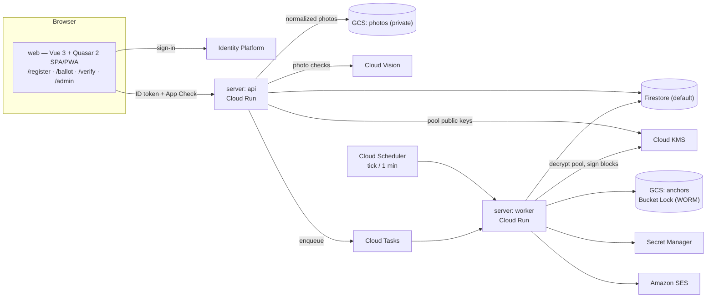
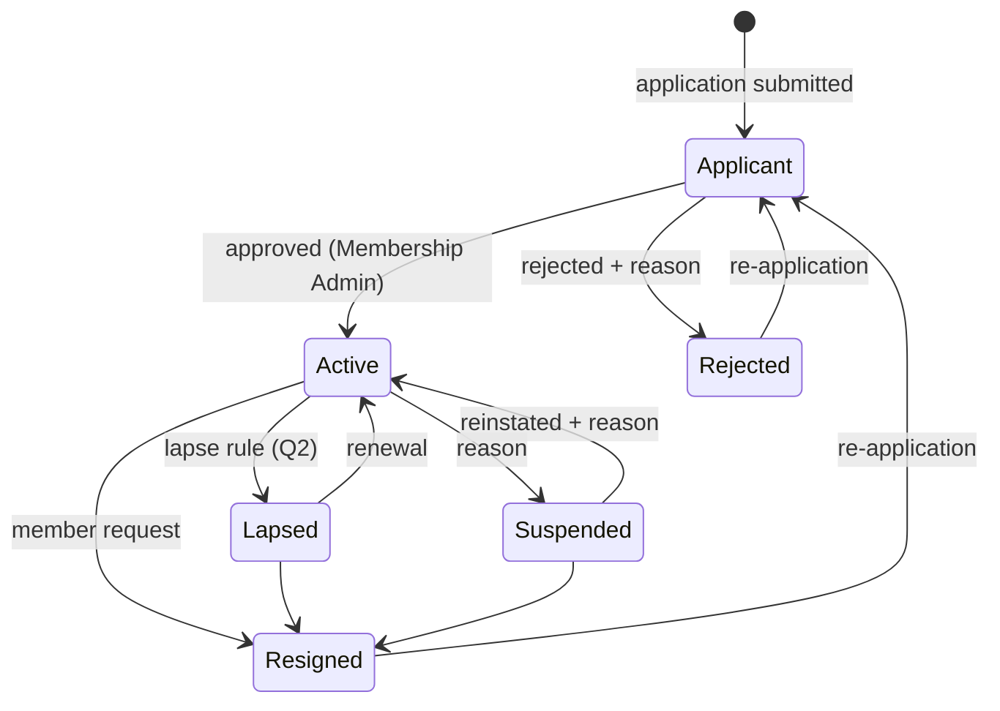
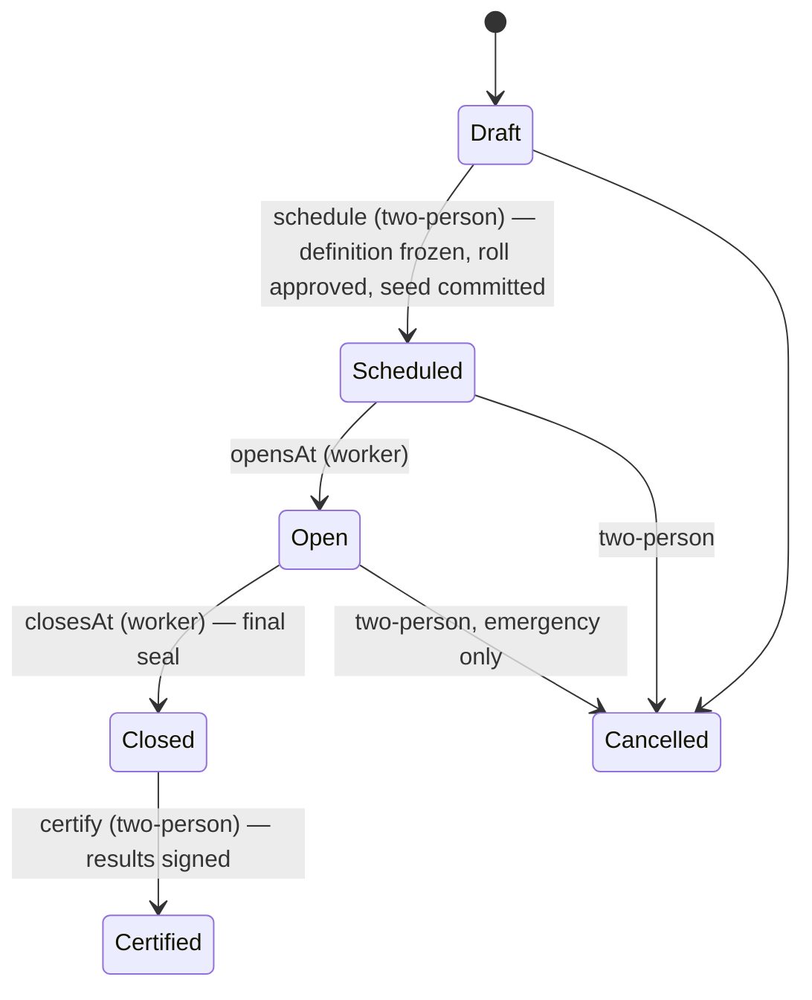
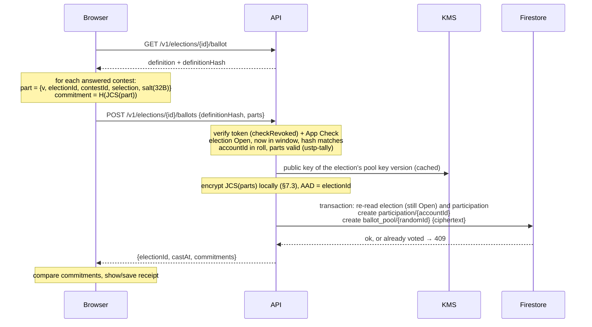

# USTPVote2 — System Design

| | |
|---|---|
| Status | Draft v0.1 — for review by USTP stakeholders |
| Date | 2026-10-20 |
| Source | [Standalone Technical Specification](spec/USTP-Standalone-Technical-Specification.docx) ([text](spec/technical-specification.md)) |
| Scope | Everything in spec §1.1 (V1). Section numbers below are this document's own; "spec §N" refers to the source. |

This document turns the standalone specification into an implementable design: concrete data layouts,
algorithms, trust boundaries and interfaces. Where the spec is silent or ambiguous it proposes an answer and
marks it; decisions that belong to USTP (bylaws, policy) are collected in [§18 Open questions](#18-open-questions).

---

## 1. Goals, non-goals, principles

### Goals
1. Run USTP member registration and organizational elections for 1,000–5,000 members inside one GCP project
   per environment, within free tiers (spec §8: ≈ $0.30–$0.60/month).
2. **Independent verifiability.** Anyone holding the public record can check that (a) the published ballots are
   exactly the ones tallied, (b) the tally is correct, (c) the record was not rewritten after the fact, and a voter
   can check (d) that their own ballot is included.
3. **Secret ballot** (per election) against members, observers, administrators and anyone with database read
   access. See [§2](#2-threat-model-and-trust-assumptions) for the precise boundary.
4. **Separation of duties**: no single administrator can approve a roll, certify a result or change an office alone.

### Non-goals for V1
- Cryptographic end-to-end verifiability that removes trust in the server at cast time (homomorphic tallying,
  verifiable mixnets). The design leaves room for it but does not attempt it.
- Coercion resistance / receipt-freeness (see [§7.5](#75-receipts-and-voter-verification)).
- Multi-seat ranked methods (STV), write-in candidates, weighted votes, proxy voting, vote changes after casting.

### Principles
- **The server is the only writer.** Firestore and Storage rules deny all client access; every read and write goes
  through the API with ID-token + App Check verification.
- **Everything that matters is a canonical object with a hash.** RFC 8785 (JCS) → UTF-8 → SHA-256, lowercase hex.
- **Determinism.** The same inputs produce a byte-identical results bundle on any machine.
- **Pure core, thin adapters.** Counting, hashing, state machines and role rules live in I/O-free packages
  (`ustp-tally`, `ustp-audit`, `ustp-domain`) that run unchanged in the API, the worker, the browser `/verify` page
  and a third party's laptop. GCP code is a thin layer around them.
- **History is append-only.** History collections are never updated or deleted by application code, and the ledger
  hash chain makes any out-of-band edit detectable.
- **Least privilege per service.** The API and worker run as different service accounts with disjoint KMS rights.

## 2. Threat model and trust assumptions

| Adversary | Can | Cannot (by design) | Controls |
|---|---|---|---|
| Outside attacker | Call public endpoints | Read member data, cast ballots | ID token + App Check on every call; rules deny direct DB access |
| Voter | Vote once, see own receipt | Vote twice; vote without being on the frozen roll | `transaction.create()` on `participation/{accountId}`; roll check in the same request |
| Member / public observer | Read published blocks, results, anchors | Link a ballot to a voter | Sealed blocks carry no voter IDs, ordered by random commitment, ≥ k ballots each |
| Firestore reader (insider with DB access, leaked backup/export/PITR) | See *who* voted and when | See *how* anyone voted, during or after the election | Pool entries are KMS-encrypted; pool key version destroyed after certification ([§7.3](#73-ballot-pool-encryption)) |
| Single administrator | Act within their role | Approve their own request; certify, freeze a roll or change an office alone | Two-person rule ([§10](#10-administration-and-separation-of-duties)) |
| Anyone with write access to the DB | Edit documents out of band | Do so undetected | Ledger hash chain, KMS-signed blocks, WORM anchors in Bucket Lock ([§8](#8-audit-ledger-hash-chain-merkle-blocks-anchors)) |
| GCP project owner / deployer | Deploy new code, change IAM | Rewrite already-anchored history | Bucket Lock; recommended public mirroring of anchors; Binary Authorization; reviewed deploys |
| **Compromised API service** | **See ballot contents with voter identity at cast time; cast for eligible non-voters** | — | Code review, reproducible builds, Binary Authorization, minimal human access, post-election participation check |

**Residual trust, stated plainly:** in V1 the API process sees the voter's identity and the ballot in the same request.
Secrecy and cast-time integrity therefore rest on the API code being the reviewed code and on nobody being able to
inspect the running process. Everything *after* the cast — storage, sealing, publication, tallying, certification — is
verifiable without trusting the operators. Spec §9's "fully consistent" privacy evaluation holds under this assumption.

Ballot stuffing by a compromised API is bounded by the roll and is detectable: after close, auditors (and, if USTP
chooses, members) can see the participation list and any member can report "I did not vote but am listed".

**Invariants an auditor can check from the record** (checked by the `ustp-verify` CLI, §16, as far as public data allows):
1. ballots in sealed blocks = participation records ≤ roll entries, and every participant is on the roll;
2. every sealed block's Merkle root and hash recompute, and each appears in the ledger;
3. the ledger hash chain is unbroken, every ledger block's signature verifies, and the anchors match;
4. re-running `ustp-tally` on the sealed blocks with the revealed tie-break seed reproduces the certified results hash.

## 3. Architecture



### 3.1 Components

| Component | Runtime | Responsibility |
|---|---|---|
| `apps/web` | Vue 3 + Quasar 2 on Vite, Firebase Hosting | Member, voter, verifier and admin UI. Computes ballot commitments and verifies Merkle proofs client-side with `ustp-audit`. |
| `apps/server` → **api** | Node 26 LTS, NestJS 12 on Fastify 5, Cloud Run service | All client-facing endpoints. Stateless. |
| `apps/server` → **worker** | Same image, different entrypoint, Cloud Run service (internal ingress, callable only by the Scheduler/Tasks invoker account) | Election clock, pool sealing, tally, ledger blocks, anchoring, email. |
| `packages/tally` (`ustp-tally`) | Pure TypeScript, zero dependencies | Ballot validation and deterministic counting for every contest type. Published publicly (spec §1.1). |
| `packages/audit` (`ustp-audit`) | Pure TypeScript, depends only on `@noble/hashes` | JCS, SHA-256, hash chains, RFC 9162 Merkle trees and proofs, ballot commitments, tie-break ordering. Isomorphic (Node + browser). Published publicly. |
| `packages/domain` (`ustp-domain`) | Pure TypeScript | Shared types, state machines, role rules, two-person checks, Firestore path constants, sealed blocks, results bundles, and the receipt and results checks the browser, the CLI and the tests share. |
| `packages/verify` (`ustp-verify`) | Node CLI, depends only on `ustp-audit` and `ustp-domain` | Independent verification from public artifacts only (§16). |

**Why one server package with two entrypoints:** the API and worker share Firestore repositories, KMS adapters and
domain logic. One package and one container image keep them in lockstep; two Cloud Run services with different
service accounts keep their privileges apart.

**Why the worker is a Cloud Run *service*, not a Job:** a once-per-minute tick as a Cloud Run Job execution pays
container start-up every minute (≈ 1,440 executions/day) and would exceed the 180,000 vCPU-second free tier. An
HTTP-triggered, request-billed service handles a tick in well under a second and scales to zero between elections.
All periodic work runs off **one** Cloud Scheduler job per environment (Cloud Scheduler gives 3 free jobs per billing
account — one per environment). One-off work (photo checks, emails, tally) goes through Cloud Tasks.

### 3.2 Repository layout

```
apps/server        NestJS on Fastify — src/main-api.ts, src/main-worker.ts
apps/web           Vue 3 + Quasar 2 SPA/PWA
packages/tally     ustp-tally   (public)
packages/audit     ustp-audit   (public)
packages/domain    ustp-domain  (internal)
packages/verify    ustp-verify  independent verifier CLI (public)
infra/firebase     firestore.rules, storage.rules, indexes, hosting config
infra/terraform    project, IAM, KMS, buckets, Cloud Run, scheduler, Binary Authorization (see its README)
docs/              this design, the source spec, ADRs
```

Toolchain: npm workspaces, TypeScript 6 (ESM, `nodenext`), Vitest, Vite 8 with `@quasar/vite-plugin`.
Builds use the committed lockfile with `npm ci --ignore-scripts` (spec §7).

## 4. Identity and accounts

- **Account ID.** Every person gets a USTP-minted UUIDv7 `accountId` (spec §3). Everything — rolls, roles,
  status history — keys on `accountId`, never on an Identity Platform `uid` or email. UUIDv7 embeds the creation
  time in milliseconds; that is acceptable (not secret) and makes IDs sortable.
- **Identities.** `account_identities/{uid}` maps an Identity Platform user to an `accountId`, so each request
  resolves in one read. One account may have several identities; an identity belongs to exactly one account.
- **Providers.** Google, Microsoft, Apple, passwordless email link, and email/password. The admin "auth switches"
  (`sign_in_methods`) are enforced by the API: a token whose `firebase.sign_in_provider` is switched off is refused,
  which takes effect within a minute (switches are cached for 60 s per instance) without changing Identity Platform
  configuration. Email link and email/password both report the provider `password`, so the API switch covers both;
  choosing between those two is Identity Platform configuration. Tokens from any other provider (custom, anonymous,
  phone) are always refused. At least one provider must stay on, and an admin cannot switch off the provider they are
  signed in with (self-lockout).
- **First sign-in.** `POST /v1/accounts` creates `accounts/{accountId}` and `account_identities/{uid}` in one
  transaction (`create`, so a race cannot mint two accounts for one uid).
- **Portability.** To add a login method the member, while signed in, also signs in with the new method and the client
  sends both ID tokens; the API links the second uid to the same account if that sign-in is under 5 minutes old and the
  uid has no account of its own. The last login method cannot be unlinked. Linking and unlinking are ledgered. Losing
  every login method requires Membership-Admin-assisted relinking with a written reason (not yet built).
- **Passwords (NIST SP 800-63B-4).** Minimum 15 characters (the single-factor minimum, applied to everyone), at least 64
  allowed, no composition rules, no forced rotation, breached-password screening, rate-limited attempts. Identity Platform
  enforces length; the browser screens against breached passwords before submission (see open question Q9), because
  Identity Platform never exposes the password to our code.
- **MFA.** Required for every admin role: admin endpoints reject tokens without `firebase.sign_in_second_factor`
  (problem type `/problems/mfa-required`), and approvals additionally require `auth_time` within the last 15 minutes
  (`/problems/reauth-required`; the web app re-authenticates and retries once). `GET /v1/me` reports `mfa.required`
  (holds a role and the policy is on) and `mfa.signedInWithMfa`.
  - The second factor offered is an **authenticator app (TOTP)**: set up on the Account page from a QR code (or typed
    key), then a 6-digit code after the first step of every sign-in and re-authentication. **SMS is not offered**:
    NIST SP 800-63B-4 treats it as a restricted authenticator, and Identity Platform bills per message.
  - **Deployment prerequisite:** TOTP must be enabled in each Identity Platform project, e.g. with the Admin SDK
    `projectConfigManager().updateProjectConfig({ multiFactorConfig: { providerConfigs: [{ state: 'ENABLED',
    totpProviderConfig: { adjacentIntervals: 5 } }] } })` (to be captured in Terraform, M5).
  - The Auth emulator does not support TOTP, so integration tests use SMS factors enrolled directly in the emulator to
    obtain real second-factor tokens; the server only checks that a second factor was used. The TOTP-specific browser
    steps can only be exercised against a real project.
  - An `account_factors` mirror for reporting is not built; Identity Platform holds the enrollments.
- **Request authentication.** `Authorization: Bearer <ID token>` and `X-Firebase-AppCheck: <token>`, both verified
  with the Firebase Admin SDK by a global guard; routes opt out only with `@Public()`. Admin routes declare their
  roles with `@Roles(...)`, which also requires MFA and verifies with `checkRevoked` (as will casting a ballot).
- **Safety switches.** `APP_CHECK_ENFORCED=false` and `ADMIN_MFA_REQUIRED=false` exist for local development and
  integration tests; the server refuses to start with either unless the Firestore and Auth emulators are configured.
  The emulator stand-ins `PHOTO_CHECKER=local`, `SECRET_STORE=emulator`, `AUDIT_SIGNER=emulator` (a local P-256
  key kept in Firestore) and `BALLOT_POOL=emulator` (local RSA keys) are refused the same way.
- **Bootstrap.** Emails listed in `BOOTSTRAP_SYSTEM_ADMIN_EMAILS` become System Admins once their account exists and
  the email is verified (checked on every `POST /v1/accounts`, which the web app calls on each sign-in and after
  verification; ledgered with actor `bootstrap`). An account that has ever held the role is never re-granted, so a
  revocation sticks. List at least two, because role changes need a second System Admin; remove the setting once real
  admins exist.

## 5. Registration

### 5.1 Member status



Every transition writes, in one transaction, the new status on `members/{accountId}`, an append-only
`member_status_history` entry and a ledger entry. Admin-initiated transitions require a non-empty written reason
(spec §9, due process). The allowed transitions are defined once in `ustp-domain`.

### 5.2 Applications, bylaws, address

- `applications/{applicationId}` stores the answers, the bylaws version accepted and that version's content hash
  (`bylaws_versions/{version}`), so it is provable which text the applicant agreed to. An application is accepted
  only against the *current* bylaws (version and hash must both match) and only from a verified email address.
  Bylaws versions are published by a Membership Admin, are immutable, and are ledgered.
- Separation of duties within membership: an admin cannot decide their own application or change their own status.
  Status changes other than application decisions (suspend, reinstate, lapse) use a separate endpoint so an
  application can never be bypassed.
- **Address minimization:** the street address is used once to look up state/district, then discarded — never
  written to Firestore, logs or task payloads. Only the derived `state` / `district` are stored. The lookup provider is
  open (Q8).

### 5.3 Profile photos

Optional, for members with a membership record (applicants included).

1. **Upload through the API:** `PUT /v1/me/photo` with the raw image as the body (`image/jpeg`, `image/png` or
   `image/webp`, at most 5 MB; anything else is 415/413).
2. **Normalize:** the API decodes it with `sharp` (rejecting anything that is not really an image of those formats, or
   smaller than 200×200), applies EXIF orientation, shrinks it to at most 1024 px, and re-encodes it as JPEG. This
   drops all metadata: GPS location, camera serials, embedded thumbnails, anything hidden in the original bytes.
3. **Check, inline:** Cloud Vision `FACE_DETECTION` (face count, detection confidence, blur and under-exposure
   likelihoods) and `SAFE_SEARCH_DETECTION`. `photoVerdict` in `ustp-domain` turns the signals into `pass` or `flag`
   with plain-language reasons (no face / more than one face / face not clearly visible / blurry / too dark / may be
   inappropriate, at `LIKELY` or above). Recorded in `photo_checks/{checkId}`.
4. **Store:** the normalized JPEG goes to the private photos bucket (`PHOTOS_BUCKET`) at
   `profile-photos/{accountId}/{photoId}.jpg`; `profile_photos/{photoId}` is `accepted` (passed) or `needs_review`
   (flagged). A new upload marks the previous photo `superseded` and deletes its image.
5. **The machine never rejects.** Flagged photos go to the Membership Admin queue (`GET /v1/admin/photos`); only a
   person accepts or rejects, with a written reason, ledgered as `photo.decided`. Rejecting deletes the image; the
   member sees the reason. Admins cannot decide their own photo. Members can remove their photo at any time.
6. No face recognition or matching is performed, no face embeddings are stored, and images are only ever served to
   the member and Membership Admins through authenticated API routes (never public URLs).

With the emulators there is no Vision API, so a local stand-in (`PHOTO_CHECKER=local`, refused outside the emulators)
assumes one clear face and flags only dark images, so the review flow can be exercised. Deployment needs: the
`PHOTOS_BUCKET` (private, uniform bucket-level access), the Vision API enabled, and the api service account allowed
to read, write and delete objects in that bucket.

## 6. Elections

### 6.1 Lifecycle



Spec §4 lists Draft → Scheduled → Open → Closed → Certified. This design adds **Cancelled** and makes
**scheduling** a two-person action, because freezing the contest rules matters as much as freezing the roll.

**Draft → Scheduled** (implemented in M2b): the Election Admin's request carries the current `definitionHash` and the
approved roll. When the Auditor approves, the server **recomputes the hash from the stored contests, candidates and
proposal texts** and refuses if anything changed since the request (the Auditor approves only what they saw), re-runs
`validateDefinition` (voting must still open in the future), and checks the roll is still the approved one. A fresh
32-byte tie-break seed is generated and stored in Secret Manager under a new secret per attempt (Secret Manager is not
transactional; the election records `tieBreakSeedRef`, the secret's ID, for the attempt that committed). Only its hash
`tieBreakSeedCommitment` is published. One ledger entry, `election.scheduled`, records the definition hash, roll
root and count, seed commitment and voting window. From then on nothing in the definition or roll can be edited.
Planned: warn when the roll is too small for the anonymity threshold (roll < 3k).

**Scheduled → Open → Closed** (implemented in M3a, the worker's clock on every tick): for a scheduled secret election
the worker first creates its ballot-pool key version ([§7.3](#73-ballot-pool-encryption)) and records it as
`poolKeyVersion`. At `opensAt` it opens the election — only once that key is ready, and only if the stored contests,
candidates and proposal texts still hash to the frozen `definitionHash` (otherwise the tick fails loudly and the election
stays scheduled). At `closesAt` it closes it. Each transition re-reads the election in a transaction (an election
cancelled meanwhile is left alone, and overlapping ticks move it once) and ledgers `election.opened` (definition hash,
window, pool key version) or `election.closed`, with actor `system`.

**Closed → results** (implemented in M4a): once every ballot is sealed (`sealedAt`, §7.2), the worker tallies the
election on the same tick and publishes provisional, signed results ([§9](#9-tallying-ustp-tally)). The election stays
Closed until certification moves it to Certified.

**Closed → Certified** (implemented in M4b, two-person `election.certify`): an Election Admin who is not a candidate
requests certification of a closed election's provisional results; the request names their `resultsHash`, and is
refused before the results exist or when an office its contests fill does not exist. An Auditor who is not a candidate
approves; in the decision's transaction the server re-checks that the election is still Closed and the results are
still provisional with exactly that hash, marks the results `certified` (`certifiedAt`, `certifiedLedgerSeq`), moves
the election to Certified (`certifiedAt`), creates a term of office for every winner of a contest tied to an office
(§6.4), and ledgers `results.certified` (`electionId, resultsHash, approvalId, terms`) and one `position_term.created`
per term. On its next tick the worker destroys the election's ballot-pool key version (§7.3).

**Cancelling** a draft is a single Election Admin action; cancelling a scheduled or open election is two-person
(`election.cancel`, approved only if the election is still in the state it was requested from). Both are ledgered.

### 6.2 Contests

One election = one ballot with any mix of contests (spec §1.1). Each contest is one of:

| `kind` | Covers (spec §1.1) | Selection on a ballot |
|---|---|---|
| `proposal` | Platform/bylaw proposals: Yes / No / Abstain, configurable pass rule and quorum | `"yes"` \| `"no"` \| `"abstain"` |
| `choose_n` | Plurality (seats 1, max 1), block (seats N, max N), approval (max = all candidates); optional support floor | array of candidate IDs (`[]` = blank) |
| `irv` | Single-seat instant-runoff | ranked array of candidate IDs, most preferred first (`[]` = blank) |

Voters may skip a contest (undervote). Rules are in [§9](#9-tallying-ustp-tally).

### 6.3 Roll snapshots

An Election Admin requests a snapshot (implemented in M2b): eligibility criteria (default: status `Active` at
`asOf`; see Q3), the sorted list of eligible `accountId`s, its count and a Merkle root over
`H(JCS({v: 1, electionId, accountId}))` (`rollMerkleRoot` in `ustp-domain`; a member can be given their own inclusion
proof). The snapshot is written to `eligibility_snapshots/{snapshotId}` as `pending` with a `roll.approve` request.
An Auditor (≠ requester, and not a candidate in the election) reviews the names and approves; the snapshot becomes
`approved`, the election points at it, any previously approved roll is `superseded`, and `roll.approved` is ledgered.
A rejected snapshot is marked `rejected`. The roll is frozen from then on: later status changes do not alter it (Q4).
Every roll entry carries equal weight.

The snapshot document holds the whole sorted list, about 25,000 members within Firestore's 1 MiB document limit (the
spec's scale is 1,000–5,000); the casting check in M3 reads it once per instance (it never changes), so a separate
`roll_entries` collection is not needed until rolls outgrow one document.

**Signature** (implemented in M2c): on its next tick after approval, the worker signs
`rollStatement = {v, type: 'roll', electionId, snapshotId, criteria, asOf, count, merkleRoot, approvalId}` with the
`audit-signing` key ([§8.3](#83-ledger-blocks-blocksindex)) and stores it as the snapshot's `signature`. The api never
signs, so signing waits for the worker (≤ 1 minute); scheduling does not wait for it. A roll superseded before the
worker got to it is still signed, since it was approved.

### 6.4 Proposals and positions

- `proposal_snapshots` freeze the exact title and text of a proposal with its content hash
  `H(JCS({v: 1, title, body}))`; they are immutable, and a proposal contest points at one. V1 enters proposals in the
  admin console; an external source is Q6. The review that admits a text to the ballot is the Auditor's approval of
  the scheduling request, which covers the whole definition including every proposal's content hash; a separate
  `proposal_reviews` collection is not used.

### 6.5 The election definition (implemented in M2a)

Drafts are edited piecewise (election, contests, candidates). `buildDefinition` in `ustp-domain` assembles them into
one canonical object: election fields, then contests in order, each with its `ustp-tally` spec, its proposal's
snapshot ID and content hash, and its candidates in the order the spec lists them. `definitionHash = H(JCS(definition))`
is shown live in the editor and to Auditors, and `validateDefinition` lists what blocks scheduling (no contests,
voting not in the future, missing proposal text or candidates, any `ustp-tally` spec problem such as more seats than
candidates). Scheduling (M2b) freezes exactly this hash. Contest and candidate IDs are random Firestore IDs, which
fit the `ustp-tally` ID pattern. Only drafts can be edited.
- `positions` define offices (title, seats, term length). Certifying an election that fills an office creates
  `position_terms` that reference the certified results hash. Any other change to an office or term is a two-person
  action. Implemented in M4b:
  - **Offices** (`positions/{positionId}`, a slug: `{title, description, seats, termMonths, definedAt, approvalId}`)
    are defined or changed only through `position.modify` with `{change: 'define', position}` (Membership or Election
    Admin requests, Auditor approves; `position.defined` ledgered). Changing an office does not touch terms already
    running.
  - **Contests fill offices:** a candidate contest may name a `positionId` while the election is a draft (it must
    exist); it is part of the frozen definition, so the Auditor scheduling the election sees which office each contest
    fills. Proposals cannot fill an office.
  - **Terms** (`position_terms/{termId}`: holder name and account if the candidate had one, contest, election,
    `startsAt`, `endsAt`, `resultsHash`, `status`) are created only by certification: one per winner, starting at
    certification and lasting the office's `termMonths` (same day of the month, or its last day). Ending one early
    (resignation, removal) is `position.modify` with `{change: 'end_term', termId}`; the holder may neither request
    nor approve it (`position_term.ended` ledgered).
  - **Public:** `GET /v1/public/positions` lists the offices and their active terms; office holders are public, like
    the results they come from. Administrators see every term in the console's Offices tab.

## 7. Ballot casting and secrecy

### 7.1 Cast flow (secret ballot)



Implemented in M3a (`VotingService`):

- **Voter endpoints:** `GET /v1/elections` lists the scheduled, open, closed and certified elections whose roll holds
  the caller, with `castAt` once they voted. `GET /v1/elections/{id}/ballot` returns the frozen definition, its hash
  and the proposal texts; the web app recomputes the hash and every proposal's `contentHash` in the browser before
  showing the ballot. Drafts and cancelled elections answer 404 to voters; anyone off the roll gets 403.
- **Checks at cast:** the token is checked for revocation (`@CheckRevoked`, as on admin routes); the election must be
  Open and the server clock inside `[opensAt, closesAt)`; the request's `definitionHash` must equal the frozen one, and
  the stored definition must still hash to it; at least one part, each for a different contest of this election, with
  a 32-byte hex salt and a selection `ustp-tally` accepts (400 otherwise). Skipped contests are simply absent.
- The approved roll is read once per api instance and kept in memory (it never changes, §6.3).
- The **participation** document's ID is the `accountId`. The cast transaction reads it and creates it, which is the
  duplicate-vote guard (spec §4); it also re-reads the election, so no ballot is accepted once a close has committed.
  For secret ballots it stores only `accountId` and server time.
- The **pool** document has a random server-generated ID and holds only ciphertext. No voter ID, no timestamp field.
- The cast endpoint never logs request bodies (Fastify does not log bodies; the logger redacts `authorization` and App
  Check headers).
- Planned with email (Amazon SES): the "you voted" email task carries `accountId` and `electionId` only — never
  commitments.

### 7.2 Sealer

Firestore records a commit timestamp on every document. The participation record and pool record of one vote share a
commit time, so anyone who can read the pool could link them. The sealer removes the pool records (spec §4, §7):

```
every tick, for each election in Open or Closed with pool entries:
  n = pool size, k = election.kAnonymity (default 10)
  Open:   if n >= 2k: seal a uniformly random (CSPRNG) subset of n - k entries, leave k in the pool
  Closed: seal everything (≥ k by construction whenever turnout ≥ k)
seal(entries):
  decrypt each (KMS); group parts by contestId; sort each group by commitment
  block = {v, electionId, index, prevSealedHash, ballotCount,
           contests: {contestId: [part...]}, merkleRoot: MTH(all commitments, sorted)}
  sealedHash = H(JCS(block))
  one transaction: create sealed_blocks/{index}; delete the sealed pool entries; append ledger entry
```

Implemented in M3b (`BallotSealer`, every tick after the clock):

- Each block is one transaction: it re-reads the chosen pool entries (if a concurrent tick sealed any of them, this
  one gives up), creates `sealed_blocks/{index}` (once per index), deletes those entries and ledgers `ballots.sealed`
  (`electionId, index, ballotCount, merkleRoot, sealedHash, prevSealedHash`). Overlapping ticks therefore cannot
  seal a ballot twice, and the `locks/tick` lease is not needed.
- Decryption (one Cloud KMS unwrap per ballot, 16 at a time) happens before the transaction.
- The stored record adds `sealedHash`, the sorted `commitments` (the Merkle leaves, kept so a receipt's block can be
  found with one `array-contains` query) and `ledgerSeq`.
- A batch larger than the cap is split evenly into blocks of at most `max(400, 2k)` ballots, so every block still
  holds at least k.
- When a closed election's pool is empty and the sealed ballots equal its participation count, the sealer ledgers
  `election.sealed` (blocks, ballots, last `sealedHash`) and sets `sealedAt`. An election nobody voted in is sealed
  with no blocks. A mismatch for a secret election would mean a lost ballot: it is logged as an error and the election
  is not marked sealed.
- **Contents are published only after close.** While voting is open, only block summaries (index, count, Merkle root,
  hash) and inclusion proofs are public, so nobody sees a running tally; `GET /v1/public/elections/{id}/sealed-blocks`
  answers 409 until the election is closed.

- Leaving k entries behind while open guarantees every block — including the last — holds ≥ k ballots, so a block's
  commit time narrows a voter down to no fewer than k candidates.
- **Ordering by commitment** instead of shuffling: commitments are salted hashes, so the order is unrelated to cast
  order, and the published order is canonical without trusting a shuffle.
- **Per-contest grouping**: parts of one ballot are not kept together in published blocks, which defeats linking a
  voter's choices across contests ("pattern voting"). Each part is verifiable on its own (§7.5).
- Blocks are capped at 400 ballots to stay well under Firestore's 1 MiB document limit.

### 7.3 Ballot-pool encryption

Not in the spec; added because the sealer alone does not stop someone reading the pool *while* it exists (a real-time
listener with database read access, or a backup / point-in-time-recovery copy).

Implemented in M3a:

- **Asymmetric KMS key `ballot-pool`** (`ASYMMETRIC_DECRYPT`, `RSA_DECRYPT_OAEP_3072_SHA256`, named by
  `BALLOT_POOL_KEY`); a **new key version per secret election**, created by the worker after scheduling. Unlike a
  symmetric key, whose encryptions always use the primary version, an asymmetric version can be addressed directly, so
  concurrent elections each get their own version.
- **Hybrid encryption** in the api: each ballot `JCS(parts)` is encrypted with AES-256-GCM under a fresh 32-byte data
  key, with the election ID as associated data (a ciphertext cannot be moved to another election's pool); the data key
  is wrapped with RSA-OAEP-SHA256 to the election's public key and then discarded. The pool entry is
  `{v, keyVersion, wrappedKey, iv, ciphertext, tag}`.
- **The api cannot decrypt at all:** it only reads public keys (`roles/cloudkms.publicKeyViewer`), and only of versions
  of the configured key, so an altered election document cannot point it at another key. Encryption needs no KMS call
  per ballot. The **worker** alone may create versions and decrypt (`cloudkms.cryptoKeyVersions.create`, `.get`,
  `.useToDecrypt`); the sealer (M3b) unwraps each data key through KMS. No human holds decrypt in production. KMS Data
  Access audit logs are on, so any decrypt is visible.
- After certification the election's key version is **destroyed**, and so are the versions of cancelled
  elections. Any copy of the pool in backups or PITR becomes permanently unreadable — forward secrecy for past elections.
  Implemented in M4b as a tick step (not a separate task): for every Certified or Cancelled election with a pool key
  and no `poolKeyDestroyedAt`, the worker destroys the version (Cloud KMS schedules it, restorable for the key's 24-hour
  window; a version already scheduled or destroyed counts as done), then sets `poolKeyDestroyedAt` and ledgers
  `election.pool_key_destroyed`. A Certified election's ballots are all sealed by then; a Cancelled one's are never
  counted. The public record shows `poolKeyDestroyedAt`.
- With the emulators, `BALLOT_POOL=emulator` keeps RSA-3072 key pairs in Firestore instead; the server refuses it
  elsewhere.
- Cost: one key version per election while it exists (a few cents a month), plus one KMS decrypt per ballot at sealing.

### 7.4 Open (roll-call) ballots

For `secrecy: "open"` elections the API writes the plaintext parts with the `accountId` into the participation
record (implemented in M3a); no pool key, no pool, no encryption. The ballot page tells voters their vote is published
with their name. The sealer still produces sealed blocks — parts carry `accountId` and are sorted by it
— so tallying, publication and verification follow one path for both modes. Nothing is secret, so roll-call ballots
are sealed once, at close (M3b): participation is frozen by then, so the chunks are the same on every attempt and blocks
already created are skipped.

### 7.5 Receipts and voter verification

- The browser computes each part's commitment *before* sending, so the voter does not have to trust the server's
  echo, and shows whether the server's commitments match. The receipt (`BallotReceipt`: election, definition hash,
  cast time, the parts with their salts, the commitments) can be downloaded as a file, and kept in browser storage only
  if the voter switches that on (implemented in M3a). It is never sent back to the server.
- After the ballot is sealed, `/verify` fetches an inclusion proof for each commitment and checks, in the browser:
  RFC 9162 inclusion in the sealed block's Merkle root → the block's hash in the ledger → the ledger block's signature
  → the anchor object in the Bucket Lock bucket. Implemented in M3b: the receipt comes from browser storage, a
  downloaded file or a paste and never leaves the browser; only commitments are looked up
  (`GET /v1/public/elections/{id}/proofs/{commitment}`, then the `ballots.sealed` entry through
  `GET /v1/public/ledger/entries/{seq}`, the signing keys and the latest anchor). The checks themselves are
  `checkReceiptPart` in `ustp-domain`, so the integration tests run exactly what the page runs. Each step is shown as
  passed, failed or not yet possible (still in the pool; ledger block or anchor not written yet). The browser checks
  that the anchor *record* covers the ledger block; fetching the anchor object itself needs the bucket to be public
  (§8.4). Once voting has closed it also recomputes every published sealed block (`sealedBlockProblems`).
- **Trade-off:** salt + selection lets a voter *prove* to someone else how they voted (vote selling / coercion).
  This is inherent to this receipt design and accepted for V1, as in most organizational systems with receipts.
  Commitments are never emailed or stored with the voter's identity.

## 8. Audit ledger: hash chain, Merkle blocks, anchors

### 8.1 Canonical hashing
All hashed objects are RFC 8785 JCS-canonicalized, UTF-8 encoded and SHA-256 hashed, written as lowercase hex.
Every hashed object carries `v` (schema version). JCS input is restricted to I-JSON: finite numbers, well-formed
strings, plain objects and arrays — anything else is an error rather than silently coerced.

### 8.2 Ledger entries (`audit_events/{seq}`)

```
entry = { v, seq, type, at, actor, subject, payload, prevHash }   hash = H(JCS(entry))
```

- One global chain. Appending runs in a transaction on `ledger_head/main` (`{seq, hash}`): read head, write
  `audit_events/{seq+1}`, update head. Writes are rare (admin actions, ≤ one seal per election per minute), well
  under Firestore's per-document write rate. **Ballot casts never touch the ledger** — that would serialize voting
  and re-create the timing link the sealer removes.
- Genesis `prevHash` is 64 zeros.
- Entry types implemented in M1: `member.status_changed` (an application decision is a status change carrying the
  `applicationId`), `identity.linked`, `identity.unlinked`, `bylaws.published`, `role.granted`, `role.revoked`,
  `approval.requested`, `approval.decided`, `signin_method.changed`. Added since: `photo.decided`, `roll.approved`,
  `election.scheduled`, `election.opened`, `election.closed`, `election.cancelled` (M2–M3a), `ballots.sealed`,
  `election.sealed` (M3b), `results.computed` (M4a), `results.certified`, `election.pool_key_destroyed`,
  `position.defined`, `position_term.created`, `position_term.ended` (M4b). The authoritative list is
  `LEDGER_EVENT_TYPES` in `ustp-domain`.
- **Selective disclosure:** member-related entries contain personal data and are visible to Auditors only. Election
  entries are public. A public verifier checks a public entry by Merkle inclusion in its ledger block (§8.3) without
  seeing the private entries in that block. Public types (`PUBLIC_LEDGER_EVENT_TYPES`): `bylaws.published`,
  `roll.approved`, `election.scheduled`, `election.opened`, `election.closed`, `ballots.sealed`, `election.sealed`,
  `election.cancelled`, `results.computed`, `results.certified`, `election.pool_key_destroyed`, `position.defined`,
  `position_term.created`, `position_term.ended`.
  `GET /v1/public/ledger/entries/{seq}` returns a public entry with its block and inclusion proof; anything else, or an
  entry not yet in a block, is 404.

### 8.3 Ledger blocks (`blocks/{index}`)

Implemented in M2c. On each tick, if entries exist beyond the last block, the worker builds an RFC 9162 Merkle tree
over their 32-byte entry hashes and writes
`block = {v, index, prevBlockHash, firstSeq, lastSeq, merkleRoot, headEntryHash, createdAt}`, `blockHash = H(JCS(block))`
and `signature = {keyVersion, signature}`. Blocks and entries are numbered from 1; block 1's `prevBlockHash` is 64 zeros.
A block covers at most 500 entries and a tick seals at most 20 blocks, so a backlog clears over several ticks.

- **Signature:** ECDSA P-256 / SHA-256 over the bytes `JCS(block)`, DER-encoded, base64. Cloud KMS signs digests, and
  the digest of those bytes is `blockHash`, so KMS signs `blockHash`; anyone can check the signature with
  `openssl dgst -sha256 -verify key.pem -signature sig.der block.json` or Web Crypto (`verifyEcdsaP256` in
  `ustp-audit`). The key is `audit-signing` (`EC_SIGN_P256_SHA256`), named by `AUDIT_SIGNING_KEY_VERSION`.
- **Only the worker signs.** Its service account alone holds `cloudkms.signer` on the key; the api, which faces the
  internet, cannot sign, so compromising it cannot produce validly signed blocks. The worker records each key version's
  public key in `signing_keys/{keyId}` (keyId = first 16 hex digits of SHA-256(keyVersion)) and in the anchors bucket
  as `v1/keys/{keyId}.pem` on first use; the api serves them at `GET /v1/public/ledger/keys`.
- **Never sign a broken chain:** before sealing, the worker checks that the new entries are numbered without gaps and
  that their hashes and links verify onto the previous block's `headEntryHash`. If not, the tick fails loudly and
  nothing is signed.
- **Idempotent:** `blocks/{index}` is created, never overwritten. Two overlapping ticks compute the same index and only
  one create succeeds, so the `locks/tick` lease (§13) is not needed for blocks; it arrives with pool sealing in M3.
- **Verification** (`GET /v1/admin/audit/verify`, Auditors): the entry chain and head, then `verifyBlocks` (numbering,
  contiguity, links, Merkle roots, block hashes), every signature against `signing_keys`, and every anchor (§8.4).
  The Auditor console also checks each published block's link, hash and signature in the browser, without relying on
  the server's verdict; Merkle roots need the private entries, so that part is the server's.

A rewrite of sealed history by someone with database access, even one that re-links every later entry and the head,
fails the block's Merkle root; re-hashing the block too fails its signature.

Merkle trees follow RFC 9162 §2.1 exactly — leaf `H(0x00 ‖ d)`, node `H(0x01 ‖ l ‖ r)`, split at the largest
power of two below n, inclusion proof verification per §2.1.3.2 — so third parties can use existing tooling.

### 8.4 Anchors (spec §4 "External Anchoring")

- Implemented in M2c. Each new block is written as `gs://<bucket>/v1/blocks/<index, 12 digits>.json`, the JCS of
  `{v, block, blockHash, signature}`, to a bucket with a retention policy (`ANCHORS_BUCKET`), with
  `ifGenerationMatch: 0` so an object is only ever created. `anchors/{index}` records the URI and object generation.
  Blocks are anchored in order; if an object already exists (a retried tick), it must hold the same bytes.
- Verification downloads each anchor object and checks its content against the block and its generation against the
  record. `GET /v1/public/anchors/latest` returns the newest anchor record.
- Until `ANCHORS_BUCKET` is set, blocks are still sealed and signed, and the worker logs that it is not anchoring.
- **Smart anchoring** (spec §8): only when a new block exists — at most one object per minute, usually far fewer.
- The bucket's retention policy is **locked in production only**. Locking is irreversible: no object (or the bucket)
  can be deleted before retention expires. dev/staging use an unlocked policy. The retention period is Q11.
- **Recommendation:** make the anchor objects publicly readable (or mirror them to a public repository) so that
  outsiders hold copies. Bucket Lock prevents rewriting, but only outside copies prove the history was never forked
  from the start by whoever controls the project.
- The `audit-signing` public key is published in the repository and the anchor bucket.

## 9. Tallying (`ustp-tally`)

`ustp-tally` is pure, synchronous, dependency-free and uses integer arithmetic only. Ratios are `{num, den}` integers
compared by cross-multiplication with `BigInt`; no floating point affects an outcome.

**Validation.** The same validator runs at cast time (API rejects invalid ballots with 400) and at tally time
(defensive: anything invalid is counted under `invalid` and excluded). Contest specs are validated too (IDs, seats,
ratio bounds, tie-break order is a permutation of the candidates).

**Proposal.**
- Counts yes / no / abstain. Quorum participation = yes + no + abstain in this contest.
- Quorum (optional): `minBallots` and/or `rollRatio` (≥ ⌈roll × ratio⌉); unmet → outcome `no_quorum`.
- Pass rule: `threshold {ratio, comparison: gt | gte}` applied to yes / base, where base is `yes_no` (abstentions
  ignored), `yes_no_abstain` (abstentions count against) or `roll` (fraction of the whole roll). Default: more than
  1/2 of yes + no. Base 0 → `failed`.

**Choose up to N.**
- Valid ballot: distinct candidate IDs, at most `maxSelections`; `[]` is a valid blank.
- Rank by votes descending, then tie-break order. A candidate needs ≥ 1 vote to be elected.
- Support floor (optional): a candidate is eligible only if votes / valid contest ballots (blanks included) meets
  the floor threshold; seats may remain vacant.
- Fill seats in rank order from eligible candidates. A tie straddling the last seat is resolved by tie-break order and
  reported.

**Instant-runoff (single seat).**
- Valid ballot: distinct candidate IDs, at most `maxRanks`; `[]` is a valid blank (excluded from rounds).
- Each round counts every ballot for its highest-ranked continuing candidate; ballots with none are exhausted.
- A candidate with more than half of the continuing ballots is elected; if one candidate remains, they are elected.
- Otherwise the candidate with the fewest votes is eliminated. Ties for last: compare the tied candidates' counts in
  earlier rounds, most recent first, and eliminate the one with fewer; if tied in every round, eliminate the one
  latest in tie-break order. Every round, elimination and tie-break is in the output.

**Tie-break order.** The seed is revealed at tally. For each candidate contest, `ustp-audit` orders candidates by
`H(JCS({v:1, seed, contestId, candidateId}))` ascending; earlier is favoured (`tieBreakOrders` in `ustp-domain`).
Anyone can check `H(seed) = tieBreakSeedCommitment` from the scheduled election (its record and its
`election.scheduled` entry) and recompute the order.

**Results bundle** (implemented in M4a):

```
bundle = {v, electionId, definitionHash, roll {snapshotId, merkleRoot, count}, participationCount,
          sealedBlocks [{index, sealedHash, ballotCount}], tally {library: "ustp-tally", version},
          tieBreakSeed, tieBreakSeedCommitment, contests [{contestId, tieBreakOrder, result}]}
resultsHash = H(JCS(bundle))
```

- `buildResultsBundle` in `ustp-domain` builds it from public data only (the frozen definition, the roll's root and
  count, every sealed block, the revealed seed) and it holds no timestamps, so anyone can rebuild it byte for byte.
  Contests are in definition order; `result` is the `ustp-tally` output with every round, elimination and tie-break
  record; `tieBreakOrder` is null for proposals. `participationCount` is the ballots in the sealed blocks, which the
  sealer has checked equal the participation records.
- It refuses (throws) rather than count anything when the definition no longer hashes to `definitionHash`, the seed
  does not match its commitment, the sealed blocks do not verify (`sealedBlockProblems`), or a block holds parts of a
  contest the definition does not have.

**The tally** (implemented in M4a, `Tallier`, a step of every tick right after the sealer, §13):

- For each Closed election with `sealedAt` and no results yet, the worker reads the seed from the secret store by
  `tieBreakSeedRef`, refuses if `seedCommitment(seed) ≠ tieBreakSeedCommitment`, re-checks that the sealed ballots
  equal the participation count, builds the bundle and signs `JCS(bundle)` with the `audit-signing` key. Cloud KMS
  signs digests, and that digest is `resultsHash`, exactly as for ledger blocks (§8.3); the key is published in
  `signing_keys` on first use.
- One transaction re-reads the election and `results/{electionId}`, creates
  `results/{electionId} = {electionId, status: "provisional", bundle, resultsHash, signature, computedAt, ledgerSeq}`
  and ledgers the public `results.computed` entry (`electionId, resultsHash, definitionHash, participationCount,
  tallyVersion, tieBreakSeed`), so the reveal of the seed is itself in the signed, anchored ledger. Overlapping ticks
  record one result; a losing tick's signature is discarded.
- A refusal fails the tick (500) on every tick until someone fixes the cause, so Cloud Scheduler records it; other
  elections are still tallied. Sealing completes on the tick that closes an election, so results normally follow on
  that same tick, and the same tick's ledger block covers `results.computed`.
- `GET /v1/public/elections/{id}/results` returns the record (404 until computed); the public election record carries
  its status, hash, time and ledger entry (`results`).

**Checking results** (`checkResults` in `ustp-domain`, run by the results page `/results/{id}` and by the integration
tests): the bundle's hash and signature; that it names the frozen definition and the approved roll; that the revealed
seed matches the published commitment; that every published sealed block is counted and recomputes from its parts; a
full re-tally with the page's own `ustp-tally` that must reproduce `resultsHash`; then the `results.computed` entry
through its signed ledger block to an anchor.

Certification (two-person, implemented in M4b, §6.1) ledgers `results.certified` referencing the same hash and marks
the record `certified` with `certifiedAt` and `certifiedLedgerSeq`; the bundle, its hash and its signature are
unchanged. For certified results `checkResults` adds the certification: a `results.certified` entry at
`certifiedLedgerSeq` naming this hash, its inclusion in a ledger block, that block's signature and an anchor. The
results page, the CLI and the tests pass it that entry.

## 10. Administration and separation of duties

### 10.1 Roles (spec §5)

| Capability | Membership Admin | Election Admin | Auditor | System Admin |
|---|:-:|:-:|:-:|:-:|
| Triage applications and photos; change member status | ● | | | |
| Create/edit draft elections, contests, proposals | | ● | | |
| Request roll snapshot, scheduling, certification, cancellation | | ● | | |
| Approve roll, scheduling, certification, cancellation, office changes | | | ● | |
| Read full ledger, run verifications | | | ● | |
| Grant/revoke roles (two-person between System Admins), sign-in switches, operations | | | | ● |

**Incompatible role pairs:** Auditor with any other role. An Election Admin who is a candidate in an election may not
act on that election (Q12; enforced on every edit, and nobody can add themselves as a candidate). All admin roles require MFA. The first System Admin is bootstrapped once from deployment
configuration and ledgered.

### 10.2 Two-person rule

`approval_requests/{id}`: `{action, target, payload, payloadHash, requestedBy, requestedAt, approverRole, status,
decidedBy, decidedAt, reason, expiresAt}`.

- Approver ≠ requester (by `accountId`), holds `approverRole` at decision time, signed in with MFA within 15 minutes.
- The account an action affects (`subject`, e.g. the person gaining a role) may be neither requester nor approver.
- The approver approves `payloadHash`; approval executes immediately (status `executed`), re-checking every
  precondition and acting on exactly that payload. Statuses: `pending` → `executed` | `rejected`.
- Requests expire after 7 days (checked at decision time). Request and decision are ledgered, plus the executed
  effect (e.g. `role.granted`) in the same transaction.
- Implemented in M1 for role changes and generalized in M2b: each action has a handler that re-checks its
  preconditions inside the decision transaction and returns its ledger entries and writes. Only one request per
  action and subject can be pending at a time. For election actions the approver must not be a candidate in that
  election.

| Action | Requested by | Approved by |
|---|---|---|
| `roll.approve` | Election Admin | Auditor |
| `election.schedule` | Election Admin | Auditor |
| `election.certify` | Election Admin | Auditor |
| `election.cancel` (Scheduled/Open) | Election Admin | Auditor |
| `position.modify` | Membership or Election Admin | Auditor |
| `role.grant` / `role.revoke` | System Admin | another System Admin |

## 11. Data model (Firestore `(default)` database)

Firestore Native mode has no namespaces. The spec's two namespaces are **module boundaries in code**: each module owns
its collections through its own repository classes, and other modules go through its service. Physically,
registration collections are top-level and election data lives under each election.

| Path | Key | Mutability | Notes |
|---|---|---|---|
| **registration** | | | |
| `accounts/{accountId}` | UUIDv7 | mutable | display name, primary email, state |
| `account_identities/{uid}` | Identity Platform uid | create/delete | → `accountId`, provider, linkedAt |
| `account_factors/{accountId}/factors/{factorId}` | | mutable | mirror of MFA enrollment, no secrets |
| `sign_in_methods/{method}` | provider ID | mutable | enabled flag (auth switches) |
| `members/{accountId}` | accountId | mutable | current status, state/district, bylaws version, memberSince |
| `member_status_history/{id}` | auto | append-only | from, to, reason, actor, ledger seq |
| `applications/{applicationId}` | auto | status only | answers, bylaws version + hash |
| `bylaws_versions/{version}` | version | immutable | text, content hash *(added)* |
| `profile_photos/{photoId}` | auto | status only | storage path, status |
| `photo_checks/{checkId}` | auto | immutable | Vision signals, verdict |
| `positions/{positionId}` | slug | two-person | title, description, seats, term months, approval (§6.4) |
| `position_terms/{termId}` | auto | created by certification; ended two-person | holder, contest, start/end, results hash, status |
| `eligibility_snapshots/{snapshotId}` | auto | immutable once approved | criteria, count, Merkle root, signature |
| **voting** | | | |
| `elections/{electionId}` | UUIDv7 | state transitions | definition, definitionHash, seed commitment, k |
| `elections/{id}/contests/{contestId}` | slug | frozen at schedule | contest spec (`ustp-tally` type) |
| `elections/{id}/candidates/{candidateId}` | slug | frozen at schedule | contestId, display data, optional accountId |
| `elections/{id}/roll_entries/{accountId}` | accountId | immutable | snapshotId |
| `elections/{id}/participation/{accountId}` | accountId | create-only | castAt; open mode: parts |
| `elections/{id}/ballot_pool/{randomId}` | random | create, delete by sealer | ciphertext only |
| `elections/{id}/sealed_blocks/{index}` | zero-padded integer | immutable | parts by contest, Merkle root, `sealedHash`, sorted commitments, ledger seq |
| `proposal_snapshots/{snapshotId}` | auto | immutable | text, content hash, source |
| `proposal_reviews/{reviewId}` | auto | immutable | decision, reviewer |
| `results/{electionId}` | electionId | provisional → certified | bundle, hash, signature, ledger seq |
| **audit & admin** | | | |
| `audit_events/{seq}` | zero-padded integer | append-only | ledger entries |
| `ledger_head/main` | — | updated per append | seq, hash *(added)* |
| `blocks/{index}` | zero-padded integer | immutable | ledger blocks, hash, signature |
| `anchors/{index}` | zero-padded integer | immutable | GCS URI, generation |
| `signing_keys/{keyId}` | hash of key version | immutable | key version, public key PEM *(added)* |
| `role_assignments/{accountId}_{role}` | composite | grant/revoke | grantedBy, approvalId |
| `approval_requests/{id}` | auto | status only | two-person requests *(added)* |

The spec places `role_assignments` and `audit_events` in the voting namespace; they serve both modules, so the
design treats them as a shared audit/admin module. Path constants and document shapes live in `ustp-domain`
(`Collections`, `records.ts`) as the single source of truth. Timestamps are ISO 8601 strings from the server clock:
they sort lexically, survive JSON unchanged and can be JCS-hashed. Member status history is ordered by ledger sequence
number, not time.

## 12. API surface (`/v1`)

Auth legend: **P** public · **M** signed-in member · **V** on the election's roll · role names for admin.

| Method & path | Auth | Purpose |
|---|---|---|
| `GET /healthz` | P | liveness |
| `GET /me` · `POST /accounts` | M | current account; first-sign-in account creation |
| `POST /me/identities` · `DELETE /me/identities/{uid}` | M | link / unlink a login method |
| `GET /bylaws/current` | P | current bylaws version and hash |
| `GET /sign-in-methods` | P | which sign-in providers are switched on (sign-in buttons) |
| `POST /registration/applications` · `GET /registration/applications/me` | M | apply; status |
| `POST /me/resign` | M | resign membership |
| `PUT /me/photo` · `GET /me/photo` · `GET /me/photo/image` · `DELETE /me/photo` | M (member record) | profile photo |
| `GET /elections` | M | elections the caller is eligible for |
| `GET /elections/{id}/ballot` | V | ballot definition and hash |
| `POST /elections/{id}/ballots` | V | cast (409 if already voted) |
| `GET /elections/{id}/participation/me` | V | "have I voted?" |
| `GET /public/elections/{id}` · `.../sealed-blocks` · `.../results` | P | published record (non-draft): definition, roll size and root, block summaries, results status; block contents once closed; the signed results bundle once tallied (404 until then) |
| `GET /public/elections/{id}/proofs/{commitment}` | P | inclusion proof for a receipt |
| `GET /public/ledger/blocks` (paged) · `.../blocks/{index}` · `.../keys` · `GET /public/anchors/latest` | P | signed ledger blocks, signing keys, anchors |
| `GET /public/ledger/entries/{seq}` | P | a public entry with its block and inclusion proof |
| `POST /admin/bylaws` | Membership Admin | publish a bylaws version |
| `GET /admin/applications` · `POST /admin/applications/{id}/decision` | Membership Admin | registration triage |
| `GET /admin/members` · `GET /admin/members/{accountId}/history` | Membership Admin | member list (paged), status history |
| `POST /admin/members/{accountId}/status` | Membership Admin | status changes |
| `GET /admin/photos` · `GET /admin/photos/{id}/image` · `POST /admin/photos/{id}/decision` | Membership Admin | photo review |
| `GET /admin/elections` · `GET /admin/elections/{id}` (detail, definition hash, problems) · `GET /admin/proposals` | Election Admin, Auditor | read election setup |
| `POST /admin/elections` · `PATCH /admin/elections/{id}` · `POST\|PUT\|DELETE …/contests[/{cid}]` · `POST\|DELETE …/contests/{cid}/candidates[/{kid}]` · `POST /admin/proposals` | Election Admin | edit drafts |
| `POST /admin/elections/{id}/roll` · `.../schedule` · `.../cancel` · `.../certify` | Election Admin | roll snapshot, scheduling, cancellation and certification requests (draft cancel is immediate) |
| `GET /admin/positions` · `POST /admin/positions` · `POST /admin/positions/{id}/terms/{termId}/end` | any admin (read); Membership or Election Admin | offices and terms; define or change an office, end a term (→ approval) |
| `GET /public/positions` | P | offices and who holds them now |
| `GET /admin/elections/{id}/roll` | Election Admin, Auditor | latest roll with member names, for review |
| `GET /admin/approvals` · `POST /admin/approvals/{id}/decision` | per action | two-person decisions |
| `GET /admin/audit/events` · `GET /admin/audit/verify` | Auditor | ledger (paged by seq); verification of chain, blocks, signatures and anchors |
| `GET\|PUT /admin/sign-in-methods` · `POST /admin/roles` | System Admin | auth switches, roles (→ approval) |

Errors use RFC 9457 problem details. Request bodies are validated against schemas shared with the web app.

## 13. Worker tasks

| Endpoint | Trigger | Work |
|---|---|---|
| `POST /tasks/tick` | Cloud Scheduler, every minute | Prepare pool keys, open/close elections on time, seal ballots (M3), tally sealed elections into signed provisional results (M4a), then seal ledger blocks, sign approved rolls and anchor (M2c). Returns what it did |
| `POST /tasks/email` | Cloud Task | send via Amazon SES |
| *(tick step, M4b)* | every tick | destroy the ballot-pool key version of certified and cancelled elections (§7.3); planned as a `destroy-pool-key` Cloud Task, which the tick made unnecessary |

Tallying is a step of the tick, not the `POST /tasks/tally` Cloud Task planned earlier: the tick already runs every
minute right after sealing, the tally is a small in-memory count, a failed tally is retried by the next tick for free,
and no Cloud Tasks queue is needed for it.

The worker accepts only OIDC tokens from the Scheduler/Tasks service accounts (Cloud Run IAM invoker), so its routes
have no sign-in of their own. Every task is idempotent. Overlapping ticks cannot double-seal: every sealed block,
ledger block and anchor is created once per index, and each ballot block's transaction re-reads the pool entries it
removes (§7.2), so the planned `locks/tick` lease turned out unnecessary. Each tick step runs even if an earlier one failed; any failure makes
the tick answer 500, so Cloud Scheduler records it. Locally, `npm run dev:worker:emulators -w apps/server` runs the
worker against the emulators and ticks every 15 seconds in place of Cloud Scheduler.

## 14. Security controls

- **Rules:** Firestore and Storage `allow read, write: if false;` (spec §7). Clients use the API and signed URLs only.
- **App Check** enforced on every API route (reCAPTCHA Enterprise provider for web).
- **IAM:** separate service accounts for api and worker; no human has Firestore data access or KMS
  encrypt/decrypt in production; break-glass group with alerting. Only the worker's account holds
  `cloudkms.signer` and `cloudkms.publicKeyViewer` on `audit-signing`; it also writes to the anchors bucket, which
  nobody may delete from. On `ballot-pool` the worker may create versions and decrypt; the api may only read public
  keys (§7.3). Tie-break seeds: the api creates their secrets at scheduling; only the worker may read them back
  (`secretmanager.versions.access`), to reveal them at tally.
- **IAM as implemented in [`infra/terraform`](../infra/terraform)** (its README lists every binding), which settles
  points this section left open:
  - Both services *read* the anchors bucket: the api for the Auditor's anchor check (§8.4), the worker to compare the
    stored bytes when a write is retried. Only the worker may create objects, and nobody may delete or overwrite them.
  - The api needs `roles/firebaseauth.viewer` for `verifyIdToken(…, checkRevoked)` on admin routes and casting.
  - The worker may also destroy `ballot-pool` versions, for `destroy-pool-key` (§13); destroyed versions stay
    restorable for 24 hours.
  - The api can create `tiebreak-seed-*` secrets and add versions to them, but cannot read any.
  - The worker's Cloud Run service takes internal traffic only, and only the `ustp-worker-invoker` account (Scheduler,
    Tasks) may call it.
  - "No human has Firestore data access" in production means no human holds a basic role (Owner, Editor and even Viewer
    include data access) there; access goes through the break-glass group, with an alert.
  - Cloud Vision appears to need only the enabled API, no role (to confirm in a real project).
  - An optional alert fires when anyone but the worker uses the signing or ballot-pool keys.
- **Logging:** structured logs with redaction; no request bodies on cast; Firestore Data Access audit logs off in
  production (they would record write paths and times; pool encryption makes them harmless, but there is no need for
  them); KMS Data Access audit logs on.
- **Supply chain (spec §7 "Binary Authorization"):** committed lockfile, `npm ci --ignore-scripts` (also set in
  `.npmrc`), Dependabot, base images pinned by digest, Cloud Build provenance, and a Binary Authorization policy that
  lets Cloud Run run only attested images.
- **Abuse:** per-account rate limits on registration and casting, in addition to Identity Platform's limits.
- **Hosting headers:** HSTS, `frame-ancestors 'none'`, `nosniff`, strict referrer policy; CSP tightened once the
  sign-in providers' origins are final.

## 15. Environments, deployment, cost

- Projects `ustp-voting-dev`, `ustp-voting-staging`, `ustp-voting-prod` (spec §2.1). Infrastructure as code with
  Terraform in [`infra/terraform`](../infra/terraform) (Q13, adopted pending USTP's confirmation): one module, one
  root per environment, state in a `ustp-voting-<env>-tfstate` bucket. The api and worker are deployed by image digest
  through Terraform. Written but not yet applied or validated (`terraform fmt`/`validate` have not run; run them and
  commit the `.terraform.lock.hcl` files before the first apply). Still missing before a first deploy: a Dockerfile
  (the image runs `node dist/main-api.js` / `node dist/main-worker.js` and listens on `$PORT`) and a CI identity that
  builds, attests and applies.
- Web → Firebase Hosting, which rewrites `/v1/**` to the api Cloud Run service so the API is same-origin (no CORS).
  api and worker → Cloud Run from one image (`node dist/main-api.js` / `node dist/main-worker.js`).
  Config: [`infra/firebase`](../infra/firebase).
- Bucket Lock retention locked in prod only.
- Cost deltas against spec §8: + ≈ $0.06/month per election with a live ballot-pool key version; one Scheduler job
  per environment (free); Cloud Tasks well within its free tier. Total remains under $1/month at the stated scale.

## 16. Testing and verification strategy

- **Pure packages:** Vitest unit tests, RFC 8785 test vectors, Merkle trees cross-checked against an independent
  implementation, worked examples for every tally rule, property-based tests (planned).
- **Server:** integration tests against the Firestore and Auth emulators (`npm run test:int -w apps/server`; needs
  Java 21). They use the emulator-only project `demo-ustpvote`, real ID tokens from the Auth emulator, and run in CI.
- **Election simulation:** build a roll, cast N ballots through the API, seal, tally, certify, then run every
  [§2 invariant](#2-threat-model-and-trust-assumptions) — in CI.
- **Web:** component tests; Playwright end-to-end for register → vote → verify.
- **Independent verification:** the `ustp-verify` CLI (`packages/verify`, M4) consumes only public artifacts: the
  `/v1/public/...` endpoints and, optionally, anchor objects downloaded from the bucket. It checks the ledger chain,
  every block signature and the anchors; an election's frozen definition hash, roll signature, every public ledger entry
  about it, its sealed blocks against their summaries and ledger entries, and sealed ballots ≤ roll; a receipt with
  `checkReceiptPart`; and published results with `checkResults` (full re-tally). Every later check trusts only the
  ledger blocks the ledger check verified. Exit code 1 on any failure; steps the next tick will complete are reported
  as waiting, not failed. See [`packages/verify/README.md`](../packages/verify/README.md).
- **Accessibility:** WCAG 2.2 AA pass over every page, with what was checked, fixed and still needs a manual
  screen-reader pass in [`docs/ACCESSIBILITY.md`](ACCESSIBILITY.md).
- **Before the first real election:** external review of the cast path and sealer, and a mock election with members.

## 17. Deviations from and clarifications of the spec

| Spec | This design | Why |
|---|---|---|
| §2 Firestore "namespaces" | Module boundaries in code; top-level registration collections, election data under each election | Firestore Native mode has no namespaces |
| §2 worker as "Cloud Run Worker / Jobs" | Cloud Run service, HTTP-triggered | Per-minute Jobs would exceed the free tier |
| §4 sealer only | + KMS encryption of pool entries with per-election key versions destroyed after certification | Sealing does not protect the pool while it exists, nor backups |
| §4 lifecycle | + `Cancelled`; scheduling is two-person | Need a terminal state for aborted elections; the contest rules matter as much as the roll |
| §5 two-person list | + scheduling, cancellation, role changes | Same reasoning |
| §6 collections | + `approval_requests`, `bylaws_versions`, `ledger_head` | Two-person workflow, provable bylaws agreement, chain head |
| §4 "1-minute anchors" | Anchor only when a new block exists, ≤ 1/min | Matches spec §8 "smart anchoring" |
| §7 "Binary Authorization: reproducible builds" | Lockfile + `--ignore-scripts` **and** an actual Binary Authorization policy on Cloud Run | They are separate controls |
| §9 privacy claims | Hold under the trusted-API assumption stated in §2 | Honest scope of V1 secrecy |
| §6 `roll_entries` collection | The roll lives in its `eligibility_snapshots` document (sorted list + Merkle root) | One immutable document per roll fits ~25k members, is cached for the casting check, and avoids thousands of writes inside the approval transaction |
| §3/§5.3 photos via signed upload URL, checked by the worker | Upload through the API, normalized (metadata stripped) and checked inline | Server-side decoding and metadata removal; works with the emulators; no URL-signing permission; one Vision call needs no task queue |
| §6 roll snapshot "signed" | Signed by the worker on its next tick after approval, not inside the approval | Keeps signing rights off the internet-facing api; a compromised api cannot sign |
| §6 collections | + `signing_keys` | Public keys of every key version that signed, for verification across key rotation |
| §4 sealed blocks published as sealed | Contents published once voting closes; summaries and inclusion proofs while open | Publishing contents during voting would show a running tally |
| (design) §13 tally as a Cloud Task after close | A step of the minute tick, right after the sealer | No queue to run or secure, results within a tick of close, and the next tick retries a failed tally |
| (added) §13 `destroy-pool-key` Cloud Task after certification | A tick step for certified and cancelled elections | Same idempotent pattern as sealing and tallying; no Cloud Tasks queue or enqueue permission needed |
| §6 position terms | Terms start at certification and last the office's `termMonths` | The bylaws' term dates are Q1; a later start date can be added to the office if USTP needs one |
| (added) §7.3 pool encryption with a symmetric key the api may only encrypt with | Asymmetric key, one version per election; the api encrypts locally to its public key (RSA-OAEP wrapping an AES-GCM data key) | Symmetric KMS encryption always uses the primary version, so concurrent elections could not each have their own; the api then holds no decrypt permission at all and makes no KMS call per ballot |

## 18. Open questions

Decisions for USTP; the design's proposed default is in brackets.

1. **Bylaws texts:** which provisions govern elections — quorum, pass thresholds per proposal type, vacancy filling? [configurable per contest]
2. **Lapse rule:** what moves Active → Lapsed (dues, renewal period, inactivity)? [manual admin action in V1]
3. **Voter eligibility:** Active on the snapshot date only, or also a minimum membership age? [Active at `asOf`]
4. **Frozen roll:** if a member is suspended after the roll is frozen, can they still vote? [yes; roll is frozen]
5. **Special candidates:** "None of the above" / "Re-open nominations" options in IRV contests? [modelled as ordinary candidates if wanted]
6. **Proposal source:** where do platform/bylaw proposals originate — manual entry, a website, a forum export? [manual entry]
7. **Anonymity threshold k** and minimum election size. [k = 10]
8. **District lookup provider** for addresses (Google's Civic Information representatives API was retired in 2025). [state only in V1]
9. **Breached-password screening:** acceptable to query a third-party k-anonymity range API (e.g. HIBP) from the browser? [yes, browser-side]
10. **Participation transparency:** after close, who sees *who voted* — auditors only, or all members? [auditors; members on request]
11. **Anchor retention period** for the production Bucket Lock (irreversible once locked). [10 years]
12. **Recusal:** must an Election Admin who is a candidate step aside for that election? [yes]
13. **Infrastructure as code:** Terraform acceptable? [yes]
14. **Repository visibility and license.** `ustp-tally` and `ustp-audit` are meant to be public; the repository was created private. [decide before the first release]
15. **Email sender domain** for Amazon SES and DMARC alignment.
16. **GCP region** for Cloud Run, Firestore and the buckets. [`us-central1`, the cheapest free-tier region]

## 19. Roadmap

| Milestone | Content |
|---|---|
| **M0 — Foundations** *(this commit)* | Design; monorepo; `ustp-tally`, `ustp-audit`, `ustp-domain` with tests; server and web skeletons; CI |
| **M1 — Identity & registration** | *Done:* auth guard + App Check, ledger hash chain, emulator test harness, accounts and identity linking, bylaws, applications, member status, Membership Admin triage, role changes via two-person approvals, auth switches, Auditor ledger verification; web sign-in (Google, Microsoft, Apple, email/password, email link), registration, account and admin console. admin two-step verification (authenticator-app setup, code step at sign-in, re-authentication for approvals, typed MFA/re-auth problems); profile photos (normalized upload, automatic checks, admin review). *Still to exercise against a real project:* authenticator-app setup and sign-in (TOTP), and Cloud Vision photo checks — neither has an emulator |
| **M2 — Election setup & ledger** | *M2a done:* draft elections, contests (all three kinds), candidates, proposal texts, live definition hash and readiness checks, recusal; Election Admin console, Auditor read-only view. *M2b done:* roll snapshots, two-person scheduling (definition re-verified, tie-break seed committed) and cancellation; approvals generalized into per-action handlers. *M2c done:* signed ledger blocks sealed by the worker tick, roll signatures, anchors in a write-once bucket, public blocks/keys/anchors and entry inclusion proofs, Auditor verification of chain, blocks, signatures and anchors (and in-browser block checks). *Still to exercise against a real project:* Cloud KMS signing and the locked anchors bucket — neither has an emulator |
| **M3 — Casting & secrecy** | *M3a done:* the worker's election clock (pool key preparation, open/close on time with the definition re-verified, ledgered); voter endpoints and the cast endpoint (roll check, revocation check, duplicate-vote guard); hybrid pool encryption to a per-election asymmetric key; roll-call ballots; ballot page with in-browser integrity checks, commitments computed before sending, and downloadable receipts. *M3b done:* the sealer (k-anonymous sealed blocks while open, the rest at close, roll-call at close, `ballots.sealed` / `election.sealed` ledgered), the published election record with block contents after close and inclusion proofs, `/verify` checking a saved, downloaded or pasted receipt through to the signed, anchored ledger. *Still to exercise against a real project:* Cloud KMS pool keys. *Moved to M5 with email (Amazon SES):* the "you voted" email |
| **M4 — Tally & certification** | *M4a done:* the tally as a tick step after sealing (seed read from the secret store and checked against its commitment, tie-break orders derived from it, `ustp-tally` over the sealed blocks with the roll size), the signed provisional results bundle in `results/{electionId}` ledgered as `results.computed`, `GET /v1/public/elections/{id}/results` and the results status in the public record, and a results page that shows every contest (IRV rounds and tie-breaks included) and re-tallies in the browser, checking the hash, signature, seed and ledger entry. *`ustp-verify` CLI done:* ledger, anchors, election record, receipts and results (full re-tally) from public artifacts only (§16). *M4b done:* two-person certification (`results.certified`, election Certified), offices defined and terms ended through `position.modify`, contests tied to offices, terms of office created at certification, public office holders, ballot-pool key destruction for certified and cancelled elections, certification in `checkResults` (results page, CLI). *Still to exercise against a real project:* Cloud KMS key destruction |
| **M5 — Hardening & launch gates** | *Done:* Terraform for dev, staging and prod (written, not yet validated or applied; §15) including the Binary Authorization policy; installable PWA (manifest, icons, a service worker that caches only the app shell and never `/v1/**`); WCAG 2.2 AA accessibility pass (`docs/ACCESSIBILITY.md`). *Still to do:* Dockerfile and a CI identity that builds, attests and applies; the "you voted" email (Amazon SES); a screen-reader pass; load test; external review; mock election |
