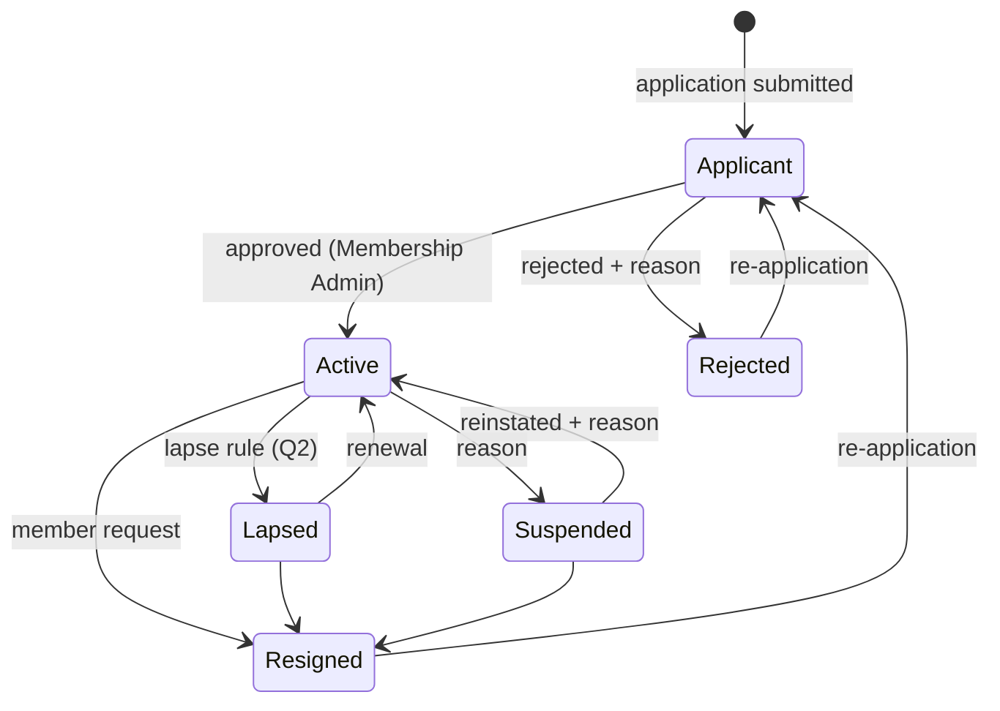
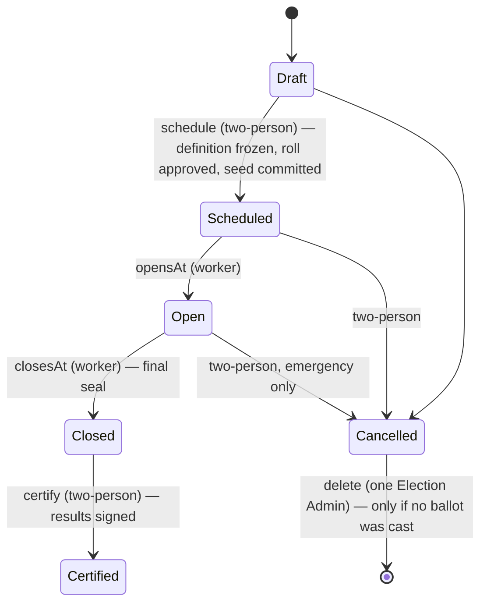
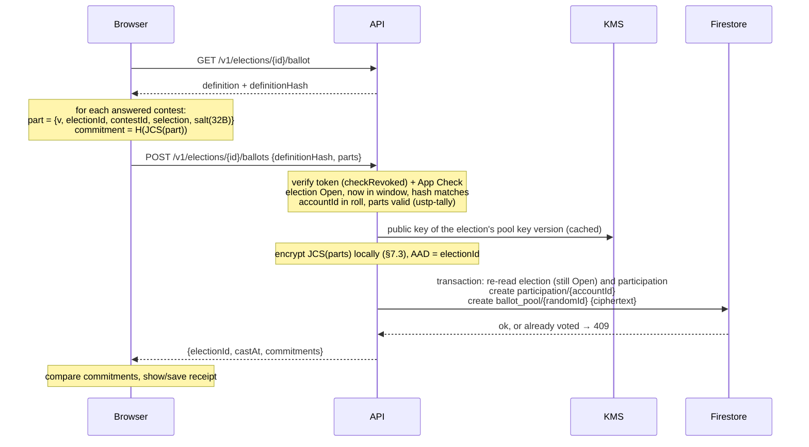

# USTPVote2 — System Design

| | |
|---|---|
| Status | Draft v0.1 — for review by USTP stakeholders |
| Date | 2026-10-20 |
| Source | [Standalone Technical Specification](spec/USTP-Standalone-Technical-Specification.docx) ([text](spec/technical-specification.md)) |
| Scope | Everything in spec §1.1 (V1). Section numbers below are this document's own; "spec §N" refers to the source. |

This document turns the standalone specification into an implementable design: concrete data layouts,
algorithms, trust boundaries and interfaces. Where the spec is silent or ambiguous it proposes an answer and
marks it; decisions that belong to USTP (bylaws, policy) are collected in [§18 Open questions](#18-open-questions).

---

## 1. Goals, non-goals, principles

### Goals
1. Run USTP member registration and organizational elections for 1,000–5,000 members inside one GCP project
   per environment, within free tiers (spec §8: ≈ $0.30–$0.60/month).
2. **Independent verifiability.** Anyone holding the public record can check that (a) the published ballots are
   exactly the ones tallied, (b) the tally is correct, (c) the record was not rewritten after the fact, and a voter
   can check (d) that their own ballot is included.
3. **Secret ballot** (per election) against members, observers, administrators and anyone with database read
   access. See [§2](#2-threat-model-and-trust-assumptions) for the precise boundary.
4. **Separation of duties**: no single administrator can approve a roll, certify a result or end a term of office
   alone.

### Non-goals for V1
- Cryptographic end-to-end verifiability that removes trust in the server at cast time (homomorphic tallying,
  verifiable mixnets). The design leaves room for it but does not attempt it.
- Coercion resistance / receipt-freeness (see [§7.5](#75-receipts-and-voter-verification)).
- Multi-seat ranked methods (STV), write-in candidates, weighted votes, proxy voting, vote changes after casting.

### Principles
- **The server is the only writer.** Firestore and Storage rules deny all client access; every read and write goes
  through the API with ID-token + App Check verification.
- **Everything that matters is a canonical object with a hash.** RFC 8785 (JCS) → UTF-8 → SHA-256, lowercase hex.
- **Determinism.** The same inputs produce a byte-identical results bundle on any machine.
- **Pure core, thin adapters.** Counting, hashing, state machines and role rules live in I/O-free packages
  (`ustp-tally`, `ustp-audit`, `ustp-domain`) that run unchanged in the API, the worker, the browser `/verify` page
  and a third party's laptop. GCP code is a thin layer around them.
- **History is append-only.** History collections are never updated or deleted by application code, and the ledger
  hash chain makes any out-of-band edit detectable.
- **Least privilege per service.** The API and worker run as different service accounts with disjoint KMS rights.

## 2. Threat model and trust assumptions

| Adversary | Can | Cannot (by design) | Controls |
|---|---|---|---|
| Outside attacker | Call public endpoints | Read member data, cast ballots | ID token + App Check on every call; rules deny direct DB access |
| Voter | Vote once, see own receipt | Vote twice; vote without being on the frozen roll | `transaction.create()` on `participation/{accountId}`; roll check in the same request |
| Member / public observer | Read published blocks, results, anchors | Link a ballot to a voter | Sealed blocks carry no voter IDs, ordered by random commitment, ≥ k ballots each |
| Firestore reader (insider with DB access, leaked backup/export/PITR) | See *who* voted and when | See *how* anyone voted, during or after the election | Pool entries are KMS-encrypted; pool key version destroyed after certification ([§7.3](#73-ballot-pool-encryption)) |
| Single administrator | Act within their role; a System Admin can grant or revoke any role, System Admin and Auditor included, alone; a Membership or Election Admin can define or change an office alone | Approve their own request; certify, freeze a roll or end a term of office alone; change their own roles; change roles or offices unrecorded | Two-person rule; role and office changes in the ledger ([§10](#10-administration-and-separation-of-duties)) |
| Anyone with write access to the DB | Edit documents out of band | Do so undetected | Ledger hash chain, KMS-signed blocks, WORM anchors in Bucket Lock ([§8](#8-audit-ledger-hash-chain-merkle-blocks-anchors)) |
| GCP project owner / deployer | Deploy new code, change IAM | Rewrite already-anchored history | Bucket Lock; recommended public mirroring of anchors; Binary Authorization; reviewed deploys |
| Release workflow (GitHub Actions as `ustp-release`) | Build, attest and run any code on `main` | Change IAM, read Firestore, use the signing or ballot-pool keys; run from another branch or workflow | Workload Identity Federation bound to `release.yml` on `main` in one GitHub environment; required reviewers on staging and production; pull-request review of `main` ([§15](#15-environments-deployment-cost)) |
| **Compromised API service** | **See ballot contents with voter identity at cast time; cast for eligible non-voters** | — | Code review, reproducible builds, Binary Authorization, minimal human access, post-election participation check |

**Residual trust, stated plainly:** in V1 the API process sees the voter's identity and the ballot in the same request.
Secrecy and cast-time integrity therefore rest on the API code being the reviewed code and on nobody being able to
inspect the running process. Everything *after* the cast — storage, sealing, publication, tallying, certification — is
verifiable without trusting the operators. Spec §9's "fully consistent" privacy evaluation holds under this assumption.

Ballot stuffing by a compromised API is bounded by the roll and is detectable: after close, auditors (and, if USTP
chooses, members) can see the participation list and any member can report "I did not vote but am listed".

**Invariants an auditor can check from the record** (checked by the `ustp-verify` CLI, §16, as far as public data allows):
1. ballots in sealed blocks = participation records ≤ roll entries, and every participant is on the roll;
2. every sealed block's Merkle root and hash recompute, and each appears in the ledger;
3. the ledger hash chain is unbroken, every ledger block's signature verifies, and the anchors match;
4. re-running `ustp-tally` on the sealed blocks with the revealed tie-break seed reproduces the certified results hash.

## 3. Architecture

```mermaid
flowchart LR
  subgraph Browser
    WEB["web — Vue 3 + Quasar 2 SPA/PWA<br/>/register · /ballot · /verify · /admin"]
  end
  WEB -- sign-in --> IDP[Identity Platform]
  WEB -- "ID token + App Check" --> API["server: api<br/>Cloud Run"]
  API --> FS[("Firestore (default)")]
  API -- "pool public keys" --> KMS[Cloud KMS]
  API -- "normalized photos" --> GCSP[("GCS: photos (private)")]
  API -- "photo checks" --> VIS[Cloud Vision]
  API -- enqueue --> CT[Cloud Tasks]
  SCH["Cloud Scheduler<br/>tick / 1 min"] --> WK["server: worker<br/>Cloud Run"]
  CT --> WK
  WK --> FS
  WK -- "decrypt pool, sign blocks" --> KMS
  WK --> GCSA[("GCS: anchors<br/>Bucket Lock (WORM)")]
  WK --> SM[Secret Manager]
  WK --> SES[Amazon SES]
```



### 3.1 Components

| Component | Runtime | Responsibility |
|---|---|---|
| `apps/web` | Vue 3 + Quasar 2 on Vite, Firebase Hosting | Member, voter, verifier and admin UI. Computes ballot commitments and verifies Merkle proofs client-side with `ustp-audit`. |
| `apps/server` → **api** | Node 26 LTS, NestJS 12 on Fastify 5, Cloud Run service | All client-facing endpoints. Stateless. |
| `apps/server` → **worker** | Same image, different entrypoint, Cloud Run service (internal ingress, callable only by the Scheduler/Tasks invoker account) | Election clock, pool sealing, tally, ledger blocks, anchoring, email. |
| `packages/tally` (`ustp-tally`) | Pure TypeScript, zero dependencies | Ballot validation and deterministic counting for every contest type. Published publicly (spec §1.1). |
| `packages/audit` (`ustp-audit`) | Pure TypeScript, depends only on `@noble/hashes` | JCS, SHA-256, hash chains, RFC 9162 Merkle trees and proofs, ballot commitments, tie-break ordering. Isomorphic (Node + browser). Published publicly. |
| `packages/domain` (`ustp-domain`) | Pure TypeScript | The domain layer (§3.3): shared types, state machines, role rules, two-person checks, aggregate commands, Firestore path constants, sealed blocks, results bundles, and the receipt and results checks the browser, the CLI and the tests share. |
| `packages/verify` (`ustp-verify`) | Node CLI, depends only on `ustp-audit` and `ustp-domain` | Independent verification from public artifacts only (§16). |

**Why one server package with two entrypoints:** the API and worker share Firestore repositories, KMS adapters and
domain logic. One package and one container image keep them in lockstep; two Cloud Run services with different
service accounts keep their privileges apart.

**Why the worker is a Cloud Run *service*, not a Job:** a once-per-minute tick as a Cloud Run Job execution pays
container start-up every minute (≈ 1,440 executions/day) and would exceed the 180,000 vCPU-second free tier. An
HTTP-triggered, request-billed service handles a tick in well under a second and scales to zero between elections.
All periodic work runs off **one** Cloud Scheduler job per environment (Cloud Scheduler gives 3 free jobs per billing
account — one per environment). One-off work (photo checks, emails, tally) goes through Cloud Tasks.

### 3.2 Repository layout

```
apps/server        NestJS on Fastify — src/main-api.ts, src/main-worker.ts
apps/web           Vue 3 + Quasar 2 SPA/PWA
packages/tally     ustp-tally   (public)
packages/audit     ustp-audit   (public)
packages/domain    ustp-domain  (internal)
packages/verify    ustp-verify  independent verifier CLI (public)
infra/firebase     firestore.rules, storage.rules, indexes (firebase.json at the root: hosting, emulators)
infra/terraform    project, IAM, KMS, buckets, Cloud Run, scheduler, Binary Authorization (see its README)
docs/              this design, the domain model (DOMAIN-MODEL.md), the source spec, ADRs
```

Toolchain: npm workspaces, TypeScript 6 (ESM, `nodenext`), Vitest, Vite 8 with `@quasar/vite-plugin`.
Builds use the committed lockfile with `npm ci --ignore-scripts` (spec §7).

### 3.3 Domain structure

The code follows domain-driven design: bounded contexts that match this document's sections, each owning its
collections, with the rules in the pure core and the GCP code around them. [DOMAIN-MODEL.md](DOMAIN-MODEL.md) holds
the context map, the aggregates and their invariants, the ubiquitous language and the migration path; contexts move to
this structure one at a time, without changing routes, documents or the ledger.

| Context | Sections | Owns |
|---|---|---|
| Accounts & identity | §4 | `accounts`, `account_identities`, `sign_in_methods` |
| Membership | §5.1–5.3 | `members`, `member_status_history`, `applications`, `profile_photos`, `photo_checks` |
| Bylaws | §5.2, §5.4, §6.6 | `bylaws_versions`, `bylaws_checks`, `bylaws_check_references` |
| Elections | §6, §7, §9 | `elections/**`, `eligibility_snapshots`, `proposal_snapshots`, `results` |
| Offices | §6.4 | `positions`, `position_terms` |
| Governance | §10 | `role_assignments`, `approval_requests`, `testing_personas` |
| Audit ledger | §8 | `audit_events`, `ledger_head`, `blocks`, `anchors`, `signing_keys` |

**Layers.** Records stay plain data (Firestore stores them, JCS hashes them, the browser reads them), so an aggregate
is its record types plus pure functions in `ustp-domain`:

- **Domain** (`packages/domain/src/<context>/`): records, rule checks and *commands*, such as
  `decideApplication(...)`, that take the current records and a request and return an `Outcome`: the next records and
  the domain events, or a refusal saying why and of what kind (`forbidden`, `not_found`, `conflict`, `rate_limited`).
  No I/O and no clock: the time comes in as an argument. The ledger entries are the domain events (`LedgerEvent`, §8.2).
  The package keeps one entry point; the folders only organise it.
- **Application** (`apps/server/src/<context>/*.service.ts`): authorise the caller, open the transaction, load through
  repositories, run the command, append its events to the ledger and save, in that order (Firestore reads come before
  writes). `assertCheck` and `accepted` turn a refusal into the HTTP status it has always had (409 by default).
- **Infrastructure** (`*.repository.ts`, `infra/`): one repository per aggregate, which alone knows its collection
  paths; the KMS, Secret Manager and Vision adapters.
- **Interface**: the controllers and worker routes of §12 and §13, unchanged.

**Ports.** A context publishes a small read or command interface for the others, called inside their transaction
where they need it, and keeps its repositories to itself. `apps/server/src/boundaries.test.ts` fails if code outside a
converted context names its collections or imports its repositories; the API module registers each context's
providers from its `providers.ts`.

**Converted so far: Membership** (members and applications). `ustp-domain/membership/` holds the member-status
machine, the application rules, the records, the Member aggregate (`memberStatusTransition`, `resignMembership`,
`changeMemberStatus`, `testVoterAdmission`) and the MembershipApplication aggregate (`submitApplication`,
`decideApplication`). In the server, `MemberRepository` and `ApplicationRepository` store them, and `Members` and
`MembershipApplications` are the application services. Elections take the roll's Active members, accounts and testing
show statuses and photos require a member record through the `MemberDirectory` port; testing admits a voter persona
through `Members`. Bylaws versions are still served by `MembershipService` until the bylaws context is split out.

**The web app** follows the same contexts ([DOMAIN-MODEL.md](DOMAIN-MODEL.md) §7). The root of `apps/web/src` holds the
app shell (router, layout and menu, the admin console that composes each context's panels, PWA), the client kernel
(`api.ts`, `session.ts`, `firebase.ts`, `acting.ts`) and the UI kit (`a11y.ts`, `dialogs.ts`, `forms.ts`, the CSS);
each converted context has a folder with its typed client (`api.ts`, the only place its routes are written), its pages
and panels, and its wording. The browser runs `ustp-domain`'s rules to offer only what the API will accept and keeps
no copy of its own; `apps/web/src/boundaries.test.ts` fails if a context's routes appear outside its client. Converted
so far: `membership/` (the Register page and the Applications and Members panels; the status changes the Members panel
offers come from `adminStatusChanges` in `ustp-domain`).

## 4. Identity and accounts

- **Account ID.** Every person gets a USTP-minted UUIDv7 `accountId` (spec §3). Everything — rolls, roles,
  status history — keys on `accountId`, never on an Identity Platform `uid` or email. UUIDv7 embeds the creation
  time in milliseconds; that is acceptable (not secret) and makes IDs sortable.
- **Identities.** `account_identities/{uid}` maps an Identity Platform user to an `accountId`, so each request
  resolves in one read. One account may have several identities; an identity belongs to exactly one account.
- **Providers.** Google, Microsoft, Apple, passwordless email link, and email/password. The admin "auth switches"
  (`sign_in_methods`) are enforced by the API: a token whose `firebase.sign_in_provider` is switched off is refused,
  which takes effect within a minute (switches are cached for 60 s per instance) without changing Identity Platform
  configuration. Email link and email/password both report the provider `password`, so the API switch covers both;
  choosing between those two is Identity Platform configuration. Tokens from any other provider (custom, anonymous,
  phone) are always refused. At least one provider must stay on, and an admin cannot switch off the provider they are
  signed in with (self-lockout).
- **First sign-in.** `POST /v1/accounts` creates `accounts/{accountId}` and `account_identities/{uid}` in one
  transaction (`create`, so a race cannot mint two accounts for one uid). In the web app a new login is made as the
  first step of registering (§5.2), not on the sign-in page.
- **Portability.** To add a login method the member, while signed in, also signs in with the new method and the client
  sends both ID tokens; the API links the second uid to the same account if that sign-in is under 5 minutes old and the
  uid has no account of its own. The last login method cannot be unlinked. Linking and unlinking are ledgered. Losing
  every login method requires Membership-Admin-assisted relinking with a written reason (not yet built).
- **Passwords (NIST SP 800-63B-4).** Minimum 15 characters (the single-factor minimum, applied to everyone), at least 64
  allowed, no composition rules, no forced rotation, breached-password screening, rate-limited attempts. Identity Platform
  enforces length; the browser screens against breached passwords before creating the account (Q9): it sends only the
  first 5 hex digits of the password's SHA-1 to Have I Been Pwned's range API, with padded responses, and refuses any
  password found there. If that service is unreachable sign-up goes ahead, since Identity Platform never exposes the
  password to our code for a later check.
- **Bot resistance at sign-up and sign-in.** Identity Platform's reCAPTCHA Enterprise integration is enforced for
  email/password sign-up, sign-in and email links, blocking scores at or below 0.3 (the web SDK preloads its
  configuration and attaches a bot-score token; the emulator has none). Identity Platform creates its own reCAPTCHA
  keys, which requires its service agent with `roles/identitytoolkit.serviceAgent`; new projects lack both, and without
  them the public reCAPTCHA config answers 500 and enforced email/password sign-in fails, so the rollout is service
  agent, then audit, then a check that the config answers with a key, then enforce. Email-enumeration protection is
  on, so a wrong password and an unknown address get the same answer; Identity Platform's per-IP sign-up quota
  applies. Behind that, every api request needs an App Check token (reCAPTCHA Enterprise), applying needs a verified
  email, applications are capped per account (§14) and a person decides each one. These settings are API-only, with no
  console switch for email/password (infra README "Identity Platform").
- **MFA.** Required for every admin role: admin endpoints reject tokens without `firebase.sign_in_second_factor`
  (problem type `/problems/mfa-required`), and approvals additionally require `auth_time` within the last 15 minutes
  (`/problems/reauth-required`; the web app re-authenticates and retries once). `GET /v1/me` reports `mfa.required`
  (holds a role and the policy is on) and `mfa.signedInWithMfa`.
  - The second factor offered is an **authenticator app (TOTP)**: set up on the Account page from a QR code (or typed
    key), then a 6-digit code after the first step of every sign-in and re-authentication. **SMS is not offered**:
    NIST SP 800-63B-4 treats it as a restricted authenticator, and Identity Platform bills per message.
  - **Deployment prerequisite:** TOTP must be enabled in each Identity Platform project with
    `adjacentIntervals: 5`. Terraform does this (`infra/terraform/modules/ustpvote/identity.tf`), together with the
    sign-in methods and authorized domains; the password policy and the Google, Microsoft and Apple providers stay
    manual (infra README "Identity Platform").
  - The Auth emulator does not support TOTP, so integration tests use SMS factors enrolled directly in the emulator to
    obtain real second-factor tokens; the server only checks that a second factor was used. The TOTP-specific browser
    steps can only be exercised against a real project.
  - An `account_factors` mirror for reporting is not built; Identity Platform holds the enrollments.
- **Request authentication.** `Authorization: Bearer <ID token>` and `X-Firebase-AppCheck: <token>`, both verified
  with the Firebase Admin SDK by a global guard; routes opt out only with `@Public()`. Admin routes declare their
  roles with `@Roles(...)`, which also requires MFA and verifies with `checkRevoked` (as will casting a ballot).
- **Safety switches.** `APP_CHECK_ENFORCED=false` and `ADMIN_MFA_REQUIRED=false` exist for local development and
  integration tests; the server refuses to start with either unless the Firestore and Auth emulators are configured.
  The emulator stand-ins `PHOTO_CHECKER=local`, `SECRET_STORE=emulator`, `AUDIT_SIGNER=emulator` (a local P-256
  key kept in Firestore) and `BALLOT_POOL=emulator` (local RSA keys) are refused the same way.
- **Bootstrap.** Emails listed in `BOOTSTRAP_SYSTEM_ADMIN_EMAILS` become System Admins once their account exists and
  the email is verified (checked on every `POST /v1/accounts`, which the web app calls on each sign-in and after
  verification; ledgered with actor `bootstrap`). An account that has ever held the role is never re-granted, so a
  revocation sticks. One is enough, since a System Admin grants roles alone (§10.2); remove the setting once real
  admins exist.

## 5. Registration

### 5.1 Member status



Every transition writes, in one transaction, the new status on `members/{accountId}`, an append-only
`member_status_history` entry and a ledger entry. Admin-initiated transitions require a non-empty written reason
(spec §9, due process). The allowed transitions are defined once in `ustp-domain`.

### 5.2 Applications, bylaws, address

- **One flow in the web app.** Registering starts on the Register page and runs in three steps, shown at the top of
  the page: create your login, apply, membership review.
  1. *Create your login* (signed-out visitors): Google, Microsoft or Apple, or an email address and password (§4
     password rules and bot resistance). A password sign-up sends the verification email, whose link leads back to
     Register. Someone who already has a login follows "Sign in" and returns to Register afterwards. The sign-in page
     itself only signs people in (email and password, or an email link, plus the federated buttons) and sends newcomers
     to Register; a sign-in there to an account with no membership also lands on Register.
  2. *Apply*: as soon as the account exists the page shows the bylaws and the application. A person whose address is
     not verified yet fills it in while the verification email is on its way; a note above the form says so and can
     send the link again. The page reloads the sign-in when the person comes back to the tab, and Submit checks that
     the ID token says the address is verified (forcing a fresh token once if not) before sending, so an unverified
     submit is stopped in the browser with the answers kept. The api still refuses any application from an unverified
     address.
  3. *Membership review*: the submitted application's status, until a Membership Admin decides it.
- **Who sees what.** The web app's menu shows the same four links to everyone, signed in or not: Register, Ballot,
  Verify and Admin; each page tells people it is not for what they can do instead. On Register, signed-out visitors
  start at step 1, and people who may apply (no membership, or a rejected or resigned one: `mayApply` in
  `ustp-domain`) at step 2. An applicant sees step 3. An Active, lapsed or suspended member sees their status instead
  of the form, and what can change it: a Membership Admin renews a lapsed membership or reinstates a suspended one,
  and the member can resign on the Account page. Ballot needs a sign-in, and someone on no current roll is told why
  from their membership status (not a member yet, an applicant, lapsed or suspended, or Active but on no roll).
- `applications/{applicationId}` stores the answers, the bylaws version accepted and that version's content hash
  (`bylaws_versions/{version}`), so it is provable which text the applicant agreed to. An application is accepted
  only against the *current* bylaws (version and hash must both match) and only from a verified email address.
  Bylaws versions are published by a Membership Admin, are immutable, and are ledgered.
- Amending the bylaws means publishing the next version. A Membership Admin drafts it in Admin → Bylaws from the
  current text, from a Word document (the browser reads the `.docx` and writes out Word's automatic numbering, such
  as "Article IV." or "2.3", so the text keeps it), or blank; edits it line by line or as a whole; reviews a line
  diff against the current version; and publishes it with a change note. The version records `amends` (the version it
  started from) and the api refuses it unless that is still the current version, so two drafts cannot silently
  overwrite each other; `bylaws.published` ledgers `amends` too. While an election whose proposals amend the current
  version (§6.6) is scheduled, open or closed, publishing is refused (409) until it is certified or cancelled.
- Any version can be downloaded as a stamped Word copy for passing around: a stamp block (party, title, version,
  publish date, amended version, change note, SHA-256 of the text, where to check it), the version and hash in every
  page header, and "page X of Y". The public page `/bylaws/{version}` shows the text, hash, change note and changes
  from the version it amends, and "Check a copy" reads a `.docx` in the browser and says which published version, if
  any, its text matches by SHA-256 (the stamp block is a separate paragraph style, so it is not part of the text).
  The published text and hash remain the record; a Word copy is a convenience.
- **Bylaws check (advisory):** while drafting, a Membership Admin can ask Claude whether the draft contradicts the US
  Constitution, Transhumanist principles or the USTP Constitution, for the whole draft or only the lines changed since
  the version it amends. It never blocks publishing, decides nothing and is not ledgered. See [§5.4](#54-bylaws-check).
- The application asks for: legal and preferred name; date of birth (at least `MINIMUM_MEMBER_AGE`, 18 until USTP
  decides Q17); two attestations (that minimum age, and support for the USTP platform); state, city and US ZIP code
  (never a street address); an optional phone number (stored as E.164); optional statement, interests, skills, how they
  heard about USTP, and wishes to volunteer or run for office; and opt-ins to the newsletter and to announcements, each
  stored with the time consent was given. The browser and the api apply the same schema, the api with its own clock.
- Data minimization: the date of birth stays on the application, for the Membership Admin's review, and is never
  copied to `members/{accountId}`; the member record gets only what membership uses afterwards (name, state, city, ZIP,
  phone, and the consents). Members who applied before these fields have `contact` and `communications` null.
- Separation of duties within membership: an admin cannot decide their own application or change their own status.
  Status changes other than application decisions (suspend, reinstate, lapse) use a separate endpoint so an
  application can never be bypassed.
- **Member profiles.** A Membership Admin opens any member from the Members or Applications tab:
  `GET /v1/admin/members/{accountId}` gives the member record, every application the account made with all its
  answers (date of birth included, as it is for the review), and the status history. The profile page shows them, with
  Change status and Correct details. Opening a profile is not ledgered or logged, like every other admin read. System
  Admins do not see profiles: their People list stays as in §10.3.
- **Changing details after joining.** The record keeps what membership uses, and it changes in two ways, each ledgered
  as `member.details_changed` with the names of the fields that changed (`legalName`, `contact.phone`,
  `communications.newsletter`…) and never their values, since the ledger cannot be erased:
  - *The member*, on their Account page (`POST /v1/me/details`): preferred name, state, city, ZIP, phone, and the two
    email opt-ins. An opt-in keeps the time it was first given; withdrawing it clears it. Not the legal name.
  - *A Membership Admin*, on the profile (`POST /v1/admin/members/{accountId}/details`): legal and preferred name,
    state, city, ZIP and phone, with a written reason; never the opt-ins, which are the member's to give, and never
    their own record.

  Both use the application's rules for the fields they share (`ustp-domain`), and a change that changes nothing is
  refused. The applications themselves are never edited: they stay the record of what was agreed to.
- **Address minimization:** the street address is used once to look up state/district, then discarded — never
  written to Firestore, logs or task payloads. Only the derived `state` / `district` are stored. The lookup provider is
  open (Q8).

### 5.3 Profile photos

Optional, for members with a membership record (applicants included).

1. **Upload through the API:** `PUT /v1/me/photo` with the raw image as the body (`image/jpeg`, `image/png` or
   `image/webp`, at most 5 MB; anything else is 415/413).
2. **Normalize:** the API decodes it with `sharp` (rejecting anything that is not really an image of those formats, or
   smaller than 200×200), applies EXIF orientation, shrinks it to at most 1024 px, and re-encodes it as JPEG. This
   drops all metadata: GPS location, camera serials, embedded thumbnails, anything hidden in the original bytes.
3. **Check, inline:** Cloud Vision `FACE_DETECTION` (face count, detection confidence, blur and under-exposure
   likelihoods) and `SAFE_SEARCH_DETECTION`. `photoVerdict` in `ustp-domain` turns the signals into `pass` or `flag`
   with plain-language reasons (no face / more than one face / face not clearly visible / blurry / too dark / may be
   inappropriate, at `LIKELY` or above). Recorded in `photo_checks/{checkId}`.
4. **Store:** the normalized JPEG goes to the private photos bucket (`PHOTOS_BUCKET`) at
   `profile-photos/{accountId}/{photoId}.jpg`; `profile_photos/{photoId}` is `accepted` (passed) or `needs_review`
   (flagged). A new upload marks the previous photo `superseded` and deletes its image.
5. **The machine never rejects.** Flagged photos go to the Membership Admin queue (`GET /v1/admin/photos`); only a
   person accepts or rejects, with a written reason, ledgered as `photo.decided`. Rejecting deletes the image; the
   member sees the reason. Admins cannot decide their own photo. Members can remove their photo at any time.
6. No face recognition or matching is performed, no face embeddings are stored, and images are only ever served to
   the member and Membership Admins through authenticated API routes (never public URLs).
7. **What the member sees:** the web app shows the chosen photo before uploading it (full and as the square it will
   appear in, with what the check looks for), and afterwards the photo, which opens larger, with the check's outcome
   in words: passed (one clear face, in focus, well lit), or what it found (`PHOTO_FLAGS` in `ustp-domain`) with a
   tip for each finding, or a reviewer's reason.
8. **Taking the photo with the camera:** phones and tablets open their own camera app (a file input with
   `capture="user"`); computers with a camera get a live, mirrored preview (`getUserMedia`, front camera, no audio)
   that runs only while its window is open, and the photo taken is not mirrored. Either way the photo goes through
   the same review and upload; nothing leaves the browser before that. Hosting already allows the camera for the
   site's own pages (`Permissions-Policy: camera=(self)`).

With the emulators there is no Vision API, so a local stand-in (`PHOTO_CHECKER=local`, refused outside the emulators)
assumes one clear face and flags only dark images, so the review flow can be exercised. Deployment needs: the
`PHOTOS_BUCKET` (private, uniform bucket-level access), the Vision API enabled, and the api service account allowed
to read, write and delete objects in that bucket.

### 5.4 Bylaws check

An advisory review of a bylaws draft by an AI model (Claude, by Anthropic), added at USTP's request, which flags lines
that may contradict one of three references and says why. It is a reading aid for the Membership Admin: it can miss
conflicts and flag ones that are not there, and nothing depends on its answer.

**References.** What a finding can name as the conflicting source:

| Source | Text the model is given | Where it comes from |
|---|---|---|
| US Constitution | The Constitution and Amendments I–XXVII, the National Archives transcription | Vendored as a dated snapshot (`apps/server/src/bylaws-check/us-constitution.ts`, 2026-10-22, with its URLs and SHA-256); public domain and unchanging |
| Transhumanist principles | Article I of the USTP Constitution ("Immutable Principles": Core Ideals, Statements of Historical Fact, Immutable Operating Principles) and the Transhumanist Bill of Rights, Version 3.0 (adopted by USTP members in December 2018) | The party's own statement of its principles on transhumanist-party.org: the constitution's Article I, and `/tbr-3/` |
| USTP Constitution | The rest of the Constitution of the United States Transhumanist Party (Articles II–IX, the Platform in Article VI included) | transhumanist-party.org/constitution/ |

"Transhumanist principles" is pinned to those two party texts rather than to transhumanism at large, because they are
what USTP itself adopted and publishes as its principles (its Values page quotes the Core Ideals and the Platform). The
party's pages are read by the worker at check time, through the site's WordPress REST API (the page body without the
theme), and cached in `bylaws_check_references/{id}` for 24 hours; if the site cannot be read, an older cached copy is
used, and with none the check fails. They are not copied into this repository: the party amends them (the constitution
last in March 2025; the page was updated in September 2026), and the site marks them "All Rights Reserved". Every check
records which text it used: URL, when it was read, the page's last-modified time and the SHA-256 of the text sent.

**Flow.** A review of a whole draft plus about 55,000 tokens of references takes a minute or two, longer than Firebase
Hosting's 60-second limit on an api request, so it runs in the worker:

1. `POST /v1/admin/bylaws/checks` (Membership Admin) with the draft's title and text, the version it amends and the
   scope (`draft`, or `changes`: lines added or changed since `amends`, computed by the api with the same line diff the
   editor shows). The api stores `bylaws_checks/{checkId}` as `queued` and answers 202. One check at a time per admin,
   at most `MAX_BYLAWS_CHECKS_PER_DAY` (20) per admin in 24 hours (409 and 429 otherwise); 503 when the check is off.
2. Every minute a Cloud Scheduler job of its own calls `POST /tasks/bylaws-checks` on the worker, which claims up to
   three queued checks in transactions (`queued` → `running`, so overlapping runs never review a draft twice), reviews
   them side by side and stores the findings (`done`) or the error (`failed`). A check still running after
   `BYLAWS_CHECK_TIMEOUT_MINUTES` (10) is marked failed. It is not a step of the tick, which must never wait on it.
3. The browser polls `GET /v1/admin/bylaws/checks/{checkId}` every 3 seconds until it is done or failed.

**The request to Claude.** Model `claude-opus-5-5` (`BYLAWS_CHECK_MODEL` overrides it) with adaptive thinking at effort
`high`, streamed, with a fixed system prompt, then the three references (one prompt-cache breakpoint after them, so
repeated checks within five minutes pay a small fraction for them), then the draft with every line numbered. For scope
`changes` the prompt names the lines to review and quotes the lines the draft removed. The system prompt defines the
three sources as above, asks only for contradictions (not style or omissions), points out that the US Constitution
mostly restrains governments rather than a private party, and says the bylaws and references are material, not
instructions. Structured output (a JSON schema) returns a summary and findings: lines, source, provision (as the
reference numbers it, e.g. "Article V, Section II"), severity (`high` plain contradiction, `medium` likely, `low`
tension) and a plain-language explanation. The worker keeps only findings that name real lines (and, for `changes`,
involve a changed line), most severe first. `fallbacks: "default"` lets the API retry a request its safety classifiers
decline on Anthropic's recommended fallback model; the record names the model that answered. A refusal, a truncated
answer or an API error fails the check with that reason.

**In the editor.** Flagged lines get a bar down their left edge and a worded label ("Finding 2") with a flag icon,
plus hidden text naming the severity and source; the edit button says "(flagged)". The findings list gives each one's
severity in words, source and provision, explanation and buttons that jump to its lines. A line edited after the check
loses its highlight and the finding says so. Nothing about the check is shown on the public bylaws pages.

**Without Anthropic.** There is no Anthropic emulator, so with the emulators `BYLAWS_CHECKER=stub` (the default there,
refused outside them) runs a deterministic stand-in that flags three test phrases ("religious test", opposing "life
extension", "without a vote of the members") and reads no references; CI and local development use it. A real
project has `BYLAWS_CHECKER=off` until it is switched on (`bylaws_check_enabled` in Terraform), which sets it to
`claude` on both services and gives the worker `ANTHROPIC_API_KEY` from the Secret Manager secret
`anthropic-api-key`. Only the worker holds the key; the internet-facing api never does.

**Cost and privacy.** See §14 and §15. The draft text leaves Google Cloud for Anthropic's API; it is the party's own
working text, and the check sends nothing about who asked. USTP should agree to that before switching it on (Q18).

## 6. Elections

### 6.1 Lifecycle



Spec §4 lists Draft → Scheduled → Open → Closed → Certified. This design adds **Cancelled** and makes
**scheduling** a two-person action, because freezing the contest rules matters as much as freezing the roll.

**Draft → Scheduled** (implemented in M2b): the Election Admin's request carries the current `definitionHash` and the
approved roll. When the Auditor approves, the server **recomputes the hash from the stored contests, candidates and
proposal texts** and refuses if anything changed since the request (the Auditor approves only what they saw), re-runs
`validateDefinition` (voting must still open in the future), and checks the roll is still the approved one. A fresh
32-byte tie-break seed is generated and stored in Secret Manager under a new secret per attempt (Secret Manager is not
transactional; the election records `tieBreakSeedRef`, the secret's ID, for the attempt that committed). Only its hash
`tieBreakSeedCommitment` is published. One ledger entry, `election.scheduled`, records the definition hash, roll
root and count, seed commitment and voting window. From then on nothing in the definition or roll can be edited.
Planned: warn when the roll is too small for the anonymity threshold (roll < 3k).

**Scheduled → Open → Closed** (implemented in M3a, the worker's clock on every tick): for a scheduled secret election
the worker first creates its ballot-pool key version ([§7.3](#73-ballot-pool-encryption)) and records it as
`poolKeyVersion`. At `opensAt` it opens the election — only once that key is ready, and only if the stored contests,
candidates and proposal texts still hash to the frozen `definitionHash` (otherwise the tick fails loudly and the election
stays scheduled). At `closesAt` it closes it. Each transition re-reads the election in a transaction (an election
cancelled meanwhile is left alone, and overlapping ticks move it once) and ledgers `election.opened` (definition hash,
window, pool key version) or `election.closed`, with actor `system`.

**Closed → results** (implemented in M4a): once every ballot is sealed (`sealedAt`, §7.2), the worker tallies the
election on the same tick and publishes provisional, signed results ([§9](#9-tallying-ustp-tally)). The election stays
Closed until certification moves it to Certified.

**Closed → Certified** (implemented in M4b, two-person `election.certify`): an Election Admin who is not a candidate
requests certification of a closed election's provisional results; the request names their `resultsHash`, and is
refused before the results exist or when an office its contests fill does not exist. An Auditor who is not a candidate
approves; in the decision's transaction the server re-checks that the election is still Closed and the results are
still provisional with exactly that hash, marks the results `certified` (`certifiedAt`, `certifiedLedgerSeq`), moves
the election to Certified (`certifiedAt`), creates a term of office for every winner of a contest tied to an office
(§6.4), and ledgers `results.certified` (`electionId, resultsHash, approvalId, terms`) and one `position_term.created`
per term. On its next tick the worker destroys the election's ballot-pool key version (§7.3).

**Cancelling** a draft is a single Election Admin action; cancelling a scheduled or open election is two-person
(`election.cancel`, approved only if the election is still in the state it was requested from). Both are ledgered.

**Deleting** a cancelled election nobody voted in removes it for good (`POST /v1/admin/elections/{id}/delete`, with a
written reason). One Election Admin does it at once, as for cancelling a draft: not a candidate in the election, and
signed in within the last 15 minutes, since nothing can bring it back. In one transaction the server re-reads the
election and refuses unless `checkElectionDeletable` in `ustp-domain` passes: the election is Cancelled, it has no
participation records (no ballot was cast, whatever its state when cancelled; an approved roll does not count), and
the worker has destroyed its ballot-pool key version, which it finds only through the election (§7.3; within a minute
of cancelling). It then deletes the election document and everything under it (contests, candidates, and the empty
participation, pool and sealed-block collections), every voter roll snapshot of the election, and requests about it
that are still pending, and ledgers `election.deleted` (`electionId, title, reason`, the admin as actor). After the
commit it deletes the election's tie-break seed secret; a failure there is logged and leaves only an unused secret.
What stays: every ledger entry about the election (public ones such as `roll.approved`, `election.scheduled` and
`election.cancelled` still verify by their inclusion proofs, §8.2), decided requests (the record of who approved
what), and proposal texts, which elections share. The public record and the admin view answer 404 afterwards; the
verify CLI, asked about a deleted election, checks instead that its `election.deleted` entry follows its cancellation,
is its last entry, and that no entry records ballots sealed for it. The election editor offers Delete on a qualifying
cancelled election (the detail's `ballotsCast` says how many ballots were cast) and explains when it cannot. What it
gives up: an election that was scheduled, and perhaps opened, loses its published definition and roll; its ledger
entries still hold their hashes, so nobody can quietly rewrite what was scheduled, but the texts themselves are gone.

**Calendar event** *(added)*: `GET /v1/public/elections/{id}/calendar.ics` is the voting window as one iCalendar event
(RFC 5545, made by `votingCalendar` in `ustp-domain`): `UID` the election ID (a UUIDv7, as RFC 7986 recommends),
`DTSTART` `opensAt` and `DTEND` `closesAt` in UTC, `SUMMARY` "USTP vote: " and the title, the election's description
and the ballot page's address in `DESCRIPTION`, the ballot page as `URL`, `DTSTAMP` the time it was made, and
`TRANSP:TRANSPARENT` so a week of voting does not show as busy. It is served for every election past its draft and holds
only what the public record shows, so it is one file for everyone: the link carries no credentials and says nothing
about who is on the roll. The ballot list and the ballot page link to it ("Add to calendar") while an election is
scheduled or open and the voter has not voted; the results page does not, since voting is over by then. The window is
frozen at scheduling and drafts are never published, so a downloaded event's times cannot go stale and `SEQUENCE`
stays 0. Cancelling is the one change: the event becomes `STATUS:CANCELLED` with `SEQUENCE:1`, which replaces the
earlier copy when the file is opened again, but a file already imported is not updated by itself. Once a cancelled
election is deleted, the file answers 404, like its public record. A feed a calendar subscribes to (every upcoming
election the voter is on the roll for) is not offered: it would need a secret URL per voter, and whoever holds that
URL, the calendar service included, would learn which rolls the voter is on.

### 6.2 Contests

One election = one ballot with any mix of contests (spec §1.1). Each contest is one of:

| `kind` | Covers (spec §1.1) | Selection on a ballot |
|---|---|---|
| `proposal` | Platform/bylaw proposals: Yes / No / Abstain, configurable pass rule and quorum | `"yes"` \| `"no"` \| `"abstain"` |
| `choose_n` | Plurality (seats 1, max 1), block (seats N, max N), approval (max = all candidates); optional support floor | array of candidate IDs (`[]` = blank) |
| `irv` | Single-seat instant-runoff | ranked array of candidate IDs, most preferred first (`[]` = blank) |

Voters may skip a contest (undervote). Rules are in [§9](#9-tallying-ustp-tally).

### 6.3 Roll snapshots

An Election Admin requests a snapshot (implemented in M2b): eligibility criteria (default: status `Active` at
`asOf`; see Q3), the sorted list of eligible `accountId`s, its count and a Merkle root over
`H(JCS({v: 1, electionId, accountId}))` (`rollMerkleRoot` in `ustp-domain`; a member can be given their own inclusion
proof). The snapshot is written to `eligibility_snapshots/{snapshotId}` as `pending` with a `roll.approve` request.
An Auditor (≠ requester, and not a candidate in the election) reviews the names and approves; the snapshot becomes
`approved`, the election points at it, any previously approved roll is `superseded`, and `roll.approved` is ledgered.
A rejected snapshot is marked `rejected`. The roll is frozen from then on: later status changes do not alter it (Q4).
Every roll entry carries equal weight.

**Rehearsal rolls** (testing mode only, §10.4): `POST …/roll` with `voters: 'test_voters'` snapshots only the Active
test voter personas, so a rehearsal's turnout and quorum are its own and not diluted by real members. Its criteria
are `{status: 'active', testVotersOnly: true}`, and that is recorded wherever the roll is: in the snapshot, in the
request's payload (so the payload hash the Auditor approves covers it), in the `roll.approved` entry that copies the
payload, in the roll statement the worker signs, and in the public record's `roll.criteria`. An ordinary roll keeps
exactly `{status: 'active'}` and has no `criteria` in its payload, so rolls already signed still verify. The api
refuses a rehearsal roll where testing mode is off (403), and so do the roll and schedule approvals, which check
again; with no Active test voters the request gets 409.

The snapshot document holds the whole sorted list, about 25,000 members within Firestore's 1 MiB document limit (the
spec's scale is 1,000–5,000); the casting check in M3 reads it once per instance (it never changes), so a separate
`roll_entries` collection is not needed until rolls outgrow one document.

**Signature** (implemented in M2c): on its next tick after approval, the worker signs
`rollStatement = {v, type: 'roll', electionId, snapshotId, criteria, asOf, count, merkleRoot, approvalId}` with the
`audit-signing` key ([§8.3](#83-ledger-blocks-blocksindex)) and stores it as the snapshot's `signature`. The api never
signs, so signing waits for the worker (≤ 1 minute); scheduling does not wait for it. A roll superseded before the
worker got to it is still signed, since it was approved.

### 6.4 Proposals and positions

- `proposal_snapshots` freeze the exact title and text of a proposal with its content hash
  `H(JCS({v: 1, title, body}))`, or for a bylaws amendment `H(JCS({v: 2, title, body, amendment}))` (§6.6); they are
  immutable, and a proposal contest points at one. V1 enters proposals in the
  admin console; an external source is Q6. The review that admits a text to the ballot is the Auditor's approval of
  the scheduling request, which covers the whole definition including every proposal's content hash; a separate
  `proposal_reviews` collection is not used.

### 6.5 The election definition (implemented in M2a)

Drafts are edited piecewise (election, contests, candidates). `buildDefinition` in `ustp-domain` assembles them into
one canonical object: election fields, then contests in order, each with its `ustp-tally` spec, its proposal's
snapshot ID and content hash, and its candidates in the order the spec lists them. `definitionHash = H(JCS(definition))`
is shown live in the editor and to Auditors, and `validateDefinition` lists what blocks scheduling (no contests,
voting not in the future, missing proposal text or candidates, any `ustp-tally` spec problem such as more seats than
candidates). Scheduling (M2b) freezes exactly this hash. Contest and candidate IDs are random Firestore IDs, which
fit the `ustp-tally` ID pattern. Only drafts can be edited.
- `positions` define offices (title, seats, term length). Certifying an election that fills an office creates
  `position_terms` that reference the certified results hash. Ending a term early is a two-person action. Implemented
  in M4b:
  - **Offices** (`positions/{positionId}`, a slug: `{title, description, seats, termMonths, definedAt, approvalId}`)
    are defined or changed by one Membership or Election Admin, at once and with a written reason
    (`POST /v1/admin/positions`; `position.defined` ledgered with that admin as actor and the reason; `approvalId`
    null). Changing an office does not touch terms already running. Until USTP chose otherwise, defining an office
    was `position.modify` with `{change: 'define', position}`, approved by an Auditor; requests made that way can still
    be decided until they expire (then `approvalId` names the request), and nothing creates new ones. What it gives
    up: one admin can create an office, or change its seats or term length, without a second person; the change is
    public in the ledger, and an election that fills the office is still frozen and approved by an Auditor at
    scheduling, and its results certified by one.
  - **Contests fill offices:** a candidate contest may name a `positionId` while the election is a draft (it must
    exist); it is part of the frozen definition, so the Auditor scheduling the election sees which office each contest
    fills. Proposals cannot fill an office.
  - **Terms** (`position_terms/{termId}`: holder name and account if the candidate had one, contest, election,
    `startsAt`, `endsAt`, `resultsHash`, `status`) are created only by certification: one per winner, starting at
    certification and lasting the office's `termMonths` (same day of the month, or its last day). Ending one early
    (resignation, removal) is `position.modify` with `{change: 'end_term', termId}`; the holder may neither request
    nor approve it (`position_term.ended` ledgered).
  - **Public:** `GET /v1/public/positions` lists the offices and their active terms; office holders are public, like
    the results they come from. Administrators see every term in the console's Offices tab.

### 6.6 Bylaws amendments

A proposal can change particular lines of the published bylaws, so members vote on exactly the words that change and,
once the election is certified, the amended bylaws follow from the result instead of being retyped.

**Format** (`ustp.bylaws-amendment` v1, `bylawsAmendmentSchema` in `ustp-domain`, JSON):

```
{ v: 1, base: { version, contentHash },
  changes: [ { op: 'replace', from, to, expect: [old lines], lines: [new lines] }
           | { op: 'insert',  after, anchor: line `after` | null, lines: [new lines] }
           | { op: 'delete',  from, to, expect: [old lines] } ] }
```

- **Lines** are those of the base version's text as stored (`splitLines`: `\r\n` and `\r` read as `\n`), numbered
  from 1, a trailing empty line after the final newline included: the numbering the bylaws editor shows (§5.2).
  Word's own paragraph or list numbering never defines them; a Word copy is only ever a picture of the text.
- **Quotes guard the base.** `replace` and `delete` quote every line they remove (`expect`), and `insert` quotes the
  line it follows (`anchor`, null for `after: 0`, the top). An amendment applies only to the version and hash it
  names, and only while every quoted line reads exactly as quoted.
- **Rules:** changes run top to bottom and do not overlap (an insert may come just before a change that starts at
  the same line, and two inserts at one point must be one insert); a range's quote covers it exactly; no line holds a
  line break; new lines carry no trailing whitespace (a Word round trip would drop it); at most 200 changes and
  300,000 quoted and new characters.

**Applying** (application v1, `applyAmendments`): every amendment must name the same base and fit it. Each change
becomes the base lines it consumes, `[start, end)` (empty for an insert), and its new lines; the changes of all the
amendments are merged in line order (an insert before a change starting at the same line) and applied in one pass, and
the lines are joined with `\n`. The result is the same in any order, and the same as splicing each change in from the
bottom up (both are tested). Two changes from different amendments **conflict** when they consume the same base line,
or an insert falls strictly inside another's lines, or both insert at the same point; adjacent changes do not, nor
does an insert right before or after another change. Conflicting amendments cannot be applied together.

**Showing:** `amendmentDiff` lists exactly the lines each change removes and adds (not a recomputed diff), with base
and amended line numbers and optional context; `amendmentText` says it in words ("Replace line 12: was … now …"), for
printed copies, screen readers and the verify CLI; `amendmentFromTexts` turns an edited copy of the base into an
amendment, one change per run of changed lines.

**In the record:**

- **The proposal** (`POST /v1/admin/proposals` with `amendment`) is a snapshot like any other, with the amendment
  stored on it and hashed with it: `H(JCS({v: 2, title, body, amendment}))`. `body` gives the reasons. Proposals
  without an amendment keep the v1 hash, and their snapshots have no `amendment` field.
- **The definition** names the base on the contest's proposal entry, `amendsBylaws: {version, contentHash}`. The key
  is present only on amendments, so every other definition hashes exactly as before; a golden test pins one.
- **The base must be current and the amendments must fit**, checked at each step:
  - writing the proposal: the base version exists, is the current one and every change fits it (400/409 otherwise);
  - adding or changing a contest that puts an amendment to the vote: the election's amendments share one base, it is
    current, their quotes still match, and none conflict (409 naming the contests);
  - the draft's `problems` list the same, so the editor shows them;
  - the scheduling request, and the Auditor's approval, which reads the current version again inside its
    transaction: the bylaws can change between request and approval, since a draft does not hold them.
- **Scheduling records the base** on the election (`amendsBylaws`, null when nothing is amended). While the election
  is scheduled, open or closed, publishing a new bylaws version is refused (409), so the lines members vote on stay
  the lines in force; certifying or cancelling it releases them.
- **The ballot** (`GET /v1/elections/{id}/ballot`) carries each proposal's amendment. The ballot page checks it with
  `ballotViewProblems`: the definition hash, each proposal's hash (v2 with the amendment) and that the amendment's
  base is the one the definition names; it lists any failure and blocks casting. It shows each amendment's changes in
  words (`amendmentText`) above the reasons, and the election editor shows them on the contest.

*Planned (in order):* after certification the passed amendments give the amended text (its hash in the
`results.certified` entry), downloadable as a draft .docx and published as the next version by a Membership Admin;
the verify CLI recomputes it; an editor for writing amendments line by line, with the changes shown as a line diff
and downloadable as JSON and .docx.

## 7. Ballot casting and secrecy

### 7.1 Cast flow (secret ballot)



Implemented in M3a (`VotingService`):

- **Voter endpoints:** `GET /v1/elections` lists the scheduled, open, closed and certified elections whose roll holds
  the caller, with `castAt` once they voted. `GET /v1/elections/{id}/ballot` returns the frozen definition, its hash
  and the proposal texts; the web app recomputes the hash and every proposal's `contentHash` in the browser before
  showing the ballot. Drafts and cancelled elections answer 404 to voters; anyone off the roll gets 403.
- **Checks at cast:** the token is checked for revocation (`@CheckRevoked`, as on admin routes); the election must be
  Open and the server clock inside `[opensAt, closesAt)`; the request's `definitionHash` must equal the frozen one, and
  the stored definition must still hash to it; at least one part, each for a different contest of this election, with
  a 32-byte hex salt and a selection `ustp-tally` accepts (400 otherwise). Skipped contests are simply absent.
- The approved roll is read once per api instance and kept in memory (it never changes, §6.3).
- The **participation** document's ID is the `accountId`. The cast transaction reads it and creates it, which is the
  duplicate-vote guard (spec §4); it also re-reads the election, so no ballot is accepted once a close has committed.
  For secret ballots it stores only `accountId` and server time.
- The **pool** document has a random server-generated ID and holds only ciphertext. No voter ID, no timestamp field.
- The cast endpoint never logs request bodies (Fastify does not log bodies; the logger redacts `authorization` and App
  Check headers).
- Planned with email (Amazon SES): the "you voted" email task carries `accountId` and `electionId` only — never
  commitments.

### 7.2 Sealer

Firestore records a commit timestamp on every document. The participation record and pool record of one vote share a
commit time, so anyone who can read the pool could link them. The sealer removes the pool records (spec §4, §7):

```
every tick, for each election in Open or Closed with pool entries:
  n = pool size, k = election.kAnonymity (default 10)
  Open:   if n >= 2k: seal a uniformly random (CSPRNG) subset of n - k entries, leave k in the pool
  Closed: seal everything (≥ k by construction whenever turnout ≥ k)
seal(entries):
  decrypt each (KMS); group parts by contestId; sort each group by commitment
  block = {v, electionId, index, prevSealedHash, ballotCount,
           contests: {contestId: [part...]}, merkleRoot: MTH(all commitments, sorted)}
  sealedHash = H(JCS(block))
  one transaction: create sealed_blocks/{index}; delete the sealed pool entries; append ledger entry
```

Implemented in M3b (`BallotSealer`, every tick after the clock):

- Each block is one transaction: it re-reads the chosen pool entries (if a concurrent tick sealed any of them, this
  one gives up), creates `sealed_blocks/{index}` (once per index), deletes those entries and ledgers `ballots.sealed`
  (`electionId, index, ballotCount, merkleRoot, sealedHash, prevSealedHash`). Overlapping ticks therefore cannot
  seal a ballot twice, and the `locks/tick` lease is not needed.
- Decryption (one Cloud KMS unwrap per ballot, 16 at a time) happens before the transaction.
- The stored record adds `sealedHash`, the sorted `commitments` (the Merkle leaves, kept so a receipt's block can be
  found with one `array-contains` query) and `ledgerSeq`.
- A batch larger than the cap is split evenly into blocks of at most `max(400, 2k)` ballots, so every block still
  holds at least k.
- When a closed election's pool is empty and the sealed ballots equal its participation count, the sealer ledgers
  `election.sealed` (blocks, ballots, last `sealedHash`) and sets `sealedAt`. An election nobody voted in is sealed
  with no blocks. A mismatch for a secret election would mean a lost ballot: it is logged as an error and the election
  is not marked sealed.
- **Contents are published only after close.** While voting is open, only block summaries (index, count, Merkle root,
  hash) and inclusion proofs are public, so nobody sees a running tally; `GET /v1/public/elections/{id}/sealed-blocks`
  answers 409 until the election is closed.

- Leaving k entries behind while open guarantees every block — including the last — holds ≥ k ballots, so a block's
  commit time narrows a voter down to no fewer than k candidates.
- **Ordering by commitment** instead of shuffling: commitments are salted hashes, so the order is unrelated to cast
  order, and the published order is canonical without trusting a shuffle.
- **Per-contest grouping**: parts of one ballot are not kept together in published blocks, which defeats linking a
  voter's choices across contests ("pattern voting"). Each part is verifiable on its own (§7.5).
- Blocks are capped at 400 ballots to stay well under Firestore's 1 MiB document limit.

### 7.3 Ballot-pool encryption

Not in the spec; added because the sealer alone does not stop someone reading the pool *while* it exists (a real-time
listener with database read access, or a backup / point-in-time-recovery copy).

Implemented in M3a:

- **Asymmetric KMS key `ballot-pool`** (`ASYMMETRIC_DECRYPT`, `RSA_DECRYPT_OAEP_3072_SHA256`, named by
  `BALLOT_POOL_KEY`); a **new key version per secret election**, created by the worker after scheduling. Unlike a
  symmetric key, whose encryptions always use the primary version, an asymmetric version can be addressed directly, so
  concurrent elections each get their own version.
- **Hybrid encryption** in the api: each ballot `JCS(parts)` is encrypted with AES-256-GCM under a fresh 32-byte data
  key, with the election ID as associated data (a ciphertext cannot be moved to another election's pool); the data key
  is wrapped with RSA-OAEP-SHA256 to the election's public key and then discarded. The pool entry is
  `{v, keyVersion, wrappedKey, iv, ciphertext, tag}`.
- **The api cannot decrypt at all:** it only reads public keys (`roles/cloudkms.publicKeyViewer`), and only of versions
  of the configured key, so an altered election document cannot point it at another key. Encryption needs no KMS call
  per ballot. The **worker** alone may create versions and decrypt (`cloudkms.cryptoKeyVersions.create`, `.get`,
  `.useToDecrypt`); the sealer (M3b) unwraps each data key through KMS. No human holds decrypt in production. KMS Data
  Access audit logs are on, so any decrypt is visible.
- After certification the election's key version is **destroyed**, and so are the versions of cancelled
  elections. Any copy of the pool in backups or PITR becomes permanently unreadable — forward secrecy for past elections.
  Implemented in M4b as a tick step (not a separate task): for every Certified or Cancelled election with a pool key
  and no `poolKeyDestroyedAt`, the worker destroys the version (Cloud KMS schedules it, restorable for the key's 24-hour
  window; a version already scheduled or destroyed counts as done), then sets `poolKeyDestroyedAt` and ledgers
  `election.pool_key_destroyed`. A Certified election's ballots are all sealed by then; a Cancelled one's are never
  counted. The public record shows `poolKeyDestroyedAt`.
- With the emulators, `BALLOT_POOL=emulator` keeps RSA-3072 key pairs in Firestore instead; the server refuses it
  elsewhere.
- Cost: one key version per election while it exists (a few cents a month), plus one KMS decrypt per ballot at sealing.

### 7.4 Open (roll-call) ballots

For `secrecy: "open"` elections the API writes the plaintext parts with the `accountId` into the participation
record (implemented in M3a); no pool key, no pool, no encryption. The ballot page tells voters their vote is published
with their name. The sealer still produces sealed blocks — parts carry `accountId` and are sorted by it
— so tallying, publication and verification follow one path for both modes. Nothing is secret, so roll-call ballots
are sealed once, at close (M3b): participation is frozen by then, so the chunks are the same on every attempt and blocks
already created are skipped.

### 7.5 Receipts and voter verification

- Before anything is cast, the ballot page checks in the browser that the ballot is the definition frozen at
  scheduling and that every proposal text, with any bylaws lines it changes, is the one the definition commits to
  (`ballotViewProblems` in `ustp-domain`; §6.6). A failure is listed and casting is blocked.
- The browser computes each part's commitment *before* sending, so the voter does not have to trust the server's
  echo, and shows whether the server's commitments match. The receipt (`BallotReceipt`: election, definition hash,
  cast time, the parts with their salts, the commitments) can be downloaded as a file, and kept in browser storage only
  if the voter switches that on (implemented in M3a). It is never sent back to the server.
- After the ballot is sealed, `/verify` fetches an inclusion proof for each commitment and checks, in the browser:
  RFC 9162 inclusion in the sealed block's Merkle root → the block's hash in the ledger → the ledger block's signature
  → the anchor object in the Bucket Lock bucket. Implemented in M3b: the receipt comes from browser storage, a
  downloaded file or a paste and never leaves the browser; only commitments are looked up
  (`GET /v1/public/elections/{id}/proofs/{commitment}`, then the `ballots.sealed` entry through
  `GET /v1/public/ledger/entries/{seq}`, the signing keys and the latest anchor). The checks themselves are
  `checkReceiptPart` in `ustp-domain`, so the integration tests run exactly what the page runs. Each step is shown as
  passed, failed or not yet possible (still in the pool; ledger block or anchor not written yet). The browser checks
  that the anchor *record* covers the ledger block; fetching the anchor object itself needs the bucket to be public
  (§8.4). Once voting has closed it also recomputes every published sealed block (`sealedBlockProblems`).
- **Trade-off:** salt + selection lets a voter *prove* to someone else how they voted (vote selling / coercion).
  This is inherent to this receipt design and accepted for V1, as in most organizational systems with receipts.
  Commitments are never emailed or stored with the voter's identity.

## 8. Audit ledger: hash chain, Merkle blocks, anchors

### 8.1 Canonical hashing
All hashed objects are RFC 8785 JCS-canonicalized, UTF-8 encoded and SHA-256 hashed, written as lowercase hex.
Every hashed object carries `v` (schema version). JCS input is restricted to I-JSON: finite numbers, well-formed
strings, plain objects and arrays — anything else is an error rather than silently coerced.

### 8.2 Ledger entries (`audit_events/{seq}`)

```
entry = { v, seq, type, at, actor, subject, payload, prevHash }   hash = H(JCS(entry))
```

- One global chain. Appending runs in a transaction on `ledger_head/main` (`{seq, hash}`): read head, write
  `audit_events/{seq+1}`, update head. Writes are rare (admin actions, ≤ one seal per election per minute), well
  under Firestore's per-document write rate. **Ballot casts never touch the ledger** — that would serialize voting
  and re-create the timing link the sealer removes.
- Genesis `prevHash` is 64 zeros.
- Entry types implemented in M1: `member.status_changed` (an application decision is a status change carrying the
  `applicationId`), `identity.linked`, `identity.unlinked`, `bylaws.published`, `role.granted`, `role.revoked`,
  `approval.requested`, `approval.decided`, `signin_method.changed`. Added since: `photo.decided`, `roll.approved`,
  `election.scheduled`, `election.opened`, `election.closed`, `election.cancelled` (M2–M3a), `ballots.sealed`,
  `election.sealed` (M3b), `results.computed` (M4a), `results.certified`, `election.pool_key_destroyed`,
  `position.defined`, `position_term.created`, `position_term.ended` (M4b), `election.deleted`, `member.details_changed` (M5). The authoritative list is
  `LEDGER_EVENT_TYPES` in `ustp-domain`.
- **Selective disclosure:** member-related entries contain personal data and are visible to Auditors only. Election
  entries are public. A public verifier checks a public entry by Merkle inclusion in its ledger block (§8.3) without
  seeing the private entries in that block. Public types (`PUBLIC_LEDGER_EVENT_TYPES`): `bylaws.published`,
  `roll.approved`, `election.scheduled`, `election.opened`, `election.closed`, `ballots.sealed`, `election.sealed`,
  `election.cancelled`, `election.deleted`, `results.computed`, `results.certified`, `election.pool_key_destroyed`,
  `position.defined`, `position_term.created`, `position_term.ended`.
  `GET /v1/public/ledger/entries/{seq}` returns a public entry with its block and inclusion proof; anything else, or an
  entry not yet in a block, is 404.

### 8.3 Ledger blocks (`blocks/{index}`)

Implemented in M2c. On each tick, if entries exist beyond the last block, the worker builds an RFC 9162 Merkle tree
over their 32-byte entry hashes and writes
`block = {v, index, prevBlockHash, firstSeq, lastSeq, merkleRoot, headEntryHash, createdAt}`, `blockHash = H(JCS(block))`
and `signature = {keyVersion, signature}`. Blocks and entries are numbered from 1; block 1's `prevBlockHash` is 64 zeros.
A block covers at most 500 entries and a tick seals at most 20 blocks, so a backlog clears over several ticks.

- **Signature:** ECDSA P-256 / SHA-256 over the bytes `JCS(block)`, DER-encoded, base64. Cloud KMS signs digests, and
  the digest of those bytes is `blockHash`, so KMS signs `blockHash`; anyone can check the signature with
  `openssl dgst -sha256 -verify key.pem -signature sig.der block.json` or Web Crypto (`verifyEcdsaP256` in
  `ustp-audit`). The key is `audit-signing` (`EC_SIGN_P256_SHA256`), named by `AUDIT_SIGNING_KEY_VERSION`.
- **Only the worker signs.** Its service account alone holds `cloudkms.signer` on the key; the api, which faces the
  internet, cannot sign, so compromising it cannot produce validly signed blocks. The worker records each key version's
  public key in `signing_keys/{keyId}` (keyId = first 16 hex digits of SHA-256(keyVersion)) and in the anchors bucket
  as `v1/keys/{keyId}.pem` on first use; the api serves them at `GET /v1/public/ledger/keys`.
- **Never sign a broken chain:** before sealing, the worker checks that the new entries are numbered without gaps and
  that their hashes and links verify onto the previous block's `headEntryHash`. If not, the tick fails loudly and
  nothing is signed.
- **Idempotent:** `blocks/{index}` is created, never overwritten. Two overlapping ticks compute the same index and only
  one create succeeds, so the `locks/tick` lease (§13) is not needed for blocks; it arrives with pool sealing in M3.
- **Verification** (`GET /v1/admin/audit/verify`, Auditors): the entry chain and head, then `verifyBlocks` (numbering,
  contiguity, links, Merkle roots, block hashes), every signature against `signing_keys`, and every anchor (§8.4).
  The Auditor console also checks each published block's link, hash and signature in the browser, without relying on
  the server's verdict; Merkle roots need the private entries, so that part is the server's.

A rewrite of sealed history by someone with database access, even one that re-links every later entry and the head,
fails the block's Merkle root; re-hashing the block too fails its signature.

Merkle trees follow RFC 9162 §2.1 exactly — leaf `H(0x00 ‖ d)`, node `H(0x01 ‖ l ‖ r)`, split at the largest
power of two below n, inclusion proof verification per §2.1.3.2 — so third parties can use existing tooling.

### 8.4 Anchors (spec §4 "External Anchoring")

- Implemented in M2c. Each new block is written as `gs://<bucket>/v1/blocks/<index, 12 digits>.json`, the JCS of
  `{v, block, blockHash, signature}`, to a bucket with a retention policy (`ANCHORS_BUCKET`), with
  `ifGenerationMatch: 0` so an object is only ever created. `anchors/{index}` records the URI and object generation.
  Blocks are anchored in order; if an object already exists (a retried tick), it must hold the same bytes.
- Verification downloads each anchor object and checks its content against the block and its generation against the
  record. `GET /v1/public/anchors/latest` returns the newest anchor record.
- Until `ANCHORS_BUCKET` is set, blocks are still sealed and signed, and the worker logs that it is not anchoring.
- **Smart anchoring** (spec §8): only when a new block exists — at most one object per minute, usually far fewer.
- The bucket's retention policy is **locked in production only**. Locking is irreversible: no object (or the bucket)
  can be deleted before retention expires. dev/staging use an unlocked policy. The retention period is Q11.
- **Recommendation:** make the anchor objects publicly readable (or mirror them to a public repository) so that
  outsiders hold copies. Bucket Lock prevents rewriting, but only outside copies prove the history was never forked
  from the start by whoever controls the project.
- The `audit-signing` public key is published in the repository and the anchor bucket.

## 9. Tallying (`ustp-tally`)

`ustp-tally` is pure, synchronous, dependency-free and uses integer arithmetic only. Ratios are `{num, den}` integers
compared by cross-multiplication with `BigInt`; no floating point affects an outcome.

**Validation.** The same validator runs at cast time (API rejects invalid ballots with 400) and at tally time
(defensive: anything invalid is counted under `invalid` and excluded). Contest specs are validated too (IDs, seats,
ratio bounds, tie-break order is a permutation of the candidates).

**Proposal.**
- Counts yes / no / abstain. Quorum participation = yes + no + abstain in this contest.
- Quorum (optional): `minBallots` and/or `rollRatio` (≥ ⌈roll × ratio⌉); unmet → outcome `no_quorum`.
- Pass rule: `threshold {ratio, comparison: gt | gte}` applied to yes / base, where base is `yes_no` (abstentions
  ignored), `yes_no_abstain` (abstentions count against) or `roll` (fraction of the whole roll). Default: more than
  1/2 of yes + no. Base 0 → `failed`.

**Choose up to N.**
- Valid ballot: distinct candidate IDs, at most `maxSelections`; `[]` is a valid blank.
- Rank by votes descending, then tie-break order. A candidate needs ≥ 1 vote to be elected.
- Support floor (optional): a candidate is eligible only if votes / valid contest ballots (blanks included) meets
  the floor threshold; seats may remain vacant.
- Fill seats in rank order from eligible candidates. A tie straddling the last seat is resolved by tie-break order and
  reported.

**Instant-runoff (single seat).**
- Valid ballot: distinct candidate IDs, at most `maxRanks`; `[]` is a valid blank (excluded from rounds).
- Each round counts every ballot for its highest-ranked continuing candidate; ballots with none are exhausted.
- A candidate with more than half of the continuing ballots is elected; if one candidate remains, they are elected.
- Otherwise the candidate with the fewest votes is eliminated. Ties for last: compare the tied candidates' counts in
  earlier rounds, most recent first, and eliminate the one with fewer; if tied in every round, eliminate the one
  latest in tie-break order. Every round, elimination and tie-break is in the output.

**Tie-break order.** The seed is revealed at tally. For each candidate contest, `ustp-audit` orders candidates by
`H(JCS({v:1, seed, contestId, candidateId}))` ascending; earlier is favoured (`tieBreakOrders` in `ustp-domain`).
Anyone can check `H(seed) = tieBreakSeedCommitment` from the scheduled election (its record and its
`election.scheduled` entry) and recompute the order.

**Results bundle** (implemented in M4a):

```
bundle = {v, electionId, definitionHash, roll {snapshotId, merkleRoot, count}, participationCount,
          sealedBlocks [{index, sealedHash, ballotCount}], tally {library: "ustp-tally", version},
          tieBreakSeed, tieBreakSeedCommitment, contests [{contestId, tieBreakOrder, result}]}
resultsHash = H(JCS(bundle))
```

- `buildResultsBundle` in `ustp-domain` builds it from public data only (the frozen definition, the roll's root and
  count, every sealed block, the revealed seed) and it holds no timestamps, so anyone can rebuild it byte for byte.
  Contests are in definition order; `result` is the `ustp-tally` output with every round, elimination and tie-break
  record; `tieBreakOrder` is null for proposals. `participationCount` is the ballots in the sealed blocks, which the
  sealer has checked equal the participation records.
- It refuses (throws) rather than count anything when the definition no longer hashes to `definitionHash`, the seed
  does not match its commitment, the sealed blocks do not verify (`sealedBlockProblems`), or a block holds parts of a
  contest the definition does not have.

**The tally** (implemented in M4a, `Tallier`, a step of every tick right after the sealer, §13):

- For each Closed election with `sealedAt` and no results yet, the worker reads the seed from the secret store by
  `tieBreakSeedRef`, refuses if `seedCommitment(seed) ≠ tieBreakSeedCommitment`, re-checks that the sealed ballots
  equal the participation count, builds the bundle and signs `JCS(bundle)` with the `audit-signing` key. Cloud KMS
  signs digests, and that digest is `resultsHash`, exactly as for ledger blocks (§8.3); the key is published in
  `signing_keys` on first use.
- One transaction re-reads the election and `results/{electionId}`, creates
  `results/{electionId} = {electionId, status: "provisional", bundle, resultsHash, signature, computedAt, ledgerSeq}`
  and ledgers the public `results.computed` entry (`electionId, resultsHash, definitionHash, participationCount,
  tallyVersion, tieBreakSeed`), so the reveal of the seed is itself in the signed, anchored ledger. Overlapping ticks
  record one result; a losing tick's signature is discarded.
- A refusal fails the tick (500) on every tick until someone fixes the cause, so Cloud Scheduler records it; other
  elections are still tallied. Sealing completes on the tick that closes an election, so results normally follow on
  that same tick, and the same tick's ledger block covers `results.computed`.
- `GET /v1/public/elections/{id}/results` returns the record (404 until computed); the public election record carries
  its status, hash, time and ledger entry (`results`).
- `GET /v1/public/elections/{id}/results.csv` serves the same results as CSV for spreadsheets (`resultsCsv` in
  `ustp-domain`), exactly when the record is served: Google Sheets loads it with
  `=IMPORTDATA("https://<host>/v1/public/elections/<id>/results.csv")`, which the results page offers to copy, so no
  Google API, account or credential is involved. It is made from the stored bundle, with contest titles and candidate
  names from the frozen definition, and holds nothing else (no participation, ballots or member data). Its first rows
  give the election, the status (and `certifiedAt`), the results hash, the results page and the signed bundle's URL,
  and say that the signed bundle, not the CSV, is the authoritative record; then each contest: proposal counts, quorum
  and outcome; choose-N ranking, support floor and winners; IRV votes per round, exhausted ballots and each round's
  result; ballots, blanks, invalid, tie-breaks and the tie-break order. RFC 4180 (CRLF, every row the same width),
  UTF-8 without a byte-order mark, and any cell starting with `=`, `+`, `-`, `@`, tab or carriage return gets a
  leading `'` so a spreadsheet cannot run it as a formula. Links use the host the request arrived at:
  `X-Forwarded-Host` (sent by the Vite dev proxy, and expected from Firebase Hosting's rewrite), else `Host`.
- **Word document** *(added)*: "Download as Word" on the results page (beside the CSV), and "Download ballot as Word"
  on the ballot page and in the election editor, save the election as a `.docx`, which Google Docs opens as it is
  (upload it to Drive, then Open with Google Docs). The browser builds it with the `docx` library the bylaws copies use
  (`apps/web/src/election-docx.ts`, loaded only on download), so no endpoint, Google API or sign-in is involved. The
  ballot: title, voting window, secret or roll-call, and every contest in order with its description, its rules in
  words (seats, choices, ranking limit, pass rule, quorum), candidates and statements, and each proposal's text (for an
  amendment, the bylaws lines it changes, then the reasons). On the results page the results follow: provisional, or
  certified with the date; turnout; per contest the outcome, the counts, the IRV rounds, tie-breaks and the tie-break
  order; then the results hash, definition hash and revealed seed, with links to the results page and the signed
  bundle. A stamp block like the bylaws copies' gives the hashes and says the signed bundle is the record; a draft's is
  marked as not final, with the definition hash as it stands. It holds only what the page already shows: the
  definition, the signed results, and the proposal texts the viewer may read. The public record names proposals by
  title and content hash only, so the results page fetches the ballot (`GET /v1/elections/{id}/ballot`) for a
  signed-in voter on the roll and otherwise names each text by its hash; no roll, participation or voter identity goes
  in. The builder refuses a proposal text that does not hash to the definition's `contentHash`, and results whose
  `definitionHash` is not the definition's. File name `ustp-vote-<title>-<date>.docx`, with `-ballot` before the date
  for the ballot alone.

**Checking results** (`checkResults` in `ustp-domain`, run by the results page `/results/{id}` and by the integration
tests): the bundle's hash and signature; that it names the frozen definition and the approved roll; that the revealed
seed matches the published commitment; that every published sealed block is counted and recomputes from its parts; a
full re-tally with the page's own `ustp-tally` that must reproduce `resultsHash`; then the `results.computed` entry
through its signed ledger block to an anchor.

Certification (two-person, implemented in M4b, §6.1) ledgers `results.certified` referencing the same hash and marks
the record `certified` with `certifiedAt` and `certifiedLedgerSeq`; the bundle, its hash and its signature are
unchanged. For certified results `checkResults` adds the certification: a `results.certified` entry at
`certifiedLedgerSeq` naming this hash, its inclusion in a ledger block, that block's signature and an anchor. The
results page, the CLI and the tests pass it that entry.

## 10. Administration and separation of duties

### 10.1 Roles (spec §5)

| Capability | Membership Admin | Election Admin | Auditor | System Admin |
|---|:-:|:-:|:-:|:-:|
| Triage applications and photos; view member profiles; change member status; correct member details (§5.2) | ● | | | |
| Create/edit draft elections, contests, proposals; delete a cancelled election nobody voted in (at once; §6.1) | | ● | | |
| Request roll snapshot, scheduling, certification, cancellation | | ● | | |
| Define or change offices (at once; §6.4) | ● | ● | | |
| Approve roll, scheduling, certification, cancellation, ending a term of office | | | ● | |
| Read full ledger, run verifications | | | ● | |
| Grant/revoke roles (one System Admin, at once; §10.2), see who holds them (§10.3), sign-in switches, operations | | | | ● |

**Incompatible role pairs:** Auditor with any other role. An Election Admin who is a candidate in an election may not
act on that election (Q12; enforced on every edit, and nobody can add themselves as a candidate). All admin roles require MFA. The first System Admin is bootstrapped once from deployment
configuration and ledgered.

The admin console is in the web app's menu for everyone (§5.2). Signed out, it leads to sign-in and back; signed in
with no role, to a page saying it is for party officers and that a System Admin grants roles (§10.2). Each officer
sees the tabs their roles allow, and a page their roles do not cover (an election, for a Membership Admin) returns to
the console.

### 10.2 Two-person rule

`approval_requests/{id}`: `{action, target, payload, payloadHash, requestedBy, requestedAt, approverRole, status,
decidedBy, decidedAt, reason, expiresAt}`.

- Approver ≠ requester (by `accountId`), holds `approverRole` at decision time, signed in with MFA within 15 minutes.
- The account an action affects (`subject`, when it is an account) may be neither requester nor approver.
- The approver approves `payloadHash`; approval executes immediately (status `executed`), re-checking every
  precondition and acting on exactly that payload. Statuses: `pending` → `executed` | `rejected`.
- Requests expire after 7 days (checked at decision time). Request and decision are ledgered, plus the executed
  effect (e.g. `results.certified`) in the same transaction.
- Implemented in M1 for role changes and generalized in M2b: each action has a handler that re-checks its
  preconditions inside the decision transaction and returns its ledger entries and writes. Only one request per
  action and subject can be pending at a time. For election actions the approver must not be a candidate in that
  election.

| Action | Requested by | Approved by |
|---|---|---|
| `roll.approve` | Election Admin | Auditor |
| `election.schedule` | Election Admin | Auditor |
| `election.certify` | Election Admin | Auditor |
| `election.cancel` (Scheduled/Open) | Election Admin | Auditor |
| `position.modify` (ending a term; §6.4) | Membership or Election Admin | Auditor |

Defining or changing an office is no longer two-person: one Membership or Election Admin does it at once (§6.4).
Deleting a cancelled election nobody voted in is one Election Admin's action too, like cancelling a draft (§6.1).

**Role changes need one System Admin.** `POST /v1/admin/roles` grants or revokes a role and takes effect at once: no
request, no second admin. Any System Admin may change anyone's roles but their own, System Admin and Auditor
included, so one admin can make another System Admin or remove the others alone. The API checks
(`checkCanChangeRole` in `ustp-domain`): the caller holds System Admin, signed in with MFA within 15 minutes (as for an
approval, since the change executes at once), the account exists and is not the caller's, and the change fits the
roles it holds now (no duplicate grant, no revoking a role it does not hold, the Auditor incompatibility). The
change is ledgered as `role.granted` / `role.revoked` with that admin as actor and the reason in the payload, in the
same transaction as the `role_assignments` write.

This replaced a two-person rule for role changes (`role.grant` / `role.revoke`, approved by another System Admin).
What it gives up: a single System Admin account, if compromised or misused, can take over role management and lock the
other admins out, and the ledger records it only after the fact. Requests made under the old rule stay decidable
(approve or reject by a System Admin other than the requester and the affected person) until they expire; nothing
creates new ones.

### 10.3 People list

System Admins need to see who holds which role, and to name the person a role change is about, without asking them
for their account ID. `GET /v1/admin/accounts` (System Admin, so MFA and the revocation check apply like any admin
route) lists accounts with only what that needs: accountId, display name, primary email and whether it is verified,
when the account was created, the member status if there is a member record, and the active roles from
`role_assignments`. It shows no legal name, state, statement, logins or photo; those stay with the Membership Admin
(§5). It is read-only and writes nothing, not even to the ledger.

- Order is by primary email (stored lowercase), then accountId; `email` filters by prefix and `after` (the last
  row's accountId) pages. `role` (a role, or `any`) lists only role holders, gathered from their assignments, so finding
  the admins never means paging through every member. Pages hold up to 100 rows.
- Roles come from one query for every unrevoked assignment: role holders are few, and the list and the role filter
  both need all of them. The query needs only single-field indexes.
- The web app's People tab (System Admin) shows the list with role chips. The role-change form picks the person from
  the same list, typing an account ID stays as a fallback, and the form explains a refusal before sending it with the
  API's own checks (`checkCanChangeRole` in `ustp-domain`: not for your own account, compatible with the roles held).
  The form sits in the People tab, under the list ("Change roles" on a row fills it in), and asks for confirmation
  before sending, because the change takes effect at once. The API still decides.

### 10.4 Testing mode

Rehearsing an election means doing every step as the person whose role it is, and the two-person rule (§10.2) needs a
different account on each side. Testing mode lets one System Admin do that alone, on a test deployment only.

- **Where:** off by default. The api refuses to start with `TESTING_MODE=true` unless it runs against the emulators
  or `DEPLOYMENT_ENVIRONMENT` is `dev` or `staging`, and Terraform's `testing_mode` variable is refused for `prod`.
  Dev has it on.
- **Personas:** `POST /v1/testing/personas` (System Admin) creates whichever admin persona is missing (Test
  Membership Admin, Test Election Admin, Test Auditor) and adds the requested number of numbered test voters, at most
  50 per deployment. A persona is an ordinary account with no login (no email, no `account_identities`) plus a
  `testing_personas` record. Admin personas get their role directly; voters become Active members on the current
  bylaws (409 while none is published). Each persona is created in its own transaction with the ledger entry its real
  counterpart gets (`role.granted` or `member.status_changed`, reason `test persona`), naming the System Admin as the
  actor. There is no System Admin persona: role changes stay with real System Admins, recorded under their own
  names.
- **Acting:** a request with `X-Act-As: <persona accountId>` runs as that persona. The guard checks that testing mode
  is on, that the caller is a System Admin signed in with MFA whose token is not revoked, and that the target is a
  persona; the request's account and roles are then the persona's, and the System Admin is kept as its `operator`.
  Every route behaves as it would for the persona, two-person checks included, so a rehearsal exercises the real
  rules, and ledger entries name the persona. The api logs each acting request with operator, persona, method and
  path; that log is what ties a persona's actions to a real person. Linking and unlinking logins refuse while acting,
  and `GET /v1/me` reports `testing.enabled` and `testing.operator`.
- **Web app:** Admin → Testing (System Admins, testing mode only) creates personas and starts acting as one. A bar
  under the menu names the persona, switches to another or stops. The choice is per browser tab (sessionStorage), so
  two tabs can be two personas; switching reloads the page as the new persona, and ballot receipts are kept per
  persona.
- **Rehearsal roll:** the Election Admin can request a roll of the test voters only (§6.3), which the editor offers as
  "Request rehearsal roll" in testing mode and marks "Rehearsal roll: test voters only". The verify CLI reads who the
  roll holds from the ledger and reports a rehearsal as one.
- **Effect on the record:** what a persona does is real data in that deployment's ledger, rolls and results. That is
  acceptable only because testing mode is confined to test deployments.

## 11. Data model (Firestore `(default)` database)

Firestore Native mode has no namespaces. The spec's two namespaces are **module boundaries in code**: each bounded
context (§3.3) owns its collections through its own repositories, and other contexts go through the port it publishes.
Physically, registration collections are top-level and election data lives under each election.

| Path | Key | Mutability | Notes |
|---|---|---|---|
| **registration** | | | |
| `accounts/{accountId}` | UUIDv7 | mutable | display name, primary email, state |
| `account_identities/{uid}` | Identity Platform uid | create/delete | → `accountId`, provider, linkedAt |
| `account_factors/{accountId}/factors/{factorId}` | | mutable | mirror of MFA enrollment, no secrets |
| `sign_in_methods/{method}` | provider ID | mutable | enabled flag (auth switches) |
| `members/{accountId}` | accountId | mutable | current status, legal and preferred name, state/district, city + ZIP + phone, email consents, bylaws version, memberSince; details change only as §5.2 says |
| `member_status_history/{id}` | auto | append-only | from, to, reason, actor, ledger seq |
| `applications/{applicationId}` | auto | status only | answers (incl. date of birth and attestations, §5.2), bylaws version + hash |
| `bylaws_versions/{version}` | version | immutable | text, content hash *(added)* |
| `bylaws_checks/{checkId}` | UUIDv7 | queued → running → done / failed | draft text and hash, scope and changed lines, requester, findings, references used, model, token usage (§5.4) *(added)* |
| `bylaws_check_references/{id}` | reference ID | replaced daily | cached text of a party page, URL, read and modified times, SHA-256 (§5.4) *(added)* |
| `profile_photos/{photoId}` | auto | status only | storage path, status |
| `photo_checks/{checkId}` | auto | immutable | Vision signals, verdict |
| `positions/{positionId}` | slug | Membership or Election Admin, at once | title, description, seats, term months, approval if any (§6.4) |
| `position_terms/{termId}` | auto | created by certification; ended two-person | holder, contest, start/end, results hash, status |
| `eligibility_snapshots/{snapshotId}` | auto | immutable once approved; deleted with its election (§6.1) | criteria (`testVotersOnly` on a rehearsal roll, §6.3), count, Merkle root, signature |
| **voting** | | | |
| `elections/{electionId}` | UUIDv7 | state transitions; deleted with everything under it if cancelled with no ballot cast (§6.1) | definition, definitionHash, seed commitment, k; `amendsBylaws` once scheduled (§6.6) |
| `elections/{id}/contests/{contestId}` | slug | frozen at schedule | contest spec (`ustp-tally` type) |
| `elections/{id}/candidates/{candidateId}` | slug | frozen at schedule | contestId, display data, optional accountId |
| `elections/{id}/roll_entries/{accountId}` | accountId | immutable | snapshotId |
| `elections/{id}/participation/{accountId}` | accountId | create-only | castAt; open mode: parts |
| `elections/{id}/ballot_pool/{randomId}` | random | create, delete by sealer | ciphertext only |
| `elections/{id}/sealed_blocks/{index}` | zero-padded integer | immutable | parts by contest, Merkle root, `sealedHash`, sorted commitments, ledger seq |
| `proposal_snapshots/{snapshotId}` | auto | immutable | text, content hash, source; `amendment` for a bylaws amendment (§6.6) |
| `proposal_reviews/{reviewId}` | auto | immutable | decision, reviewer |
| `results/{electionId}` | electionId | provisional → certified | bundle, hash, signature, ledger seq |
| **audit & admin** | | | |
| `audit_events/{seq}` | zero-padded integer | append-only | ledger entries |
| `ledger_head/main` | — | updated per append | seq, hash *(added)* |
| `blocks/{index}` | zero-padded integer | immutable | ledger blocks, hash, signature |
| `anchors/{index}` | zero-padded integer | immutable | GCS URI, generation |
| `signing_keys/{keyId}` | hash of key version | immutable | key version, public key PEM *(added)* |
| `role_assignments/{accountId}_{role}` | composite | grant/revoke | grantedBy (approvedBy, approvalId only for two-person grants made before §10.2's change) |
| `approval_requests/{id}` | auto | status only; pending ones go with a deleted election | two-person requests *(added)* |
| `testing_personas/{accountId}` | accountId | immutable | kind, label, number, createdBy; testing mode only (§10.4) *(added)* |

The spec places `role_assignments` and `audit_events` in the voting namespace; they serve both modules, so the
design treats them as a shared audit/admin module. Path constants and document shapes live in `ustp-domain`
(`Collections`; `records.ts`, or a converted context's own, such as `membership/records.ts`) as the single source of
truth. Timestamps are ISO 8601 strings from the server clock:
they sort lexically, survive JSON unchanged and can be JCS-hashed. Member status history is ordered by ledger sequence
number, not time.

## 12. API surface (`/v1`)

Auth legend: **P** public · **M** signed-in member · **V** on the election's roll · role names for admin.

| Method & path | Auth | Purpose |
|---|---|---|
| `GET /healthz` · `GET /v1/health` | P | liveness: `/healthz` for startup probes; `/v1/health` from outside, since Cloud Run's front end reserves some paths ending in "z" |
| `GET /me` · `POST /accounts` | M | current account; first-sign-in account creation |
| `POST /me/identities` · `DELETE /me/identities/{uid}` | M | link / unlink a login method |
| `GET /bylaws/current` | P | current bylaws version and hash |
| `GET /bylaws` · `GET /bylaws/{version}` | P | every version without its text, newest first; one version in full |
| `GET /sign-in-methods` | P | which sign-in providers are switched on (sign-in buttons) |
| `POST /registration/applications` · `GET /registration/applications/me` | M | apply; status |
| `POST /me/resign` | M | resign membership |
| `POST /me/details` | M | own preferred name, state, city, ZIP, phone and email opt-ins (§5.2) |
| `PUT /me/photo` · `GET /me/photo` · `GET /me/photo/image` · `DELETE /me/photo` | M (member record) | profile photo |
| `GET /elections` | M | elections the caller is eligible for |
| `GET /elections/{id}/ballot` | V | ballot definition and hash |
| `POST /elections/{id}/ballots` | V | cast (409 if already voted) |
| `GET /elections/{id}/participation/me` | V | "have I voted?" |
| `GET /public/elections/{id}` · `.../sealed-blocks` · `.../results` | P | published record (non-draft): definition, roll size and root, block summaries, results status; block contents once closed; the signed results bundle once tallied (404 until then) |
| `GET /public/elections/{id}/results.csv` | P | the results as CSV for spreadsheets (Google Sheets `IMPORTDATA`), an unsigned copy of the bundle served when it is (404 until then; §9) |
| `GET /public/elections/{id}/calendar.ics` | P | the voting window as an iCalendar event for "Add to calendar", any non-draft election, the same for every caller (§6.1) |
| `GET /public/elections/{id}/proofs/{commitment}` | P | inclusion proof for a receipt |
| `GET /public/ledger/blocks` (paged) · `.../blocks/{index}` · `.../keys` · `GET /public/anchors/latest` | P | signed ledger blocks, signing keys, anchors |
| `GET /public/ledger/entries/{seq}` | P | a public entry with its block and inclusion proof |
| `POST /admin/bylaws` | Membership Admin | publish a bylaws version; `amends` must name the current version, and no election amending it may be scheduled, open or closed (409 otherwise, §6.6) |
| `POST /admin/bylaws/checks` · `GET /admin/bylaws/checks/{checkId}` | Membership Admin | queue the advisory bylaws check of a draft (202; 409 while the admin's last one runs, 429 past 20 a day, 503 when off); read it until done (§5.4) |
| `GET /admin/applications` · `POST /admin/applications/{id}/decision` | Membership Admin | registration triage |
| `GET /admin/members` · `GET /admin/members/{accountId}/history` | Membership Admin | member list (paged), status history |
| `GET /admin/members/{accountId}` · `POST /admin/members/{accountId}/details` | Membership Admin | member profile (record, applications with answers, history); correct names, state, contact with a reason (§5.2) |
| `POST /admin/members/{accountId}/status` | Membership Admin | status changes |
| `GET /admin/photos` · `GET /admin/photos/{id}/image` · `POST /admin/photos/{id}/decision` | Membership Admin | photo review |
| `GET /admin/elections` · `GET /admin/elections/{id}` (detail, definition hash, problems) · `GET /admin/proposals` | Election Admin, Auditor | read election setup |
| `POST /admin/elections` · `PATCH /admin/elections/{id}` · `POST\|PUT\|DELETE …/contests[/{cid}]` · `POST\|DELETE …/contests/{cid}/candidates[/{kid}]` · `POST /admin/proposals` | Election Admin | edit drafts |
| `POST /admin/elections/{id}/roll` · `.../schedule` · `.../cancel` · `.../certify` | Election Admin | roll snapshot (`voters: 'test_voters'` for a rehearsal roll, testing mode only, §6.3), scheduling, cancellation and certification requests (draft cancel is immediate) |
| `POST /admin/elections/{id}/delete` | Election Admin | permanently delete a cancelled election nobody voted in, at once (204; 409 otherwise; §6.1) |
| `GET /admin/positions` · `POST /admin/positions` · `POST /admin/positions/{id}/terms/{termId}/end` | any admin (read); Membership or Election Admin | offices and terms; define or change an office (at once), end a term (→ approval) |
| `GET /public/positions` | P | offices and who holds them now |
| `GET /admin/elections/{id}/roll` | Election Admin, Auditor | latest roll with member names, for review |
| `GET /admin/approvals` · `POST /admin/approvals/{id}/decision` | per action | two-person decisions (§10.2) |
| `GET /admin/audit/events` · `GET /admin/audit/verify` | Auditor | ledger (paged by seq); verification of chain, blocks, signatures and anchors |
| `GET\|PUT /admin/sign-in-methods` · `POST /admin/roles` | System Admin | auth switches; grant or revoke a role, at once (returns the account's roles afterwards; §10.2) |
| `GET /admin/accounts` (paged; `email` prefix, `role` filter) | System Admin | People list: accounts with member status and active roles, read-only (§10.3) |
| `GET\|POST /testing/personas` · header `X-Act-As` on any signed-in route | System Admin, testing mode only (404 otherwise) | test personas and acting as them (§10.4) |

Errors use RFC 9457 problem details. Request bodies are validated against schemas shared with the web app.

## 13. Worker tasks

| Endpoint | Trigger | Work |
|---|---|---|
| `POST /tasks/tick` | Cloud Scheduler, every minute | Prepare pool keys, open/close elections on time, seal ballots (M3), tally sealed elections into signed provisional results (M4a), then seal ledger blocks, sign approved rolls and anchor (M2c). Returns what it did |
| `POST /tasks/bylaws-checks` | Cloud Scheduler, every minute (its own job, 300 s deadline) | Run up to three queued bylaws checks with Claude and fail any stuck for 10 minutes (§5.4). Returns `{checked, failed}`; a failed check is recorded on the check, not as a failed task |
| `POST /tasks/email` | Cloud Task | send via Amazon SES |
| *(tick step, M4b)* | every tick | destroy the ballot-pool key version of certified and cancelled elections (§7.3); planned as a `destroy-pool-key` Cloud Task, which the tick made unnecessary |

Tallying is a step of the tick, not the `POST /tasks/tally` Cloud Task planned earlier: the tick already runs every
minute right after sealing, the tally is a small in-memory count, a failed tally is retried by the next tick for free,
and no Cloud Tasks queue is needed for it.

The worker accepts only OIDC tokens from the Scheduler/Tasks service accounts (Cloud Run IAM invoker), so its routes
have no sign-in of their own. Every task is idempotent. Overlapping ticks cannot double-seal: every sealed block,
ledger block and anchor is created once per index, and each ballot block's transaction re-reads the pool entries it
removes (§7.2), so the planned `locks/tick` lease turned out unnecessary. Each tick step runs even if an earlier one failed; any failure makes
the tick answer 500, so Cloud Scheduler records it. Locally, `npm run dev:worker:emulators -w apps/server` runs the
worker against the emulators and calls the tick and the bylaws checks every 15 seconds in place of Cloud Scheduler.

## 14. Security controls

- **Rules:** Firestore and Storage `allow read, write: if false;` (spec §7). Clients use the API and signed URLs only.
- **App Check** enforced on every API route (reCAPTCHA Enterprise provider for web).
- **IAM:** separate service accounts for api and worker; no human has Firestore data access or KMS
  encrypt/decrypt in production; break-glass group with alerting. Only the worker's account holds
  `cloudkms.signer` and `cloudkms.publicKeyViewer` on `audit-signing`; it also writes to the anchors bucket, which
  nobody may delete from. On `ballot-pool` the worker may create versions and decrypt; the api may only read public
  keys (§7.3). Tie-break seeds: the api creates their secrets at scheduling; only the worker may read them back
  (`secretmanager.versions.access`), to reveal them at tally.
- **IAM as implemented in [`infra/terraform`](../infra/terraform)** (its README lists every binding), which settles
  points this section left open:
  - Both services *read* the anchors bucket: the api for the Auditor's anchor check (§8.4), the worker to compare the
    stored bytes when a write is retried. Only the worker may create objects, and nobody may delete or overwrite them.
  - The api needs `roles/firebaseauth.viewer` for `verifyIdToken(…, checkRevoked)` on admin routes and casting.
  - The worker may also destroy `ballot-pool` versions, after certification or cancellation (§13); destroyed versions
    stay restorable for 24 hours.
  - The release workflow's `ustp-release` may push to the image repository, sign attestations for
    `ustpvote-reviewed`, and update the two Cloud Run services (`run.developer` on each, acting as their accounts). It
    has no key and is reachable only through Workload Identity Federation from `release.yml` on `main`, in the GitHub
    environment of the same name as the project's environment.
  - The api can create `tiebreak-seed-*` secrets and add versions to them, but cannot read any.
  - The worker's Cloud Run service takes internal traffic only, and only the `ustp-worker-invoker` account (Scheduler,
    Tasks) may call it.
  - "No human has Firestore data access" in production means no human holds a basic role (Owner, Editor and even Viewer
    include data access) there; access goes through the break-glass group, with an alert.
  - Cloud Vision appears to need only the enabled API, no role (to confirm in a real project).
  - An optional alert fires when anyone but the worker uses the signing or ballot-pool keys.
- **Bylaws check (§5.4):** the Anthropic API key is a Secret Manager secret that only the worker reads (as
  `ANTHROPIC_API_KEY`, mounted by Cloud Run); Terraform creates the secret but a person adds the key, so it is never in
  Terraform state, and the api never holds it. The draft text and the party's published texts go to Anthropic's API
  over TLS; nothing identifying the requester does. Under Anthropic's commercial terms API inputs are not used to train
  models by default; check the current terms and the organization's retention settings before enabling. The bylaws
  and references are marked as material, not instructions, in the prompt; the answer is held to a JSON schema,
  findings naming lines that do not exist are dropped, and the browser shows them as plain text. A wrong or manipulated
  answer can only mislead a reader: it publishes, blocks and ledgers nothing.
- **Logging:** structured logs with redaction; no request bodies on cast; Firestore Data Access audit logs off in
  production (they would record write paths and times; pool encryption makes them harmless, but there is no need for
  them); KMS Data Access audit logs on.
- **Supply chain (spec §7 "Binary Authorization"):** committed lockfile, `npm ci --ignore-scripts` (also set in
  `.npmrc` and the Dockerfile), Dependabot (npm, Actions, the base image's digest, the Terraform provider), the base
  image pinned by digest, the server image built only by the release workflow from `main` and attested by digest, and
  a Binary Authorization policy that lets Cloud Run run only attested images. Build provenance (SLSA) is not recorded
  yet: the image is built in GitHub Actions rather than Cloud Build (§17), and GitHub's artifact attestations need a
  public repository or GitHub Enterprise.
- **Abuse:** at most `MAX_APPLICATIONS_PER_WINDOW` (3) applications per account in 30 days (429 beyond that; only one
  can be pending at a time anyway), counted from the account's own applications so no IP addresses are stored; casting
  is limited to one ballot per voter by `participation/{accountId}`. Sign-up volume per IP is left to Identity
  Platform's quota and reCAPTCHA Enterprise (§4), which see the real client address; behind Hosting and Cloud Run the
  api cannot tell a forwarded address from a forged one.
- **Hosting headers:** HSTS, `frame-ancestors 'none'`, `nosniff`, strict referrer policy; CSP tightened once the
  sign-in providers' origins are final.

## 15. Environments, deployment, cost

- Projects `ustpvote2-dev`, `ustpvote2-staging`, `ustpvote2-prod` (spec §2.1 names `ustp-voting-*`; see §17).
  Infrastructure as code with
  Terraform in [`infra/terraform`](../infra/terraform) (Q13, adopted pending USTP's confirmation): one module, one
  root per environment, state in a `ustpvote2-<env>-tfstate` bucket, provider versions locked. CI runs
  `terraform fmt` and `validate` on every pull request; nothing has been planned or applied against a real project.
- **Server image:** [`apps/server/Dockerfile`](../apps/server/Dockerfile), built from the repository root. A build
  stage installs the server's workspaces from the lockfile with `--ignore-scripts` and compiles them; the runtime
  stage holds only the compiled packages and the server's production dependencies, owned by root and run as the
  unprivileged `node` user, on `node:26-trixie-slim` pinned by digest. CI builds it on every pull request and starts
  both entrypoints in production mode.
- **Releases:** [`.github/workflows/release.yml`](../.github/workflows/release.yml), run by hand per environment from
  `main`, builds the image, pushes it, attests its digest and rolls the worker and then the api onto it. It acts as
  `ustp-release` through Workload Identity Federation, which accepts only that workflow on `main` in the GitHub
  environment named after the project's environment; staging and production add required reviewers there. Terraform
  creates the services with a first image and then ignores the image, so releases and infrastructure changes are
  separate: the release identity cannot change IAM, and `terraform apply` stays with a person holding Owner rights.
  Setup per environment: [`infra/terraform/README.md`](../infra/terraform/README.md#release-workflow).
- Web → Firebase Hosting, which rewrites `/v1/**` to the api Cloud Run service so the API is same-origin (no CORS).
  api and worker → Cloud Run from one image (`node dist/main-api.js` / `node dist/main-worker.js`).
  Config: [`firebase.json`](../firebase.json) at the repository root (the Firebase CLI only publishes folders inside the
  one holding it) and the rules and indexes in [`infra/firebase`](../infra/firebase).
- Bucket Lock retention locked in prod only. Testing mode (§10.4) is on in dev and can never be on in prod.
- Cost deltas against spec §8: + ≈ $0.06/month per election with a live ballot-pool key version; one Scheduler job
  per environment (free); Cloud Tasks well within its free tier. Total remains under $1/month at the stated scale.
- **Bylaws check (§5.4), when switched on:** Anthropic bills per token, outside Google Cloud. At Claude Opus 5.5's
  list prices ($4 per million input tokens, $20 per million output tokens, cache writes $5 and cache reads $0.20 per
  million) a check of a typical draft (10,000 tokens) costs about $0.45 the first time (about 55,000 tokens of references
  written to the cache, the draft, and several thousand tokens of thinking and findings) and about $0.20 when repeated
  within five minutes. The largest draft the api accepts (500,000 characters) costs up to about $1.50. The 20-checks-a-day
  limit per admin bounds the worst case; give the key a workspace with a monthly spend limit (infra README). A second
  Scheduler job per environment costs $0.10/month beyond the three free jobs per billing account.

## 16. Testing and verification strategy

- **Pure packages:** Vitest unit tests, RFC 8785 test vectors, Merkle trees cross-checked against an independent
  implementation, worked examples for every tally rule, property-based tests (planned).
- **Server:** integration tests against the Firestore and Auth emulators (`npm run test:int -w apps/server`; needs
  Java 21). They use the emulator-only project `demo-ustpvote`, real ID tokens from the Auth emulator, and run in CI.
- **Election simulation:** build a roll, cast N ballots through the API, seal, tally, certify, then run every
  [§2 invariant](#2-threat-model-and-trust-assumptions) — in CI.
- **Web:** component tests; Playwright end-to-end for register → vote → verify.
- **Independent verification:** the `ustp-verify` CLI (`packages/verify`, M4) consumes only public artifacts: the
  `/v1/public/...` endpoints and, optionally, anchor objects downloaded from the bucket. It checks the ledger chain,
  every block signature and the anchors; an election's frozen definition hash, roll signature, every public ledger entry
  about it, its sealed blocks against their summaries and ledger entries, and sealed ballots ≤ roll; a receipt with
  `checkReceiptPart`; and published results with `checkResults` (full re-tally). Every later check trusts only the
  ledger blocks the ledger check verified. Exit code 1 on any failure; steps the next tick will complete are reported
  as waiting, not failed. See [`packages/verify/README.md`](../packages/verify/README.md).
- **Accessibility:** WCAG 2.2 AA pass over every page, with what was checked, fixed and still needs a manual
  screen-reader pass in [`docs/ACCESSIBILITY.md`](ACCESSIBILITY.md).
- **Before the first real election:** external review of the cast path and sealer, and a mock election with members.

## 17. Deviations from and clarifications of the spec

| Spec | This design | Why |
|---|---|---|
| §2 Firestore "namespaces" | Module boundaries in code; top-level registration collections, election data under each election | Firestore Native mode has no namespaces |
| §2 worker as "Cloud Run Worker / Jobs" | Cloud Run service, HTTP-triggered | Per-minute Jobs would exceed the free tier |
| §4 sealer only | + KMS encryption of pool entries with per-election key versions destroyed after certification | Sealing does not protect the pool while it exists, nor backups |
| §4 lifecycle | + `Cancelled`; scheduling is two-person; a cancelled election nobody voted in can be deleted | Need a terminal state for aborted elections; the contest rules matter as much as the roll; elections set up by mistake or for practice should not stay in every list, and the ledger keeps their record (§6.1) |
| §5 two-person list | + scheduling, cancellation; officer position modifications only for ending a term | Same reasoning. Role changes were two-person too until USTP chose one System Admin for them (§10.2), and defining or changing an office until USTP chose one Membership or Election Admin for it (§6.4) |
| §6 collections | + `approval_requests`, `bylaws_versions`, `ledger_head` | Two-person workflow, provable bylaws agreement, chain head |
| §4 "1-minute anchors" | Anchor only when a new block exists, ≤ 1/min | Matches spec §8 "smart anchoring" |
| §7 "Binary Authorization: reproducible builds" | Lockfile + `--ignore-scripts` **and** an actual Binary Authorization policy on Cloud Run | They are separate controls |
| §9 privacy claims | Hold under the trusted-API assumption stated in §2 | Honest scope of V1 secrecy |
| §6 `roll_entries` collection | The roll lives in its `eligibility_snapshots` document (sorted list + Merkle root) | One immutable document per roll fits ~25k members, is cached for the casting check, and avoids thousands of writes inside the approval transaction |
| §3/§5.3 photos via signed upload URL, checked by the worker | Upload through the API, normalized (metadata stripped) and checked inline | Server-side decoding and metadata removal; works with the emulators; no URL-signing permission; one Vision call needs no task queue |
| §6 roll snapshot "signed" | Signed by the worker on its next tick after approval, not inside the approval | Keeps signing rights off the internet-facing api; a compromised api cannot sign |
| §6 collections | + `signing_keys` | Public keys of every key version that signed, for verification across key rotation |
| §4 sealed blocks published as sealed | Contents published once voting closes; summaries and inclusion proofs while open | Publishing contents during voting would show a running tally |
| (design) §13 tally as a Cloud Task after close | A step of the minute tick, right after the sealer | No queue to run or secure, results within a tick of close, and the next tick retries a failed tally |
| (added) §13 `destroy-pool-key` Cloud Task after certification | A tick step for certified and cancelled elections | Same idempotent pattern as sealing and tallying; no Cloud Tasks queue or enqueue permission needed |
| §6 position terms | Terms start at certification and last the office's `termMonths` | The bylaws' term dates are Q1; a later start date can be added to the office if USTP needs one |
| §2.1 projects `ustp-voting-dev`, `-staging`, `-prod` | `ustpvote2-dev`, `-staging`, `-prod` | Project IDs are global, and the `ustp-voting-*` IDs already belong to the separate USTP Hub system in the vernalfuture.com organization (its own voting app); USTPVote2 stays out of those projects |
| (design) §14 "Cloud Build provenance" | The image is built by a GitHub Actions workflow and attested there; no provenance yet | One workflow builds, attests and deploys with a keyless identity; Cloud Build would add a build service account, a source bucket and its IAM. Provenance can come from Cloud Build or GitHub's artifact attestations later |
| (design) §15 deploys through `terraform apply -var=server_image=…` | Terraform creates the services with a first image; the release workflow rolls them onto later images and Terraform ignores the image | Deploying through Terraform would need an identity able to refresh everything, including IAM and Firestore metadata; the release identity needs only the two services |
| (added) §7.3 pool encryption with a symmetric key the api may only encrypt with | Asymmetric key, one version per election; the api encrypts locally to its public key (RSA-OAEP wrapping an AES-GCM data key) | Symmetric KMS encryption always uses the primary version, so concurrent elections could not each have their own; the api then holds no decrypt permission at all and makes no KMS call per ballot |

## 18. Open questions

Decisions for USTP; the design's proposed default is in brackets.

1. **Bylaws texts:** which provisions govern elections — quorum, pass thresholds per proposal type, vacancy filling? [configurable per contest]
2. **Lapse rule:** what moves Active → Lapsed (dues, renewal period, inactivity)? [manual admin action in V1]
3. **Voter eligibility:** Active on the snapshot date only, or also a minimum membership age? [Active at `asOf`]
4. **Frozen roll:** if a member is suspended after the roll is frozen, can they still vote? [yes; roll is frozen]
5. **Special candidates:** "None of the above" / "Re-open nominations" options in IRV contests? [modelled as ordinary candidates if wanted]
6. **Proposal source:** where do platform/bylaw proposals originate — manual entry, a website, a forum export? [manual entry]
7. **Anonymity threshold k** and minimum election size. [k = 10]
8. **District lookup provider** for addresses (Google's Civic Information representatives API was retired in 2025). [state only in V1]
9. **Breached-password screening:** acceptable to query a third-party k-anonymity range API (e.g. HIBP) from the browser? [yes, browser-side]
10. **Participation transparency:** after close, who sees *who voted* — auditors only, or all members? [auditors; members on request]
11. **Anchor retention period** for the production Bucket Lock (irreversible once locked). [10 years]
12. **Recusal:** must an Election Admin who is a candidate step aside for that election? [yes]
13. **Infrastructure as code:** Terraform acceptable? [yes]
14. **Repository visibility and license.** `ustp-tally` and `ustp-audit` are meant to be public; the repository was created private. [decide before the first release]
15. **Email sender domain** for Amazon SES and DMARC alignment.
16. **GCP region** for Cloud Run, Firestore and the buckets. [`us-central1`, the cheapest free-tier region]
17. **Membership requirements:** minimum age, and the wording of the platform attestation applicants confirm. [18; "I
    support the platform and goals of the US Transhumanist Party."]
18. **Bylaws check (§5.4):** may bylaws drafts be sent to Anthropic, under whose account and spend limit, and in which
    environments? Is "Transhumanist principles" rightly Article I of the USTP Constitution plus the Transhumanist Bill of
    Rights 3.0? Should the repository instead carry dated copies of the party's texts (they are USTP's own, marked "All
    Rights Reserved")? [off until agreed; those two texts; read from the party's site]

## 19. Roadmap

| Milestone | Content |
|---|---|
| **M0 — Foundations** *(this commit)* | Design; monorepo; `ustp-tally`, `ustp-audit`, `ustp-domain` with tests; server and web skeletons; CI |
| **M1 — Identity & registration** | *Done:* auth guard + App Check, ledger hash chain, emulator test harness, accounts and identity linking, bylaws, applications, member status, Membership Admin triage, role changes (two-person at first, one System Admin since M5; §10.2), auth switches, Auditor ledger verification; web sign-in (Google, Microsoft, Apple, email/password, email link), registration, account and admin console. admin two-step verification (authenticator-app setup, code step at sign-in, re-authentication for approvals, typed MFA/re-auth problems); profile photos (normalized upload, automatic checks, admin review). *Still to exercise against a real project:* authenticator-app setup and sign-in (TOTP), and Cloud Vision photo checks — neither has an emulator |
| **M2 — Election setup & ledger** | *M2a done:* draft elections, contests (all three kinds), candidates, proposal texts, live definition hash and readiness checks, recusal; Election Admin console, Auditor read-only view. *M2b done:* roll snapshots, two-person scheduling (definition re-verified, tie-break seed committed) and cancellation; approvals generalized into per-action handlers. *M2c done:* signed ledger blocks sealed by the worker tick, roll signatures, anchors in a write-once bucket, public blocks/keys/anchors and entry inclusion proofs, Auditor verification of chain, blocks, signatures and anchors (and in-browser block checks). *Still to exercise against a real project:* Cloud KMS signing and the locked anchors bucket — neither has an emulator |
| **M3 — Casting & secrecy** | *M3a done:* the worker's election clock (pool key preparation, open/close on time with the definition re-verified, ledgered); voter endpoints and the cast endpoint (roll check, revocation check, duplicate-vote guard); hybrid pool encryption to a per-election asymmetric key; roll-call ballots; ballot page with in-browser integrity checks, commitments computed before sending, and downloadable receipts. *M3b done:* the sealer (k-anonymous sealed blocks while open, the rest at close, roll-call at close, `ballots.sealed` / `election.sealed` ledgered), the published election record with block contents after close and inclusion proofs, `/verify` checking a saved, downloaded or pasted receipt through to the signed, anchored ledger. *Still to exercise against a real project:* Cloud KMS pool keys. *Moved to M5 with email (Amazon SES):* the "you voted" email |
| **M4 — Tally & certification** | *M4a done:* the tally as a tick step after sealing (seed read from the secret store and checked against its commitment, tie-break orders derived from it, `ustp-tally` over the sealed blocks with the roll size), the signed provisional results bundle in `results/{electionId}` ledgered as `results.computed`, `GET /v1/public/elections/{id}/results` and the results status in the public record, and a results page that shows every contest (IRV rounds and tie-breaks included) and re-tallies in the browser, checking the hash, signature, seed and ledger entry. *`ustp-verify` CLI done:* ledger, anchors, election record, receipts and results (full re-tally) from public artifacts only (§16). *M4b done:* two-person certification (`results.certified`, election Certified), offices defined and terms ended through `position.modify`, contests tied to offices, terms of office created at certification, public office holders, ballot-pool key destruction for certified and cancelled elections, certification in `checkResults` (results page, CLI). *CSV export done:* `GET /v1/public/elections/{id}/results.csv` from the signed bundle, with a download button and a Google Sheets `IMPORTDATA` formula on the results page (§9). *Word export done:* the ballot and results as a `.docx` built in the browser, for Word and Google Docs, from the results page, the ballot page and the election editor (§9). *Still to exercise against a real project:* Cloud KMS key destruction; that the CSV's links name the site's domain behind Hosting |
| **M5 — Hardening & launch gates** | *Done:* Terraform for dev, staging and prod (validated in CI with locked providers, not yet applied; §15) including the Binary Authorization policy; the server image (`apps/server/Dockerfile`, built and smoke-tested in CI); the release workflow and its keyless `ustp-release` identity (build, push, attest, roll out; §15); installable PWA (manifest, icons, a service worker that caches only the app shell and never `/v1/**`); WCAG 2.2 AA accessibility pass (`docs/ACCESSIBILITY.md`); the System Admins' People list, who holds which role, and picking the person in the role-change form (§10.3); role changes by one System Admin, taking effect at once, with the form in the People tab (§10.2); offices defined or changed by one Membership or Election Admin, at once (§6.4); testing mode for rehearsing elections, with test personas a System Admin acts as, on in dev and never in prod (§10.4); the advisory bylaws check with Claude, run by the worker, with flagged lines highlighted in the draft editor (§5.4; off in real projects until Q18 is settled, and not yet run against Anthropic's API); registering as one flow, from creating the login to a submitted application, with the email verified while the form is filled in (§5.2); permanent deletion of a cancelled election nobody voted in, by one Election Admin, ledgered as `election.deleted` (§6.1); "Add to calendar" for a voting window, an iCalendar event from the public record linked from the ballot list and ballot page (§6.1); member profiles for Membership Admins with every application answer, members changing their own details and email opt-ins, and Membership Admin corrections with a reason, ledgered as `member.details_changed` (§5.2). *Still to do:* bring up dev for real (first apply, Identity Platform, first release); the "you voted" email (Amazon SES); a screen-reader pass; load test; external review; mock election |
