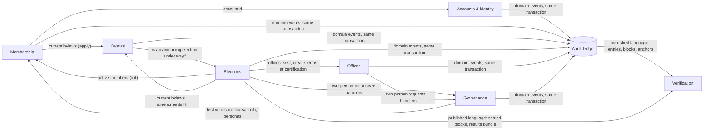

# USTPVote2 — Domain model (DDD design note)

| | |
|---|---|
| Status | Agreed 2026-10-25; step 1 (Membership) done, steps 2–7 to follow (§6) |
| Date | 2026-10-25 |
| Scope | Structure of `packages/domain`, `apps/server/src` and, lightly, `apps/web/src`. No change to API routes, Firestore layout, ledger format or hashing. |

[DESIGN.md](DESIGN.md) stays the source of truth for *what* the system does. This note is about *where the rules live*:
bounded contexts, their aggregates and invariants, and a migration path in small steps that change no behaviour.

## 1. Where the rules lived (survey, 2026-10-25)

The code is already half domain-centred. `ustp-domain` holds pure rules: the member-status machine
(`checkStatusChange`), roles and the Auditor incompatibility (`checkRoleChange`), the two-person rules
(`TWO_PERSON_ACTIONS`, `checkCanRequest`, `checkCanApprove`, `checkCanChangeRole`), the election state machine
(`electionTransitionAuthority`, `checkElectionDeletable`), the definition and its hash, the amendment engine, rolls,
sealing, results, terms from results. `ustp-tally` and `ustp-audit` are clean generic libraries. The web app reuses the
domain checks (`mayApply`, `checkCanChangeRole`, `checkElectionDeletable`) to explain refusals before sending.

What is not domain-centred:

1. **Invariants inline in services.** The NestJS services mix authorisation, rules, record building and Firestore
   calls. Examples: `MembershipService.decideApplication` (decider ≠ applicant, application still pending, applicant
   still `applicant`), `submitApplication` (current bylaws by version *and* hash, 3 applications per 30 days),
   `setStatus` ("members re-apply themselves", "decide the pending application instead"); `ElectionsService.editable`
   (only drafts, candidate recusal).
2. **One rule, many copies.** Candidate recusal is checked in 8 places with two wordings
   (`elections.service.ts`, `election-approvals.ts`). The election state is set directly in 6 places
   (cancel, schedule, cancel-approve, certify, clock open, clock close); only the two cancel paths consult
   `electionTransitionAuthority`. "Only closed elections are certified" appears at request and at approval.
3. **Contexts reach into each other's storage.** `members` is read by accounts, elections (roll), photos and
   personas, not only membership. Membership reads `elections` (the bylaws hold during an amending election).
   Elections reads `positions`, writes `position_terms` at certification, reads and deletes `approval_requests`, and
   reads `testing_personas`. `role_assignments` has three writers (role changes, bootstrap, personas).
4. **The governance service knows every caller.** `ApprovalsService.handlerFor` switches on action names and imports
   the election, office and role handlers, so the generic two-person mechanism depends on the contexts that use it.
5. **Domain events are untyped.** Every context calls `ledger.record(tx, [{type, actor, subject, payload}])` with the
   payload written inline; nothing pins a payload's shape per event type, although `ustp-verify` parses them.
6. **`ustp-domain` is flat.** 40 files, one 166-line index; `records.ts` and `api.ts` hold every context's document
   shapes and request schemas.
7. **Web restates a few predicates** ("upcoming" = scheduled or open and not voted, in `BallotPage.vue` and
   `VotePage.vue`; "editable" = draft, in `ElectionEditorPage.vue`). Minor.

## 2. Bounded contexts and context map

| Context | DESIGN.md | Owns (Firestore) | Kind |
|---|---|---|---|
| **Accounts & identity** | §4 | `accounts`, `account_identities`, `sign_in_methods` | supporting |
| **Membership** | §5.1–5.3 | `members`, `member_status_history`, `applications`, `profile_photos`, `photo_checks` | core |
| **Bylaws** | §5.2, §5.4, §6.6 | `bylaws_versions`, `bylaws_checks`, `bylaws_check_references` | core |
| **Elections** (setup, roll, voting, sealing, results) | §6, §7, §9 | `elections/**`, `eligibility_snapshots`, `proposal_snapshots`, `results` | core |
| **Offices** | §6.4 | `positions`, `position_terms` | supporting |
| **Governance** (roles, two-person rule, testing mode) | §10 | `role_assignments`, `approval_requests`, `testing_personas` | core rule, generic mechanism |
| **Audit ledger** | §8 | `audit_events`, `ledger_head`, `blocks`, `anchors`, `signing_keys` | shared kernel |
| **Verification** (`ustp-verify`, `/verify`, receipt and results checks) | §7.5, §16 | — (reads the public record) | conformist |

`ustp-tally` (counting) and `ustp-audit` (JCS, hashes, Merkle, signatures) are generic subdomains and stay as they are.

Every arrow becomes a **port**: a small interface the upstream context publishes (e.g. `MemberDirectory.activeIds(tx)`),
called inside the caller's transaction where today the caller reads the other context's collection. Firestore
transactions span contexts, which is fine and stays: the two-person rule needs an effect and its approval in one
commit. What changes is that only the owner touches its documents.

## 3. Aggregates and invariants

| Context | Aggregate (root → parts) | Invariants it guarantees |
|---|---|---|
| Membership | **Member** (`members/{accountId}` → `member_status_history`) | transitions only per §5.1; admin changes need a reason; nobody changes their own status; every change writes member, history and `member.status_changed` together; `memberSince` set once, at first Active |
| Membership | **MembershipApplication** | only against the current bylaws (version and hash); verified email; at most 3 per 30 days; pending → approved \| rejected once; decider ≠ applicant; applicant still `applicant` |
| Membership | **ProfilePhoto** | machine flags, people decide; reviewer ≠ owner; new photo supersedes the old |
| Bylaws | **BylawsVersion** | immutable; `amends` is the current version; no publishing while an amending election is scheduled, open or closed |
| Bylaws | **BylawsCheck** | queued → running → done \| failed; one at a time per admin, 20 a day |
| Elections | **Election** (election → contests, candidates) | lifecycle per §6.1 with the authority it names; edits only in draft; candidate recusal; window opens before it closes; definition frozen by its hash at scheduling and re-checked at opening; delete only if cancelled, no ballots, pool key destroyed |
| Elections | **VoterRoll** (eligibility snapshot) | pending → approved \| rejected \| superseded; frozen once approved; rehearsal rolls only in testing mode |
| Elections | **ProposalText** (proposal snapshot) | immutable; content hash v1/v2; an amendment fits the current bylaws |
| Elections | **Participation** + ballot pool | one per voter (create-only); voter on the roll; election open within its window |
| Elections | **Results** | computed once from sealed blocks; provisional → certified only for the hash requested |
| Offices | **Office** (position) | defined or changed at once with a reason; running terms untouched |
| Offices | **Term** | created only by certification; active → ended by two persons; holder neither requests nor approves |
| Governance | **ApprovalRequest** | one pending per action and subject; approver ≠ requester ≠ subject; approver's role, MFA, sign-in ≤ 15 min; 7-day expiry; executes exactly the approved payload hash |
| Governance | **RoleAssignment** | one System Admin, not on their own account; Auditor holds no other role |
| Ledger | **Ledger** (head → entries) | append-only, gap-free, hash-chained; blocks signed only by the worker |

**Value objects** (plain types, most exist already): `AccountId` (UUIDv7), `Role`, `MemberStatus`, `ElectionState`,
`Sha256Hex` / content hash, `BylawsBase {version, contentHash}`, `VotingWindow {opensAt, closesAt}`, `RollCriteria`,
`Commitment`, `MerkleRoot`, `ContestSpec` (`ustp-tally`), `Actor` (account, roles, MFA, sign-in age), `Check`.

**Domain events are the ledger entries.** `LEDGER_EVENT_TYPES` is the event catalogue; an event is
`{type, actor, subject, payload}` before the ledger numbers and chains it. The stored format does not change; the
migration types each payload once in `ustp-domain`, so writers and `ustp-verify` share one definition.

## 4. Layers

The style stays the codebase's own: **records are plain data** (Firestore stores them, JCS hashes them, the web reads
them), so an aggregate is its record type plus **pure functions** that check a command and return the next records and
the events. No classes with hidden state.

| Layer | Where | Contains |
|---|---|---|
| Domain | `packages/domain/src/<context>/` | record types, value objects, `check…` rules, aggregate functions (`decideApplication(...) → {application, transition}`), event payload types. No I/O, no clock (time is passed in). Used by api, worker, web and verify. |
| Application | `apps/server/src/<context>/*.service.ts` | one service per use-case group: authorise the caller, open the transaction, load through repositories, call the domain, record its events, save. Maps a `Check` to the HTTP status it has today. |
| Infrastructure | `apps/server/src/<context>/*.repository.ts`, `infra/` | repositories (one per aggregate) hiding collection paths and `tx.get/create/set`; KMS, Secret Manager and Vision adapters. |
| Interface | controllers, worker task routes, web pages | unchanged routes and payloads. |

`ustp-domain` keeps one entry point (`import … from 'ustp-domain'`); folders only organise it.

## 5. Ubiquitous language

Terms as DESIGN.md and the UI use them, and the code name where it differs. Stored names stay as they are; code names
change only where a context is being reworked anyway.

| Term | Meaning | In code / storage |
|---|---|---|
| Account | a person known to USTP, keyed by `accountId` | `accounts` |
| Login (identity) | an Identity Platform user linked to an account | `account_identities` |
| Member, applicant | an account with a member record; `applicant` until decided | `members`, `MemberStatus` |
| Application | a request to join, against one bylaws version | `applications` |
| Member status change | the only way status moves, always ledgered | `member.status_changed` |
| Bylaws version, amendment | immutable published text; a line-exact change to one version | `bylaws_versions`, `BylawsAmendment` |
| Election, draft, definition, definition hash | the ballot being prepared; its canonical object and hash | `elections`, `ElectionDefinition` |
| Contest: proposal, choose-N, IRV | one question on the ballot | `ContestRecord.spec.kind` |
| Proposal text | frozen title and text a proposal contest points at | `proposal_snapshots` |
| Voter roll, rehearsal roll | frozen list of eligible accounts; test voters only | `eligibility_snapshots`, `RollSnapshotRecord` |
| Ballot, participation, receipt | a cast vote; the fact someone voted; the voter's commitment | `ballot_pool`, `participation`, `BallotReceipt` |
| Sealed block | anonymised batch of ballots | `sealed_blocks` |
| Results, certification | signed tally bundle; the Auditor's approval of it | `results` |
| Office, term | a position people are elected to; one holder's period in it | `positions`, `position_terms` (code says *position*) |
| Role | Membership Admin, Election Admin, Auditor, System Admin | `role_assignments` |
| Request, approval (two-person rule) | an action one admin asks and another decides | `approval_requests`, `TWO_PERSON_ACTIONS` |
| Ledger entry, block, anchor | the hash-chained record, its signed Merkle batches, their WORM copies | `audit_events`, `blocks`, `anchors` |
| Testing mode, persona | rehearsing alone on a test deployment | `testing_personas`, `X-Act-As` |

## 6. Migration path

One context per PR, each behaviour-preserving: same routes, same status codes and messages, same documents, same
ledger entries; `typecheck`, unit tests and the emulator integration tests pass unchanged (tests change only where they
import moved code). Ordered by gain against risk, and around work in flight.

1. **Membership** (members and applications) — *done*; it sets the pattern. `packages/domain/src/membership/`
   (`member-status`, `registration`, `records`, and the aggregates in `member.ts` and `application.ts`); `LedgerEvent`
   moved to `ustp-domain`; `Check` has an optional refusal kind and commands return an `Outcome`, so `assertCheck` and
   `accepted` keep each status code; server `MemberRepository`, `ApplicationRepository`, application services
   `MembershipApplications` and `Members`, registered from `membership/providers.ts`; a `MemberDirectory` port that
   elections (roll and roll names), accounts (`/me`, People list), photos and personas use instead of reading
   `members`; `boundaries.test.ts` keeps it so. Bylaws stays in `MembershipService` for now (see step 2).
2. **Bylaws** — out of `MembershipService` into `bylaws/` with the bylaws check; domain `bylaws/` (versions,
   amendments, text diff); a `BylawsRegistry` port for elections; an `AmendingElections` port from elections so bylaws
   stops reading `elections`. After the adopted-bylaws work in progress has merged, since it changes these methods.
3. **Governance** — `ApprovalRequest` aggregate functions and repository; a handler registry, so each context
   registers its own handlers and `ApprovalsService` no longer imports them; one `RoleAssignments` writer used by role
   changes, bootstrap and personas.
4. **Offices** — `Office` and `Term` aggregates; an `Offices` port (`assertExist`, `createTermsFromResults`) so
   certification stops writing `position_terms`; the term rules shared by request and approval.
5. **Elections**, in two PRs. (a) Setup and lifecycle: one `transitionElection` used by all six state changes,
   recusal and the draft guard as one rule, repositories for election, contests, candidates, rolls and results.
   (b) Voting, sealing and tallying (the worker steps) on the same repositories.
6. **Ledger events typed** — a payload type per `LedgerEventType`, used by `ledger.record` and by `ustp-verify`; a
   golden test pins every payload's shape.
7. **Accounts, photos, testing personas, web** — the remaining repositories and ports; web uses domain predicates
   instead of restating them.

DESIGN.md §3.3 describes the structure as each step lands; each PR marks its step done here and adds its context to
`boundaries.test.ts`. Once Bylaws no longer depends on Elections (step 2), each context can become a Nest module that
exports only its ports.
