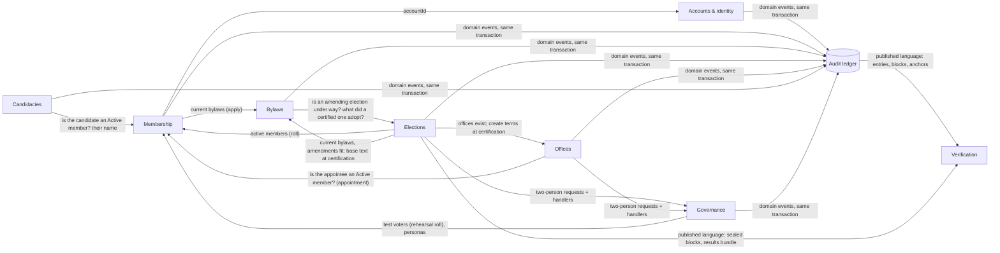

# USTPVote2 — Domain model (DDD design note)

| | |
|---|---|
| Status | Agreed 2026-10-25; step 1 (Membership) done, steps 2–7 to follow (§6). Web app (§7): agreed 2026-10-26; W1 (Membership) and W4 (Offices) done. Candidacies (DESIGN §5.8) was built in this structure from the start, server and web |
| Date | 2026-10-25 |
| Scope | Structure of `packages/domain`, `apps/server/src` and, lightly, `apps/web/src`. No change to API routes, Firestore layout, ledger format or hashing. |

[DESIGN.md](DESIGN.md) stays the source of truth for *what* the system does. This note is about *where the rules live*:
bounded contexts, their aggregates and invariants, and a migration path in small steps that change no behaviour.

## 1. Where the rules lived (survey, 2026-10-25)

The code is already half domain-centred. `ustp-domain` holds pure rules: the member-status machine
(`checkStatusChange`), roles and the Auditor incompatibility (`checkRoleChange`), the two-person rules
(`TWO_PERSON_ACTIONS`, `checkCanRequest`, `checkCanApprove`, `checkCanChangeRole`), the election state machine
(`electionTransitionAuthority`, `checkElectionDeletable`), the definition and its hash, the amendment engine, rolls,
sealing, results, terms from results. `ustp-tally` and `ustp-audit` are clean generic libraries. The web app reuses the
domain checks (`mayApply`, `checkCanChangeRole`, `checkElectionDeletable`) to explain refusals before sending.

What is not domain-centred:

1. **Invariants inline in services.** The NestJS services mix authorisation, rules, record building and Firestore
   calls. Examples: `MembershipService.decideApplication` (decider ≠ applicant, application still pending, applicant
   still `applicant`), `submitApplication` (current bylaws by version *and* hash, 3 applications per 30 days),
   `setStatus` ("members re-apply themselves", "decide the pending application instead"); `ElectionsService.editable`
   (only drafts, candidate recusal).
2. **One rule, many copies.** Candidate recusal is checked in 8 places with two wordings
   (`elections.service.ts`, `election-approvals.ts`). The election state is set directly in 6 places
   (cancel, schedule, cancel-approve, certify, clock open, clock close); only the two cancel paths consult
   `electionTransitionAuthority`. "Only closed elections are certified" appears at request and at approval.
3. **Contexts reach into each other's storage.** `members` is read by accounts, elections (roll), photos and
   personas, not only membership. Membership reads `elections` (the bylaws hold during an amending election).
   Elections reads `positions`, writes `position_terms` at certification, reads and deletes `approval_requests`, and
   reads `testing_personas`. `role_assignments` has three writers (role changes, bootstrap, personas).
4. **The governance service knows every caller.** `ApprovalsService.handlerFor` switches on action names and imports
   the election, office and role handlers, so the generic two-person mechanism depends on the contexts that use it.
5. **Domain events are untyped.** Every context calls `ledger.record(tx, [{type, actor, subject, payload}])` with the
   payload written inline; nothing pins a payload's shape per event type, although `ustp-verify` parses them.
6. **`ustp-domain` is flat.** 40 files, one 166-line index; `records.ts` and `api.ts` hold every context's document
   shapes and request schemas.
7. **Web restates a few predicates** ("upcoming" = scheduled or open and not voted, in `BallotPage.vue` and
   `VotePage.vue`; "editable" = draft, in `ElectionEditorPage.vue`). See §7 for the web app.

## 2. Bounded contexts and context map

| Context | DESIGN.md | Owns (Firestore) | Kind |
|---|---|---|---|
| **Accounts & identity** | §4 | `accounts`, `account_identities`, `sign_in_methods` | supporting |
| **Membership** | §5.1–5.3 | `members`, `member_status_history`, `applications`, `registration_form`, `registration_form_versions`, `profile_photos`, `photo_checks` | core |
| **Bylaws** | §5.2, §5.4, §6.6 | `bylaws_versions`, `bylaws_checks`, `bylaws_check_references` | core |
| **Elections** (setup, roll, voting, sealing, results) | §5.5, §6, §7, §9 | `elections/**`, `eligibility_snapshots`, `proposal_snapshots`, `results`, `consistency_checks`, `consistency_documents` | core |
| **Offices** | §6.4 | `positions`, `position_terms` | supporting |
| **Candidacies** (members running for public office) | §5.8 | `candidacies` | supporting |
| **Governance** (roles, two-person rule, testing mode, who sees which link, the voting home's quote, the home page hub, the Anthropic API key) | §5.6, §10 | `role_assignments`, `approval_requests`, `testing_personas`, `navigation`, `home_quote`, `hub`, `hub_logos`, `hub_covers`, `hub_backgrounds`, `hub_clicks`, `anthropic_key` | core rule, generic mechanism |
| **Audit ledger** | §8 | `audit_events`, `ledger_head`, `blocks`, `anchors`, `signing_keys` | shared kernel |
| **Notifications** (election notices by email) | §6.8 | `notices` (with `recipients`), `notice_outbox`, `notice_settings`, `notice_receipts`, `notice_tests` | supporting |
| **Verification** (`ustp-verify`, `/verify`, receipt and results checks) | §7.5, §16 | — (reads the public record) | conformist |

`ustp-tally` (counting) and `ustp-audit` (JCS, hashes, Merkle, signatures) are generic subdomains and stay as they are.



Every arrow becomes a **port**: a small interface the upstream context publishes (e.g. `MemberDirectory.activeIds(tx)`),
called inside the caller's transaction where today the caller reads the other context's collection. Firestore
transactions span contexts, which is fine and stays: the two-person rule needs an effect and its approval in one
commit. What changes is that only the owner touches its documents.

## 3. Aggregates and invariants

| Context | Aggregate (root → parts) | Invariants it guarantees |
|---|---|---|
| Membership | **Member** (`members/{accountId}` → `member_status_history`) | transitions only per §5.1; admin changes need a reason; nobody changes their own status; every change writes member, history and `member.status_changed` together; `memberSince` set once, at first Active; details change only by the member (not the legal name) or by another Membership Admin with a reason (not the opt-ins), ledgered as `member.details_changed` by field name |
| Membership | **MembershipApplication** | only against the current bylaws (version and hash) and the registration form's current version; verified email; at most 3 per 30 days; both membership questions answered Yes or No, and neither answer refuses; pending → approved \| rejected once; decider ≠ applicant; applicant still `applicant` |
| Membership | **RegistrationForm** (`registration_form/current`, `registration_form_versions/{version}`) | both questions, the Core Ideals' heading and at least one ideal; each part within its limit once tidied; a bonus link only at `https://`; saved whole from the version it was edited from, each version kept and each changed part ledgered as `registration_form.changed`; what the answers mean is fixed (Yes to the first: United States Member, No: Allied Member) |
| Membership | **ProfilePhoto** | machine flags, people decide; reviewer ≠ owner; new photo supersedes the old |
| Bylaws | **BylawsVersion** | immutable; `amends` is the current version; no publishing while an amending election is scheduled, open or closed; adopted from an election (`adoptedIn`) only once it is certified, with exactly the text its passed amendments give, once per election |
| Bylaws | **BylawsCheck** | queued → running → done \| failed; one at a time per admin, 20 a day |
| Elections | **Election** (election → contests, candidates) | lifecycle per §6.1 with the authority it names; edits only in draft; candidate recusal; window opens before it closes; definition frozen by its hash at scheduling and re-checked at opening; delete only if cancelled, no ballots, pool key destroyed |
| Elections | **VoterRoll** (eligibility snapshot) | pending → approved \| rejected \| superseded; frozen once approved; rehearsal rolls only in testing mode |
| Elections | **ProposalText** (proposal snapshot) | immutable; content hash v1/v2; an amendment fits the current bylaws |
| Elections | **Participation** + ballot pool | one per voter (create-only); voter on the roll; election open within its window |
| Elections | **Results** | computed once from sealed blocks; provisional → certified only for the hash requested |
| Offices | **Office** (position) | defined or changed at once with a reason; running terms untouched |
| Offices | **Term** | created by certification, or by an appointment two persons approve (an Active member, a free seat, starting no later than approved, no longer than the office's term; the appointee neither requests nor approves); marked elected or appointed (`basis`); active → ended by two persons; holder neither requests nor approves |
| Candidacies | **Candidacy** (`candidacies/{candidacyId}`) | declared and changed only by its Active member, withdrawn by them at any time; at most five open with elections to come, one per race; the district one the Census lists for that state, stored as the Census names it; only a version a Membership Admin approved is public, never their own, and only while the member is Active; a decision is on the version seen; a change waits while the approved version stays up; withdrawn or taken down (with a reason) is final; decisions, public withdrawals and removals ledgered as `candidacy.changed` |
| Governance | **ApprovalRequest** | one pending per action and subject; approver ≠ requester ≠ subject; approver's role, MFA, sign-in ≤ 15 min; 7-day expiry; executes exactly the approved payload hash |
| Governance | **RoleAssignment** | one System Admin, not on their own account; Auditor holds no other role; at most two roles per person |
| Governance | **NavigationSettings** (`navigation/current`) | shows, never permits; no section for a role the API refuses it to, and none for membership alone; People and Navigation always shown to System Admins; a role's Admin link follows its sections; every start page one its audience is shown; saved whole from the version it was edited from, each changed cell ledgered as `navigation.changed` |
| Governance | **HomeQuote** (`home_quote/current`) | shown needs its words and who said them; each part within its limit once tidied; saved whole from the version it was edited from, each changed part ledgered as `home_quote.changed` |
| Governance | **Hub** (`hub/current`) | shown sections need a title and shown links a title and address (a page of the app, https or mailto); the accent takes white text at 4.5:1; the logo is one uploaded here; the live widget needs the server ID; IDs unique; saved whole from the version it was edited from, each change ledgered as `hub.changed`. Its click counters (`hub_clicks`) count only what it shows, and hold no personal data (DESIGN §10.6) |
| Governance | **SignIn** (`sign_ins/{uid}_{authTime}`) | one per login and `auth_time`, created once by the api, never changed; read by System Admins and Auditors only; never ledgered; deleted 180 days after it was seen (DESIGN §10.7) |
| Governance | **SiteAnalytics** (`site_analytics/current`) | a Google Analytics 4 measurement ID or none; saved from the version it was edited from, each change ledgered as `analytics.changed` (DESIGN §10.7) |
| Governance | **AnthropicKey** (`anthropic_key/current`, the `anthropic-api-key` secret) | System Admins only; the key's shape checked before it is sent anywhere, and tried with Anthropic before it is kept; one live version, older ones destroyed; never returned, recorded or ledgered (only its last four characters and who added it); each add or removal ledgered as `anthropic_key.changed` |
| Ledger | **Ledger** (head → entries) | append-only, gap-free, hash-chained; blocks signed only by the worker |

**Value objects** (plain types, most exist already): `AccountId` (UUIDv7), `Role`, `MemberStatus`, `ElectionState`,
`Sha256Hex` / content hash, `BylawsBase {version, contentHash}`, `VotingWindow {opensAt, closesAt}`, `RollCriteria`,
`Commitment`, `MerkleRoot`, `ContestSpec` (`ustp-tally`), `Actor` (account, roles, MFA, sign-in age), `Check`.

**Domain events are the ledger entries.** `LEDGER_EVENT_TYPES` is the event catalogue; an event is
`{type, actor, subject, payload}` before the ledger numbers and chains it. The stored format does not change; the
migration types each payload once in `ustp-domain`, so writers and `ustp-verify` share one definition.

## 4. Layers

The style stays the codebase's own: **records are plain data** (Firestore stores them, JCS hashes them, the web reads
them), so an aggregate is its record type plus **pure functions** that check a command and return the next records and
the events. No classes with hidden state.

| Layer | Where | Contains |
|---|---|---|
| Domain | `packages/domain/src/<context>/` | record types, value objects, `check…` rules, aggregate functions (`decideApplication(...) → {application, transition}`), event payload types. No I/O, no clock (time is passed in). Used by api, worker, web and verify. |
| Application | `apps/server/src/<context>/*.service.ts` | one service per use-case group: authorise the caller, open the transaction, load through repositories, call the domain, record its events, save. Maps a `Check` to the HTTP status it has today. |
| Infrastructure | `apps/server/src/<context>/*.repository.ts`, `infra/` | repositories (one per aggregate) hiding collection paths and `tx.get/create/set`; KMS, Secret Manager and Vision adapters. |
| Interface | controllers, worker task routes, web pages | unchanged routes and payloads. |

`ustp-domain` keeps one entry point (`import … from 'ustp-domain'`); folders only organise it.

## 5. Ubiquitous language

Terms as DESIGN.md and the UI use them, and the code name where it differs. Stored names stay as they are; code names
change only where a context is being reworked anyway.

| Term | Meaning | In code / storage |
|---|---|---|
| Account | a person known to USTP, keyed by `accountId` | `accounts` |
| Login (identity) | an Identity Platform user linked to an account | `account_identities` |
| Member, applicant | an account with a member record; `applicant` until decided | `members`, `MemberStatus` |
| Application | a request to join, against one bylaws version | `applications` |
| Member status change | the only way status moves, always ledgered | `member.status_changed` |
| Member details change, correction | the member's own update, or a Membership Admin's correction with a reason | `member.details_changed` |
| Bylaws version, amendment | immutable published text; a line-exact change to one version | `bylaws_versions`, `BylawsAmendment` |
| Election, draft, definition, definition hash | the ballot being prepared; its canonical object and hash | `elections`, `ElectionDefinition` |
| Contest: proposal, choose-N, IRV | one question on the ballot | `ContestRecord.spec.kind` |
| Proposal text | frozen title and text a proposal contest points at | `proposal_snapshots` |
| Voter roll, rehearsal roll | frozen list of eligible accounts; test voters only | `eligibility_snapshots`, `RollSnapshotRecord` |
| Ballot, participation, receipt | a cast vote; the fact someone voted; the voter's commitment | `ballot_pool`, `participation`, `BallotReceipt` |
| Sealed block | anonymised batch of ballots | `sealed_blocks` |
| Results, certification | signed tally bundle; the Auditor's approval of it | `results` |
| Office, term | a position people are elected or appointed to; one holder's period in it | `positions`, `position_terms` (code says *position*) |
| Appointment | a term given without an election, asked for by one admin and approved by an Auditor | `position.appoint`, `basis: 'appointment'`, `position_term.appointed` |
| Role | Membership Admin, Election Admin, Auditor, System Admin | `role_assignments` |
| Audience; navigation settings; start page | a column of the settings (a membership state or a role); who is shown which link and section; where each lands | `AUDIENCES`, `navigation/current`, `StartPage` |
| Request, approval (two-person rule) | an action one admin asks and another decides | `approval_requests`, `TWO_PERSON_ACTIONS` |
| Ledger entry, block, anchor | the hash-chained record, its signed Merkle batches, their WORM copies | `audit_events`, `blocks`, `anchors` |
| Testing mode, persona | rehearsing alone on a test deployment | `testing_personas`, `X-Act-As` |
| Demo election | a rehearsal made up at random and scheduled by the personas in one request | `demoElection`, `POST /v1/testing/demo-elections` |

## 6. Migration path

One context per PR, each behaviour-preserving: same routes, same status codes and messages, same documents, same
ledger entries; `typecheck`, unit tests and the emulator integration tests pass unchanged (tests change only where they
import moved code). Ordered by gain against risk, and around work in flight.

1. **Membership** (members and applications) — *done*; it sets the pattern. `packages/domain/src/membership/`
   (`member-status`, `registration`, `records`, and the aggregates in `member.ts` and `application.ts`); `LedgerEvent`
   moved to `ustp-domain`; `Check` has an optional refusal kind and commands return an `Outcome`, so `assertCheck` and
   `accepted` keep each status code; server `MemberRepository`, `ApplicationRepository`, application services
   `MembershipApplications` and `Members`, registered from `membership/providers.ts`; a `MemberDirectory` port that
   elections (roll and roll names, finding and checking members who stand as candidates), accounts (`/me`, People
   list), photos and personas use instead of reading `members`; `boundaries.test.ts` keeps it so. Bylaws stays in
   `MembershipService` for now (see step 2).
2. **Bylaws** — out of `MembershipService` into `bylaws/` with the bylaws check; domain `bylaws/` (versions,
   amendments, text diff); a `BylawsRegistry` port for elections; an `AmendingElections` port from elections so bylaws
   stops reading `elections`. After the adopted-bylaws work in progress has merged, since it changes these methods.
3. **Governance** — `ApprovalRequest` aggregate functions and repository; a handler registry, so each context
   registers its own handlers and `ApprovalsService` no longer imports them; one `RoleAssignments` writer used by role
   changes, bootstrap and personas. The navigation settings, the voting home's quote (DESIGN §10.5) and the hub
   (§10.6) already live in `governance/` in `ustp-domain`; their services are `administration/navigation.ts`,
   `administration/home-quote.ts` and `administration/hub.ts` in the server until this step moves the context.
4. **Offices** — `Office` and `Term` aggregates; an `Offices` port (`assertExist`, `createTermsFromResults`) so
   certification stops writing `position_terms`; the term rules shared by request and approval. *Begun:* appointments
   (DESIGN §6.4) put their rules in `ustp-domain` (`appointments.ts`: `planAppointment` at the request, `appointTerm` at
   the approval, both through `checkAppointment`), and the server reads what they need in `positions/appointment-context.ts`.
5. **Elections**, in two PRs. (a) Setup and lifecycle: one `transitionElection` used by all six state changes,
   recusal and the draft guard as one rule, repositories for election, contests, candidates, rolls and results.
   (b) Voting, sealing and tallying (the worker steps) on the same repositories.
6. **Ledger events typed** — a payload type per `LedgerEventType`, used by `ledger.record` and by `ustp-verify`; a
   golden test pins every payload's shape.
7. **Accounts, photos, testing personas, web** — the remaining repositories and ports; web uses domain predicates
   instead of restating them.

DESIGN.md §3.3 describes the structure as each step lands; each PR marks its step done here and adds its context to
`boundaries.test.ts`. Once Bylaws no longer depends on Elections (step 2), each context can become a Nest module that
exports only its ports.

## 7. The web app (`apps/web`)

The browser is a client of the same contexts. It never decides (the API does), but it runs `ustp-domain`'s rules to
offer only what is allowed and to explain a refusal before sending, and it checks receipts, results and the ledger
itself. So the web app follows the same boundaries as the server, with the rules in one place for both.

### 7.1 Where things are (survey, 2026-10-26)

- **Flat folders.** 11 pages in `pages/`, 14 admin panels in `components/admin/`, and about 25 helper modules at the
  root of `src/` that belong to different contexts (`bylaws-docx.ts`, `election-docx.ts`, `receipts.ts`, `photos.ts`,
  `camera.ts`, `sign-in.ts`, `mfa.ts`, `approval-text.ts`…).
- **HTTP written inline.** 83 `api('METHOD', '/v1/…')` calls in 26 components and modules, each choosing its response
  type. Several endpoints are fetched from more than one place: the current bylaws (Register, Bylaws panel), the
  People list (People panel, role-change form), offices (Offices panel, contest dialog), the signing keys and the
  latest anchor (Audit panel, Results, Verify), approval decisions (Approvals panel, election editor), the ballot (Vote,
  Results).
- **Rules restated.** `MembersPanel.vue`'s `NEXT` copies the member-status machine; "upcoming" (scheduled or open, not
  voted yet) is written out in `BallotPage.vue` and three times in `VotePage.vue`; `photos.ts` copies the server's
  accepted image types and sizes ("must match the server"); `AdminPage.vue`'s tab roles restate the role matrix the
  server's `@Roles(...)` hold (DESIGN §10.1).
- **Already right.** Forms validate with the API's own schemas (`createApplicationSchema`, `positionInputSchema`…);
  `mayApply`, `checkCanChangeRole`, `checkElectionDeletable`, `ballotViewProblems`, the receipt and results checks and
  the amendment text come from `ustp-domain`.

### 7.2 Structure

```
apps/web/src/
  main.ts App.vue router.ts layouts/ pwa.ts   app shell: routes (same paths), layout and menu, PWA
  pages/HomePage.vue pages/AdminPage.vue      shell pages; the admin console composes each context's panels
  api.ts firebase.ts session.ts acting.ts     client kernel: HTTP and problem details, sign-in state, persona header
  a11y.ts dialogs.ts forms.ts *.css           UI kit every context uses
  accounts/      sign-in, account page, MFA, sign-in methods panel
  membership/    register, applications, members; profile photos and camera
  bylaws/        bylaws pages, editor panel, bylaws check, Word files
  elections/     ballot list, vote, results, editor, contests, receipts, Word export
  offices/       offices panel
  candidacies/   the Candidates pages and map, the declaration form, the Candidacies panel
  governance/    approvals, people and role changes, testing personas and bar
  ledger/        audit panel; the public ledger client (blocks, keys, anchors, entries)
  verification/  the /verify page
```

Each context folder holds:

- **`api.ts`**: its typed client, one function per endpoint, named in the ubiquitous language (`submitApplication`,
  `decideApplication`, `memberHistory`) and returning `ustp-domain` types. The only place that context's `/v1/…` paths
  appear; it calls the kernel's `api()`, so authentication, App Check, the persona header and problem details stay in
  one place.
- **Pages and components** (`*Page.vue`, `*Panel.vue`, dialogs), routed from `router.ts` at the same paths, with the
  same titles.
- **View logic**: wording and labels for the context's terms (`approval-text`, `election-text`), composables, file
  exports. No rule the API or `ustp-domain` owns: a predicate the UI needs (which status changes to offer, whether
  voting is still ahead, photo limits) goes into `ustp-domain` beside the rule it comes from, so server and browser
  cannot drift.

Contexts use each other only through their `api.ts` and the components they mean others to embed (the account page
shows membership's resign; the election editor decides approvals through governance's client). A unit test, like the
server's, fails if a context's API paths appear outside its folder.

### 7.3 Migration (web)

Each step behaviour-preserving: same routes and URLs, page titles, headings, labels and focus order; `typecheck`,
`npm test` and a browser check in light and dark themes. A web step can ship with its server step or on its own.

- **W1. Membership** (members and applications) — *done*: `membership/api.ts`; `RegisterPage`,
  `ApplicationsPanel` and `MembersPanel` moved into `membership/`; `NEXT` gave way to `adminStatusChanges(status)` in
  `ustp-domain` (same options in the same order); the account page resigns through the client; the boundary test
  starts with it.
- **W2. Bylaws**, **W3. Governance** (begun: `governance/` holds the navigation settings' client, panel, wording
  and store, the quote's, and the hub's (its page, admin tabs and click client), and the admin tabs come from `ADMIN_SECTIONS` and `SECTION_ROLES` in `ustp-domain`, which a server test
  checks against the `@Roles` of each section's routes; still to move: approvals, people, role changes, testing),
  **W4. Offices** (*done*: `offices/api.ts` is the only place the offices routes are written, and the ballot builder
  and the Members tab call it; `offices/` holds the Offices panel, the appointment dialog and its member picker, the
  profile's Offices card and the public Offices page, with their wording in `office-text.ts`; the boundary test
  includes it), **W8. Candidacies** (*done*, built this way from the start: `candidacies/api.ts` alone writes its routes, the Census districts' and the Maps key's included; its wording is in `candidacy-text.ts`; the boundary test includes it), **W5. Elections** (`votingAhead(election)` in `ustp-domain` for "upcoming"; begun: `elections/api.ts` holds the ballot builder's calls, §6.5, while the rest of the editor still calls its routes itself), **W6. Ledger and
  verification** (one public-ledger client for the audit panel, results and verify), **W7. Accounts and photos**
  (photo limits into `ustp-domain`), each following the matching server step where there is one.
